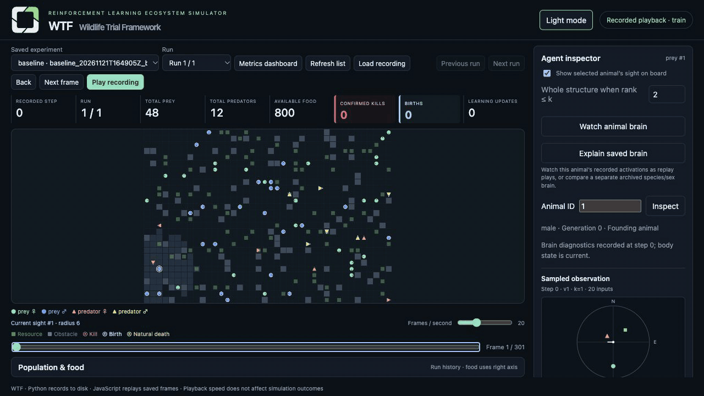

# WTF — Wildlife Trial Framework

A Python reinforcement-learning ecosystem with independently learning prey and
predators, growing resources, obstacles and paired male/female reproduction. Environments are JSON;
a JavaScript canvas viewer replays saved runs. Add named prey/predator species
through JSON; the presets start with one of each.

The simulator records first and the viewer plays later, keeping training and
rendering independent. Replay chunks use structured binary deltas and lossless XZ compression to reduce disk usage.



A short replay of a saved experiment. See the [live species charts](docs/recording.md#per-step-species-dashboard)
for population, energy, births and hunting trends.

For Python and Docker setup, see [INSTALL.md](INSTALL.md).

## Quick start

Requires Python 3.12+. Run from the project directory:

```sh
cd /path/to/wtf
python3.12 -m venv .venv
.venv/bin/python -m pip install --cache-dir .cache/pip -r requirements.txt
.venv/bin/python -m ecosystem.cli environments/baseline.json --runs 1
./run.sh
```

Open <http://127.0.0.1:8000>, select the saved experiment and click **Play recording**.
You can close the simulator before starting playback. Python packages stay in
`.venv`; the viewer needs no packages or build step.

## Keep learned brains

Completed training runs archive health, kills, lifespan and food-gain champions
for each species/sex group inside `results/<run-name>/champions/`. Models keep their scores and ancestry.
Use the longest-lived prey champions and predator hunting champions to start a new generation:

```sh
.venv/bin/python -m ecosystem.cli environments/baseline.json --runs 1 \
  --brains-from PREVIOUS_RUN_NAME --brain prey=lifespan --brain predator=kills
```

Replace `PREVIOUS_RUN_NAME` with a folder name under `results/` containing compatible Q champions. See the
[saved-brain guide](docs/brain-library.md) to choose another criterion, algorithm
or exact model generation. Species-wide selectors resolve matching female and male champions separately.
With multiple runs, each group’s champion seeds the next run by default; add `--no-chain-brains` to restart from the original models.

## Documentation

Browse the [documentation hub](docs/index.md) for a reading path, or use the
[GitHub Pages documentation](https://sagnik1511.github.io/wtf/) once its deployment
is enabled. The site adds search and grouped navigation to these same guides.

| Area | Entry points |
| --- | --- |
| Get started | [Installation](INSTALL.md), [complete tutorial](docs/tutorial.md), [run/resume](docs/running.md) |
| Worlds and species | [Customization](docs/customization.md), [configuration](docs/configuration.md), [geography](docs/geography.md), [species](docs/species.md) |
| Learning and behavior | [Algorithms](docs/algorithms.md), [observations](docs/observations.md), [champions](docs/brain-library.md), [evaluation](docs/evaluation.md) |
| Viewer and storage | [Playback](docs/recording.md), [appearance](docs/viewer-visual-reference.md), [explainability](docs/explainability.md), [artifact structures](docs/replay-data-structures.md) |
| Development | [Architecture](docs/architecture.md), [testing](docs/development.md), [extensions](docs/extending-worlds-and-actions.md), [packaging](docs/packaging.md) |
| Reference | [Configuration fields](docs/configuration-reference.md), [commands](docs/command-reference.md), [visual guide](docs/visual-guide.md), [compatibility](docs/compatibility.md) |

## Project layout

```text
ecosystem/     Python simulation, learning, archives and analysis
viewer/        JavaScript playback engine
environments/  JSON experiment presets
maps/          Editable river, highland and valley layouts
docs/          Detailed guides
tests/         Python and JavaScript checks
```

Generated `results/`, `brain_library/`, `.cache/` and `.venv/` remain local and are
ignored by Git. Observed survival and champion scores are useful diagnostics;
checking learning quality requires matched evaluation on unseen world seeds.

## License

Copyright © 2026 Sagnik Roy. Released under the [MIT License](LICENSE).
