# Recurrent PPO, QR-DQN, Maskable PPO and MAPPO

[Algorithms](algorithms.md) · [Configuration](configuration.md) · [Saved brains](brain-library.md) · [Analysis](analysis.md)

These are small standard-library implementations integrated with the existing
Python trainer. They require no additional packages. The JavaScript viewer
continues to replay saved data independently of training.

## Presets and commands

Each preset configures both species with its named algorithm and explicitly
selects longest-lived champions for cross-episode inheritance. They preserve the
world, bodies, rewards and reproduction settings of `ppo_large_predator.json`.
The feedforward hidden layers are `[16]` for prey and `[64, 32]` for predators.
Recurrent PPO adds a GRU before those layers; MAPPO adds a separate critic.

Run from the project root. Choose one command:

```sh
.venv/bin/python -m ecosystem.cli environments/recurrent_ppo.json --runs 20 --seed 100 --progress
.venv/bin/python -m ecosystem.cli environments/qrdqn.json --runs 20 --seed 100 --progress
.venv/bin/python -m ecosystem.cli environments/maskable_ppo.json --runs 20 --seed 100 --progress
.venv/bin/python -m ecosystem.cli environments/mappo.json --runs 20 --seed 100 --progress
```

These presets start with fresh weights. Add `--brain prey=fresh --brain
predator=fresh` to explicitly override any future JSON warm-start requests.
Later episodes chain the preceding episode's lifespan champions. Add
`--no-chain-brains` to initialize every episode from the experiment's original
weights. Explicit `--seed` selects reproducible incrementing seeds under the
existing CLI behavior.

To reuse compatible champions, supply `--brains-from PREVIOUS_RUN_NAME`.
Algorithm, action order and architecture must match; ordinary PPO weights cannot
initialize these new algorithms. Additional compatibility checks cover GRU size,
quantile count, critic layers and mask/context versions. Champion snapshots
contain learned parameters; warm starts reset optimizers and experience buffers.
Exact checkpoints retain the full training state instead.

## Recurrent PPO

Template type: `recurrent_ppo`. This combines a single GRU cell, a tanh MLP,
categorical PPO policy and scalar value output. The GRU processes the configured local observation: 20 flat features or 32
terrain features. This is a GRU
implementation, not an LSTM or an adapter to a third-party trainer.

Additional fields:

```json
"recurrent_size": 32,
"sequence_length": 8
```

The presets use GRU sizes 16 for prey and 32 for predators. Hidden sizes are
bounded to 1–128; sequences to 1–128 steps and at most the rollout length.
`batch_size` must cover at least one sequence. Training shuffles contiguous
sequences, preserves chronological order inside each sequence, and backpropagates
through time within it. Each sequence starts from its recorded pre-decision
hidden state, treated as a constant boundary. Minibatches contain up to
`floor(batch_size / sequence_length)` sequences, including short final sequences.
There is no burn-in reconstruction of hidden states after optimizer updates.

Memory persists across decisions and rollout updates, including during
evaluation. Diagnostics read memory without advancing it. Death and time-limit
truncation reset memory after bootstrap calculation. A newborn mixes both parents' learned parameters and starts with fresh optimizer
state, zero memory and an empty rollout. Champions contain no episodic memory. Exact checkpoints retain
hidden state, sequence boundaries, partial rollouts and pending decisions.

The inspector displays memory norm and sequence-buffer size. Recurrent inference
and backpropagation add computation and memory per animal; the sequence limit
bounds the backpropagation tape, not the animal's lifetime memory influence.


## Recurrent decision state

The memory is private to one animal and survives ordinary steps. Checkpoint restore preserves it; a newborn starts at zero.



## QR-DQN

Template type: `qrdqn`. The network predicts `num_quantiles` return values per
action. Decisions maximize the mean predicted return, with epsilon-greedy
exploration during training. It uses a pairwise quantile Huber objective and
Adam, with the loss averaged across both current and target quantiles.

The presets use 16 quantiles, a 512-transition ring buffer, batch size 16,
learning start after 32 transitions, training every four decisions, a target
update every 32 optimizer updates and a base learning rate of `0.0003`.
Predators retain their 1.25 learning-rate multiplier.

Double-DQN target construction selects the next action using the online mean
values and evaluates its quantiles with the target network. Death prevents
bootstrapping; time-limit truncation bootstraps the next observation. Reproduction
copies online and target weights and optimizer state, but no replay samples.
Warm starts initialize the target from loaded online weights.

The inspector shows mean action values and epsilon. Recorded diagnostics also
include return quantiles per action and quantile loss. Quantile count is bounded
to 2–128; pairwise loss computation grows quadratically with that count, and
output weights grow linearly. Replay is bounded per animal, so total memory
still grows with population.


## Distributional action values

QR-DQN predicts several return quantiles for each action. Action selection uses their mean; replay training fits the quantiles.



## Maskable PPO

Template type: `maskable_ppo`. This retains PPO's MLP and value head while
normalizing action probabilities over the currently available actions. Masks
come from immediate conditions before simultaneous action resolution:

| Action | Available when |
| --- | --- |
| Move forward | The destination is clear/unoccupied and passes terrain movement rules |
| Swim, when configured | Near/in water, clear destination, sufficient health/energy and an allowed climb |
| Reproduce, when configured | A physically eligible nearby mate and child cell are available; partner consent is not predicted |
| Eat | A positive resource patch is underfoot or in front, energy is below maximum, and bite/conversion values are positive |
| Attack | A resource-eating animal is directly in front and attack damage is positive |
| Turn or rest | Always |

A species must allow rest or turning so its mask can never become empty. Masks
apply to training, greedy evaluation and random-mode decisions for this
algorithm. They are recorded with each rollout sample and reused when computing
PPO ratios and entropy; old masks are never replaced with current ones.
The network and critic receive the configured 20/32 local features, not mask bits.

This is action availability under an explicit immediate-neighborhood rule,
including conditions not fully represented by the nearest-target feature vector.
It provides additional local guidance and changes the decision problem. In
particular, attack availability is checked before movement, so a predator cannot
anticipate a prey moving into its front cell during the same step. An available
action can still fail because of contention or target movement. Masked and
unmasked experiments therefore need separate interpretation.

The inspector labels unavailable actions and shows zero probability for them.
Masks are derived again after births, deaths and checkpoint restore.


## Masked decisions

The decision-time mask is stored with the sample. It describes immediate availability, not guaranteed success after simultaneous actions.



## Experimental MAPPO variant

Template type: `mappo`. This implements centralized training and decentralized
execution for a changing population. Each animal retains an independent local
actor, critic and optimizer. There is no shared live policy across a species and
no shared live parameter references after reproduction; paired crossover creates an independent child. This is a project-specific MAPPO
variant, not a reproduction of the original benchmark implementation.

The actor consumes only its configured 20/32 local features. The separate critic consumes
those features plus a fixed 16-feature, team-relative global summary:

- Four global features: normalized time, available resource fraction, animal
  density and obstacle density.
- Six allied and six opponent features: population density, mean normalized
  energy, mean normalized health, mean normalized x/y position and mean age
  divided by the episode step limit. Empty groups contribute zeros. Opponents
  here mean all other species, even if the configuration has more than two.

The summary aggregates the world rather than flattening every entity. Its size
is independent of population, and it includes information outside an animal's
view. Only the critic receives that information; changing global context while
holding the local observation fixed cannot change actor probabilities.

The default critic has one 32-unit tanh layer, configured through
`critic_hidden_layers`. Its current/next context is captured consistently around
the real world step; terminal agents receive no bootstrap, while surviving
agents at a time limit bootstrap from the post-step context.

All MAPPO animals receive the mean ordinary reward of their species' agents that
acted that step, including agents that die. Newborns do not enter the mean until
they first act. Other algorithms keep their original individual rewards. This
creates a cooperative training objective within a species. The world's ordinary
individual `last_reward` and behavior-analysis reward metrics remain unchanged;
MAPPO's optimizer uses the species mean, labeled in brain diagnostics as
`reward_scope: "species_mean"`. Do not interpret individual reward charts as the
exact MAPPO training return.

The inspector labels MAPPO as experimental and shows reward scope. Recorded
brain diagnostics also include critic context. More critics and a changed reward
objective are relevant when comparing this variant with independent PPO.


## MAPPO information boundaries

Global context goes only to the private critic. The actor remains local, while training rewards are averaged within the acting animal’s species.



## Evaluation and compatibility

All four algorithms support the existing progress bar, recordings, reproduction,
run-local champion archive, lifespan chaining, mixed-species configurations,
greedy evaluation and exact plain/compact checkpoints. GRPO trial worlds can
contain the new algorithms without changing their real memory, masks, weights
or random streams; recurrent trial memory advances only in the trial and newborn
trial memory starts empty.

Use fresh held-out seeds and frozen opponents to compare policy quality. Matching
seeds alone does not isolate an algorithm if network capacity, action masks,
reward scope or champion-selection rules differ. Numerical and lifecycle tests
verify implementation behavior; they do not establish improved hunting or
survival. No training-speed benchmark is claimed for these additions.

## References

- [GRU / RNN encoder-decoder](https://arxiv.org/abs/1406.1078)
- [Proximal Policy Optimization](https://arxiv.org/abs/1707.06347)
- [Distributional RL with quantile regression](https://arxiv.org/abs/1710.10044)
- [Invalid action masking in policy gradients](https://arxiv.org/abs/2006.14171)
- [PPO in cooperative multi-agent games](https://arxiv.org/abs/2103.01955)

## Terrain-enabled variants

Set `observation_version: 2` on a complete algorithm template used by a terrain
environment. Local networks/GRUs then use 32 features, action masks also gate
swimming/climbing, and MAPPO uses 32 actor inputs plus its existing 16 critic-only
context inputs. GRPO trial worlds share only read-only static map lookups. See
[geography](geography.md); the 20-input descriptions above apply to flat version 1.
