# Learning algorithms and networks

[Project overview](../README.md) · [Configuration](configuration.md) · [Analysis](analysis.md)

Use [the customization handbook](customization.md) for setup changes, or [the new-policy checklist](extending-policies.md) to implement another learner.

Commands in this guide run from the project root.

The `species.<name>.brain` field selects a template in `brains`. Each animal receives its own model, optimizer, random streams and experience storage; referencing a common template never shares live weights between animals. The supplied baseline remains the existing Q-network comparison.

```sh
.venv/bin/python -m wtf.cli environments/ppo.json --runs 1
.venv/bin/python -m wtf.cli environments/mixed_brains.json --runs 1
```

Per-species `learning_rate_multiplier` scales a template's learning rate without
changing training frequency. Presets use prey 1.0× and predator 1.25×; see
[species learning rates](configuration.md#learning-rates-per-species).


## Multilayer DQN

Use `type: "dqn"` for scalar DQN or `type: "ddqn"` for scalar Double DQN,
both with one to four hidden dense layers. The
legacy `q_network` type and bundled `dqn.json` preset retain their existing
single-hidden-layer format and behavior. For example:

```json
{
  "type": "dqn",
  "network": {
    "type": "mlp",
    "hidden_layers": [64, 32, 16],
    "activation": "tanh"
  },
  "learning_rate": 0.001,
  "discount_factor": 0.98,
  "batch_size": 8,
  "replay_capacity": 512,
  "learning_starts_after": 32,
  "train_every_steps": 8,
  "target_update_every_training_steps": 50,
  "huber_threshold": 1.0,
  "max_grad_norm": 0.5,
  "exploration": {
    "initial": 0.35,
    "minimum": 0.05,
    "decay_per_decision": 0.999
  }
}
```

`[64, 32, 16]` means three hidden layers, followed by one scalar Q-value output
per allowed action. Training uses `reward + gamma * max(Q_target(next_state))`;
death removes the bootstrap, while a time-limit truncation retains it. This is
scalar max-target DQN. With `type: "ddqn"`, the target instead evaluates
`Q_target(next_state, argmax(Q_online(next_state)))`. DDQN therefore separates
next-action selection from evaluation; neither type uses quantile regression.
Each animal owns its replay, target weights, Adam state and exploration RNG.
Replay capacity therefore contributes to memory per living animal.

The existing packed FP32 model storage and optional native dense/gradient/Adam
kernels support every layer. No additional dependency is required. The inspector
shows action Q-values, epsilon, TD loss and sampled hidden-layer activations;
archived-weight explanations support the same observation/action contract.
Checkpoints restore the complete controller state. Birth uses the existing
independent inheritance/mutation rules and clears child replay/training state.
Warm starts reset replay/optimizer state and synchronize the target network.
Saved models must match the exact algorithm (`dqn` or `ddqn`), action order, inputs and hidden
widths; `q_network` and other algorithm weights are not silently converted.

## Private learning loop

Each animal owns this loop. A template supplies initial settings and weights, not a shared live species policy.



Supported algorithms:

| Template `type` | Model and training |
| --- | --- |
| `q_network` | Existing one-hidden-layer action-value network, replay, target network, epsilon-greedy policy and SGD |
| `dqn` | One-to-four-hidden-layer scalar DQN, private replay/target network, epsilon-greedy choices, Huber TD loss and Adam |
| `ddqn` | Scalar Double DQN with the same configurable dense layers; online next-action selection and separate target-network evaluation |
| `ppo` | Categorical policy and scalar critic sharing an MLP, recent on-policy rollouts, GAE, clipped policy loss, entropy bonus and Adam |
| `a2c` | Independent advantage actor-critic, one gradient update per rollout, GAE and entropy regularization |
| `reinforce` | Actor-only episodic Monte Carlo policy gradient with a running baseline from previous episodes |
| `grpo` | Experimental actor-only clipped policy updates using comparable simulator trajectory groups and a frozen reference policy |
| `recurrent_ppo` | GRU memory with PPO and chronological truncated backpropagation through time |
| `qrdqn` | Quantile-regression Double DQN, bounded replay, target network and Adam |
| `maskable_ppo` | PPO with stored per-decision immediate local action masks |
| `mappo` | Experimental centralized-critic PPO with independent local actors and species-mean training rewards |
| `discrete_sac` | Categorical soft actor-critic, private replay, twin online/target Q critics and fixed entropy temperature |
| `trpo` | Conjugate-gradient natural policy step with empirical KL backtracking and a separate value critic |
| `lstm_ppo` | PPO with hidden/cell LSTM memory and truncated chronological BPTT |

See [Discrete SAC, TRPO and LSTM PPO](additional-policies.md) for complete templates,
selection and lifecycle contracts. The bundled `lstm_ppo` preset configures both
species with LSTM PPO and can be run by its short name.

See the [advanced algorithms guide](advanced-algorithms.md) for presets, commands,
configuration, memory behavior and the changed action/reward rules of these variants.

The maintained ordinary-PPO preset now uses separate `prey_ppo`/`predator_ppo`
templates with version-4 inputs; see [current PPO configuration](configuration.md#current-ordinary-ppo-preset).
The standalone `brains.small_ppo` example below illustrates the base algorithm
fields and retains its legacy default input contract:


```json
{
  "type": "ppo",
  "network": {
    "type": "mlp",
    "hidden_layers": [
      16
    ],
    "activation": "tanh"
  },
  "learning_rate": 0.001,
  "discount_factor": 0.98,
  "gae_lambda": 0.95,
  "clip_ratio": 0.2,
  "entropy_coefficient": 0.01,
  "value_coefficient": 0.5,
  "rollout_steps": 64,
  "epochs": 4,
  "batch_size": 16,
  "max_grad_norm": 0.5,
  "normalize_advantages": true,
  "target_kl": 0.03
}
```

Set either species' `brain` to `"small_ppo"` to use that template. All policy-based templates (`ppo`, `a2c`, `reinforce`, `grpo`) accept one to four tanh layers in `network.hidden_layers`. Change `[16]` to `[32, 16]`, for example, to experiment with a deeper DNN. The network architecture is separate from the PPO algorithm. The legacy Q-network configuration retains its single-layer format and behavior.

PPO samples actions from its categorical policy in training; greedy evaluation and the random-action baseline do not train. It stores at most `rollout_steps` transitions per animal and consumes them after each update. Buffers also flush when an animal dies or a run reaches its step limit, including short partial rollouts. Death disables value bootstrapping; time-limit truncation bootstraps the final observation but breaks the episode trace. Advantages are normalized only within that individual's rollout when enabled. Critic targets are the GAE lambda returns; critic loss is un-clipped mean squared error with the conventional one-half factor. `epochs` and `batch_size` control repeated minibatch passes. The shared gradient is clipped by `max_grad_norm`. Adam uses beta1 0.9, beta2 0.999 and epsilon 1e-8. A positive `target_kl` stops remaining minibatches if their approximate policy KL exceeds the cap; zero disables that check. Extreme log-ratios are bounded to ±60 for numerical safety.

The implementation follows the clipped PPO objective and GAE structure described in the [PPO paper](https://arxiv.org/abs/1707.06347) and [Spinning Up's PPO reference](https://github.com/openai/spinningup/blob/master/spinup/algos/pytorch/ppo/ppo.py). It is a small independent standard-library implementation, with numerical gradient checks, rather than a wrapper around PyTorch or an established training library.

PPO checkpoints include model and Adam state, partial rollouts with old log probabilities/values, pending action data and random-generator states. Mixed-algorithm experiments and legacy Q checkpoints restore through the same runner. Retaining brains preserves model/optimizer state across runs, while PPO's consumed rollout data is discarded. The viewer shows action probabilities, entropy and critic value for PPO; Q-learning recordings continue to show action values and epsilon. Existing recordings without an algorithm label remain supported.

PPO needs multiple passes over recent data and maintains optimizer moments, so it is not automatically cheaper or better at hunting than Q-learning. Small layers, short rollouts and modest epoch counts keep this implementation suitable for CPU experiments. Test algorithms with held-out seeds and matched physical configurations; an implementation test or a few kills is not evidence of a trained policy outperforming the baseline. The additional algorithms below share the same configuration, checkpoint and playback interfaces.

## A2C and REINFORCE

```sh
.venv/bin/python -m wtf.cli environments/a2c.json --runs 1 --progress
.venv/bin/python -m wtf.cli environments/reinforce.json --runs 1 --progress
```

A2C uses the same configurable shared policy/value MLP as PPO, with one full-rollout advantage actor-critic update instead of repeated clipped-objective epochs. GAE targets, terminal handling, entropy regularization and gradient clipping are retained. Its structure follows the advantage actor-critic family represented by the [Baselines A2C reference](https://github.com/openai/baselines/blob/master/baselines/a2c/a2c.py), with independent per-animal models rather than shared population weights.

REINFORCE has no critic. It collects one animal's complete finite episode, computes discounted rewards-to-go and the summed discounted log-policy gradient, and applies one Adam update. The scalar baseline is derived only from earlier episodes, then updated using `baseline_decay` after the current update. Optional advantage normalization is disabled in the example. This is an episodic implementation of the [REINFORCE policy-gradient family](https://link.springer.com/article/10.1007/BF00992696), with entropy regularization and gradient clipping. Time limits define finite episodes for this actor-only method; they are not bootstrapped from a value network. To bound memory without silently treating arbitrary fragments as complete episodes, `max_episode_steps` must be at least `world.max_steps`. Increase both when requesting longer REINFORCE runs. The selected completed-episode policy can seed the next run through champion chaining; the new controller starts with a fresh baseline. Its policy does not change midway through a collected episode.

## Experimental GRPO

```sh
.venv/bin/python -m wtf.cli environments/grpo.json --runs 1 --progress
```

This is a finite-horizon simulator adaptation of the group-relative clipped policy objective in [DeepSeekMath](https://arxiv.org/html/2402.03300v3), rather than the original language-model training setup. Each focal animal samples `group_size` alternative trajectories from the **same current world state**. Environment RNG and other agents' action RNG streams restart from matching states for every trial. Other policies remain frozen during the group, and no real controller's `choose`/`learn` methods are called inside a trial. Only the focal policy uses different trial action samples. Its observations remain local; rewards come from the ordinary environment rules.

Discounted returns are standardized within that group, never across unrelated animals. Every step in a trajectory receives its trajectory's group-relative advantage. The objective is averaged per trajectory and then per group, so shorter trajectories are not accidentally underweighted. Clipped importance ratios use the sampling policy's old log probabilities. Because there are few discrete actions, the reference penalty uses exact categorical KL against a frozen copy of the animal's initial policy. There is no critic. Equal-return groups are filtered out entirely, including regularization, to avoid updates without a relative reward signal; the inspector reports group counts and reward spread. A single real transition advances scheduling; GRPO's learning signal comes from the matched trial outcomes.

The default example uses four trials, four steps per trial, `train_every_steps: 128` per agent, and at most one group per real world step (`experiment.grpo_updates_per_step: 1`). Groups are scheduled in rotating order. Trials run sequentially; one group-private world is restored and reset between trials, with matching RNG state and reusable immutable initial observations. See [trial/inference ownership](training-workflow-performance.md). No other agent's replay buffer or network is copied for a trial. Larger groups/horizons can substantially increase training time. The theoretical extra world-step budget per real step is at most `grpo_updates_per_step * group_size * rollout_horizon`, with fewer steps when no agents are due or trials terminate early.

Trial worlds do not advance the real simulation or contribute kills, deaths, food, or frame recordings to it. Progress and playback counts describe only the real timeline. Checkpoints preserve the frozen reference policy, group/training RNG states and update scheduling, so a restored run reproduces its future trials. The example keeps prey on Q-learning to limit overhead; either species can reference a GRPO template.

All nine algorithms can coexist through species-to-brain references. Their checkpoints include the relevant partial rollout/episode buffers and optimizer state. The inspector shows action probabilities for policy-based methods, Q-values for Q-learning, critic values only where a critic exists, and episode/group details where applicable. Algorithm correctness tests do not establish better ecosystem performance; compare multiple held-out seeds before drawing that conclusion.

See [saved champions](brain-library.md) for transferring compatible learned weights to a fresh experiment, and [analysis](analysis.md) for checking whether updates lead to useful behavior.


## GRPO trial isolation

A group compares alternatives from one state. Hypothetical trial events never enter the real replay or counters.



## Rare mutation during reproduction

All algorithms support optional [newborn mutations](mutation.md). They change
1–3 inherited matrix weights by default on approximately one training birth in
10,000, then reset that child's optimizer state and synchronize relevant targets
or reference networks. Parents and evaluation policies remain unchanged. This
is independent of the algorithm's normal parameter updates and does not change
model signatures or require additional packages.

## Optional terrain observations

All nine algorithms also support observation version 2, with 32 inputs and the
optional swim action. Flat presets retain version 1 and 20 inputs. Models must
match input version and action order when warm-started. See
[terrain observations](geography.md#terrain-observations-and-model-compatibility).

Version 3 adds generic [mating-readiness observations](mating-observations.md)
for 42 inputs on flat and terrain maps, with a distinct model signature. The
meandering-river preset opts in; other presets retain their existing versions.
