# Behavior and learning analysis

[Project overview](../README.md) · [Playback](recording.md) · [Algorithms](algorithms.md)

Commands in this guide run from the project root.

The viewer's **Behavior & learning** panel analyzes the entire selected saved
run, including frames after the current playback position. It compares early
and late windows and reports sampled learning activity. Analysis reads one
committed playback chunk at a time, never restores a brain or advances the
simulation, and writes nothing from the playback server. It is computed once
when a run is opened in the viewer. Existing recordings work immediately.

To save a reusable JSON report (all runs by default):

```sh
.venv/bin/python -m ecosystem.analyze results/grpo_20261115T040119Z_c52525
.venv/bin/python -m ecosystem.analyze results/grpo_20261115T040119Z_c52525 --run 1 --window-steps 250
```

The default output is `analysis.json` inside that ignored results folder.
Time windows expand automatically to keep at most 120 windows per run.
The read-only API is `/api/recordings/{id}/runs/{run}/analysis`.

| Statistic | Meaning |
| --- | --- |
| Animal-steps | One animal alive at the start of one observed step; controls for changing population |
| Productive feeding | Eat attempts that actually gain energy / observed eat attempts |
| Hunting success | Kills / observed attack attempts; hit success also counts nonlethal hits |
| Movement success | Successful moves / observed move attempts, including blocked attempts |
| Energy coverage | Energy gained from food or prey / living, known action and reproduction energy demand |
| Starving time | Animal-steps starting at zero energy / observed animal-steps |
| Reward per animal-step | Reconstructed event reward including death penalties / animal-steps |
| Birth/death rates | Observed births or deaths per 1,000 animal-steps |
| Completed lifespan | Mean age at death; living animals are censored and reported separately |
| Occupied grid fraction | Distinct recorded occupied cells / all map cells |
| Optimizer updates | Positive per-animal diagnostic counter changes after its first sample; inherited counters are excluded |
| GRPO signal | Fraction of sampled new groups with identical returns, plus groups with a positive return |
| Policy entropy | Entropy divided by log(action count); 100% means uniform probabilities on sampled states |
| Reproduction energy | Newborn energy grants minus both parents’ reproduction costs for paired births (one parent for legacy birth events); these grants can sustain populations without better feeding |

The energy-input budget separates opening stored energy, energy gained through
feeding/hunting, and newborn grants. An energy-coverage ratio below one means
food intake did not cover the measured demand; initial and newborn stores can
fund the remainder. Missing terminal actions can omit some action costs, so
action coverage is reported. Age at death is a descriptive mean of completed
lives, not an unbiased survival estimate.

Coverage flags identify missing frames and terminal actions. Behavioral rates
use consecutive frames only; sampled event counts and learning updates are
lower bounds. A large jump in the sampled GRPO group counter cannot recover
earlier group returns, so only the latest group is classified. Initial samples
establish counter baselines, preventing offspring from being credited for their
parent's optimizer work. No training settings are changed by analysis.

Early/late differences can reflect inheritance, age, food availability and
survivor selection. Optimizer activity proves that updates ran; it does not
prove useful learning. To establish improvement, freeze policies and compare
trained, fresh and random controls across matched held-out seeds, reporting
results separately for each species.


## From recorded behavior to an assessment

The report can show behavior changes and optimizer activity. A separate matched evaluation is needed to test whether learned policies perform better.



## Terrain measurements

Terrain records add swim attempts/success, current-driven cell moves and terrain
energy demand. Walking success excludes swim strokes and forced drift. Demand
includes successful swim/climb charges and water maintenance; drowning damage
uses the existing damage-taken reward accounting. Drowning deaths are separate
from predation/starvation, and terrain CSV files include their total. A nonlethal
attack followed by drowning is not a predator kill. See [geography](geography.md).

## Reproduction decisions and failed actions

Per-step dashboard selectors include failed action attempts, reproduction attempts
and successful reproducing parents per attempt. A successful paired birth counts
as two successful parent choices and one child. The ratio is missing when no
attempt occurs. Older telemetry without these fields displays missing values.
Analysis reconstructs [reward accounting](rewards.md), including energy demand,
failed attempts and each parent’s birth reward. Terminal failed choices carry a
small event so death does not hide their action or penalty. Legacy recordings
without that information retain their existing action-coverage limitations.
