# Architecture and simulation rules

[Project overview](../README.md) · [Algorithms](algorithms.md) · [Configuration](configuration.md)

Commands in this guide run from the project root.

For trial and inference ownership, see [GRPO resets and actor batches](training-workflow-performance.md).

## Runtime boundaries

Python owns simulation and learning. Playback reads saved artifacts; it does not call a live world or load controllers.

Ordinary playback reads recorded chunks. The optional explanation branch combines
one sampled observation with saved species/sex champion weights; it does not
restore the learning checkpoints or feed explanations back into the simulation.
See [archived-model explanation](explainability.md#what-is-being-explained).

## Components

The [package layout guide](package-layout.md) maps every former import to its current subpackage and explains the public API.

| Location | Responsibility |
| --- | --- |
| `wtf/simulation/geography.py` | Map validation, sparse immutable terrain and local terrain features |
| `wtf/simulation/world.py` | Bodies, resources, movement, combat, rewards and reproduction |
| `wtf/simulation/perception.py` | Incremental spatial windows and cache invalidation |
| `wtf/learning/brain.py`, `ppo.py`, `policy_gradients.py` | Independent learned models |
| `wtf/learning/grouped_rollouts.py` | Matched, resettable group-private GRPO trial worlds |
| `wtf/learning/batched.py` | Independent dense-policy inference jobs and ordered per-animal sampling |
| `wtf/experiment/runner.py` | Run lifecycle, feedback, checkpoints and champion selection |
| `wtf/storage/library.py` | Compact model artifacts, compatibility and model ancestry |
| `wtf/storage/recording.py` | Frame streaming and read-only recording access |
| `wtf/inspection/analyze.py` | Offline behavior analysis from saved frames |
| `wtf/server.py` | Read-only playback HTTP server |
| `wtf/inspection/explanations.py`, `explainability.py` | Bounded archived-weight analysis without live controllers |
| `viewer/` | JavaScript canvas playback and inspection |
| `environments/` | JSON experiment presets |

## Species identities

Species are arbitrary nonempty keys under the JSON `species` object. Diet values
`resource` and `prey` define prey/predator feeding roles. Multiple species may
share a role and a brain template while keeping independent controllers,
reproduction pairs, species/sex champion pools and metrics. Observation target
indexes combine animals by diet; they do not add a feature block per species.
See [adding species](species.md) for behavior and configuration details.

## Simulation steps and observations

`world.py` owns physical state and emits events. `brain.py` owns individual learning. `runner.py` connects observations, actions, consequences and experiences. `recording.py` writes playback files; `server.py` serves those files and can analyze archived model weights on demand without restoring a world or learner; `viewer/` renders saved data and controls playback.

## One simulation step

Body births resolve inside the world step. Child controllers inherit only after the parents receive that step’s learning update.

The world collects all actions before changing animal state:

1. Resolve turns and voluntary movement (including terrain-enabled swimming), then apply river currents through intermediate cells. Charge successful swim/climb costs. On flat maps, resolve turns and movement as before. Walls and initial animal occupancy block moves. Swaps and following into cells vacated during the same step are disallowed. Competing claims to an empty cell use seeded random selection.
2. Resolve enabled same-species `challenge` contests after movement/drift. Apply configured costs/damage and winner food/cell priority.
3. Resolve resource feeding with seeded contention order. Prey eat from their current cell, or the cell directly ahead. Eating stops at maximum energy.
4. Resolve simultaneous attacks against prey in the cell directly ahead. Combined damage is capped at remaining health. Exactly one seeded attacker gets energy for a kill. A prey's chosen feeding action can complete in the same step it is killed.
5. Charge living and action costs, including failed movement and attack attempts. On terrain maps, charge water maintenance and apply drowning damage when appropriate. At zero energy, apply starvation damage. Swim/uphill movement separately enforces terrain affordability; ordinary living and attempt costs clamp energy at zero.
6. Record deaths and individual rewards, remove dead bodies, resolve eligible births, regrow resources up to capacity, and construct the next observations.
7. Give each learning agent its own experience, including a terminal experience on death, then mix both parents’ model parameters into independent newborn controllers.

Food rewards use actual energy gained. Predators also receive the configurable `species.predator.rewards.per_damage_dealt` reward for successful hits (default environment value: `0.05` per actual damage point). A 10-damage hit earns `0.5`. For example, 40 actual damage at coefficient `0.05` earns `2.0`. Food reward uses only actual energy gained up to the configured cap; scenarios can use weaker multi-hit predators. Hit rewards do not restore energy. Missed attacks earn no hit reward. When several predators attack the same prey, its actual health loss is split proportionally to their attack strengths, so overkill cannot multiply damage credit. Omitting `per_damage_dealt` preserves the previous zero-hit-reward behavior, including for old checkpoints. Damage taken and death give configurable penalties. There is no proximity or survival bonus. Presets penalize energy demand and failed actions and reward each successful parent; see [reward accounting](rewards.md). Reproduction requires mutual consent through `reproduce`, simultaneously by default or through overlapping configured intent while resting and follows the configured distance, maturity, health, energy, cooldown and population rules in the [configuration guide](configuration.md#reproduction). There is no corpse persistence or health recovery.

Current presets use V7 inputs: own state, nearest-k relative targets,
terrain, mating/consent and opportunities, plus configured motion/scent and
optional evidence blocks. Inputs are body-relative with explicit presence.
Visibility respects configured radius, wall occlusion, optional 150°/180°
heading sectors, day/night modifiers and water credit. Elevation and animals
currently do not occlude sight. Read [current vector layouts](learning/v7-observations.md)
and [the sensing-to-learning flow](learning/features.md) instead of assuming one
universal input width or nearest-only sensor.

The minimal `q_network` uses one tanh hidden layer, private replay and SGD. DQN/DDQN and other learners use their documented architectures, optimizers and target-update rules. PPO uses the [actor-critic implementation](algorithms.md), including its own Adam state. A2C, REINFORCE and GRPO share the small-network/optimizer infrastructure described in the [algorithm guide](algorithms.md). No learning algorithm requires a third-party ML framework. Fresh founders start from sex-specific copied base weights but have separate policy and learning randomness. Target networks synchronize after the configured number of training updates.

The same brain template can be referenced by multiple species without sharing live weights. Learning updates occur at the configured cadence. Death is terminal. Time-limit truncations retain bootstrapped future value for Q/PPO/A2C; actor-only REINFORCE and GRPO use their finite returns. Modern run-to-run chaining imports matching species/sex champion weights into
fresh controllers with empty experience buffers, new optimizer state and the
configured exploration settings. Disabling chaining restores the original
starting models. Exact checkpoint resume preserves full controller state;
legacy controller retention remains supported for older checkpoints. See
[saved-brain initialization and chaining](brain-library.md#automatically-chain-runs).

Founder construction uses one pristine template per populated species/sex during
run initialization. Each founder receives detached controller state and its own
original seeded RNGs. Templates are discarded before learning; they do not create
a shared policy. This optimization also loads each selected starting model once
per group. See [founder initialization](performance.md#founder-initialization-and-shared-reporting)
for ownership and compatibility guarantees.

`train` explores and learns; `evaluate` chooses greedily and does not learn; `random` chooses random allowed actions and does not learn. A population that survives longer is not by itself evidence of learning. Compare frozen trained brains with fresh and random policies across multiple held-out seeds. The initial settings are experimental, not calibrated for stable coexistence. Independent simultaneous learners can be unstable. Each new CLI invocation starts fresh controllers, optionally with saved weights selected through `initial_brain`. Exact continuation uses `--resume`; see [saved models](brain-library.md). With `--seed` or a deterministic seed policy, repeating a single run reproduces its outcome; it does not continue learning from a previous invocation. Randomized mode varies fresh runs but is not a substitute for retaining or resuming learned brains. Use multiple runs with champion chaining or resume an intermediate checkpoint to continue training. Making successful attacks lethal increases predation opportunities; it is a physical rule change, not evidence that the model learned to hunt.

The standard-library implementation prioritizes inspectability and small populations. Large worlds and many private networks will be slower than a vectorized implementation. CLI metrics stream to disk, and playback charts retain the current run’s lightweight history across world-chunk changes. The simulation runner retains at most 2,000 sampled metric points per current run for checkpoint compatibility; this is separate from playback recording.

Completed-state reporting shares metrics explicitly between CLI recording, CSV,
progress and terminal output when their schedules coincide. Summaries and
snapshots own detached metric maps. Standalone world/recorder calls still read
fresh state, including after direct edits within a tick. This removes repeated
scans without changing sampling schedules, replay contents or playback; see
[shared reporting](performance.md#founder-initialization-and-shared-reporting).

The [brain explanation window](explainability.md) is opened from the Agent
inspector. It combines one recorded observation with an explicitly identified
archived species/sex champion, not the animal’s unrecorded historical weights.
Stateless forward/reverse arithmetic and bounded caches live on the playback
side; training and replay formats are unchanged.

For [actual animal activity](explainability.md#recorded-animal-activations), the
recorder requests hidden activations in the existing diagnostic forward pass.
Detached, storage-only FP32 arrays accompany observations and scores in each
sampled diagnostic. Playback reads them directly and follows the selected
animal without an archive lookup, live controller or new inference. This path
is separate from the optional stateless archived-weight analysis.

## Installed runtime resources

The Python wheel retains the same simulation/playback boundary. Viewer files,
maintained presets, maps and schema are bundled under `wtf/assets/` through
an explicit allowlist; `resources.py` locates them without requiring a checkout.
Writable results and shared model-library paths use the working directory or
explicit paths. See [package structure and isolated checks](packaging.md).
