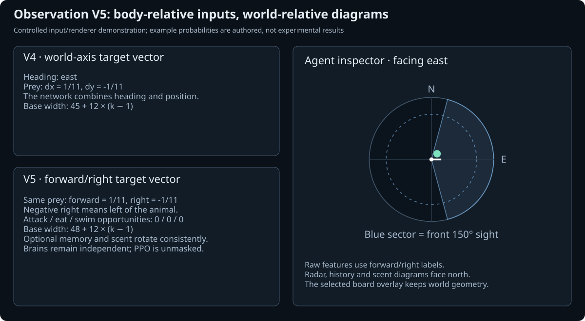
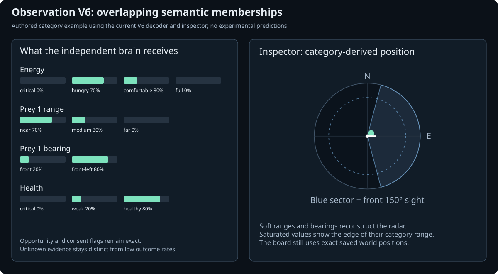
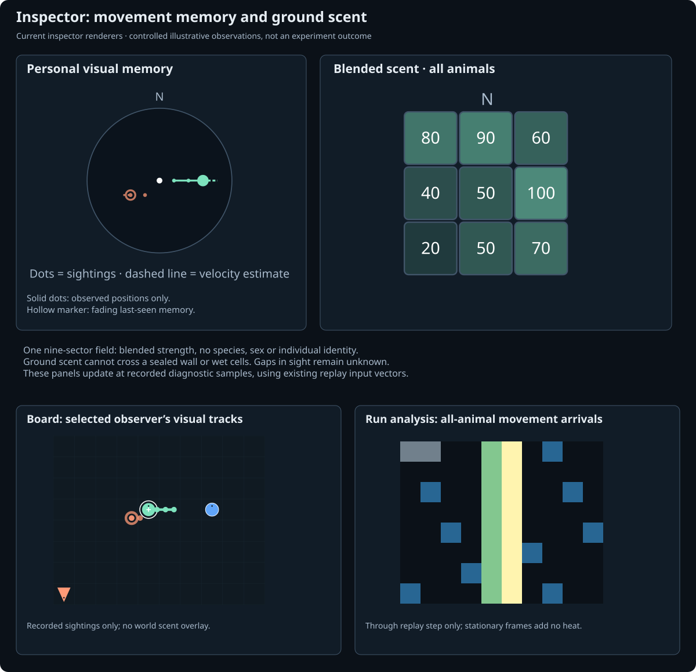

# Archived sensory inputs and inspector views

[Historical reference](index.md) · [Current guide](../viewer-visual-reference.md)

This page preserves earlier layouts and display contracts for old artifacts or
explicit comparison settings. It is not the current preset setup. Current guides
use V7 and the maintained feature pipeline; runtime readers still support these
older contracts. Historical measurements are not new evaluations.

## Observation V5

The inspector identifies V5 inputs and shows immediate attack/eat/swim
opportunities with the existing light/dark-aware status styling. These indicators
do not mask predictions. Raw input/attribution labels use forward/right and
body-relative scent sectors. Radar targets, flow, histories and scent grids are
projected back through the **sampled heading** so they stay north-up alongside
the world board. Current sight remains tied to the current selected body; sampled
inputs can lag it. Older recordings retain their original appearance.
See [layout and opportunity definitions](../observations.md#observation-version-5).

## Observation V6

The inspector's **V6 soft categories** disclosure shows up to 48 nonempty groups
from the selected animal's saved input, updating during replay. Full semantic
labels remain available in the raw vector, network structure and saved-weight
explanations. Opportunity indicators retain their exact flags and do not mask
ordinary PPO predictions. Existing charts decode category-derived values for
health, terrain, mating, social/consequence estimates, movement memory and scent.
Radar/history positions are representative after any band saturation; the world
board always uses exact saved positions. Both modes use the viewer theme.
See [bands, widths and saturation](../observations.md#observation-version-6) and the
[complete ordered input layout](../observations.md#v6-input-layout), plus the
[V5 → V6 data comparison](../observations.md#what-changed-from-v5-to-v6).

## Input contract and model compatibility

The existing observation-version 1–4 blocks stay in their current order. V5
projects directional memory and scent into the current body frame and adds three
opportunities before these optional blocks; the viewer projects them back to
north-up using the sampled heading. See [V5](../observations.md#observation-version-5). Optional
movement and scent blocks are appended afterwards. For `K` visible slots per
category and `H > 0` history steps, movement adds `2 * K * (7 + 3 * H)` values:

| Per tracking slot | Meaning |
| --- | --- |
| 7 summary values | Last-seen dx/dy, estimated velocity x/y per step, normalized age, confidence, currently-visible flag |
| 3 values per previous step | Historical dx/dy and observed flag, newest lag first; zeros mark unknown steps |

Blended scent adds nine values total. Separated scent adds nine values per
channel: one channel per sensed species, or female then male channels per species
with sex separation enabled. Legacy channel order follows `scent_observation.species`. Version 1, K=1, H=3 and two sex-separated species has
`20 + 32 + 36 = 88` inputs. Those are legacy numeric layouts. The maintained
tracking preset now uses V7 compact summaries: prey K=3 and predator K=10 have
106 and 267 inputs respectively, including three-step history and four-value
blended scent. See [V7 details](../observations.md#observation-version-7).

Model signatures include history length and the ordered scent contract. Changing
those fields, including scent mode, requires fresh compatible weights; equal input width alone is not
sufficient. Explicit history zero retains the legacy signature. Old recordings
and configurations remain readable and keep their original input layouts.

## Inspector and replay

New V7 presets use the compact movement plot and scent compass shown in the
[V7 sensory diagram](../assets/viewer/observation-v7.svg). The legacy numeric view
below remains available for older recordings.

Select an animal during saved playback, then click **Tracks & scent charts** in
the inspector to jump directly to **Movement memory & scent**. This section is
below **Sampled observation** in the independently scrollable sidebar and shows
its recorded sensory inputs. Movement
dots are personal sightings; missing steps break the connecting line. Hollow
markers and fading opacity identify remembered targets. Dashed line segments in the inspector show the
last velocity estimate, not confirmed future movement. Prey/predator colors
refer to the existing diet categories. The scent panel shows the local
blended strength pattern in a single heatmap (or the original species/sex grids
for separated recordings), with north upwards and
the observer's current cell in the center. Compact headings keep the diagrams
stable; hover a movement marker for its slot, visibility, age and confidence
instead of repeating those details in paragraphs below the chart.

Panels update at diagnostic samples as playback advances, rather than inventing
intermediate data. Use a nonzero `recording.diagnostics_every_steps`; lower
intervals give smoother updates and larger recordings. The existing diagnostic
step label distinguishes the sampled observation from the current replay frame.
Old recordings without these inputs do not acquire retrospective tracks.
