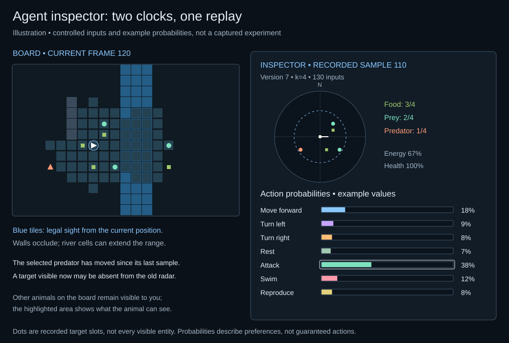

# Agent inspector illustration

[Inspector guide](../../recording.md#visual-agent-inspector) · [Asset index](../README.md)



`inspector-example.svg` is an explanatory vector illustration, not a screenshot
or a training result. A controlled 21 × 14 world supplies real version-7, k=4
observations (130 inputs), with a wall and three-column river. Both species use
base sight 4 plus up to 3 across water. The actor moves between the labelled
sample step 110 and current frame 120; no training is performed. Target slots,
heading, health/energy and current sight are derived from that constructed state.
Action probabilities are explicitly invented example values summing to 100%.
They illustrate preference bars and do not claim accuracy or learning progress.

Regenerate or verify from the repository root, with Graphviz available for the
companion flow diagrams:

```sh
.venv/bin/python -m work.build_recent_doc_diagrams
.venv/bin/python -m work.build_recent_doc_diagrams --check
```

The [generator](../../../work/build_recent_doc_diagrams.py) constructs this SVG
directly and includes its controlled world inputs. The SVG needs no browser,
external images or JavaScript. Raster review previews belong under ignored
`.cache/docs-viz/`; original recordings and experiment data are not embedded.
