# Binary replay and checkpoint storage

[Playback](recording.md) · [Runs and checkpoints](running.md) · [Performance](performance.md)

For file trees, record layouts, entity schemas and a worked field-mask example,
see [Playback data structures](replay-data-structures.md).

The disk-focused defaults are binary replay chunks and binary checkpoints,
compressed with XZ. Training and rendering remain separate. CSV metrics, JSON
summaries, environment definitions and champion metadata/indexes stay readable.
No NumPy, PyTorch, browser package, database or build step is required.

## What is stored

| Data | New default | Purpose |
| --- | --- | --- |
| Replay chunks | `run_0001_chunk_000000.bin.xz` | World frames, events and sampled brain diagnostics |
| Checkpoints | `run_0001.bin.xz`, `final.bin.xz` | Exact continuation, including models, optimizers, memories and RNGs |
| Metrics and summaries | Existing CSV / JSON | Readable experiment outcomes |
| Champion weights | Shared `champions/models/<sha256>.bin.xz` | Lossless, deduplicated warm-start model snapshots |
| Champion metadata and indexes | JSON | Criteria, ranks, scores, source and weight references |

Replay files do not contain model weights or optimizer buffers. Checkpoints do.
Version-3 champion artifacts now reference shared binary/XZ weights. The existing
codec stores exactly representable arrays as FP32 and preserves legacy FP64
values without quantization. Identical models are stored once across criteria
and runs; unchanged records preserve their identity. Configurations are pooled
within each generation. Old version-1/2 JSON artifacts still load. See
[champion retention](brain-library.md#promote-only-improvements). Disk size grows with retained episodes, recording cadence, diagnostics,
checkpoint cadence, model size and population even with the binary format.

For the weight reference object, one-record blob and example layer dimensions,
see [champion weight records](replay-data-structures.md#champion-weight-records).

## Champion storage measurement



One frozen first-run archive from the deep river experiment contained 22
criterion artifacts and used 8,663,633 bytes in the prior JSON layout. Exporting
the same exact model values in the new layout used 620,497 bytes, including its
index, metadata/configurations and shared weights: **92.8% smaller**. Eight
unique model blobs accounted for 521,548 bytes. All 22 model round trips matched.
A second unchanged archive added 98,993 metadata/index bytes and **zero new weight
bytes**. These measurements describe one archive, not total experiment storage;
replays and full resume checkpoints are separate. No runtime/RAM speedup is
claimed. Existing result folders were not rewritten.

Each model blob is one `WTFB` version-1 record with kind `champion_model`,
containing the signature, precision and parameters. SHA-256 names and verifies
the uncompressed record bytes; it is not a pickle or executable model object.
Weights and configuration references are constrained to their archive layout.
New readers support both layouts; older runtimes cannot load version-3 champions.
The viewer does not read champion weights and needs no format change.

## Structured binary layout

Each file starts with four magic bytes `WTFB` followed by version byte `0x01`
(five bytes total). A sequence of
little-endian 32-bit record lengths follows, each followed by a typed record.
An encoder/decoder symbol table is scoped to that one file, never to another
chunk. Unknown versions, invalid symbols, malformed records and non-finite
numbers are rejected.

The layout uses:

- Raw little-endian float32 arrays when every source value is exactly
  representable, otherwise float64; no decimal strings or base64.
- Packed uint8, uint16 or uint32 arrays when the actual values fit and their
  payload is smaller than signed varints. Small values retain varints when
  equally small or smaller; RNG words usually use uint32.
- Dictionary-coded strings, including field names, species and actions.
- Column-packed tables for lists of records with the same fields, including
  animals, resources and events. Repeated keys are stored as a field table.
- Typed lists/maps for varying-shape diagnostics and extension fields.
- A separate signed large-integer representation for Python state such as the
  64-bit randomization seed. JavaScript decodes this type as `BigInt` when used;
  ordinary replay IDs and counters remain normal safe-integer Numbers.

Numbers retain their original integer/float representation in Python, including
signed floating zero. The binary encoder never quantizes source values: a
float64 value uses float32 encoding only when decoding recovers it exactly.
New model training already stores parameters in float32; physics and legacy
models keep their source values. Scalar floats remain float64 on disk.

WTFB version 1 has additive array tags: `15` for float32, `16` for uint8 and `17`
for uint16, alongside existing float64 (`10`), uint32 (`12`) and signed varints
(`9`). Python and JavaScript readers accept both forms and return the same
ordinary floats/integers/Numbers to the application. Older readers do not know
the new tags: update/restart the playback server and refresh the viewer together.
Each chunk is still independently decoded and seeking/memory bounds are unchanged.

Live IDs, ages, generations, counters and seeds remain Python integers. Their
lifetimes/configuration do not justify a universal uint8/uint16 bound; blindly
narrowing them could overflow. Live action indices/headings mostly reference
small shared Python integers already, so changing individual scalar objects to
boxed NumPy integers would not provide a packed-array saving.

Replay records wrap the existing keyframe-and-field-delta layout. Each chunk
has an independent header, a full first frame, subsequent delta packets and a
footer confirming frame count. A frame is buffered for binary encoding, not an
entire recording. The browser uses `DataView` to decode arrays and reconstructs
the same bounded world chunk consumed by the existing playback engine.

Checkpoint version 3 uses a metadata record, one record per detached controller
and a final shared-value table. Shared configurations and identical model values
are still pooled. Numeric data is written directly as binary instead of wrapping
it in base64 inside JSON. The public loader returns the same version-1 state
shape expected by `Experiment.restore`; no pickle or executable object loader is
involved. Restore still materializes the full checkpoint in RAM.


For the checkpoint record envelope, per-controller state and restore/access paths,
see [checkpoint block diagrams](checkpoint-data-structures.md).

## Two payloads, one bounded file at a time

Binary layout and compression are separate layers. Playback chunks are independently decodable; an exact checkpoint still restores the whole learning state.



## Compression choices

New presets use:

```json
"recording": {
  "enabled": true,
  "frame_every_steps": 1,
  "frames_per_chunk": 64,
  "diagnostics_every_steps": 10,
  "encoding": "binary",
  "compression": "xz",
  "compression_level": 6
}
```

XZ uses LZMA2 with a dictionary explicitly limited to 1 MiB. This is the
compression dictionary size, not a claim that the entire encoder uses 1 MiB of
RAM. It prioritizes smaller disk files and can cost more CPU than gzip. Use
`compression: "gzip"` for `.bin.gz`, or `"none"` for `.bin`, when writing speed
matters more. Levels 1–9 control compression effort. JSON `delta` and `snapshot`
encodings remain supported.

CLI checkpoint output defaults to `--checkpoint-format binary` and `.bin.xz`.
Use `--checkpoint-format compact` for the previous base64-array JSON/gzip format,
or `--checkpoint-format json` for plain JSON. Programmatic checkpoint writers
select binary by `.bin`, `.bin.gz` or `.bin.xz` extension.

## Convert existing completed results

```sh
# Replays and exact checkpoints, verified before replacement:
.venv/bin/python -m ecosystem.optimize_storage results/EXPERIMENT
# Every completed/interrupted experiment; active recordings are skipped:
.venv/bin/python -m ecosystem.optimize_storage results --all
# Restrict conversion or choose faster compression:
.venv/bin/python -m ecosystem.optimize_storage results/EXPERIMENT --only replays
.venv/bin/python -m ecosystem.optimize_storage results/EXPERIMENT --only checkpoints --compression gzip
```

Conversion processes one chunk or checkpoint at a time. It compares canonical
expanded-state SHA-256 digests, checks that source files did not change during
conversion, and publishes a replacement atomically only if it is smaller.
Verified redundant format copies are removed. Failed verification keeps the
current file's originals. Already completed files from an interrupted conversion
remain readable; conversion is not an all-experiment transaction. Repeating it
is safe, though verification itself still reads data.

Readable metrics, summaries and champion artifacts are untouched. Existing
training configurations are not retuned. The manifest reports binary/mixed
physical storage separately from the historical recording configuration.
Keep the current reader when rolling back source code: an older runtime cannot
load binary checkpoints. Old `.json` / `.json.gz` checkpoint paths resolve to
converted binary counterparts when the original file is absent.

## Browser transport and caching

The viewer requests `X-WTF-Replay: binary-v1`. The server returns native binary
records with `application/vnd.wtf.replay-binary`. XZ is decompressed by the server
one requested chunk at a time because browser-native XZ decompression is not
assumed. Gzip-capable requests can receive stored `.gz` bytes directly. Requests
without the new header, including old `delta-v1` clients on binary storage,
receive compatible expanded JSON. JSON recordings remain readable.

This prioritizes disk size rather than the smallest localhost response. The
browser still keeps one decoded world chunk; binary storage does not reduce
those expanded object sizes. Random seeks may also read the preceding chunk to
recover event positions, as before.

The server caches at most four derived 128-frame telemetry pages. Entries include
manifest and source-chunk stat fingerprints, so updated files or extended active
recordings invalidate them. Returned data is detached from the cached copy.
There is no whole-recording cache, model-output cache or simulation-state cache.
Recording also skips sorting/copying static obstacles and world dimensions that
are already stored once in run metadata.

## Why not NumPy or PyTorch files?

[NumPy `savez_compressed`](https://numpy.org/doc/stable/reference/generated/numpy.savez_compressed.html)
stores typed `.npy` arrays in a DEFLATE-compressed ZIP container. That is useful
for numeric interchange, but a browser would still need its archive/array reader
and a representation for births, variable diagnostics and frame deltas. The
binary layout above directly handles those records with native browser APIs.

[PyTorch serialization](https://docs.pytorch.org/docs/stable/notes/serialization)
uses an uncompressed ZIP64 archive by default; installing it would not by itself
shrink these files. This project currently trains standard-library networks with packed numeric model buffers. Adopting tensor libraries for faster training is a separate design
change, not necessary for storing their numeric parameters in compressed binary.


## Native replay helpers

Optional [v2 CPU kernels](native-kernels-v2.md) accelerate integer-array/varint
handling, replay comparisons/copies and dashboard groups without changing the
binary tags, compression, canonical values or chunk memory bounds. Matched old/new
recordings have identical compressed chunk bytes. Unsupported Python tree types
and stale/missing extension APIs retain the existing reference operations.
