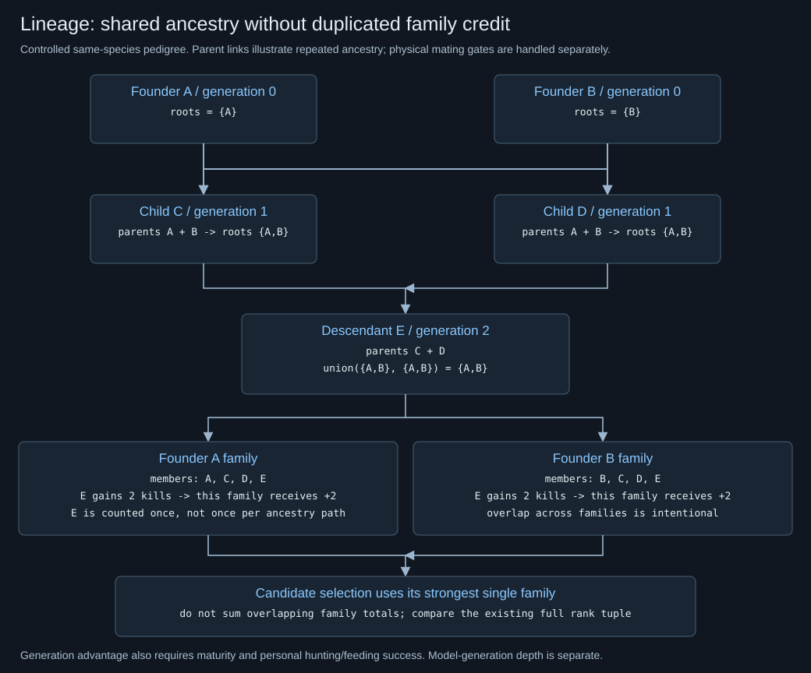

# Saved champions and model generations

[Project overview](../README.md) · [Configuration](configuration.md) · [Runs and checkpoints](running.md)

Commands in this guide run from the project root.

For the nested binary record, shared blob references and layer-array shapes, see
[the model-weight block diagram](replay-data-structures.md#champion-weight-records).

## Promote only improvements

Fresh experiments default to `experiment.promote_only_improved: true`.
Champions retain the **best observed rank so far** across the experiment for
independent species/sex/criterion groups. A candidate replaces a record only
when its full existing rank tuple is strictly higher, including its documented
tie-breakers. An exactly equal rank keeps the incumbent weights. This applies
to every tracked criterion; the chosen `--champion`/`--brain` criterion determines
which group's record initializes the next episode.

For example, a predator kill champion with 11 kills cannot be replaced by an
8-kill candidate. Equal kills can still improve a secondary ranking field, such
as lifespan. Loaded typed champions seed their recorded criterion/rank, so the
first new episode must improve that record too. An unchanged winner retains its
artifact ID and model generation. A lineage ledger still resets for each new
world; retained champion snapshots keep their original run/family provenance.

Every numbered run has a small index of the best models available at that point.
Entries mark `improved: false` when they retain an earlier record; source run and
animal metadata identify where the weights were actually acquired. Selecting
`--brain-run N` therefore selects the best-so-far archive as of N. Weights are not
written again for an unchanged champion. `--no-chain-brains` restarts each world
from the configured initial models while still tracking archive records.

Set `experiment.promote_only_improved: false` to restore per-episode champion
replacement. Old checkpoints without the effective `improvement_only` field keep
their previous behavior on exact resume; fresh invocations and warm starts use
the new default. The experiment manifest/checkpoint records the effective flag.
A running Python process keeps the implementation it already loaded.

Optional [early stopping](running.md#stop-on-performance-plateaus) watches the
selected species/sex criteria and stops after a configurable number of runs with
no new rank record. It does not count optimizer updates or unused archive criteria.

These are observed episode records, not frozen-policy evaluations across matched
worlds. Different seeds, opponent policies and survival conditions can affect
rank; strict retention prevents rank regression but does not prove generalization.


## Tracked champion criteria

Training automatically tracks four independent champions for each sex within every species:
`health` (highest HP), `kills` (most individual kills), `lifespan` (oldest age
reached) and `food` (most actual energy gained from food or prey). Prey cannot
kill under the current rules, so their kill score remains zero; use `food` for
a useful foraging champion. These are observed records, not validated estimates
of a model's quality on other worlds. Predators also track a `balanced` champion
that combines kills with capped survival credit; see the scoring rule below.
Both diets also archive a `lineage` champion, using successful biological
generations and founder-family performance. Existing default selectors remain
unchanged; enable lineage explicitly as described below.

Champions capture the model at the step the record is set, after that step's
learning. Dead animals are considered before their controllers are discarded.
A previously healthy champion keeps the weights from its healthy moment; its
later starvation cannot overwrite that snapshot. Equal primary scores prefer
older animals, so an initially healthy untrained founder does not permanently
lock the health record. Kills and food gained are tracked per lifetime, and
newborns start those counters at zero. Raw HP is used for health, and age reached
also includes living survivors rather than treating their age as a completed
lifespan. The exact tie-breaking ranks are included with each model.


## Weights versus exact state

For the full continuation payload and restored runtime ownership, see
[checkpoint structures](checkpoint-data-structures.md).

Champion loading transfers compatible learned parameters. It does not restore an animal’s body, optimizer, memory or pending experience.



## Balance predator kills and survival

The GRPO preset uses this predator setting; other environments can opt in:

```json
"champion_selection": {
  "criterion": "balanced",
  "survival_steps_per_kill": 300,
  "max_survival_bonus": 2
}
```

The score is `kills + min(age / survival_steps_per_kill, max_survival_bonus)`
after the first kill. With zero kills, the score is zero and no survival bonus
is awarded. Ties prefer more kills, then greater age, energy gained and health.
Both living and dead predators are considered. For example, 8 kills at age 600
scores 10, versus 9 kills at age 100 scoring 9.33. A predator with 10 kills at
age 100 scores 10.33 and wins. Long survival can contribute at most two points;
never hunting cannot beat a predator that has killed. This is a configurable
selection heuristic, not a measured estimate of policy quality.

The selected criterion applies to later runs even when initial weights came
from an older kill-only champion. `--brain predator=kills` explicitly switches
back to kill-only selection; `--brain predator=balanced` selects the combined
criterion. Prey remain on lifespan selection by default. This changes champion
selection and inheritance, not RL rewards, update frequency or rollout horizon.
It does not resolve sparse GRPO learning signals by itself.

For a source archive without a compatible `balanced` snapshot, `--brains-from`
rescores the **available saved candidates** using their recorded age and kills,
then loads the highest-ranked candidate. The old archive is never rewritten.
An unarchived individual's weights cannot be reconstructed, so this is the best
available saved candidate, not a recovered whole-run combined champion. Future
runs save the true combined champion and its scoring policy in
`predator/{female,male}/balanced.json`. Different scoring settings also trigger rescoring of
available source candidates. Shared-library `best:balanced`/`latest:balanced`
selectors require a matching scoring policy so unlike formulas are not ranked
together.

```sh
.venv/bin/python -m ecosystem.cli environments/grpo.json --runs 50 --seed 100 \
  --brains-from results/EXPERIMENT \
  --brain predator=balanced --progress
```

## Select successful biological lineages

Use `--champion` to choose later-run winners without loading starting weights:

```sh
.venv/bin/python -m ecosystem.cli environments/meandering_river.json \
  --runs 10 --seed 100 --progress \
  --champion prey=lineage --champion predator=lineage
```

This preset starts fresh with A2C prey and GRPO predators. Run 1 starts with its
configured initialization; subsequent runs use matching species/sex best-so-far
lineage winners. The earlier qualified-lineage guard also remains available
when strict retention is disabled. See [guarded promotion](mating-observations.md#guard-provisional-lineage-winners).
`--runs 1` still archives those winners for later
use. `--no-chain-brains` disables promotion while preserving the archives.
`--champion prey:male=food` selects a different male criterion; sex-specific
choices override broad choices regardless of argument order. `--champion`
takes precedence over the criterion implied by `--brain`.

The JSON equivalent, inside each species object, is:

```json
"champion_selection": {"criterion": "lineage"}
```

### Founder membership and family credit



The pedigree is a controlled ancestry example. Parent links explain set union
and credit; physical mating eligibility remains governed by the normal rules.

A **family** consists of one founder and its descendants, including both sexes.
Each newborn inherits the union of its parents' founder memberships. An animal
contributes its own lifetime kills, actual food energy and age once to each
founder family it belongs to. Shared ancestry cannot duplicate a kill within
one family. For an animal in several families, selection uses its strongest
family, rather than summing overlapping family totals. Family size is allowed
to contribute to fitness; rates are recorded alongside totals for interpretation.
Family counters include deceased relatives without retaining their controllers.

A candidate must reach the selection age and earn **at least one personal kill**
for a prey-eating species, or **positive personal food energy** for a resource-
eating species, before receiving a generation advantage. The selection age
normally equals `reproduction.min_age_steps` (at least one step), without the
per-animal reproduction timing deviation. Override it with the positive integer
`champion_selection.lineage_min_age_steps`. Reaching this age counts a descendant
as viable even if it dies later; this is a maturity proxy, not reproductive proof.

Ranks compare left to right:

| Diet | Rank, highest first |
| --- | --- |
| Predator (`prey`) | Proven birth generation, family kills, viable descendants, family animal-time, family kills per animal-step, personal kills, personal age, HP |
| Prey (`resource`) | Proven birth generation, family animal-time, viable descendants, family food energy, food energy per animal-step, personal age, personal food energy, HP |

Animal-time is the sum of family members' ages. A newborn cannot displace a
proven adult on ancestry alone. If no proven animal exists for a species/sex,
a provisional candidate is still saved: `score: -1`, `lineage.qualified: false`.
These fallbacks compare personal kills/age for predators or age/food for prey.
Once a proven candidate exists, its nonnegative generation score wins.

Only actual births advance biological generation. Founders begin at zero,
and a child advances beyond the maximum **tracked** parent generation. Loading
weights, replaying an episode or advancing `model_generation` does not create
births. Each new episode resets its physical family history, even when models
are chained from an older episode; this is selection across independent worlds,
not one continuous biological world.

The additional snapshots live at
`<species>/<female-or-male>/lineage.json`. They contain the selected founder,
observed generation, family totals, rates, qualification, partial-history flag,
scoring policy and exact rank. Counts are **as of the snapshot step**. Later
family success does not rewrite dead animals' historical models or retroactively
rescore every discarded brain. Species/sex champion pools remain independent.

Exact checkpoints include the compact family ledger and counters. Legacy
checkpoints without a ledger start tracked family history from the available
animals; these snapshots are marked `partial_history: true`. Missing deceased
ancestors and their offspring are not invented. Old champion archives without
`lineage` cannot be reconstructed from lifespan/kill winners alone, so explicit
lineage loading reports no matching champion instead of guessing.

To load a new run's archived winners:

```sh
.venv/bin/python -m ecosystem.cli environments/meandering_river.json \
  --brains-from results/<experiment-name> \
  --brain prey=lineage --brain predator=lineage --runs 10 --progress
```

Shared-library `best:lineage` and `latest:lineage` require matching lineage policy,
algorithm, architecture, action signature, species and sex. Explicit run/path
loading transfers compatible weights under the new environment's policy; it
does not import the old physical family. Compare ranks across equal episode
budgets and comparable worlds: a longer episode provides more opportunities.
Lineage selection changes curation and inheritance, not RL rewards, observations
or mating decisions. It is a fitness heuristic, not proof of general intelligence
or a self-sustaining ecosystem.

## Brains belong to their run

Each completed training run indexes its best-so-far champions. There is no need to track
which separate model-library generation contains a result:

```text
results/<run-name>/champions/run_0001.json
results/<run-name>/champions/run_0001/manifest.json
results/<run-name>/champions/models/<sha256>.bin.xz
results/<run-name>/champions/run_0001/configs/<sha256>.json
results/<run-name>/champions/run_0001/prey/{female,male}/{health,kills,lifespan,food,lineage}.json
results/<run-name>/champions/run_0001/predator/{female,male}/{health,kills,lifespan,food,balanced,lineage}.json
```

New version-3 champion JSON files contain metadata and a reference to lossless
binary/XZ model weights in the shared `champions/models/` directory. Identical
weights across criteria or episodes share one file. Training configuration is
stored once per distinct configuration in the numbered generation's `configs/`
directory. The loader returns the same full model structure to callers; old
version-1/2 inline-JSON weights remain readable. Keep the shared models directory
when copying an experiment; a single new JSON artifact alone is insufficient.

The experiment folder is self-contained. Moving it keeps its models usable.
Experiments with several numbered runs keep separate `run_0002`, `run_0003`, etc.
By default loading chooses the latest archived numbered run; `--brain-run` pins
one. Results and optional legacy shared libraries remain ignored by Git.

List the available champions by run name:

```sh
.venv/bin/python -m ecosystem.library --run PREVIOUS_RUN_NAME
```

The model snapshots contain weights and provenance, with no replay or optimizer
buffers. Tracking retains at most four models per resource-eating species/sex group and five per predator species/sex group and performs no disk
writes inside the simulation-step loop. Models are published atomically when
the numbered run completes.

## Choose models with CLI arguments

Reuse champions from a specific saved experiment without changing its environment JSON:

```sh
.venv/bin/python -m ecosystem.cli environments/ppo.json --runs 1 \
  --brains-from PREVIOUS_PPO_RUN_NAME \
  --brain prey=lifespan --brain predator=kills
```

Replace the source name with its experiment folder name under project `results/`.
An explicit experiment path also works for a custom results directory.
`--brains-from` defaults to its latest archived run and the species' configured
`champion_selection.criterion`, falling back to lifespan for resource eaters and
kills for predators. The GRPO preset configures predators to use `balanced`. Add `--brain-run 1` to pin a
particular run. Each selected model must match the target species, recorded sex and architecture.
The source artifacts stay unchanged, and the new experiment saves the resolved
paths in `environment.json` and their provenance in `manifest.json`.

Repeat `--brain SPECIES[:SEX]=MODEL` to select a species or a particular sex. `MODEL` accepts:

| Value | Selection |
| --- | --- |
| `health`, `kills`, `lifespan`, `food`, `balanced`, `lineage` | That champion from `--brains-from` |
| `best:food`, `best:kills`, etc. | Best compatible champion across the library |
| `latest:lifespan`, etc. | Criterion from the latest compatible library generation |
| Path to an artifact JSON | Exact saved model |
| `fresh` | Fresh initialization for that species or species/sex, overriding any JSON warm start |

For example, choose different per-run champions or keep one species fresh:

```sh
.venv/bin/python -m ecosystem.cli environments/ppo.json --runs 1 \
  --brains-from PREVIOUS_PPO_RUN_NAME --brain prey=lifespan --brain predator=health
.venv/bin/python -m ecosystem.cli environments/ppo.json --runs 1 \
  --brains-from PREVIOUS_PPO_RUN_NAME --brain prey=fresh
```

Unknown species, duplicate selections, missing artifacts and incompatible models
fail before a new results folder is created. These options cannot be combined
with `--resume`, which restores the exact saved experiment instead.

## Species and sex selection

Best brains are separate for `prey:female`, `prey:male`, `predator:female` and
`predator:male`. All health/kills/lifespan/food records, predator balanced records,
archive ancestry and run-to-run transfers stay within their matching group.
Species-wide flags such as `--brain prey=lifespan` choose the female lifespan
champion for females and the male lifespan champion for males. They do not pick
one winner across both sexes.

Choose different criteria or reset just one group:

```sh
.venv/bin/python -m ecosystem.cli environments/ppo.json --runs 10 \
  --brains-from PREVIOUS_PPO_RUN_NAME \
  --brain prey=lifespan --brain predator=fresh --brain predator:male=kills
```

A sex-specific flag takes precedence over a species-wide flag regardless of
argument order. Duplicate requests for the same exact group are rejected.
`--brain prey:male=best:lifespan` filters shared-library records by male sex;
`latest:` works the same way. Explicit sex-specific selections fail if missing
or mismatched. Automatic `--brains-from` loading leaves an unavailable sex fresh,
rather than copying the opposite-sex winner. Such groups are absent from the
recorded `initialized_from` map. Inspect saved manifest provenance per species/sex.

A path to a known-sex artifact supplied as `prey=PATH` initializes only that sex.
Supplying it as `prey:male=PATH` rejects a female artifact. Legacy version-1
artifacts without any sex metadata can seed both sexes as a shared starting
model; they are not evidence of separately selected historical sex champions.
A version-1 artifact that does record sex still initializes only that sex.

## Optional JSON defaults

Explicit JSON paths are still supported. Earlier shared-library selectors also remain available for existing configurations:

```json
"initial_brain": {"selection": "best", "metric": "lifespan"}
```

For predators, use `"metric": "kills"` or `"lifespan"`; `"health"` is available
for either species. `"selection": "latest"` uses that criterion's model from
the most recent compatible archived generation. Selectors are resolved when an
experiment starts, and each agent receives an independent copy. To pin a
specific generation, use the path printed by the library command:

```json
"initial_brain": {"path": "results/PREVIOUS_RUN_NAME/champions/run_0001/prey/female/food.json"}
```

Relative paths resolve from the project root, regardless of the working
directory. Files must match species, recorded sex, algorithm, network shape, observation
version and action order. A Q model cannot initialize a PPO or GRPO controller.
Malformed or non-finite weights are rejected. A selector with no compatible
model fails clearly when explicitly selected for a sex. Broad selections may
leave an unavailable sex fresh, as described above.

Each newly initialized controller gets fresh body state, empty experience
buffers, fresh optimizer state and random streams, and the exploration settings
from its JSON.
Q target weights and GRPO's frozen reference policy start at the imported model.
Learning rates and other training settings can be changed without changing the
architecture. Exact checkpoints embed the selected weights and champion book,
so resuming does not need the original files or newer archive versions.

Initialization validates and loads a selected model once per populated
species/sex, then makes independent founder controllers from that pristine
state. This construction reuse does not share live weights, optimizer state or
random streams, and templates do not survive into learning. See the
[initialization implementation](performance.md#founder-initialization-and-shared-reporting).

## Automatically chain runs

`experiment.chain_best_brains` defaults to `true`. When `--runs` is greater than
one, each later training run starts each species/sex group from its selected
best-so-far champion. For example, `--brain prey=lifespan` chooses female and male
prey lifespan records separately, and `--brain predator=kills` chooses predator
kill records. An unchanged or worse run retains the earlier winner. With
`promote_only_improved: false`, each episode supplies its own champions instead.
Without a saved starting model, the selected JSON criterion applies. If omitted,
the generic fallback is `lifespan` for resource eaters and `kills` for prey eaters.
Explicit CLI criterion selectors also set that species' chaining criterion. Models transfer in memory even with `--no-library`.

```sh
.venv/bin/python -m ecosystem.cli environments/ppo.json --runs 3 \
  --brains-from PREVIOUS_PPO_RUN_NAME --brain prey=lifespan --brain predator=kills
```

Run 1 starts from the named source. Later runs use the best records available
after each completed run, which can still come from that source or an earlier run.
Body state, optimizer state, experience buffers and controller counters restart
each run; learned model weights carry forward.
Archive parent links and recorded run metadata identify the actual source.

To start every run from the original initialization instead:

```sh
.venv/bin/python -m ecosystem.cli environments/ppo.json --runs 3 \
  --brains-from PREVIOUS_PPO_RUN_NAME --brain prey=lifespan --brain predator=kills \
  --no-chain-brains
```

Use `--chain-brains` to explicitly enable chaining. The JSON alternative is
`"chain_best_brains": false` under `experiment`. With chaining disabled, even
fresh random starting weights are pinned to the first initialization; world
and controller random streams can still differ. Evaluation/random controls
start from the original frozen models rather than promoting training champions.

The older `retain_brains_between_runs` field applies only to legacy checkpoint
continuation. New experiments use `chain_best_brains` instead. Checkpoints from
before this flag keep their original individual-controller retention behavior;
resuming does not silently change an old experiment's training policy.

Artifacts record scores, world seed, run, tick, animal ID, body generation,
training configuration and source artifact. `model_generation` counts warm-start
ancestry depth, separately from reproduction generations. Subsequent chained
runs also record their prior run number. Old archive directories stay available
for comparisons and branching new lineages. Legacy checkpoints that lack
individual kill/food counters begin counting those statistics at the resumed
age; `statistics_since_age` makes that limitation explicit. Past model weights
that were never saved cannot be reconstructed from a playback recording.

```sh
# Train, then use the result folder name printed by the first command.
.venv/bin/python -m ecosystem.cli environments/ppo.json --runs 1
.venv/bin/python -m ecosystem.cli environments/ppo.json --runs 1 \
  --brains-from PREVIOUS_PPO_RUN_NAME --brain prey=lifespan --brain predator=kills
```

The older `champion_lineage.json` preset uses shared-library selectors for a prey
`lifespan` champion and a predator `kills` champion. The default workflow now uses
`--brains-from RUN_NAME` and per-species `--brain` criteria.
With no JSON or CLI initialization request, agents start fresh. `--library-dir PATH`
opts into an additional shared archive and selects the shared search location
for legacy `best:`/`latest:` selectors. Run-local models are still saved. Explicit
JSON paths remain relative to the project root. `--no-library` skips publishing new
generations. Evaluation and random-control runs do not publish champion models.


## Champion chaining between runs

Repeat this independently for each species/sex group. No opposite-sex or different-species champion is silently substituted.



## Older shared archives

Older run indexes that point into `brain_library/` continue to load. To make one
self-contained, copy its existing models into the run with:

```sh
.venv/bin/python -m ecosystem.library --run PREVIOUS_RUN_NAME --localize
```

This preserves model bytes and artifact identities and keeps the original shared
copies. It can be repeated safely.

For modern champion chaining, dead controllers (including founders) are released
after their terminal learning and champion snapshot. Their optimizer update
counts remain in the experiment totals. Exact legacy checkpoint retention still
keeps founder controllers when they are required for the next run.

## Compatibility of the additional algorithms

Recurrent PPO, QR-DQN, Maskable PPO and the experimental MAPPO variant use the
same run-local archive and CLI selection workflow. All four supplied presets
select `lifespan` for both species. `fresh` resets initialization; it does not
change that criterion. In addition to algorithm and action order, compatible
models require matching GRU size, quantile count, actor/critic layers and
mask/context versions where applicable. Ordinary PPO weights cannot initialize
these variants. Recurrent champions omit episodic hidden state; newborns and
warm starts begin with zero memory. Exact checkpoints retain it. See
[advanced algorithms](advanced-algorithms.md) for details.

## Mutated biological lineages

Rare [newborn mutations](mutation.md) change inherited weights during training.
Selected champions from these lineages include `mutated`, `mutation_count` and
`mutation_weights` in source metadata. Their model signatures and loading commands
are unchanged. A new run starts a new biological family tree while retaining
model ancestry through its source artifact. Replays contain scalar lineage/event
information rather than the actual parameter arrays.

Paired births record both biological parent IDs and sex in champion source
metadata. A child mixes the two current brains, then optionally mutates. The
archive's run-to-run source artifact chain is species/sex-specific and is distinct
from the within-run biological two-parent family tree. A newborn's random sex
determines which champion pool it competes in, after inheriting from both parents.

## Per-sex JSON overrides and archive versions

Inside a species, `initial_brains` overrides the common `initial_brain` request
for a particular sex; `null` means explicitly fresh. Criteria for subsequent
chaining can also differ:

```json
"initial_brains": {
  "female": {"path": "results/PREVIOUS_RUN_NAME/champions/run_0001/prey/female/lifespan.json"},
  "male": null
},
"champion_selection_by_sex": {"female": "lifespan", "male": "food"}
```

An omitted sex inherits the common initialization request, if present. An omitted
sex-specific criterion uses `champion_selection.criterion` or the existing
species default. Balanced scoring parameters remain species-wide, but candidate
ranking is independent for male and female predators.

New manifests/indexes use `library_version: 2` and artifacts use
`brain_artifact_version: 2`. Readers accept versions 1 and 2. No old archive is
rewritten. Older checkpoints with a species-only champion book retain historical
winners only when their sex was recorded, and seed missing groups from currently
living controllers. Unsaved historical winners cannot be reconstructed. Old
species-wide source initialization is preserved on checkpoint migration; new
selection/chaining is sex-specific. Current checkpoints preserve both pools
and provenance, including when source files are unavailable.
