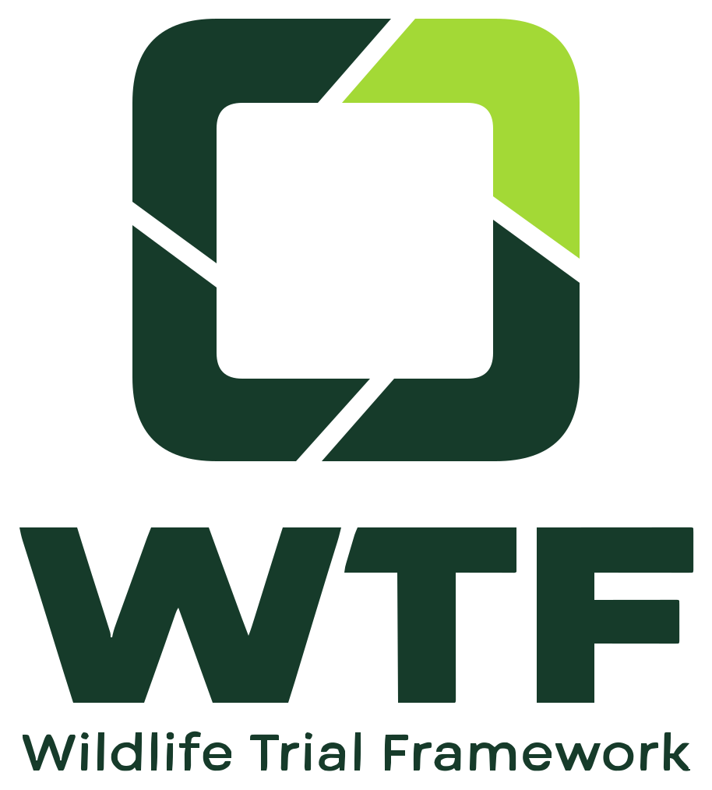

# Project identity and logo assets

[Documentation home](index.md) · [Viewer appearance](viewer-visual-reference.md)

The WTF identity uses four separated segments around an open environment, with
one lime segment marking a changing state. Use the approved forest/lime artwork
and its pale-mint dark-theme variant. The SVG files are the primary artwork:
shapes and lettering are paths, with no embedded raster image, font dependency
or opaque background. PNGs are transparent fallback exports of the same SVGs.

## Choose the right form

| Placement | Form | Theme selection |
| --- | --- | --- |
| README and documentation home | Full symbol, WTF lettering and project-name lockup | GitHub follows the OS preference; the website follows its theme toggle |
| Documentation header and navigation | Symbol only beside the site title | Website light/dark theme |
| Viewer header | Symbol only beside the existing readable title | Viewer light/dark theme, independently of simulated day/night |
| Browser tab | Symbol-only SVG favicon; PNG fallback | SVG follows the browser's OS colour preference |

Do not squeeze the full lockup into a small square or add it beside another copy
of the same logo lettering. Keep a little clear space and preserve the aspect
ratio. Use the pale version on dark surfaces rather than adding a white box.

{ .brand-sample-light width="200" }
{ .brand-sample-dark width="200" }


## Canonical artwork

| Form | Light-surface SVG | Dark-surface SVG | PNG fallbacks |
| --- | --- | --- | --- |
| Symbol | [Forest/lime](assets/branding/wtf-symbol-light.svg) | [Pale mint/lime](assets/branding/wtf-symbol-dark.svg) | [Light](assets/branding/wtf-symbol-light.png), [dark](assets/branding/wtf-symbol-dark.png) |
| Full lockup | [Forest/lime](assets/branding/wtf-lockup-light.svg) | [Pale mint/lime](assets/branding/wtf-lockup-dark.svg) | [Light](assets/branding/wtf-lockup-light.png), [dark](assets/branding/wtf-lockup-dark.png) |
| Favicon | [Adaptive SVG](assets/branding/favicon.svg) | Same SVG | [32 px PNG](assets/branding/favicon.png) |

The primary colours are forest **`#163b2a`**, lime **`#a3d936`** and pale mint
**`#def3e5`**. White regions in the logo are transparent cutouts; the surface
behind the artwork supplies their colour. The main silhouette is deliberately
simple; the outlined wordmark retains the approved lettering across platforms.

## Motion policy

The documentation home-page hero and the viewer’s recording-loading indicator
use animation. Four ribbon sections circulate
anticlockwise around a fixed rounded-square band over a 12-second cycle. The
central opening, outer boundary and lettering remain stationary; diagonal scarf
joins travel with the ribbon. The animation uses native SVG path animation,
without JavaScript, external resources or embedded raster frames.

Use [the light motion lockup](assets/branding/wtf-lockup-motion-light.svg) or
[the dark motion lockup](assets/branding/wtf-lockup-motion-dark.svg) to match the
site theme. These are presentation variants; the static SVGs above remain the
canonical artwork. With `prefers-reduced-motion`, the motion SVG displays the
original static mark. PNG fallbacks are also static.

The viewer temporarily swaps its header symbol for the matching
[symbol-only light](assets/branding/wtf-symbol-motion-light.svg) or
[dark motion SVG](assets/branding/wtf-symbol-motion-dark.svg) while opening a
recording or explicitly selecting a run. Success and failure both restore the
static symbol. Playback, seeking and frame buffering do not animate the header;
reduced-motion preferences display the static symbol even during loading.

Keep the README, documentation headers/navigation, favicons and other guide
pages unanimated. Do not apply a global spinning-logo rule. Preserve the fixed opening
and diagonal joins when maintaining the home-page animation.

## Maintain and export

Editable source SVGs and PNG fallbacks live under `docs/assets/branding/`.
The viewer ships byte-identical copies of the symbol/favicons under
`viewer/branding/`, so installing the Python package does not require the docs.
Keep both copies synchronized and include viewer assets in
[the packaging allowlist](../packaging_assets.json) and [source manifest](../MANIFEST.in).
Docker already includes the viewer directory.

Use an SVG renderer for PNG exports; this adds no simulator dependency. For
example, with librsvg installed:

```sh
rsvg-convert -w 256 -o docs/assets/branding/wtf-symbol-light.png docs/assets/branding/wtf-symbol-light.svg
rsvg-convert -w 512 -o docs/assets/branding/wtf-lockup-light.png docs/assets/branding/wtf-lockup-light.svg
```

Repeat for the dark variants and keep the PNG alpha channel. Export the favicon
at 32 px. Both theme variants should use identical paths and view boxes; only
the primary fill changes. Review on light and dark surfaces before replacing
artwork. Do not turn outlined lettering back into environment-dependent fonts.

The [Material logo partial](overrides/partials/logo.html) and site CSS follow the
site's selected theme. The viewer uses its existing `data-theme` attribute;
changing the branding never changes recorded lighting, policies or replay time.
Website build overrides are excluded from published page content.
