# Calibrating survival and reproduction

[Configuration](configuration.md) · [Rewards](rewards.md) · [Geography](geography.md)

**Layout change:** enclosed valleys was subsequently reshaped into one enclosure
with prey inside, predators outside and boundary-biased food. The measurements
below use the previous captured map, not this new layout. Water presets now also extend sight across rivers, a rule
not used in the measurements below. Enclosed valleys now also uses DQN prey with PPO predators rather than the
Q networks for both species used in these measurements. See
[placement details](geography.md#enclosed-valley-starting-layout).

**Current choice:** the original terrain JSON files now contain the selected
settings, all with radius two. Separate `_calibrated.json` copies were removed. See the
[proximal-only calibration](#proximal-only-calibration-current) for the selected
parameters and latest comparisons; earlier tables below are historical.

Health alone does not determine whether an animal can reproduce. Both parents
need maturity, health above threshold, energy after living/action costs, a free
birth cell and a nearby opposite-sex conspecific. Both must choose reproduction
in the same step. Starvation lowers health only after energy reaches zero; there
is no passive health decay or health recovery. Increasing max health can extend
starving survival without restoring energy eligibility.

## Highlands assessment

The completed local experiment `highlands_20261117T100127Z_838407` contains 20
chained training runs of 1,500 steps. The analysis found 19 prey births and one
predator birth; predators were extinct at the end of 18 runs. Feeding supplied
49% of measured prey energy demand and 33% of predator demand. There were 524
prey starvation deaths and 239 predator starvation deaths. Newborn and initial
energy stores are excluded from those intake/demand ratios. Local results are
ignored and are not bundled with this document.

Snapshot checks every 10 steps in runs 1, 10 and 20 gave these nested counts:

| Sampled animal states | Prey | Predator |
| --- | ---: | ---: |
| All alive | 10,169 | 1,428 |
| Mature/cooldown-ready | 6,338 | 1,055 |
| Also healthy enough | 6,053 | 886 |
| Also enough energy | 3,446 | 455 |
| Also a physically eligible mate and birth cell | 95 | 4 |

These are sampled animal states, not distinct pairs or exact birth-phase
opportunities. Checks use snapshot positions and readiness; subsequent movement,
combat, costs and simultaneous consent can change the actual outcome. They show
that energy and mate availability deserve attention before raising health.

## Initial highlands candidate (historical)

The initial experimental candidate used the costs below and radius three.
The currently selected highlands preset uses radius two, based on the larger
matrix below; the six-episode check in this section describes the initial
candidate. The original highlands values are retained in captured experiment configurations;
the active highlands file now contains the selected settings.

| Parameter | Original | Initial candidate |
| --- | ---: | ---: |
| Prey living cost | 0.10 | 0.07 |
| Prey movement cost | 0.15 | 0.10 |
| Predator living cost | 0.15 | 0.10 |
| Predator movement cost | 0.20 | 0.14 |
| Predator attack cost | 1.00 | 0.35 |
| Both species’ mating radius | 2 | 3 |

Health, starvation damage, initial energy, maturity windows (prey 300 ±10%,
predator 100 ±10%), cooldowns, birth costs, offspring energy grants, rewards,
population caps, map and Q-network settings are unchanged. Radius three still
requires line of sight and a dry reachable route. This candidate changes multiple
constants, so it evaluates a package rather than attributing an effect to one.

For an illustrative uniform six-action policy, excluding food and climbs, prey
have expected energy 22.5 at age 300 under original costs, below the mating
minimum of 30. The candidate leaves about 34. These are budgeting calculations,
not predictions: actual learned action frequencies differ, terrain spends extra
energy and feeding restores reserves.

Run matched fresh comparisons with independent initializations for every run:

```sh
.venv/bin/python -m ecosystem.cli environments/highlands.json \
  --runs 10 --seed 100 --no-chain-brains --progress
.venv/bin/python -m ecosystem.cli environments/highlands.json \
  --runs 10 --seed 100 --no-chain-brains --progress
```

Use separate invocations with the same seeds and initialization selectors.
Champion chaining changes the starting policies and confounds a cost comparison.
Check births, eligible-parent opportunities, productive feeding, starvation,
survival, population caps and offspring survival together. More births alone
can reflect easier physics or more use of birth energy grants.

## Small matched check

Six in-memory training episodes compared fresh original/candidate policies on
seeds 100, 101 and 102, each for 1,500 steps with no chaining or saved replay.
Initial model/world seeds match within each pair. Both variants train normally,
so trajectories and later random consumption diverge after the physical changes.
The local 20-run recording above uses chaining and is a separate assessment.

| Aggregate over three seeds | Original | Calibrated |
| --- | ---: | ---: |
| Prey births | 1 | 6 |
| Predator births | 4 | 4 |
| Starvation deaths, both species | 130 | 92 |
| Predation kills | 42 | 66 |
| Prey alive at episode end | 13 | 28 |
| Predators alive at episode end | 0 | 4 |

Per seed, original → calibrated births (prey/predator) were 0/0 → 0/0,
0/3 → 5/3, and 1/1 → 1/1. The seed-100 candidate still had no births.
This small check supports testing the candidate for survival; it does not
establish a statistically reliable gain, better learned policies or a solution
to predator reproduction. No neural weights, checkpoints or replay outputs from
this check were added to the repo.

## Repeating terrain comparisons

The original JSON files now contain the selected settings. Without a reference
report, `baseline` means those current files; it no longer means the old
pre-calibration constants. To reproduce the historical comparisons below, add
`--reference-report results/terrain_calibration_20261117/summary.json` to each
harness command. This reads the exact captured baseline configs, including map
geometry, without changing the active presets. That local ignored report is
not bundled with the repository. CLI training commands always use the chosen
current JSON directly; no reference report is needed for normal runs.


The reusable harness compares the three supplied terrain presets with matched fresh
seeds. It saves readable scalar metrics and captured configurations in ignored
`results/`; it writes no replays, checkpoints or model archives.

```sh
.venv/bin/python -m work.calibrate_terrain \
  --seeds 100 101 102 103 104 --steps 1000
```

Current default variants are `baseline`, `energy` (reduced costs, radius two),
and `energy_breeding` (reduced costs plus lower breeding requirements/costs).
Additional proximal variants are `energy_reserves` and `energy_maintenance`.
`energy_radius` remains an explicit historical-reproduction option; it is excluded
from defaults and the proximal-only study. The original 45-episode matrix used
`--variants baseline energy energy_radius`. Use
`--environments environments/highlands.json` to restrict maps, `--variants` to
restrict candidates and `--output results/terrain_comparison/summary.json` for an
explicit destination. Every episode is fresh, trains normally and uses the same
seed for its matched variants. Sources are copied before modification. Health,
food, terrain locomotion costs, reproduction age/cooldown/costs, rewards and
network hyperparameters stay fixed.

Episode summaries include per-species births, surviving offspring, end population,
starvation/drowning deaths, energy coverage and sampled physical mating
availability. The sampled availability checks run every 10 steps without changing
RNG, clocks or choices. Scalar summaries are atomically replaced after each
completed episode. No server is needed.

A 1,000-step horizon permits prey maturity and subsequent births but censors later
survival; it cannot establish sustained coexistence. Five seeds are exploratory.
Prefer changes with consistent survival and reproduction benefits over a large
birth total on one seed. Compare radius 2 versus 3 separately from energy changes.
The dry highlands model has six actions while wet maps have seven; compare
variants within a map before drawing conclusions across maps. This matrix holds
the Q algorithm fixed and does not establish PPO/GRPO performance.

## First cross-terrain matrix (historical)

The subsequent matrix ran **45 fresh training episodes**: three maps × three
variants × five seeds (100–104), each 1,000 steps. The same Q-network implementation
and hyperparameters were used within every comparison. These seeds were used for
selection; they are not an independent held-out evaluation. All episodes completed
and their population/death/birth ledgers balance. The captured configurations,
per-seed metrics and aggregate summary are stored locally in ignored
`results/terrain_calibration_20261117/summary.json`. Results are reproducible with
the harness above; no replay/model files were produced.

All counts below sum over five episodes. Paired columns show **prey / predator**.
Offspring alive is an end-of-episode count, not a completed-lifetime survival rate.

| Map | Variant | Births | Alive at end | Offspring alive | Starvation deaths | Predator extinction runs |
| --- | --- | ---: | ---: | ---: | ---: | ---: |
| river_crossing | baseline | 10 / 0 | 42 / 1 | 5 / 0 | 219 | 4/5 |
| river_crossing | energy | 12 / 2 | 109 / 3 | 9 / 0 | 137 | 2/5 |
| river_crossing | energy_radius | 15 / 2 | 111 / 4 | 11 / 0 | 133 | 2/5 |
| highlands | baseline | 10 / 4 | 76 / 2 | 9 / 1 | 177 | 4/5 |
| highlands | energy | 16 / 4 | 119 / 14 | 13 / 2 | 98 | 1/5 |
| highlands | energy_radius | 19 / 4 | 124 / 13 | 18 / 2 | 99 | 1/5 |
| enclosed_valleys | baseline | 8 / 0 | 52 / 0 | 4 / 0 | 216 | 5/5 |
| enclosed_valleys | energy | 15 / 1 | 113 / 7 | 14 / 0 | 133 | 1/5 |
| enclosed_valleys | energy_radius | 21 / 1 | 113 / 6 | 19 / 0 | 141 | 1/5 |

Initial selections below are historical. The river radius-three recommendation
was withdrawn to preserve proximal reproduction; all current calibrated presets
use radius two. The follow-up proximal-only study is documented below.

Initially selected configurations:

- [River crossing](../environments/river_crossing.json): lower costs
  and radius **3**. Compared with energy alone, the wider radius raised prey
  births on two seeds with no decreases on the other three, left predator births
  unchanged, reduced starvation and slightly improved surviving populations.
- [Highlands](../environments/highlands.json): lower costs, radius
  **2**. Radius three added three prey births, all on seed 104, and more surviving
  prey offspring, but no extra predator births and one fewer surviving predator.
  Retain the smaller radius as a conservative choice pending additional seeds.
- [Enclosed valleys](../environments/enclosed_valleys.json): lower
  costs, radius **2**. Radius three added six prey births and five surviving prey
  offspring, but left total prey survivors unchanged, added seven starvation
  deaths and left one fewer surviving predator. Prefer the lower-demand option.

The CLI multi-run commands below are useful follow-up comparisons, but do not
exactly reproduce the matrix: CLI increment mode keeps the base brain/founder-sex
initialization across numbered runs, while the harness creates a new independent
experiment with each seed as its config seed. Use the harness to reproduce the
reported matrix.

The earlier highlands radius-three candidate remains available through the
harness’s `energy_radius` variant. The original three presets were subsequently updated in place with the
proximal-only selections below; historical values remain in captured reports.
No map costs, health, reproduction ages, cooldowns or birth energy grants were
relaxed. The selected presets share model signatures with their corresponding
original preset. They still default to the original run/chaining behavior;
explicitly disable chaining when comparing fresh policies:

```sh
.venv/bin/python -m ecosystem.cli environments/highlands.json \
  --runs 5 --steps 1000 --seed 100 --no-chain-brains --progress
# Also: environments/river_crossing.json
#       environments/enclosed_valleys.json
```

Across the selected settings, starvation deaths fell from **612 to 364**;
prey births increased from **28 to 46**, and predator births from **4 to 7**.
Predator extinction at the horizon fell from **13/15 to 4/15** episodes.
However, **no predator offspring survived to the horizon in river/valley trials**
under any candidate. Most predator survivors there are founders, so extending
founder survival is not the same as sustaining generations. Short training
results do not prove stable coexistence or better learned policies; validate the
selected configurations on new seeds and longer horizons before generalizing.
This study tested Q networks, not the separate river PPO preset.

## Proximal-only calibration (current)

The three original terrain presets now keep **`mate_radius: 2`**. The earlier river
radius-three recommendation is withdrawn. Both parents must still choose
reproduction simultaneously within radius, with line of sight, a dry reachable
route, health/energy readiness and a free birth cell. Health, starvation damage,
body energy caps, maturity, cooldowns, rewards and birth costs remain unchanged.

The follow-up ran **48 additional episodes** of 1,000 steps: 27 screening episodes
(three maps × three new candidates × seeds 100–102) and 21 new-seed comparisons
(seeds 200–202). Nine earlier radius-two energy-control episodes were reused for
screening only after checking their captured configurations exactly matched.
All use fresh Q policies, no chaining and no model/replay output.

| Candidate | Changes relative to lower-cost radius-two reference |
| --- | --- |
| `energy_breeding` | Minimum breeding energy prey/predator 30/40 → 25/35; birth cost 10/15 → 8/12 |
| `energy_reserves` | Starting energy prey/predator 60/80 → 75/100, below unchanged caps 100/120 |
| `energy_maintenance` | Living cost prey/predator 0.07/0.10 → 0.05/0.075; predator attack cost 0.35 → 0.25 |

All candidates retain reduced movement costs (prey 0.10, predator 0.14). For the
reserves candidate, living costs remain 0.07/0.10 and predator attack cost 0.35.
The new-seed comparisons tested reference versus maintenance on every map and
also reserves on highlands, where screening showed more surviving offspring.
These comparisons informed selection, so they are not an unbiased held-out
assessment. They remain short training experiments, not frozen-policy learning
benchmarks or evidence of biological realism.

Counts below sum three episodes per row. Paired values are **prey / predator**.

| Map | Configuration | Births | Alive at end | Offspring alive | Starvation deaths |
| --- | --- | ---: | ---: | ---: | ---: |
| river_crossing | Reference | 2 / 2 | 44 / 9 | 2 / 1 | 67 |
| river_crossing | Selected | 8 / 5 | 59 / 18 | 7 / 4 | 42 |
| highlands | Reference | 8 / 2 | 59 / 11 | 8 / 1 | 51 |
| highlands | Selected | 16 / 5 | 83 / 18 | 16 / 3 | 34 |
| enclosed_valleys | Reference | 4 / 3 | 50 / 5 | 4 / 1 | 84 |
| enclosed_valleys | Selected | 10 / 4 | 77 / 10 | 10 / 1 | 54 |

Selected presets:

- [River crossing](../environments/river_crossing.json): maintenance
  variant. New-seed predator births increased from 2 to 5 and surviving predator
  offspring from 1 to 4; no increased radius or initial energy grant.
- [Highlands](../environments/highlands.json): reserves variant.
  New-seed predator births increased from 2 to 5 and surviving predator offspring
  from 1 to 3. Maintenance improved founder survival but reduced predator births
  from 2 to 1 and left no predator offspring alive, so it was not selected here.
- [Enclosed valleys](../environments/enclosed_valleys.json): maintenance
  variant. Predator births increased from 3 to 4 and predator survivors from 5
  to 10. Surviving predator offspring remained at one, so sustained predator
  generations remain an unresolved limitation on this map.

Highlands’ starting-energy change also gives every newborn 75/100 energy rather
than 60/80. It increases energy supplied through birth; better counts cannot be
attributed to learning or feeding improvements. The other two selections leave
founder and child grants unchanged. None changes the physical proximity rules.

Across the selected new-seed comparisons, prey births increased **14 → 34**,
predator births **7 → 14**, and surviving predator offspring **3 → 8**. The
population/birth/death ledgers balance, and initial population plus total births
never reached any cap, so population limits were not responsible for the counts.
The original 1,500-step preset duration is retained for normal runs; the data
above is censored at 1,000 steps and does not establish long-term coexistence.

Local scalar results live in ignored `results/terrain_proximal_screen_20261117/`,
`results/terrain_proximal_holdout_20261117/` and the small consolidated
`results/terrain_proximal_20261117/decision.json`. Reproduce the study with:

```sh
.venv/bin/python -m work.calibrate_terrain \
  --variants energy_breeding energy_reserves energy_maintenance \
  --seeds 100 101 102 --steps 1000
.venv/bin/python -m work.calibrate_terrain \
  --variants energy energy_maintenance --seeds 200 201 202 --steps 1000
.venv/bin/python -m work.calibrate_terrain \
  --environments environments/highlands.json \
  --variants energy_reserves --seeds 200 201 202 --steps 1000
```

The nine screening controls are the `energy` variant on seeds 100–102 from the
first matrix; reproduce them separately with the same harness if needed. Outputs
are only readable metrics/configurations, not neural weights or replay frames.


## Historical calibration study flow

This diagram summarizes the recorded Q-network study, not a new experiment. The current valley layout, mixed brains and water-sight rule changed afterward.



## Remaining policy constraint

The current 20/32-feature observations have no explicit sex, maturity/cooldown or
eligible-mate cue. Same-species nearest-target features do not identify a mate’s
sex or consent. Two simultaneous decisions are difficult to coordinate, and
failed reproduction receives a penalty. Lower costs cannot guarantee births.
A separate modeling improvement would expose mating readiness and eligible-mate
direction/distance, with a versioned observation contract. Maskable PPO can hide
physically unavailable reproduction, but does not predict consent. Do not switch
algorithms during the same constants comparison.
