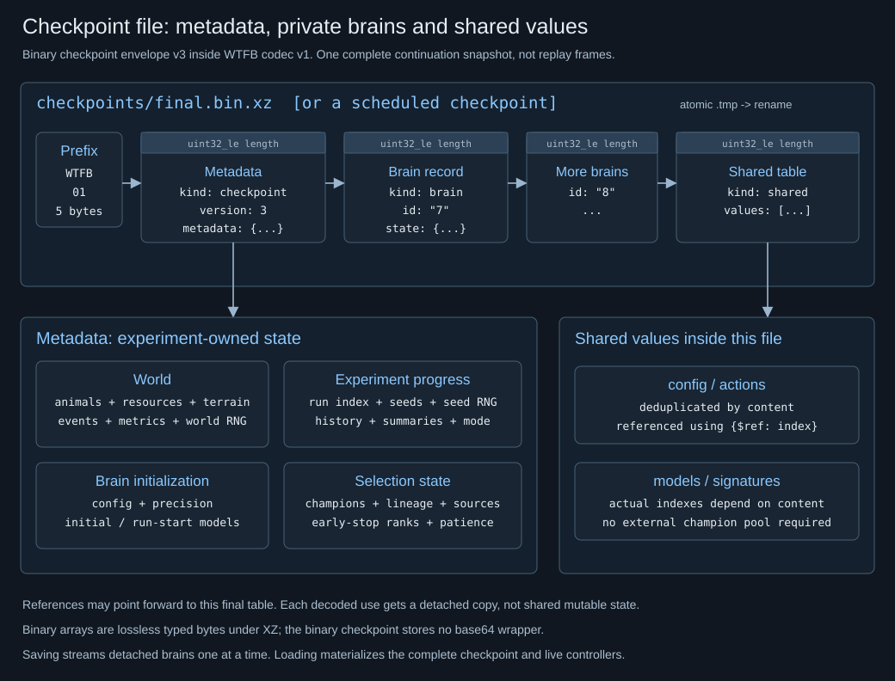
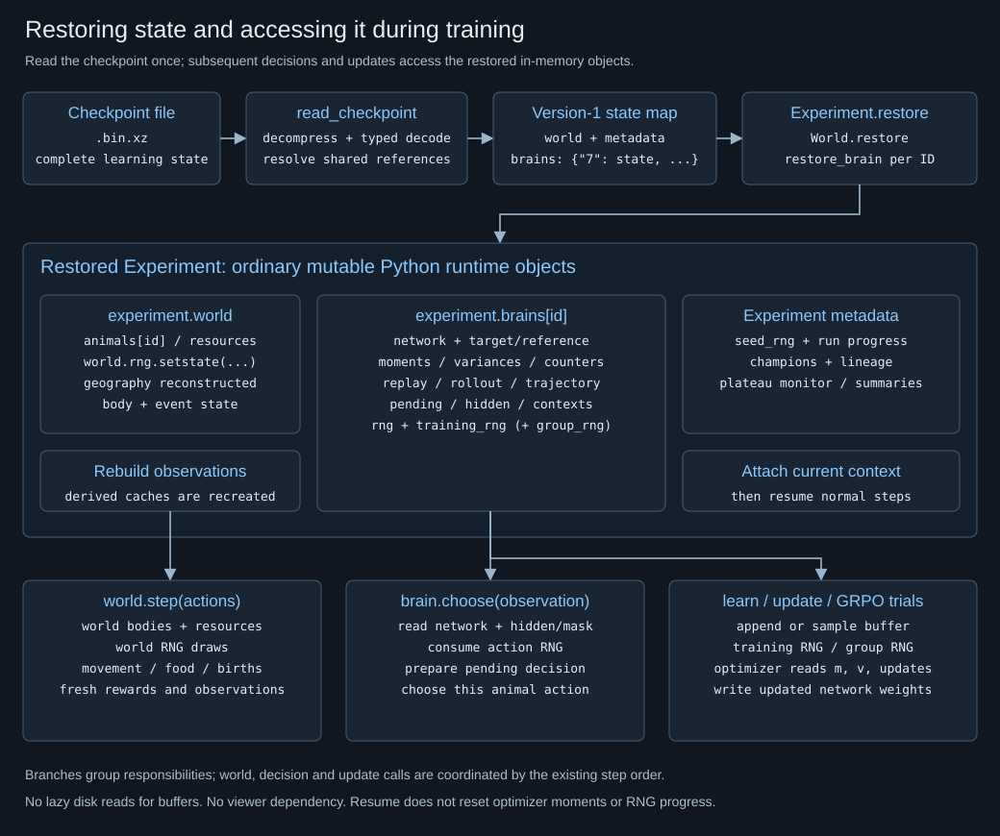

# Checkpoint storage, restoration and runtime access

[Artifact map](replay-data-structures.md) · [Binary layout](binary-storage.md) · [Exact resume](running.md#resume-an-exact-experiment) · [Champion weights](replay-data-structures.md#champion-weight-records)

A checkpoint stores the complete serialized experiment needed for continuation:
world state, private controllers, learning history and random-generator progress.
It is distinct from replay frames and champion warm-start weights. The diagrams
show ownership and access paths, using actual field names where applicable.

## File records and shared values



The default `checkpoints/final.bin.xz` decompresses to:

```text
WTFB + 0x01                              five-byte binary codec prefix
uint32_le length + {
  kind: "checkpoint", version: 3,
  metadata: <encoded experiment state without brains>
}
uint32_le length + {kind: "brain", id: "7", state: <encoded controller>}
uint32_le length + {kind: "brain", id: "8", state: <encoded controller>}
...                                      one record per saved controller
uint32_le length + {kind: "shared", values: [...]}
```

The final shared-value table ends the sequence; there is no replay-style footer.
Each length counts the following typed payload bytes. Envelope version **3**,
WTFB codec version **1** and the logical returned checkpoint version **1** name
different layers. The reader internally uses its compact decoder to resolve
references, then returns the ordinary version-1 experiment-state dictionary.

`config`, `actions`, `model`, `signature` and model-shaped snapshots can be
pooled by content. Their encoded occurrences become `{"$ref": index}` pointing
into the file's shared table, which can be written after the referencing record.
Indexes depend on traversal/content, not fixed field numbers. Resolving a reference
produces a detached copy, so disk deduplication does not share mutable runtime
brains. Reserved tag-like map keys are escaped by the codec when necessary.

These shared values are **inside the checkpoint**. Resuming does not load the
external champion model pool, even when the experiment originally warm-started
from it. Binary numeric arrays are lossless typed bytes; the older compact
JSON/gzip format uses base64 array wrappers. Both remain readable alongside
legacy plain JSON. See [binary layout details](binary-storage.md#structured-binary-layout).

The writer builds metadata and streams one detached controller at a time into a
compressed `.tmp` file, closes it and atomically renames it. It does not hold a
second detached copy of every brain simultaneously. The programmatic
`checkpoint()` method does construct a complete detached snapshot when requested.

## Experiment-owned metadata

| State group | Representative saved fields | Restored owner / purpose |
| --- | --- | --- |
| World | `world.config`, `seed`, `snapshot`, `rng_state`, `lifespans`, `next_animal_id` | `experiment.world`: bodies, resources, terrain, events, counters and world RNG |
| Run progress | `mode`, `run_index`, `finished_run`, `run_seeds`, `history`, `summaries` | Experiment scheduling and reporting |
| Seed generation | `randomization_seed`, `seed_rng_state` | Continues the randomized world-seed stream when configured |
| Initialization | `brain_precision`, `initial_models`, `initial_weights`, `run_initial_models` | Compatible later worlds and run chaining |
| Selection | `champions`, `champion_artifacts`, `lineage`, promotion/guard flags | Best-so-far records and lineage provenance |
| Update accounting | `retired_updates`, `inherited_updates` | Preserves experiment totals as controllers are retired or inherited |
| Early stopping | `early_stopping` ranks, counter and stop reason | Continues plateau monitoring rather than restarting patience |

World snapshots include positions, bodies, resources, geography-related state,
events and cumulative metrics. Mutable animal/resource objects and geographic
lookup objects are reconstructed. Derived observations and transient perception
caches are rebuilt; they are not restored as authoritative saved caches.

## Inside each controller


The outer `brains` map uses string animal IDs on disk. `Experiment.restore`
converts them back to integer keys in `experiment.brains`. The body is owned by
`experiment.world.animals[id]`; the controller and its private buffers are owned
by `experiment.brains[id]`. Species/sex metadata and selection pools do not merge
those individual controllers.

| Controller | Experience and additional state |
| --- | --- |
| Q network / DQN (`q_network`) | `weights`, `target`, `replay`, `cursor`, exploration `epsilon`; SGD has no Adam moments |
| QR-DQN | Online/target networks, `replay`, `cursor`, `epsilon`, Adam state and quantile network configuration |
| PPO / A2C | `network`, `moments`, `variances`, `rollout`, `pending` and update counters |
| REINFORCE | `trajectory`, `pending`, running `baseline`, network and Adam state |
| GRPO | Actor trajectory/pending state, `reference_network`, `group_rng_state`, `last_group_step`, baseline and Adam state |
| Recurrent PPO | PPO state plus `hidden`, saved sequence hidden inputs and recurrent pending data |
| Maskable PPO | PPO state plus current `mask`; rollout/pending inputs preserve decision mask information |
| MAPPO | Actor/critic parameters, PPO state and current/next centralized `context` |

All nine algorithms preserve their applicable learning state; the drawing groups
possible fields and does not imply every algorithm uses every block.

### Optimizer arrays and counters

For Adam controllers, `moments` and `variances` have the same layer/key/array
shape as the network parameters. They store first- and second-moment estimates.
`updates` is the optimizer step counter used for bias correction; restoring
weights without these arrays/counter would change the next update. The controller's
configuration also restores learning rate, clipping and other algorithm settings.
Numeric reconstruction respects the saved precision, including legacy FP64 state.

Temporary gradient arrays and a Python execution stack are not serialized.
Continuation resumes through the normal simulation/controller APIs from the
saved state, rather than halfway through an executing native kernel.

### Replay, rollout and pending records

Q/QR-DQN replay entries contain observation, action, reward, next observation,
`terminated` and `truncated`. `cursor` preserves the next ring-buffer replacement
position. A terminal transition may have no next observation; truncation is kept
separate for bootstrap semantics. Restoring keeps entries and their order.

PPO/A2C rollout entries additionally carry saved action log-probability, value
and next-value information. REINFORCE/GRPO use their actor trajectory records;
recurrent/masked/centralized variants preserve the inputs their update requires.
`pending` stores the latest decision information awaiting completion when
applicable. Restore rebuilds the correct tuple/record types rather than treating
all buffers as the same generic replay list.

### Random-generator state

RNG state is the generator's complete `getstate()` value, including its internal
state/index and optional cached Gaussian value—not just its original seed.
Deserialization converts list representations back to tuples for `setstate()`.

| Saved stream | Runtime consumer |
| --- | --- |
| World `rng_state` | `world.rng`: conflict resolution, feeding order and stochastic reproduction mechanics |
| Experiment `seed_rng_state` | Next world-seed generation under the randomized seed policy |
| Brain `rng_state` | Controller action sampling/exploration |
| Brain `training_rng_state` | Replay sampling or policy minibatch shuffling, as applicable |
| GRPO `group_rng_state` | Group-trial randomness, independent of the real world's stream |

Birth crossover and mutation use short-lived, deterministically derived streams
from the world seed and child ID. Their transient generators are not additional
long-lived RNG state missing from the checkpoint.

Restore may construct temporary initialized controllers, then overwrites their
serialized parameters, buffers, counters and RNG states. Saved streams are not
reset to those construction seeds. World restoration builds bodies directly
rather than drawing a fresh random layout.

## Restore path and runtime access



The CLI resume path is `Experiment.restore(read_checkpoint(path), ...)`:

1. Decompress and decode the file; validate record kinds/version, duplicate IDs
   and the shared-table structure. Resolve shared references into detached state.
2. Restore configuration, precision, progress, initialization models, champion/
   lineage state, experiment seed RNG and early-stopping state.
3. `World.restore` reconstructs bodies/resources/geography and restores world RNG.
4. Dispatch each applicable brain record through `restore_brain` to the correct
   controller class. Restore numeric arrays, buffer record types, optimizer
   state, counters, RNGs and algorithm-specific working state.
5. Recompute observations and attach current contexts, then resume the existing
   step order. These ownership arrows are not a new execution schedule.

Modern restore can account for saved dead controllers' update totals without
rebuilding their networks/buffers. Legacy controller-retention behavior remains
explicit. This is why a historical file can contain more brain records than the
modern restored live-controller map.

| Operation after restore | Objects accessed in memory |
| --- | --- |
| `brain.choose(observation)` | Online policy/Q network; action RNG; recurrent/masked state where applicable; pending decision fields |
| `world.step(actions)` | Bodies/resources/geography and world RNG; produces new rewards, events and observations |
| `brain.learn(experience)` | Appends/replaces experience, advances counters and triggers the algorithm's scheduled updates |
| Q replay update | Samples `replay` with `training_rng`, reads online/target parameters, applies SGD or QR-DQN's Adam update |
| Policy update | Reads rollout/trajectory samples, bootstraps as applicable, uses training RNG where needed, updates network and Adam arrays |
| GRPO trial/update path | Uses saved actor/reference models and group RNG; new isolated trial worlds are generated by normal trial logic |

Checkpoint loading materializes the **whole learning state** in RAM. Replay
buffers are not memory-mapped or fetched from the file per minibatch; normal
training does not keep reading the checkpoint. This differs from the viewer,
which loads bounded playback chunks and never restores optimizer state.

## Sources and verification

The structures follow [checkpoint I/O](../ecosystem/checkpoint_io.py),
[experiment restore](../ecosystem/runner.py), [world restore](../ecosystem/world.py),
[controller dispatch](../ecosystem/brains.py), [Q learning](../ecosystem/brain.py),
[PPO](../ecosystem/ppo.py), [policy gradients](../ecosystem/policy_gradients.py),
[Adam](../ecosystem/optimization.py) and the algorithm extensions.
The [storage asset catalog](assets/storage/README.md) records diagram provenance.

Record order, shared-value detachment, nonempty Q replay and PPO rollout, nonzero
Adam moments, RNG restoration and exact subsequent steps were checked with short
controlled fixtures. The existing all-algorithm binary continuation test also
covers all nine algorithms with XZ/gzip. These validate the explanations; no
experiment files were changed and no learning-quality claim is made.
