# Environment configuration and reproduction

[Project overview](../README.md) · [Runs](running.md) · [Algorithms](algorithms.md)

Commands in this guide run from the project root.

Each JSON file is a complete experiment definition:

| Preset | Prey | Predators | Prey / predator brain |
| --- | ---: | ---: | --- |
| [a2c.json](../environments/a2c.json) | 48 | 12 | a2c / a2c |
| [dqn.json](../environments/dqn.json) | 48 | 12 | q_network / q_network |
| [baseline.json](../environments/baseline.json) | 48 | 12 | q_network / q_network |
| [champion_lineage.json](../environments/champion_lineage.json) | 48 | 12 | q_network / q_network |
| [dense_obstacles.json](../environments/dense_obstacles.json) | 24 | 6 | q_network / q_network |
| [grpo.json](../environments/grpo.json) | 48 | 12 | q_network / grpo |
| [mixed_brains.json](../environments/mixed_brains.json) | 48 | 12 | q_network / ppo |
| [ppo.json](../environments/ppo.json) | 64 | 6 | ppo [16], k=3 / ppo [64, 32], k=10 |
| [ppo_large_predator.json](../environments/ppo_large_predator.json) | 48 | 12 | ppo [16] / ppo [64, 32] |
| [recurrent_ppo.json](../environments/recurrent_ppo.json) | 48 | 12 | recurrent_ppo / recurrent_ppo |
| [qrdqn.json](../environments/qrdqn.json) | 48 | 12 | qrdqn / qrdqn |
| [competition.json](../environments/competition.json) | 48 | 6 | maskable_ppo / maskable_ppo; optional contests enabled |
| [maskable_ppo.json](../environments/maskable_ppo.json) | 48 | 6 | maskable_ppo / maskable_ppo |
| [mappo.json](../environments/mappo.json) | 48 | 12 | mappo / mappo |
| [predator_heavy.json](../environments/predator_heavy.json) | 24 | 14 | q_network / q_network |
| [reinforce.json](../environments/reinforce.json) | 48 | 12 | reinforce / reinforce |
| [scarce_food.json](../environments/scarce_food.json) | 24 | 6 | q_network / q_network |

`champion_lineage.json` requires archived compatible Q models; the other presets start fresh unless you add `initial_brain`.

The common `maskable_ppo.json` contains the supported flat-world survival profile:
version-4 consent inputs, prey escape actions, predator/prey top-k 10/3, predator
radius 3 and 60 energy per kill. See [current calibration](calibration.md) for its
scope and unresolved tradeoffs. Other algorithm and terrain presets retain their
own contracts. Superseded exploratory JSONs stay local instead of expanding the
public preset list.

Copy a JSON file, edit its name and values, and pass its path to the Python CLI to add a scenario. The playback viewer shows the recorded configuration as read-only text.

All costs and growth rates are per simulation step. Playback speed changes only the rate of displaying saved frames. Configuration changes apply to the next CLI experiment; they cannot change an existing recording.

`wtf/config.py` validates required and unknown fields, numeric ranges, compatible diets and actions, referenced brain templates, replay settings, and world capacity. Invalid configurations are rejected before simulation begins. `environment.schema.json` provides an editor-friendly structural schema; Python validation also enforces cross-field constraints.

Use `obstacles.generation = "explicit"` with `explicit_cells = [[x, y], ...]` for hand-designed maps. In this mode `occupied_fraction` is ignored. Animals and resource patches may share cells; two animals cannot occupy one cell. Generation does not guarantee connected free space.


For all field definitions and allowed values, see the [complete reference](configuration-reference.md). For an end-to-end editing workflow and extension map, see [customization](customization.md).

## From configuration to experiment

The effective configuration is captured with results. Later edits affect a new invocation, not an existing replay or checkpoint.



## Geography and maps

Flat maps remain the default. Optional `river_crossing.json`, `highlands.json`
and `enclosed_valleys.json` environments select editable map files under `maps/`.
`river_crossing_ppo.json` uses the same river with PPO for both species.
For three-layer prey `[64, 32, 16]`, four-layer predators `[128, 96, 64, 32]`
and longer predator sight, use
[`river_crossing_strong_predator_deep.json`](../environments/river_crossing_strong_predator_deep.json).
The earlier `river_crossing_strong_predator.json` keeps prey `[16]` and predators
`[128, 64]`;
see the [river preset details](geography.md#river-crossing-with-stronger-predator-capacity).
Rivers require swimming, currents carry animals, and elevation adds climbing
costs and limits. Terrain-enabled brains use observation version 2 (32 features with default k=1;
both enhanced river presets use k=4 for 68 features).
See [geography](geography.md) for map syntax, locomotion settings and model
compatibility. These presets still contain one prey species and one predator.

## Adding species

The default `prey` and `predator` keys are species names, not a fixed list.
Add complete entries under new names to create additional prey or predator
species. The `diet` field determines feeding behavior, and mating/champion
selection remain species-specific. See [adding species](species.md) for a
copyable configuration recipe, optional colors and observation semantics.

## Environment-specific actions

Each species’ `allowed_actions` defines its brain outputs for that environment.
Dry presets omit `swim`; river and enclosed-valley presets include it. For example,
a dry prey can use `["move_forward", "turn_left", "turn_right", "rest", "eat", "reproduce"]`.
Use `attack` instead of `eat` for predators. Include `swim` for a species that
should cross water; omitting it can intentionally keep that species on land.
The action list stays fixed during a run. Changing its contents or order changes
the model signature, so start fresh or load matching saved weights.

## Common changes

| Change | JSON field |
| --- | --- |
| Starting populations | `species.<name>.initial_population` |
| Species colors | `species.<name>.display.color`, `.display.male_color` |
| Body health/energy | `species.<name>.body` |
| Perception radius | `species.<name>.body.vision_radius` |
| Visible targets per category | `brains.<template>.observation_top_k` (1–16, default 1; [input layout](observations.md)) |
| Sight extension across water | `species.<name>.body.water_vision_bonus` ([directional sight](geography.md#directional-sight-across-water)) |
| Food supply/regrowth | `resources` |
| Founder zones and boundary food | `placement` ([layout guide](geography.md#enclosed-valley-starting-layout)) |
| Terrain map | `terrain.map_file`, resolved into embedded rows and legend |
| Swim/climb abilities | `species.<name>.locomotion` and `allowed_actions` |
| Map size and duration | `world.width`, `world.height`, `world.max_steps` |
| Learning rate per species | `species.<name>.learning_rate_multiplier` (template rate × multiplier) |
| Model and training algorithm | `species.<name>.brain` and the referenced `brains` template |
| Predator survival + kill selection | `species.predator.champion_selection` ([scoring rule](brain-library.md#balance-predator-kills-and-survival)) |
| Family success and biological generations | `species.<name>.champion_selection.criterion: "lineage"`, optional `lineage_min_age_steps`, or `--champion SPECIES[:SEX]=lineage` ([scoring rule](brain-library.md#select-successful-biological-lineages)) |
| Stop after stagnant runs | `experiment.early_stopping.patience_runs`, optional `.species` ([guide](running.md#stop-on-performance-plateaus)) |
| Strict best-so-far champions | `experiment.promote_only_improved` (default `true`; exact rank ties retain the incumbent) |
| Cross-run inheritance | `experiment.chain_best_brains` (default `true`), or `--no-chain-brains` |
| Reject provisional lineage replacements | `experiment.guard_lineage_chaining` (default `true` for fresh experiments; [details](mating-observations.md#guard-provisional-lineage-winners)) |
| Initial learned weights | `species.<name>.initial_brain` ([guide](brain-library.md)) |
| Reproduction | `species.<name>.reproduction` |
| Rare newborn weight mutation | `species.<name>.mutation` ([guide](mutation.md)) |
| Randomization and repetitions | `experiment` ([guide](running.md#randomized-and-reproducible-runs)) |
| Disk recording cadence | `recording` ([guide](recording.md)) |

For per-experiment model choices without editing JSON, use the [CLI model selectors](brain-library.md#choose-models-with-cli-arguments). The resolved choices are saved with the new experiment.

Predator health in the supplied presets is 55 in the main scenarios and 44 in
the dense-obstacle, scarce-food and predator-heavy scenarios (a 10% increase).
Reproduction thresholds remain at 80% of maximum health. With starvation damage
of 1, the extra health provides roughly 5 or 4 additional starving steps,
respectively, assuming no other damage or recovery. This is a tuning choice;
actual survival also depends on energy use and hunting.

## Learning rates per species

All supplied presets use `learning_rate_multiplier: 1.0` for prey and `1.25`
for predators. Set this optional field inside each species object:

```json
"learning_rate_multiplier": 1.25
```

The effective rate is the referenced `brains` template's `learning_rate` times
this multiplier. For a template rate of `0.001`, prey use `0.001` and predators
use `0.00125`. Referencing a common template still creates independent models;
this setting does not modify the template or another species' rate. Set both to
`1.0` for equal rates; lower values reduce update size. Multipliers must be
between 0.01 and 10, and the effective rate must remain within the algorithm's
validated range (0.000001–1 for Q-learning, 0.000001–0.1 for policy algorithms).
Omitting the field defaults to 1.0, preserving old configurations.

This applies to every supported algorithm, including QR-DQN and the PPO variants. It changes update size,
not update frequency, rollout length, exploration or reward. REINFORCE still
updates only when an episode finishes; PPO/GRPO clipping and gradient clipping
still apply. Policy/value networks that share an optimizer both use the rate.
Larger updates do not guarantee faster or better learning and can destabilize it;
the asymmetry is an experimental choice rather than a biological rule. Compare
matched seeds and evaluation outcomes using the [analysis guide](analysis.md).

Newborns inherit their parent's effective rate. New runs, including champion
warm starts and chaining, apply the current environment's multiplier once.
Exact checkpoint resumes retain the stored controller configuration; editing an
environment does not retune an already saved checkpoint or recording.

## Current ordinary PPO preset

Current source `environments/ppo.json` uses ordinary, unmasked PPO on a 32×24
flat world with 64 prey and six predators. Prey have 40 health, escape actions,
version-4 consent inputs, top-k 3 and a `[16]` network. Predators use top-k 10
and a `[64, 32]` network, with attack damage 40, attack cost 0.25 and 80 energy
per kill. Predator breeding requires 30 energy and spends 10 per parent.
Both species use failed-action reward −0.01, offspring reward +3 and PPO entropy
coefficient 0.03. These settings support feeding and reproduction from fresh
brains without action masking.

Both keep five-step mating intent, rare birth mutation and lifespan champion
selection. Proximal mating radii remain prey 2 and predator 3. This is a starter
for finite-horizon survival and reproduction, with limited matched-seed checks;
it does not guarantee stable populations. See the
[calibration scope](calibration.md#ordinary-ppo-adaptation).

Templates are `brains.prey_ppo` and `brains.predator_ppo`. Their inputs/actions
are 69/9 and 153/6 respectively. Richer inputs and the deeper predator network increase per-animal compute/model
cost; fewer predators do not establish a total runtime or memory improvement.
Legacy stock 20-input PPO weights are incompatible;
start fresh or provide matching signatures. Existing exact resumes retain their
old configurations, and old playback remains unchanged.

The preset retains 1,500 steps per episode and five randomized episodes by
default. Recovery is periodic every 500 steps, retaining two files; periodic
best-brain checks run every 250 steps and retain two qualifying collections.
Run-end champion archives are still kept for every episode. Capture is full
detail for only the final two scheduled episodes (4–5 at the default run count).
The published 0.0.2.9 preset predates this update; these settings require current
source, including its new episode selector.

```sh
# 200-step episodes; record the actual final two training episodes.
.venv/bin/python -m wtf run ppo --runs 10 --steps 200 --progress
# Inspect all training episodes instead:
.venv/bin/python -m wtf run ppo --runs 3 --record-last-episodes -1 --progress
```

A 200-step horizon is shorter than prey maturity at 300 steps and cannot assess
prey reproduction. Use a longer horizon when evaluating multi-generation survival;
changing the recording window does not change learning or maturity gates.

## Larger predator PPO network

`environments/ppo_large_predator.json` remains the earlier flat-world preset:
12 predators, legacy nearest-target observations and `[16]` prey / `[64, 32]`
predator networks. It is no longer a capacity-only variant of the refreshed
`ppo.json`, which now has the same hidden-layer sizes but different observations,
actions, population and body settings. Do not compare the two as if only network
depth changed.

To isolate capacity, copy one complete current environment and change only
`brains.predator_ppo.network.hidden_layers`; use fresh or compatible starting
weights and matched seeds. Architecture/input/action changes affect model
signatures. More capacity costs model/optimizer memory and computation and does
not guarantee better hunting. [Matched evaluation](evaluation.md) describes
how to separate those effects.

The [advanced algorithms guide](advanced-algorithms.md) covers GRU memory,
quantile regression, immediate action masking and centralized critics. All four
new presets select lifespan champions for both species.

## Reproduction

For current recommendations, energy budgets and eligibility bottlenecks, see
[survival/reproduction calibration](calibration.md).

All supplied environments enable paired male/female reproduction for both species.
Edit `species.prey.reproduction` or `species.predator.reproduction` in your JSON:

```json
"reproduction": {
  "enabled": true,
  "health_threshold": 24,
  "min_age_steps": 300,
  "age_deviation_pct": 10,
  "cooldown_steps": 225,
  "cooldown_deviation_pct": 10,
  "min_energy": 30,
  "energy_cost": 10,
  "mate_radius": 2,
  "max_population": 96
}
```

Health must be **strictly greater** than `health_threshold` (absolute health,
not a percentage). Both parents must be alive after combat/starvation, the same
species and opposite sexes, and meet their own age, energy and cooldown gates.
Each must afford `energy_cost` with energy left over. They must be within
`mate_radius` Euclidean grid cells (integer 1–10, default 2), with an unobstructed
line of sight. Both must consent through `reproduce`; the default requires the
same step. Optional `intent_steps` preserves consent while resting (1–128, default
1). Proximity alone never triggers a birth. See [mating intent](mating-intent.md)
for persistence, cancellation and failure reasons. Include `reproduce` in each species’ `allowed_actions`.
There is no neural-weight similarity gate. See [learning feedback](rewards.md)
for configurable successful-birth rewards and failed-attempt penalties.

Pairs are selected with seeded contention. Each parent can participate in at most
one birth per step. A child needs a free cardinal neighbor of either parent and
cannot push population over `max_population`. Successful births charge the full
configured energy cost to **each** parent and start both cooldowns; failed pairing,
space or capacity checks charge neither and start no cooldown. Normal living
costs and the configured negative failed-action reward still apply. Newborns cannot mate in their birth step.
Reproduction spends energy, with no direct health deduction. Presets charge each
prey parent 10 energy (minimum breeding energy 30, leaving at least 20), and each
predator parent 15 (minimum 40, leaving at least 25) in most presets. The current
ordinary-PPO preset instead charges predators 10 (minimum 30, leaving at least 20).
These reserves are measured
immediately after reproduction; later living/action costs still apply. Edit `energy_cost` to tune the tradeoff.

There is no single-parent/asexual fallback. Cooldowns use simulation steps, not
playback time. Existing preset health and age settings are retained, with
reproduction timing with approximately 10% deviation:

| Species | First eligible age | Cooldown after an actual birth |
| --- | --- | --- |
| Prey | `300 ± 30` = 270–330 steps | `225 ± 23` = 202–248 steps |
| Predator | `100 ± 10` = 90–110 steps | `200 ± 20` = 180–220 steps |

Each animal draws one uniformly distributed integer from the inclusive first-age
window on its first reproduction check. After a successful birth it draws one
cooldown interval, measured from that actual birth age. Newborns have their own
first-age draw; they do not inherit their parent's clock. These are per-animal
age windows, not global simulation ticks, and timing is independent of the brain
algorithm. The example `min_age_steps` is the center of the first-age window,
so a nonzero deviation permits maturity before that center.

Timing is never redrawn just because a step passes or health, energy, capacity
or space prevents birth. Once the sampled age is reached, eligibility persists
until the birth succeeds, even beyond the window's upper edge; the health and
energy gates still apply. The window randomizes when eligibility begins, rather
than defining a short fertility period or a per-step birth probability.

Both deviation fields are optional percentages from 0 to 100, defaulting to
zero. `10` means ±10%; fractional percentages such as `2.5` are supported.
The step deviation is `floor(center * percentage / 100 + 0.5)` (half steps
round up). For example, a 225-step cooldown with 10% deviation rounds to ±23
steps. Editing the center automatically scales its window.
Zero restores the original fixed minimum-age and cooldown rules and consumes no
extra timing randomness. Windows extending below one step are clipped to one.
The world seed controls timing draws, and checkpoints retain pending clocks and
random-generator state for exact continuation. Editing a preset affects new
experiments; an exact resume uses its saved rules and clock.

Older saved configurations with `age_deviation_steps` or
`cooldown_deviation_steps` remain readable with their original absolute-step
semantics. New presets use percentages. Do not specify both units for the same
clock; validation rejects that ambiguity.

Founders are balanced between female and male (an odd population has one extra
female), shuffled with a separate seed derived from the configured seed. Sex
assignments remain stable across runs of that config. Fresh founder weights use
a distinct initialization seed per sex; animals of the same sex start from copies
of their template and all controllers train independently. Sex currently changes
mating eligibility and founder weight initialization, not body attributes or
observations. Saved champions and chaining are separate by species and sex:
females load female champions and males load male champions. Use `initial_brains`
for per-sex paths and `champion_selection_by_sex` for per-sex criteria, or CLI
selectors such as `--brain predator:male=kills`. See the
[saved-brain guide](brain-library.md#species-and-sex-selection) for legacy archives
without sex metadata and missing-group behavior. Controllers remain independent.

A child starts at age zero with `body.max_health` and `body.initial_energy`.
After both parents receive current-step feedback, uniform crossover selects each
policy/value matrix weight and bias independently from either parent with 50%
probability. This creates an independent child model, not shared parameter arrays.
The inherited generation is one plus the older parental generation. Its sex is
sampled with equal probability, independently of parameter crossover.

Optimizer moments, counters, baselines, replay/rollout buffers, pending decisions
and GRU memory start fresh after crossover; target/reference networks synchronize
to the mixed weights. Hyperparameters and exploration settings come from the
mother, with new child RNG streams. Masks and centralized contexts are derived
from the current world. The [rare mutation rule](mutation.md) then optionally
perturbs a few mixed matrix weights during training. Evaluation and random modes
still perform crossover but skip mutation and learning. Crossover can disrupt
learned features; it is an experimental inheritance rule.

Replay bodies expose `sex`, maternal `parent_id` and paternal `second_parent_id`.
Birth events use the mother as `actor`, the father as `mate` and child as `target`.
The viewer inspector and cyan birth banner show both parents. Children first act
on the next step and must reach their own maturity windows. GRPO trial children
also get independent mixed policies, with optional rare mutations, without
changing real controllers or physical RNG streams outside the trial.

Set `enabled` to false to disable births. Omitting `reproduction` also disables
it, keeping older environment files and checkpoints compatible. Changes affect
new experiments; resuming uses the saved configuration. Old replay files remain
viewable. Older checkpoints without sex fields receive deterministic ID-based
sexes, and their saved single-template founder weights migrate to both sex banks.
Resumed births use the new paired rules: old asexual numerical trajectories are
not preserved. New checkpoints resume exactly under the new implementation.
Reproduction can delay
extinction but does not guarantee a stable ecosystem: offspring still need food,
and parents with low health cannot reproduce.


## Reproduction gates

Failure at any gate prevents a birth. Only a successful pair pays birth energy and starts its cooldown.



## Rare newborn mutations

All supplied presets enable `species.<name>.mutation` with
`probability_per_birth: 0.0001`, `max_changed_weights: 3` and `noise_std: 0.005`.
This applies only to training births. A selected child receives small Gaussian
perturbations on 1–3 matrix weights, fresh optimizer state and synchronized
algorithm targets/references. The parent is unchanged. Omit the block or disable
it to retain ordinary inheritance. See the [mutation guide](mutation.md) for
configuration, probability semantics, lineage tracking and exact resume behavior.

## Relative walking and visible consent

[Escape actions and visible consent](escape-and-consent.md) describes relative
walking, version-4 inputs, signatures and physical constraints. Set populations,
mating radii and allowed actions in the environment JSON; consult the
[calibration guide](calibration.md) for current recommendations and their scope.

## Recording animal activations

`recording.record_activations` is an optional boolean, defaulting to `true`. It
adds each living animal's hidden-layer visualization arrays to existing diagnostic
samples. Recurrent PPO also records prior recurrent memory. Only these new arrays
are stored as FP32; simulation/learning precision is unchanged. Set the flag to
`false` to omit this field. The existing `diagnostics_every_steps` interval and
recording/chunk sampling rules determine capture frequency; zero diagnostics
disables it. See [recorded brain activity](explainability.md#recorded-animal-activations).

## Optional day–night cycle

See [day–night configuration and playback](day-night.md) for gradual sunlight,
species-specific night vision/energy modifiers and the maintained example.

## Optional same-species competition

[Competition](competition.md) adds the learned `challenge` action for shared
food and blocked paths. It is disabled by default; `competition.json` is the
explicit opt-in example. Adding the action changes saved-model compatibility.
