# Experimental CUDA training

[Performance](performance.md) · [Installation](installation.md) · [Running experiments](running.md)

CPU remains the default. The optional Linux/NVIDIA backend keeps animals' weights,
optimizer state, replay sampling and RNG ownership independent. The initial T4
prototype was slower than native CPU; the revised backend adds optional FP32,
cooperative dense kernels, smaller gradient storage complete PPO training
updates and optional device-resident DQN/DDQN optimizers. The preceding ABI-2
implementation was measured on a Colab Tesla T4; the ABI-3 DQN optimizer revision
requires a fresh NVIDIA build and benchmark. CPU-oracle tests are not GPU execution evidence.

## GPU and CPU responsibilities

| Learner | GPU training work | Work remaining on CPU |
| --- | --- | --- |
| PPO / masked PPO | Minibatch forward, clipped objective, entropy/value derivatives, backward, norm clipping, Adam and KL rejection | GAE/advantage normalization, private shuffle schedules, rollout collection |
| DQN / DDQN | TD targets, Huber loss, backward, reduction, clipping, Adam and scheduled target synchronization | Private replay/RNG sampling and publication of portable CPU snapshots; optional CPU optimizer comparison |
| A2C / REINFORCE / GRPO / MAPPO / TRPO / discrete SAC / QR-DQN | No training-update kernel yet; optional dense action evaluation | Existing learners and optimizers; GRPO trial worlds/evaluation |
| Recurrent PPO / LSTM PPO / legacy `q_network` | None | Entire learner |

`--cuda-inference auto` uses the existing CPU action-evaluation path for CUDA-trained
PPO, masked PPO, DQN and DDQN. It uses CUDA dense evaluation for the other supported
dense policies. This avoids launching small GPU inference calls every world step
when the useful GPU work is a training minibatch. `--cuda-inference cpu` forces CPU
actions; `--cuda-inference cuda` forces the supported CUDA action path and allows
comparison with the original prototype. Unsupported/custom controllers stay on CPU.
An entirely unsupported population rejects CUDA selection.

World physics, observations, reproduction, champion selection, recording and the
viewer keep their existing paths and formats. Learning schedules and batch sizes
are unchanged. Brains are never pooled into a shared species model.

## Training state and transfer boundaries

Ready ordinary/masked PPO updates are grouped by architecture, minibatch capacity
and objective/optimizer settings. Every animal retains its own epoch count,
shuffle RNG, samples, optimizer-step counter, KL stopping and metrics. Short final
batches and animals finishing early use inactive sample slots, not extra evidence.

For one group, parameters and private Adam moments/variances upload once. They
remain on-device across that group's epochs and minibatches. Each round transfers
only its observations, sample metadata, masks and small metric/acceptance summaries.
Updated parameters and optimizer buffers copy back once before champion selection,
child inheritance, diagnostics or checkpointing. Device state is not authoritative
across world steps: published CPU state remains the portable source of truth.
DQN/DDQN use the [resident optimizer path](#dqn-state-residency-and-publication) by default.
`--cuda-optimizer cpu` retains the gradient-download/CPU-Adam comparison path.

The new kernel stores activations and layer deltas per sample, then reduces their
products across the batch. It removes the former `animals × samples × parameters`
gradient tensor. Warps cooperate on each forward dot product, reading adjacent
weights. Reduction order can change floating-point rounding even in FP64.

Each workspace caches the exact uploaded FP32 weight bytes, including DQN targets.
Unchanged contents skip upload and native validation. Content comparisons detect
in-place writes and raw buffer edits; there is no reliance on a step counter alone.
Python staging arrays are reused, while model validity checks run in native code
on changed uploads. Group order/population changes still trigger uploads when bytes
differ. Cache/buffer ownership is per experiment; LRU eviction releases both staging
and device buffers. No cache is serialized.

## Where the CUDA path saves work



The improvement comes from changing work and transfers along the learning path:

| Boundary | Original work | Revised work and architectural benefit |
| --- | --- | --- |
| Action selection | Small GPU inference calls every world step | Auto mode keeps DQN/PPO actions on native CPU, avoiding those GPU launches/transfers |
| Host preparation | Rebuild staging arrays and scan each weight in Python | Reuse fixed buffers; bulk copies and native validation reduce Python work |
| Weight transfer | Upload online and target weights for each training batch | Exact-content caches upload changed buffers; unchanged targets/weights stay on GPU |
| Dense forward | Each output thread walks a weight row serially | Warp lanes cooperate on a dot product and read adjacent weight elements |
| Gradient storage | Materialize every sample's full parameter gradient, then reduce | Keep activations/deltas and reduce their products directly, avoiding the large gradient tensor |
| DQN optimizer | Download gradients, widen FP32 values through Python, then run CPU clipping/Adam | Keep reduced gradients on GPU; clip, update private Adam state and synchronize targets there, then bulk-publish CPU snapshots |

For `M` independent brains, `B` samples, `P` parameters and `A` total activations,
the removed gradient tensor scales as `M × B × P`. The revised training scratch
scales with `M × B × A`, plus one `M × P` reduced gradient. Fewer large intermediate
writes/reads and allocations reduce memory traffic; the separate
[buffer-accounting table](#analytical-device-buffer-footprint) quantifies allocations.

Caches compare actual buffer contents, not only an update counter, so raw in-place
weight edits are observed. Changing group membership/order can require uploads.
The diagrams describe implemented mechanisms, not a measured time allocation to
each optimization; component profiling is required for that attribution.

## DQN state residency and publication

`--cuda-optimizer cuda` is the default **when the CUDA backend is selected**;
ordinary CPU training remains unchanged. One grouped update owns separate online,
target, first-moment and second-moment slots for every animal. The CPU samples
private replay buffers using the same RNG and training cadence, without allocating
an unused CPU gradient tree. Groups include architecture, sample count, algorithm,
discount, Huber threshold, clipping limit and learning rate. Update counters and
target synchronization decisions remain per animal.

The GPU computes TD targets, gradients, clipping and Adam. Optimizer arithmetic
widens gradients to double even with FP32 forward/backward, preserving the previous
CPU optimizer's arithmetic/storage contract: moments, variances and weights round
to FP32 on storage. FP32 forward/backward remains an explicit numerical tradeoff;
CUDA math is not promised to be bit-identical to CPU or earlier CUDA revisions.

Before the grouped call returns, coherent FP32 weights/moments/variances and small
loss summaries download and publish to the existing CPU-owned brain objects.
Targets update on the GPU and the matching CPU snapshot at each animal's configured
interval. Selection, offspring, diagnostics, serialization and checkpoints need no
new device-aware readers. Gradients never download on this path.

Exact-content caches retain device weights, targets and optimizer state across calls
only while their bounded workspace survives. CPU edits, model replacement, changed
slot order and population changes cause changed buffers to upload again. Failed
native updates invalidate all four upload caches. Eviction releases device buffers,
host mirrors and staging together; restore starts with cold caches on CPU. This is
bounded device residency with eager CPU publication, not GPU-only checkpoint state.

`--cuda-optimizer cpu` retains the earlier gradient-download path. When the rebuilt
CPU extension exposes `widen_f32`, one native loop exactly widens the complete FP32
gradient/loss array into a reusable FP64 buffer. Layer unpacking then uses same-type
bulk copies. Without that optional helper, the earlier conversion remains supported.
PPO and other learners ignore the DQN optimizer-placement option.

### Host unpacking measurement

On local macOS ARM64 / CPython 3.12, 64 private networks with layout
`[20,64,64,32,10]` contain 7,914 parameters each. A warmed microbenchmark of gradient
conversion plus layer unpacking (nine samples, five calls per sample, median per
call) measured **15.295 ms before versus 0.455 ms after: 33.6× faster**. Gradient
bytes matched exactly. The isolated whole-array conversion measured 15.964 ms versus
0.061 ms. These are host-only measurements, excluding GPU transfers, Adam and world
work; they do not establish a new full-loop CUDA speedup.

The earlier T4 FP32 DQN profile measured GPU computation at 0.134 s but CPU
optimizer/unpacking at 7.972 s; DDQN measured 0.190 s versus 8.494 s. That motivates
this revision. New hardware performance and numerical comparisons remain pending.

## PPO state residency and publication



The original PPO CUDA path offloaded action evaluation while training stayed on
CPU. The revised path uploads each ready animal's weights and Adam state once,
then performs forward, loss, backward, clipping and Adam on GPU for its minibatches.
Only sample data and small metric/acceptance reports cross the boundary each round.
Weights and moments copy back once when the grouped update finishes.

Epochs, private shuffle RNGs, GAE and scheduling remain on CPU. A rejected animal
keeps its weights/moments and stops independently; the others continue. Published
CPU snapshots are coherent before champion selection, child inheritance,
diagnostics and checkpointing. GPU batching never merges animals' parameters or
changes their configured learning cadence. FP64 remains the default; optional
FP32 changes arithmetic, not this ownership structure.

## Build on Linux or Colab

Use a checkout of the CUDA branch containing `tests/` and `work/`, Python 3.12–3.13
for the native CPU baseline, and an NVIDIA GPU/driver plus
[CUDA toolkit](https://docs.nvidia.com/cuda/cuda-installation-guide-linux/).
Use the same GPU runtime for both CPU and CUDA benchmarks.

```sh
python -m pip install -e . setuptools wheel
python -m work.build_native
python -m wtf.native.cuda_build
WTF_TEST_CUDA=1 python -m unittest tests.test_cuda -v
```

**Rebuild after pulling this update:** the native CUDA ABI changes from 1 to 2.
An old `_cuda_dqn.so` fails clearly and must not be reused. NVCC/C++17 builds the
library without PyTorch, CuPy or NumPy. Imports never run a compiler. The default
architecture is `native`; use `--arch sm_75` for an explicit T4 target if necessary.
Portable wheels/sdists ship source, never device-local CUDA binaries.

For read-only installs, build with `--output /path/to/_cuda_dqn.so` and set
`WTF_CUDA_LIBRARY=/path/to/_cuda_dqn.so`. The published PyPI wheel may predate this
branch; use the matching checkout for these features.

## Arithmetic and inference controls

| Option | Meaning |
| --- | --- |
| `--device cpu` | Default CPU execution |
| `--device cuda` | Explicit experimental CUDA execution |
| `--cuda-precision fp64` | Default GPU arithmetic; FP32 stored parameters/Adam state |
| `--cuda-precision fp32` | Optional GPU arithmetic, activations and gradient buffers use FP32 |
| `--cuda-inference auto\|cpu\|cuda` | Choose CPU/native or CUDA action evaluation as described above |
| `--cuda-batch-agents N` | Maximum independent jobs grouped together; default 64, range 1–4096 |
| `--cuda-workspace-mb N` | Device workspace LRU budget in MiB; default 256, range 1–16384 |
| `--cuda-optimizer cpu/cuda` | DQN/DDQN optimizer placement; default cuda, cpu retains gradient download plus CPU Adam |
| `--cuda-profile` | Opt-in CUDA event and host packing/optimizer timings |

```sh
python -m wtf run ppo --runs 5 --seed 100 --progress --device cuda
python -m wtf run maskable_ppo --runs 5 --seed 100 --progress \
  --device cuda --cuda-precision fp32
```

FP32 affects GPU brain calculations only. It does not change world physics,
configuration values, replay dtypes, checkpoint formats or the default CPU path.
It can change actions, KL decisions, learned weights and subsequent trajectories;
reduced precision is a numerical tradeoff, not exact behavioral equivalence.
FP64 GPU sums and math also need not match CPU bit-for-bit.

The historical `dqn` preset uses legacy `q_network`, not dense DQN. The benchmark
constructs actual dense `dqn`/`ddqn` from the QR-DQN preset with its quantile option
removed. For custom JSON, see [policy definitions](additional-policies.md).

The device budget excludes driver/context and host memory. Host staging arrays and
exact-byte upload caches are bounded by live workspaces but consume additional RAM;
PPO rollouts and DQN replay also remain on the host. Profiled workspaces add two CUDA
events each. One model/minibatch exceeding the budget fails explicitly. Dense
layouts support 1–16 layers of widths 1–4096 and sample batches up to 4096.

Python callers use `experiment.set_training_device('cuda', precision='fp32',
inference='auto', optimizer='cuda', profile=False)`. Selecting CPU closes that experiment's cache.
Restore defaults to CPU; select CUDA and precision again after restoring. Backend
handles, profiling counters and execution choices are not checkpoint fields.
Evaluation remains CPU-only. Device errors abort visibly; resume a completed
checkpoint rather than retrying a partially advanced world as a transaction.

## Colab comparison

From the existing checkout, pull the branch and rebuild CPU and CUDA extensions before testing. Kernel ABI 3
rejects older shared libraries explicitly. Run the
hardware suite first. For the first timing pass, compare CPU and optimized FP64:

```sh
python -m work.benchmark_cuda --algorithms ppo dqn ddqn --devices cpu cuda \
  --steps 1000 --warmup 32 --hidden 64 64 32 --seed 100 --repeats 1 \
  --cuda-precision fp64 --output .cache/cuda-fp64.json
```

Then benchmark optional FP32 separately:

```sh
python -m work.benchmark_cuda --algorithms ppo dqn ddqn --devices cpu cuda \
  --steps 1000 --warmup 32 --hidden 64 64 32 --seed 100 --repeats 1 \
  --cuda-precision fp32 --output .cache/cuda-fp32.json
```

Each command runs six experiments sequentially: CPU/GPU for each learner. Both
species use the named learner; legacy controllers in mixed presets are replaced
with the named learner. Each subprocess receives the same fixed seed/configuration
within its pair. No recordings or checkpoints are written. Use `--repeats 3` for
multiple matched seeds after the first successful pass. Omit `--algorithms` to
exercise all eleven supported dense families; only PPO/masked PPO and DQN/DDQN have
training kernels. Use `--cuda-inference cuda` to isolate the forced-GPU action path.

Reports include complete loop/startup/warmup/steady time, actual seeds, step/update
counts, process peak RSS, native CPU backend, CUDA precision/inference strategy,
workspace bytes and kernel-job counts. Linux peak host RAM uses post-exec VmHWM
from `/proc/self/status` when available, avoiding inherited rusage peaks from a
large notebook parent. Timings include world work and transfers.
A speedup ratio is suppressed for unmatched counts, zero training updates, no CUDA
jobs, or a profiled run. Matching counts do not prove identical trajectories.

### Compare DQN optimizer placement

Use the same checkout to isolate placement from other code changes. The CPU
optimizer comparison already includes the new exact widening helper. Run each
precision separately, with profiling disabled for headline timings:

```sh
python -m work.benchmark_cuda --algorithms dqn ddqn --devices cpu cuda \
  --steps 1000 --warmup 32 --hidden 64 64 32 --seed 100 --repeats 3 \
  --cuda-precision fp64 --cuda-optimizer cpu --output .cache/dqn-host-adam.json
python -m work.benchmark_cuda --algorithms dqn ddqn --devices cpu cuda \
  --steps 1000 --warmup 32 --hidden 64 64 32 --seed 100 --repeats 3 \
  --cuda-precision fp64 --cuda-optimizer cuda --output .cache/dqn-device-adam.json
```

Repeat with `--cuda-precision fp32`, then use `--cuda-profile` in separate diagnostic
runs to distinguish host publication from GPU computation. Compare actual per-seed
steps/updates as well as timing and RAM. More state is resident on the GPU, and
publishing full optimizer snapshots can increase transfer volume; speed is to be
measured rather than inferred from fewer Python operations. Keep replay artifacts
and checkpoint contracts unchanged.

## Diagnose time and bytes

Run a separate diagnostic pass, not the headline timing comparison:

```sh
python -m work.benchmark_cuda --algorithms ppo dqn ddqn --devices cuda \
  --steps 1000 --warmup 32 --hidden 64 64 32 --seed 100 --repeats 1 \
  --cuda-precision fp32 --cuda-profile --output .cache/cuda-profile.json
```

The `accelerator` section reports:

- `packing_seconds`: host elapsed preparation/staging, including workspace allocation and PPO scheduling.
- `cpu_optimizer_seconds`: CPU gradient conversion/unpacking and Adam in comparison mode; CPU snapshot publication only in resident DQN mode. GPU Adam is included in `cuda_compute_seconds`.
- `dqn_optimizer`: selected DQN/DDQN optimizer placement, `cpu` or `cuda`.
- `cuda_upload_seconds`, `cuda_compute_seconds`, `cuda_download_seconds`: CUDA event
  elapsed intervals around each phase; upload intervals may include host cache
  checks/staging gaps between synchronous copies. They are not pure device busy time.
- `host_to_device_bytes`, `device_to_host_bytes`: actual requested copy bytes,
  including initial layout metadata; unchanged weights do not add transfer bytes.
- `weight_uploads`, `weight_cache_hits`: exact-content upload/cache decisions.
- `ppo_batches`, `ppo_model_updates`: grouped minibatch calls and completed private
  rollout updates; `records[].updates` is the actual optimizer-update count.

Event profiling introduces synchronization and overhead. Leave it off for speed
comparisons. Component counters do not account for every Python/CUDA runtime cost
and are not an additive replacement for full-loop timing. Process RSS is host memory;
workspace bytes exclude GPU context/driver overhead.

## Analytical device-buffer footprint

For 64 independent networks with layout `[20,64,64,32,10]` and 16 samples per
training batch, allocation formulas give the following DQN workspace sizes:

| Layout | Device buffer bytes | MiB | Reduction from original |
| --- | --- | --- | --- |
| Original FP64 gradient tensor | 77,449,792 | 73.862 | — |
| Revised FP64 activations/deltas | 11,569,728 | 11.034 | 85.06% |
| Revised optional FP32 | 7,814,976 | 7.453 | 89.91% |

These are exact buffer-accounting calculations, not measured peak GPU/RAM usage.
They exclude host staging/content caches, allocator overhead, CUDA context and
profiling events. They do not establish runtime improvements.

## Original prototype baseline

The user-reported single-pair Colab baseline used Python 3.13.16, a Tesla T4,
NVCC 13.0.88, seed 100, 1000 steps, hidden layers `[64,64,32]`, FP64 and forced CUDA
action evaluation. CPU native kernels were built in the same runtime.

| Learner | CPU loop | Original CUDA loop | Optimizer updates on each side |
| --- | --- | --- | --- |
| PPO | 32.721 s | 78.386 s | 14522 |
| DQN | 17.066 s | 35.288 s | 8144 |
| DDQN | 23.370 s | 38.820 s | 8714 |

Those numbers establish a slowdown for the original implementation and workload.
They are not results for the revised kernels. Revised NVIDIA correctness, RAM and
speed measurements are pending. Follow [NVIDIA's guidance](https://docs.nvidia.com/cuda/cuda-c-best-practices-guide/)
on transfer reduction and coalesced access, and retain CPU whenever complete
training is faster there.
