# Customization handbook

[Installation](../INSTALL.md) · [Field definitions](configuration-reference.md) · [Tutorial](tutorial.md) · [Contributor context](project-context.md)

Use this page to decide **what to edit**, then use the field reference for the
exact definition, allowed values, required status and schema default. Start
from a complete preset; partial snippets in other guides show individual fields,
not necessarily complete valid environments.

## A safe editing workflow

1. Choose the closest maintained preset under `environments/`.
2. Copy it under ignored `environments/local/`, give it a new `name`, and edit it.
3. Validate the full JSON with Python before training. JSON schema/editor hints
   help, but Python also checks relationships between settings.
4. Run a short seeded episode, inspect the saved configuration and replay, then
   run longer matched-seed evaluations for behavior claims.
5. Keep experimental JSONs local. Promote a supported configuration into a common
   maintained preset only with appropriate evidence and compatibility notes.

For example, from the checkout root:

```sh
mkdir -p environments/local
cp environments/maskable_ppo.json environments/local/my_world.json
# Edit name and settings in the copied file, then validate:
.venv/bin/python -c 'import sys; from wtf.config import load; load(sys.argv[1]); print("Configuration valid")' environments/local/my_world.json
.venv/bin/python -m wtf.cli environments/local/my_world.json --runs 1 --steps 200 --seed 100 --progress
```

A replay contains the configuration captured when training ran. Editing a preset
now does not change existing recordings or checkpoints. Start a new experiment
for changed settings; `--resume` restores saved configuration/state instead.



## What to change, and where

| Goal | Edit / entry point | Details |
| --- | --- | --- |
| World size, episode length, seed | `world`, `seed`, `experiment.world_seed_policy`; CLI `--steps`, `--seed`, `--seed-policy` | [World definitions](configuration-reference.md), [run seeds](running.md#randomized-and-reproducible-runs) |
| Food supply and regrowth | `resources` | [Configuration](configuration.md), [calibration](calibration.md) |
| Obstacles and enclosure placement | `obstacles`, `placement` | [Geography](geography.md), schema definitions |
| Rivers, currents, height, new map shape | `terrain` and its map JSON; `species.<name>.locomotion` | [Map editing and physics](geography.md), [physics cases](physics.md) |
| Add another animal species | Add a complete `species.<name>` entry with an existing diet | [Step-by-step species guide](species.md) |
| Health, energy, sight, walking/feeding/combat costs | Species `body` | [Field definitions](configuration-reference.md), [reward accounting](rewards.md) |
| Available action choices | Species `allowed_actions` | Action meanings below; [terrain actions](configuration.md#environment-specific-actions) |
| Reproduction, maturity, consent, population cap | Species `reproduction` | [Gates and consent](configuration.md#reproduction), [mating observations](mating-observations.md) |
| Rare newborn mutation | Species `mutation` | [Mutation](mutation.md) |
| Optional sunlight and night behavior | Root `day_night`, species `circadian` | [Day–night guide](day-night.md) |
| Per-species colors and male/female distinction | Species `display`; theme button affects interface appearance | [Viewer appearance](viewer-visual-reference.md), [species colors](species.md#viewer-colors-and-metrics) |
| Choose an existing algorithm or increase network depth | Species `brain` points to a named `brains` template | [Algorithm guide](algorithms.md), [advanced algorithms](advanced-algorithms.md) |
| Learning speed and optimizer cadence | Template learning rate, batch/rollout/update fields; species multiplier | [Field reference](configuration-reference.md), algorithm-specific guides |
| See more targets or add mating/terrain inputs | Template `observation_version`, `observation_top_k`; body sight | [Observation layouts](observations.md) |
| Add a new algorithm implementation | Python controller and explicit dispatch/schema registration | [New-policy integration](extending-policies.md) |
| Load champions or choose what counts as best | CLI `--brains-from`, `--brain`, `--champion`; species selection configuration | [Brain library](brain-library.md) |
| Chain multiple runs or stop on stagnation | `experiment`; CLI run/chaining/early-stop overrides | [Running](running.md) |
| Reduce replay disk usage or change diagnostics cadence | `recording` | [Recording controls](recording.md), [storage layouts](replay-data-structures.md) |
| Add another metric | World/event data → CLI/telemetry → analyzer/dashboard | [Architecture](architecture.md), [analysis](analysis.md), developer boundaries below |
| Change playback UI, charts, inspector or themes | `viewer/`; no simulation logic in browser | [Viewer definitions](viewer-visual-reference.md), [explainability](explainability.md) |
| Move execution into Docker or change ports/results path | Launcher/Compose; server `--host`, `--port`, `--results` | [Docker](docker.md), [installation](../INSTALL.md) |
| Change numeric kernels or precision | `numeric.py`, `kernels.py`, `_kernels*`; requires equivalence tests | [Native kernels](native-kernels.md), [performance](performance.md) |

There is no universal best health, learning rate or reproduction configuration.
Changing more than one parameter makes causes harder to isolate. Use
[calibration](calibration.md) for current supported recommendations, and retain
matched seeds and the original JSON when comparing alternatives.

## Terms used throughout the setup

| Term | Definition |
| --- | --- |
| Species | Exact configured identity, such as `deer`; used for mating, champion pools and per-species metrics |
| Diet | Existing ecological role: `resource` eats shared food, `prey` hunts resource-eaters; not a species name |
| Brain template | Named architecture/optimizer configuration; many independent animal brains can use it |
| Policy/model/brain | An animal's controller parameters and private learning state; archive weights contain less state than a checkpoint |
| Algorithm | Learning/update rule (`q_network`, `ppo`, `a2c`, `reinforce`, `grpo`, `recurrent_ppo`, `qrdqn`, `maskable_ppo`, `mappo`) |
| Network depth | Number of hidden processing stages; architecture is separate from algorithm |
| Observation version | Feature-layout contract; changing it can invalidate saved weights |
| Observation top-k | Maximum visible slots per food/prey/predator category; empty slots are zero-filled |
| Sight radius | Physical visibility distance, affected by optional water and sunlight; independent of top-k |
| Viewer rank threshold k | Whole-network display cutoff by hidden-stage count; unrelated to observation top-k |
| World step | One discrete simultaneous-action update; unrelated to replay frames per second |
| Episode/run | One world lifetime up to the step limit or extinction; an experiment may contain several runs |
| Biological generation | Parent/child depth inside an episode; distinct from experiment run number and archived model generation |
| Champion warm start | Copy compatible archived parameters into new controllers/worlds; fresh optimizer/experience state |
| Exact resume | Restore saved world, controller, optimizer, buffer and RNG state with the saved remaining schedule |
| Replay | Stored frames/events/diagnostics for offline viewing; does not resume training |
| Interface theme | Browser light/dark preference; simulated day/night independently affects board lighting and configured physics |

Observation widths are `20`, `32`, `42`, `45` for versions 1–4 at top-k 1;
add `12 × (k − 1)` for additional target slots. Adding another species does not
add another category or species-ID input. Inspect [observation definitions](observations.md)
for ordering and normalization.

## Action definitions

| Action | Meaning |
| --- | --- |
| `move_forward` | Attempt one cell in the animal's current heading |
| `move_backward` | Attempt one cell opposite its heading without turning |
| `strafe_left`, `strafe_right` | Attempt a lateral cell without turning |
| `turn_left`, `turn_right` | Change heading by 90 degrees; do not move |
| `rest` | Remain in place; ordinary living cost still applies; may retain configured mating intent |
| `eat` | Resource-eater attempts to consume food at its cell/front under existing feeding rules |
| `attack` | Predator attempts to damage a resource-eating target in front |
| `swim` | Attempt active forward water movement/entry when terrain and physical eligibility permit; normal walking cannot enter water |
| `challenge` | Optional same-species contest ahead for shared food or blocked space; see [competition](competition.md) |
| `reproduce` | Express consent; birth still requires an eligible nearby same-species opposite-sex partner, consent, route and space |

An available action is a choice, not guaranteed success. Movement conflicts,
changing targets, insufficient physical eligibility or absent mates can make an
attempt fail. Masked policies remove immediately invalid choices using the
pre-step state; simultaneous resolution can still change outcomes. Physical
costs and failed-action rewards follow the [generic feedback contract](rewards.md).
New action **names** require code changes across actions, physics, masks,
signatures, diagnostics and tests; adding a string to JSON is insufficient.

## Compatibility when changing settings

| Change | Consequence |
| --- | --- |
| Populations, food, costs, health, sunlight, rewards | Usually preserves tensor shape, but changes the learning task and may alter eligibility/trajectory |
| Hidden widths, input version/top-k, action names/order, recurrent/quantile/critic dimensions | Changes model signatures; start fresh or use a genuinely matching archive |
| Rename/add a species | Creates distinct species/sex archive groups; do not relabel another species' saved metadata to force a match |
| Change algorithm | Requires matching algorithm signature; PPO and masked PPO archives are not interchangeable |
| Reduce diagnostic/recording cadence | Reduces saved detail; the viewer cannot reconstruct omitted activations/events |
| Change package/runtime/backend | Loading and exact future trajectory are different guarantees; see [compatibility](compatibility.md) |

CLI overrides such as `--runs`, `--steps`, `--seed`, `--mode`, `--brain`,
`--champion`, `--chain-brains` and `--early-stop-runs` belong to execution, not
arbitrary new JSON fields. The complete current flag list is available without
training via `.venv/bin/python -m wtf.cli --help`; viewing uses
`.venv/bin/python -m wtf.server --help`.

## Developer extension boundaries

Existing species, algorithms, architecture sizes and supported map symbols are
configuration choices. A new ecological diet/food-web rule, action, observation
layout, algorithm or file encoding is a source-code extension. Follow this chain:

1. Define the public configuration and validation in `wtf/config.py` and
   `environment.schema.json`. Every schema field needs a definition.
2. Implement physics in `world.py`/`geography.py`, learning in controller modules,
   orchestration in `runner.py`; do not put training into viewer code.
3. Preserve model signatures, independent RNGs/weights, inheritance and exact
   checkpoint restoration. Explicitly version changed input/artifact contracts.
4. Extend events/metrics, recording codecs, Python/JS readers, telemetry, analysis
   and inspector/dashboard only where the new data requires it. Store static
   data once, and keep replay chunks independently decodable.
5. Validate legacy/default parity where promised, source extension behavior,
   checkpoint continuation, new births and viewer seeking. Run the relevant
   [tests and all formatters](development.md), regenerate the field reference and
   document an actual implementation rollout.

For policy-specific hooks see [adding policy models](extending-policies.md).
For complete custom-map/action-list examples and new physics/action integration,
see [world and action extensions](extending-worlds-and-actions.md).
Existing [architecture diagrams](architecture.md) show these boundaries; no
experiment logs belong in these guides.

## Keeping definitions complete

Field meanings live in `description` entries of
[`environment.schema.json`](../environment.schema.json), alongside types, ranges,
enums and defaults. The [generated reference](configuration-reference.md) exposes
all of them, including per-algorithm alternatives and map symbols. Regenerate with:

```sh
.venv/bin/python -m work.build_config_reference
.venv/bin/python -m work.build_config_reference --check
```

The checker fails for a missing field definition or stale document. Python's
validator remains authoritative for relational rules; update both schema and
validator when adding settings. Associate the schema with environment JSONs in
your editor for inline definitions; do not insert unknown configuration fields
solely to configure editor behavior.

## If a change appears to do nothing

| Symptom | Check |
| --- | --- |
| Preset edits do not change a replay | Existing recordings retain their original JSON; start a new experiment |
| Preset edits do not change a resumed experiment | Exact resume restores saved configuration; use a fresh run for new settings |
| A new template name is rejected | `brain` must refer to a key under `brains`; a new algorithm `type` still needs source integration |
| New species cannot load old weights | Species/sex identity and model signatures must match; start the new identity fresh |
| Reproduction is not happening | Check physical eligibility, consent/intent, mate route, nearby opposite sex and birth space; inspect failed reasons |
| Night settings have no effect | Root `day_night.enabled` must be true; `circadian` alone does not turn on a cycle |
| More top-k does not reveal distant animals | Top-k limits slots, while sight/rays determine visibility first |
| Changing viewer rank k does not change learning | That control changes display detail only |
| A theme changes panels but a paused board stays old | Refresh updated JS once; current handlers redraw the canvas without stepping |
| A new field works in an editor but training rejects it | Python's strict validator also needs support; schema descriptions alone do not implement behavior |

For every simulator/server/analyzer flag, see the [command reference](command-reference.md).
