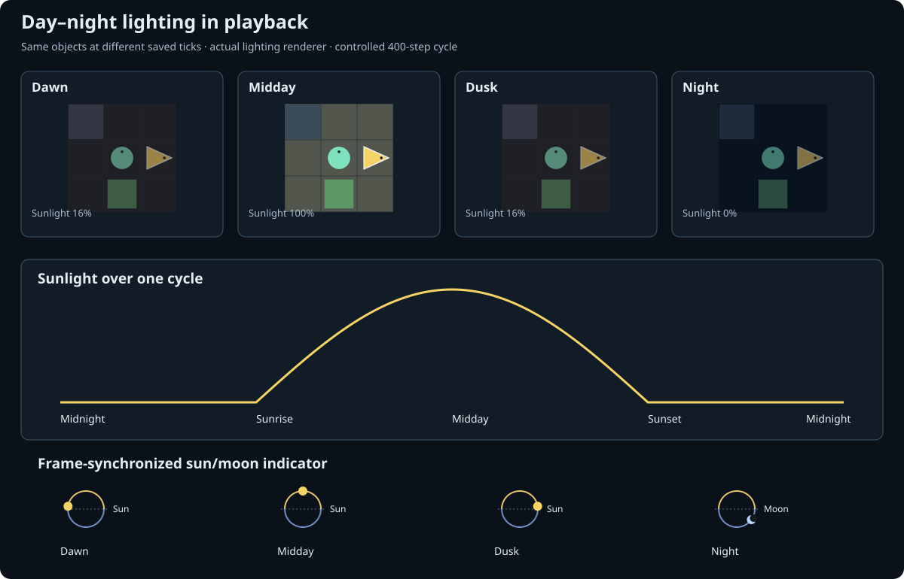
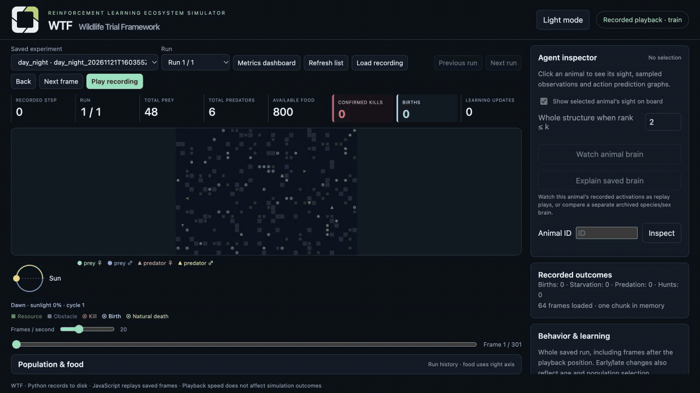

# Day–night cycles

[Configuration](configuration.md) · [Playback](recording.md) · [Appearance reference](viewer-visual-reference.md)

Optional sunlight changes an animal's sight and energy costs through a repeating
world-time cycle. It is a configurable environmental mechanism, not a claim that
all predators or prey have the same biological activity pattern.



## Configure the cycle

Use `environments/day_night.json` as a complete masked-PPO example:

```sh
.venv/bin/python -m ecosystem.cli environments/day_night.json \
  --runs 1 --seed 100 --progress
```

The feature is **opt-in per environment**. Omit `day_night`, or set its
`enabled` flag to `false`, to keep static daylight and base body values. Other
maintained presets are not automatically opted in.

Add this optional top-level object to another environment:

```json
"day_night": {"enabled": true, "cycle_steps": 400, "start_phase": 0.25}
```

Phase zero is midnight, 0.25 sunrise, 0.5 midday and 0.75 sunset. Phase advances
by `1 / cycle_steps` per simulation step, independently of playback speed.
Sunlight is zero overnight and follows a half cosine over daylight: it rises
smoothly from zero after sunrise, reaches one at midday, and returns to zero at
sunset. The viewer labels the low-light daylight intervals dawn/dusk. The default
start phase is sunrise; `cycle_steps` is an integer from 4 to 10,000,000.

## Species effects

Each species may define optional multipliers, independently of diet or sex:

```json
"circadian": {
  "night_vision_radius_multiplier": 0.5,
  "night_living_cost_multiplier": 0.8,
  "night_movement_cost_multiplier": 1.1
}
```

At night these scale the base body values; at midday the original body values
apply. Intermediate values use `night + (1 - night) * sunlight`. Omitted
multipliers equal one. Multipliers range from 0.05 to 4. Vision is rounded to the
nearest grid radius, halves upward, and clamped to 1–256; costs remain continuous.
The same effective vision applies to target observations and visible mates.
Water sight bonuses remain additive after this radius change. Mating distance,
health limits, attack damage, swimming surcharges and resource growth retain
their configured rules. Energy-cost feedback uses actual charged costs.

The example reduces prey night vision more than predator night vision; edit the
multipliers to model different activity patterns. Lower living cost represents
lower background energy demand, not forced sleeping or a disabled policy.
Animals still choose their normal actions. Observation-vector sizes are unchanged:
there is no explicit clock/light input, so learning receives the changed local
observations and feedback rather than a new time feature. Existing weights can
initialize these worlds, but suitability requires evaluation under the cycle.

## Playback and storage



This 3.5-second full-viewer preview samples the maintained day–night preset
at 20-step intervals. It compresses world time to show the sunlight cycle and
time dial together. [Clip sources and refresh workflow](assets/terrains/README.md#refresh-the-clips)
are documented separately; it is a UI demonstration rather than a learning evaluation.


The ground brightens gradually toward midday, before animal/resource glyphs
are drawn. The board darkens gradually with a warm dawn/dusk tint, and stays legible at
night. Event highlights and surrounding controls remain readable. A status label
shows phase, sunlight percentage and cycle number. A sun/moon marker orbits
a compact dial beside it: the gold upper arc represents daylight and the blue
lower arc night. The sun crosses the upper arc from dawn through midday to dusk;
the moon follows the lower arc overnight. Its position changes only with saved
frames, freezes on pause and follows backward seeking. No separate animation
timer runs, and the entire indicator is hidden for disabled/absent cycles. The Agent inspector reports
current effective sight/living/movement costs; its board overlay uses current
light, while its sampled observation radar uses the diagnostic sample's time.
Seeking backward, changing runs and changing playback speed use the saved tick;
there is no independent wall-clock animation.

Only the configuration is stored, once. Sunlight and effective body values are
derived from tick, so replay frame payloads gain no per-animal or per-step fields.
Checkpoints likewise derive the cycle after restore without consuming RNG draws.
Effective body dictionaries are shared read-only within one species/tick and
refreshed at the next tick. Flat worlds can supply these exact values through a
lazy species view to the existing native metabolism kernel. Terrain/unsupported
cases retain the Python reference path. Playback shares sunlight/body values
within a draw; see [ownership and validation](performance.md#daynight-rendering-and-metabolism).
No measured throughput improvement is claimed.

Without an enabled cycle, physics and lighting retain their previous behavior.
Older recordings continue to display normally. Refresh the viewer after updating;
new cycle-enabled recordings require the updated viewer for correct lighting
and sight overlays.

## Interface theme

The header **Light mode / Dark mode** button changes the entire viewer
appearance independently of world time. It remembers the choice in browser
storage; unavailable storage limits the preference to the current page. Switching
the interface theme leaves the saved recording, animal behavior and playhead
unchanged. The grid redraws immediately even while playback is paused; loading
a recording again or advancing a frame is unnecessary. Light mode also changes the grid, ground, obstacles and terrain palette.
Animals keep their species/sex colors, with contrast outlines for the light
ground. Daylight illumination and night shading apply on top of either palette,
so simulated night remains visibly darker even with the light interface.
