# Development and verification

[Project overview](../README.md) · [Architecture](architecture.md) · [Performance](performance.md)

Commands in this guide run from the project root using Python 3.12+. Create the
development environment with `python3.12 -m venv .venv` and install
`requirements.txt` there. To upgrade an existing environment, stop its processes
when convenient, rename it to `.venv-py39-backup` (or another ignored backup),
then recreate **at `.venv`** and reinstall dependencies and formatter/build tools.
Do not move a newly built venv into place: console-script shebangs embed its
creation path. Rebuild optional native kernels with the new interpreter. Restore
the backup to its original path if rolling back, together with compatible source.

For a new coding session, start with [AGENTS.md](../AGENTS.md) and the maintained
[project context](project-context.md). Repo-local workflows live under
[`.agents/skills/`](../.agents/skills/); their entrypoints are linked in AGENTS.md.
Read the matching skill for saved-run analysis, optimization or release work.
These files are tracked so future sessions can recover project decisions without
relying on chat history. They add no runtime dependencies.

```sh
.venv/bin/python -m unittest discover -v
# Optional JS playback-engine checks (requires Node.js 20+):
node --test tests/*.test.mjs
```

Tests cover strict configuration validation, resource limits, blocked and contested movement, feeding rewards, simultaneous hunts, starvation, occlusion, independent weights, positive-feedback learning, terminal versus truncated experience, evaluation behavior, deterministic and randomized runs, exact JSON checkpoint continuation including future random seeds and mixed PPO/Q models, PPO finite-difference gradient checks and terminal/truncated rollouts, resets, streamed recording correctness, recording transparency, committed-chunk visibility, bounded playback chunk loading, seeking, and read-only HTTP endpoints.


## Mandatory formatting

Every code-changing development update ends with repository-wide source
formatting, followed by formatter check modes and the checks relevant to the
change. This is required for developer agents by [AGENTS.md](../AGENTS.md#mandatory-formatting-after-development-updates).
Format all maintained source files, including new non-ignored files, rather than
only the files changed in that update.

| Source | Formatter | Verification |
| --- | --- | --- |
| Python in `ecosystem/`, `tests/`, `work/` | Black | `black --check` on the same source set |
| C/C++ and CPython extension source/headers | clang-format | `clang-format --dry-run --Werror` on the same source set |
| JavaScript, CSS, HTML and maintained JSON | Prettier | `prettier --check` on the same source set |
| Shell scripts | shfmt | `shfmt -i 2 -d` on the same source set |

Use the repository's existing formatter settings, with dependencies isolated in
`.venv` or the project's local development-tool environment. Python formatter
invocations should use `.venv/bin/python -m black` once installed there. Do not
silently fetch or run an unpinned tool through a package-runner command. If a
required tool is unavailable or fails, resolve the dependency within authorized
scope or report which formatter prevented completion.

The repository keeps native indentation in [`.clang-format`](../.clang-format)
and JavaScript quote style in [`.prettierrc.json`](../.prettierrc.json). Shell
formatting uses two-space indentation (`shfmt -i 2`) and the script's own dialect.
The 0.0.1.14 formatting pass used Black 24.10.0, clang-format 22.1.5,
Prettier 3.3.3 and shfmt v3.11.0 (`shfmt-py` 3.11.0.2). Local tool setup:

```sh
.venv/bin/python -m pip install black==24.10.0 shfmt-py==3.11.0.2
npm install --prefix .cache/formatters --cache .cache/npm --no-audit --no-fund --save-exact prettier@3.3.3
```

Black and shfmt run from `.venv`; Prettier runs from
`.cache/formatters/node_modules/.bin/prettier`. The native formatter uses the
installed `clang-format` executable. These development tools and their caches
are isolated from runtime dependencies and remain ignored by Git.

Build the file set from Git-tracked files plus new non-ignored source files.
Exclude `.venv`, `node_modules`, results, brain libraries/checkpoints, native build
outputs, caches, generated documentation assets and media. Format native headers
as well as implementation files, and preserve shell dialects. Formatting source
strings must preserve behavior; generated SVG/HTML exports are regenerated with
their own tools only when their source or output actually changes.

Run relevant tests after formatting. If a fix changes code again, repeat the
format/check cycle. Summarize formatter results in the final handoff, including
any unavailable tools. Documentation-only updates require link/asset checks;
they do not trigger an unrelated source-wide reformat or training run.

## Documentation visuals

Apply the [selective visual guidance](visual-guide.md#when-a-visual-helps): diagrams
should reveal useful structure or relationships. A clear table, short paragraph
or command often needs no figure. Prefer existing visual cross-links and verify
new structural examples against the implementation.

## Choose checks for the change

Use the focused checks described below. Documentation/media work does not require a new ecology training experiment.



## Local server

The server binds only to `127.0.0.1`. Use `--port 8001` if the default port is occupied. Close the terminal process or press Ctrl-C to stop it.

## Working conventions

Keep Python packages inside `.venv`. Simulation changes should be checked with
seeded runs and exact checkpoint continuation where relevant. Performance tests
compare observations and numerical operations against reference implementations;
timing thresholds are kept out of unit tests.

Generated `results/`, `brain_library/`, `.cache/`, bytecode and `.venv/` are
ignored. Benchmark output and local reference snapshots under `work/performance/`
are ignored; runnable benchmark scripts are retained. Champion publication is
disabled in CLI unit-test subprocesses with `--no-library`, while dedicated
library tests use temporary directories.

Tests also cover model compatibility, independent warm-started agents, ancestry,
pre-death model capture, missing-library checkpoint restores, analyzer coverage,
energy budgets and inherited learning-counter baselines.

## Release records

Keep [the rollout hub](releases/README.md) and its versioned child documents
current when preparing implementation changes. Use the [release template](releases/TEMPLATE.md),
record actual commit hashes only after they exist, and distinguish Pending work
from Committed history. Include behavior, compatibility/migration, validation
results and rollback considerations. Documentation-only hash reconciliation stays
attached to the rollout it records. Do not change the Python package version or
create Git tags merely to update this documentation index.

## Advanced algorithm checks

`tests/test_advanced_algorithms.py` checks GRU gradients through two timesteps,
quantile Huber and masked-policy derivatives, actor/critic information separation,
current/next critic contexts, terminal/truncated bootstrap, newborn memory,
mask preservation, bounded replay, mixed policies, GRPO trial isolation,
recording transparency, frozen evaluation weights, exact JSON/compact resume,
and CLI progress/archive/warm-start workflows. See the
[advanced algorithms guide](advanced-algorithms.md) for the experiment semantics.

Reproduction-window tests additionally cover inclusive bounds, per-animal spread,
positive-step clipping, one draw per clock, all delayed-birth gates, cooldowns
measured from actual births, legacy zero-deviation RNG behavior and pending-clock
preservation across JSON/compact checkpoints and delta replays.

`tests/test_advanced_efficiency.py` guards against duplicate GRU head passes,
unused bootstrap/target outputs, repeated QR-DQN diagnostic inference, duplicate
MAPPO contexts, critic inference during greedy MAPPO execution, discarded default
networks and per-agent trial occupancy/controller copies. These checks count
operations and validate numerical results, without timing thresholds or profiling.

`tests/test_binary_storage.py` verifies typed-column Python/JavaScript parity,
signed zero and large seeds, corruption rejection, playback seeking, binary
checkpoint continuation for all algorithms, recording transparency, atomic
verified conversion, legacy HTTP fallback and bounded/invalidation-safe telemetry
caching. [Binary storage](binary-storage.md) documents formats and migration.

`tests/test_simulation_caches.py` verifies the bounded per-world visibility LRU,
obstacle/implementation invalidation, checkpoint exclusion, current target
selection, reproduction timing flag reuse, one-pass populations and final-only
champion model copies against the former ranking path. Cache checks use call
counts and exact state comparisons rather than wall-clock thresholds.

`tests/test_mutation.py` covers sparse matrix-only changes for all algorithms,
parent/RNG independence, zero/disabled behavior, optimizer/target/reference
resets, update accounting, lineage inheritance, frozen evaluation, GRPO trial
isolation, readable mutation metrics, champion provenance and exact JSON/binary
resume. Forced events also pass the JavaScript binary replay decoder.

`tests/test_paired_reproduction.py` covers sex-specific founder templates,
independent uniform crossover and fresh child training state for all nine
algorithms, both-parent lineage through JSON/binary checkpoints, pair population
caps, single-survivor infertility, legacy migration and dual-parent energy
accounting. Reproduction/window fixtures now require eligible pairs; JavaScript
birth-marker checks retain both parents across chunk transitions.

`tests/test_sex_champions.py` covers four independent champion groups, sex-specific
archive paths/ancestry, all-nine-algorithm warm starts and chaining, broad/narrow
CLI precedence, fresh/missing-sex behavior, incompatible sex rejection, shared
library filtering, version-1 migration and source-independent checkpoint resume.

`tests/test_multiple_species.py` checks arbitrary species names with two prey
and two predator species, independent controllers, all-algorithm checkpoint
resume, diet-based perception/masks/combat, same-species pairing, eight champion
groups, generic CLI/CSV output and binary replay/telemetry/analysis. Tests use
local fixtures; shipped presets keep exactly one species per role.
`tests/species-style.test.mjs` checks generated and explicitly configured colors
without fixed-name or fixed-palette assumptions.

`tests/test_geography.py` covers swim/health/energy/depth gates, fractional and
negative river vectors, intermediate-cell collision/corner handling, slope costs,
drowning attribution, terrain mating isolation, all-nine-algorithm 32-input
training and exact JSON/binary resume, mutations, GRPO static-map isolation,
embedded map restoration, CSV/CLI output and Python/JS binary replay parity.
`tests/terrain.test.mjs` covers static map rendering, metadata across seeks/runs,
new dashboard fields and final death/kill positions after drift.

## Terrain calibration experiments

[Calibration](calibration.md) documents optional, explicitly requested training
comparisons. `python -m work.calibrate_terrain` uses tqdm and writes only scalar
results/configurations under ignored results. It is an experiment utility, not
a default verification step. Its defaults run 45 short episodes; select fewer
seeds/maps/variants when a small smoke check is sufficient.


## Optional native kernels

Build with `.venv/bin/python -m work.build_native` on a supported interpreter.
`tests/test_native_kernels.py` checks strict dense/output-range/backprop agreement,
all-nine-algorithm checkpoint/backend switching, nonzero Adam momentum/clipping,
legacy fallback, malformed buffers/dimensions and missing-extension behavior.
Run the full suite with both `WTF_KERNELS=native` and `WTF_KERNELS=python` after
changes. Native-specific checks skip when no supported extension is built. See
[CPU kernels](native-kernels.md) for build requirements and reproducible benchmarks.


The second rollout adds `tests/test_native_extensions.py` for exact fused PPO,
GRU, quantile, group, codec and lifecycle behavior, malformed inputs and API-version
fallback. See [the v2 report](native-kernels-v2.md) for native-to-native benchmark
commands, replay-byte checks and the saved 1,500-step comparison. The data-path
probe is `work/performance/benchmark_data_kernels.py`.

`tests/test_champion_promotion.py` covers strict and tied records, independent
species/sex pools, warm-start baselines, opt-out/legacy resume, source removal,
all-algorithm binary checkpoint continuation, unchanged archive identities,
weight deduplication, signed zero/legacy FP64 and invalid/corrupt references.
Legacy per-episode ancestry tests explicitly opt out of strict retention.

`tests/test_early_stopping.py` covers patience boundaries, rank ties/regressions,
any-group resets, species and sex-specific criteria, warm-start baselines,
disabled/non-training modes, validation, exact binary continuation for all nine
algorithms, unchanged choices before stopping, CLI final artifacts, periodic and
completed-stop resume, and rejection of CLI resume overrides.

`tests/inspector-stats.test.mjs` verifies input offsets for observation versions
1/2/3 and k=1/4/16, presence padding, signed Q/probability scales, masks,
seek-safe bounded score-only histories and static sight-cache invalidation.
It compares overlay visibility against Python World rays on 48 cases spanning
eight presets and both diets. `tests/inspector-view.test.mjs` checks SVG rendering,
missing/legacy inputs, mating/terrain sections and disclosure persistence.

`tests/test_export_efficiency.py` counts configuration serializations during an
archive export, checks exact saved config/model values and verifies cache release
between exports. Inspector tests additionally cover deferred history creation,
one score pass per chart build, reopen reuse and score-only sample validation.
These checks use operation counts rather than timing thresholds.

## Generated files and Git hygiene

The root [ignore rules](../.gitignore) keep local results, brain libraries,
virtual environments, tool caches, native builds, coverage, dependency installs,
logs and temporary files out of new commits. Raw study work under
`docs/experiments/` is local output, including the uncompressed matrix tables.
The entire local manuscript workspace, `docs/paper/`, is ignored, including
sources and evidence. It is optional and is not available in a fresh clone.
Source code, environment/map JSON, repo-local skills, intentional diagrams and
documentation GIFs remain trackable. Do not add package-documentation links that
require files from the ignored manuscript workspace.

Check tracked files that already match ignore rules with:

```sh
git ls-files -ci --exclude-standard
```

Adding an ignore rule does not remove an already tracked file. After confirming
that a particular file is generated, `git rm --cached -- path/to/file` removes it
from the index while keeping the local copy. Avoid broad directory removal when
it contains maintained source, paper evidence or pending work. Ignoring outputs
does not delete them locally or reduce existing Git history.

## Documentation scope

Keep operational guides about current supported behavior and reusable procedures.
Use placeholder recording names in examples. Tests may substantiate an adopted
fix or optimization; individual ecological trials and campaign logs are not
package documentation or software releases. Paper observations stay in the
separate manuscript workspace without making operational guides depend on them.

After relevant evaluation, maintain `docs/calibration.md` as the current
best-supported recommendation, including objective, applicable conditions and
remaining tradeoffs. Replace superseded recommendations instead of appending
trial reports. Do not create or extend release notes solely because an
experiment ran or its observations were analyzed.

## Shared tools versus local research

Keep `work/build_*`, the documented calibration utility, documentation/media
regeneration tools and the maintained performance benchmarks available in Git.
They support package development, verification and public documentation assets.
Runtime tests, environment/map presets and repo-local skills remain maintained
source, even when the runtime can execute without them.

Paper runners, matrix campaigns, exploratory lineage/inheritance/density studies
and their experiment-only tests stay local under the explicit ignore rules.
Keep their import dependencies together locally; a fresh clone must not require
them to import the package or collect the maintained test suite. Source recordings,
learned models and generated measurements are also local. A study-only pending
note is not a package rollout. Intentional documentation GIFs, the banner and
reusable diagram sources/exports remain shared assets.

`tests/test_mating_context_efficiency.py` verifies phase-local mating reuse and
short-circuit birth-space checks. It checks fresh standalone behavior after
same-tick edits, independent restored contexts, unchanged RNG/checkpoint state,
ordered birth choices across terrain and the distinction between visibility
features and reproduction masks. Final birth eligibility must always be checked
after costs/combat rather than inherited from a decision-phase context.

`tests/test_founder_reporting_efficiency.py` guards founder-template construction
and model-load counts, original seeded state across all nine controllers, and
independent weights/configuration/RNGs. It also checks shared report scan counts
through the CLI, detached summary/snapshot maps, unsampled captures and fresh
standalone reads after same-tick edits. Keep report reuse explicit and confined
to the unchanged completed state; never infer freshness from tick alone.

`tests/test_explainability.py` compares archived inference and analytic local
gradients across all nine learners, verifies deep/top-k contracts, blob-cache
freshness/deduplication, inline compatibility, path bounds and the read-only HTTP
endpoint. `tests/explainability-view.test.mjs` checks signed charts, explicit
selected-animal requests, missing-model behavior, stale-response rejection and
release on close. Keep archived predictions distinct from recorded animal scores;
never label zero-state GRU analysis as historical recurrent inference.

`tests/test_activation_diagnostics.py` checks all nine learners for unchanged
controller/world checkpoints and existing prediction fields with recording on
and off, one diagnostic inference pass, actual recurrent memory, detached FP32
visualization-only arrays, diagnostic scheduling and option validation.
`tests/brain-activations.test.mjs` checks selected-only display, chart reuse between
samples, backward/run/chunk transitions, death/close clearing and older-recording
fallback without archive/API requests.

Saved-brain follow-mode regressions in `tests/explainability-view.test.mjs` also
cover sample-level request deduplication, one in-flight/latest-pending queue,
stale selection/death results, pin/resume and bounded error retries.
`tests/api.test.mjs` checks the actionable restart message for old servers missing
the explanation endpoint. Archive-read tests fingerprint all fixture files before
and after analysis to verify that following cannot grow saved artifacts.

`tests/network-structure.test.mjs` checks depth-based rank (default k=2), full
unit counts, bundled dense connectivity, deep summaries, recurrent blocks and
legacy gray-unit topology. Brain-view tests verify lazy Advanced sections,
input/output priority and threshold redraws without explanation requests. Rank
is a viewer-only depth limit, separate from observation top-k or matrix rank.
