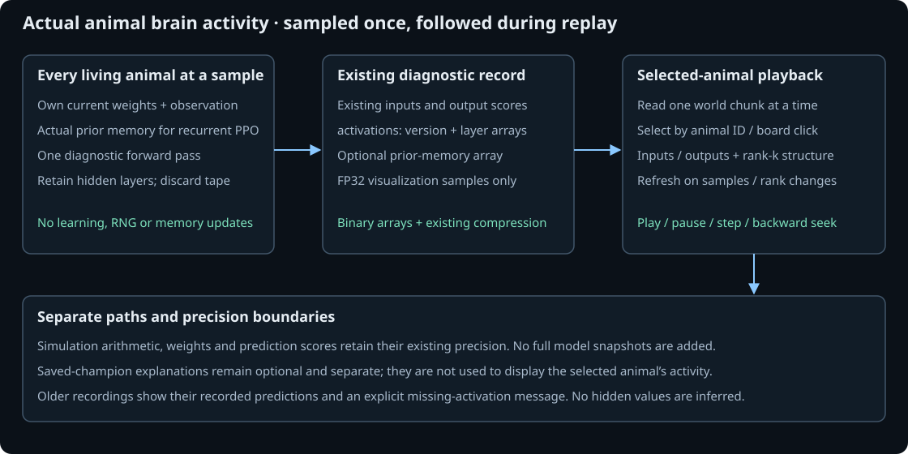

# Animal brain activity and archived-model explanations

[Playback](recording.md#visual-agent-inspector) · [Saved brains](brain-library.md) · [Performance](performance.md#sampled-animal-activations)

Select an animal on the board, or enter its **Animal ID** and click **Inspect**.
**Watch animal brain** shows that animal's own sampled activations as replay
plays. **Explain saved brain** opens the separate archived-champion comparison.
These are different data sources; the recorded activity view needs no champion
archive or explanation API request.

## Recorded animal activations

The [inspector appearance sheet](viewer-visual-reference.md#inspector-and-brain-views) shows the radar, output bars and rank-based network display.



New recordings capture hidden-layer activations for every living animal whenever
normal brain diagnostics are sampled: the first recorded frame of each chunk,
the configured diagnostic interval, and forced final samples. The inspector
puts observed inputs and action scores first, with rank-based structure detail.
**Watch animal brain** opens a larger window with play/pause, next-frame and
backward-step controls. Small brains show the whole structure; deeper-unit maps
are available under Advanced. The view
follows the selected animal and refreshes when a new diagnostic sample arrives;
body and brain-sample steps are displayed separately. There is no interpolation
between samples and no additional explanation timer or server inference.

Samples describe the model's next-decision prediction at the recorded state,
after that simulation step's learning update. They do not reconstruct the action
already taken or prove that an animal understood its environment. Policy scores,
Q estimates, masks and value/quantile fields retain their existing interpretation.
MAPPO records its local actor's hidden layers; the separate central critic is not
shown as an action route. Recurrent PPO records both actual prior memory and the
resulting GRU activation, without resetting or advancing its live memory.

The new diagnostic field is deliberately small:

```text
activations
├── version: 1
├── layers: [hidden_layer_0[], hidden_layer_1[], ...]
└── recurrent_prior: [...]  (recurrent PPO only)
```

Only these visualization arrays are rounded to FP32 before storage. Learning,
world physics, model weights and existing observations/prediction scores retain
their existing precision. The codec then stores the sampled values losslessly
using its existing typed-array and compression support. Inputs and outputs are
already in diagnostics and are not duplicated; weights, gradients, connection
matrices, optimizer state and training experiences are not added.

`recording.record_activations` defaults to `true`. Set it to `false` to keep the
previous smaller diagnostic payload. Set `diagnostics_every_steps` to a larger
interval for fewer samples, or zero to omit diagnostics and activations entirely.
No diagnostic capture runs on unsampled frames. Recording itself must be enabled.

Older recordings cannot recover hidden activations that were never saved. Their
actual recorded predictions remain available, with an explicit missing-activation
message rather than a failed archive load. Selection/death/run changes and
backward seeking clear or replace the displayed sample; future samples are never
used. Newborns appear when alive at a diagnostic sample. Restart training/start a
new recording for this field, then refresh the viewer. The window also works for
new recordings that saved no champion archives.

## Archived comparison

The remaining sections describe **Explain saved brain**, which analyzes a chosen
archived species/sex champion. **Follow replay samples** is enabled by default:
opening the window leaves playback running, and its own play/pause, step and back
controls advance the same playhead. Weighted routes, activations, predictions and
local input sensitivities update when the selected animal's recorded observation
sample changes. The archived weights stay fixed for the selected run/criterion.
These re-evaluations are separate from that animal's recorded activity.

Uncheck **Follow replay samples** to pin the displayed observation. Applying a
what-if automatically pins that observation and pauses playback; checking Follow
again clears the override and returns to the latest selected sample. At high
playback speeds intermediate observations may be skipped to keep work bounded;
the header states the observation actually explained. While following,
selection/run changes or missing observations clear incompatible displays. An error stops automatic
retries; use **Retry** after fixing missing data or restarting an outdated server.

This following behavior adds **zero saved recording data**. It reuses existing
observations and champion artifacts. Older recordings can therefore use it even
when their hidden-activation samples were never recorded, provided their
observations and matching champions are available.

## What is being explained


The inputs come from the selected animal's most recent recorded diagnostic at
or before the displayed frame, within the loaded chunk. The dashboard shows both
the body step and diagnostic step. The model comes from that run's matching
species/sex champion archive, using its configured selection criterion by
default. Other available criteria can be selected explicitly. Arbitrary species
names and species/sex-specific model choices are supported.

The archived champion may belong to another animal, a later step, or a retained
winner from an earlier episode. Its source animal, run, step, criterion and model
generation are displayed. It is **not a reconstruction of the selected animal's
historical weights or thoughts**. Gray prediction bars show the animal's actual
recorded predictions for comparison; colored bars show fresh inference with the
archived model. Neither is necessarily the action sampled during exploration.

No historical weights are invented. Missing archives, omitted diagnostics,
unknown sex, incompatible inputs/actions or absent animals produce an explanation
message while normal playback/inspection remains available. Saving more replay
frames does not recover weights that were never stored.

## Reading the visualizations

| View | Meaning |
| --- | --- |
| Whole structure / summary | All units when hidden rank ≤ k (default 2), otherwise a stage-size summary; connections show declared topology, not weight strength |
| Advanced weighted routes | Selected observation → hidden → output paths; hover nodes for activation, bias where applicable and output sensitivity |
| Connections | Up to three strongest incoming links among displayed units; color shows the sign of `input activation × weight`, and thickness shows magnitude |
| Input influence | Top normalized inputs ranked by absolute input × local gradient of the selected action's probability or expected return |
| Prediction comparison | Archived-model probabilities/Q estimates beside the selected animal's recorded predictions |
| Advanced activation maps | Every unit in each displayed layer; sign by color and intensity clipped at absolute activation one |
| What-if input | Re-evaluate the same archived model after changing one normalized input; other observations and recorded masks remain fixed |

The route graph shows up to 12 influential units in each hidden layer, selected
by absolute activation × output sensitivity. All units still participate in
inference. Hidden units have no assigned biological meanings, and omitted edges
are not zero weights. The value head may appear in actor-critic output maps, but
has zero sensitivity when explaining an action probability.

For a selected action score `s(x)`, the feature display computes
`influence[i] = x[i] * ∂s/∂x[i]`. The reverse pass includes tanh derivatives and,
for policies, the softmax competition between allowed actions. This is a local
sensitivity estimate, not a causal claim, an additive decomposition of the
prediction, or a measure of learned biological knowledge. Zero-valued inputs
have zero input×gradient even when their derivative is nonzero. Large changes
can leave the local approximation; saturation can make gradients small.

What-if controls accept one finite value between −1 and 1. They do not advance
the world, recompute visibility, move neighbors, change health/energy bodies,
re-evaluate mating/swim eligibility or retrain weights. Changing one feature can
create an observation that no valid world could produce. Reset restores the
original recorded inputs. The recorded comparison bars never change.

## Worked activation example



This is a controlled mathematical illustration, not an animal's measured brain.
The two active input columns, biases and tanh units produce raw action logits;
softmax compares both logits to obtain the displayed probabilities. The reverse
pass targets **move backward** and reports each input times its local probability
gradient. The values were checked through the production archived-inference
path and against finite differences. Other input columns and the value head are
omitted for clarity. See the [asset provenance](assets/structures/README.md).

## Algorithm-specific interpretation

| Algorithms | Interpretation |
| --- | --- |
| DQN / `q_network` | Tanh hidden state and action Q values; exploration may choose a different action |
| PPO, A2C, REINFORCE, GRPO | Feed-forward policy activations and normalized action probabilities; GRPO reference policies/trials are not reconstructed |
| Maskable PPO | Uses the selected diagnostic's recorded action mask; masked probabilities and their gradients are zero |
| QR-DQN | Routes end at return quantiles; the action chart and attribution use each action's quantile mean |
| Recurrent PPO | Explicitly resets prior GRU memory to zero because archives store weights, not the animal's historical recurrent state; exposes update/reset/candidate/current-state maps |
| MAPPO | Explains the local actor only; its independent centralized critic does not select actions |

For zero-state GRU analysis, reset gates are displayed but multiply zero prior
memory. GRU links represent a local Jacobian times the input, rather than an
additive decomposition through a dense layer. The header and tooltips distinguish
these routes. This view does not establish how recurrent memory affected a
historical decision.

## Data access and cost

The window requests only
`GET /api/recordings/{id}/runs/{run}/explain/{animal}/{frame_index}`.
`frame_index` is the run's recorded frame index, not a simulation tick. Optional
query fields are `criterion`, `action`, or the paired `feature`/`value` override.
Unsupported/duplicate query fields fail clearly. The server uses the same
published chunks and portable run-local champion indexes as playback. Binary/XZ
version-3 model references and legacy inline-weight archives with known sex are
supported; arbitrary external model paths are not accepted.

Archived comparison uses stateless weight arithmetic. The server never
instantiates a world, controller, optimizer or training replay buffer. This
archive-only path adds no capture hooks or weight snapshots; actual activity
uses the optional activation arrays described above. Neither path requires a new
dependency, checkpoint schema or model signature. Existing recordings support
archive comparison when their diagnostic/champion artifacts are present.

The browser retains one displayed explanation while open and releases it on
close. Requests are made on explicit control changes or new recorded observation
samples while following, not every animation frame. There is at most one request
in flight and one newest pending request; superseded pending work is discarded.
Stale responses cannot replace the current selection, and unchanged samples reuse
their charts. Body and explained-sample timestamps remain distinct. No snapshots,
extra replay fields or sidecar explanation files are saved by following. The server retains
at most two packed models totaling one million scalar parameters, plus two
selected-animal diagnostic contexts. File-stat keys invalidate changed
chunks/weights; shared weight blobs are reused across champion criteria. One
chunk is decoded on a context miss and released. See the
[optimization review](performance.md#on-demand-brain-explanations) for limits.

Restart an existing playback server after updating this patch, then refresh the
page. No training restart, artifact conversion or native rebuild is needed.

## Input/output first and the rank threshold

The primary view shows what the recorded inputs describe and the action scores
they produce. Recorded animal activity presents input meanings and probabilities
or Q estimates; archived analysis presents local input sensitivity beside the
archived/recorded prediction comparison. Neither input values nor hidden-unit
colors alone establish causal importance.

**Whole structure when rank ≤ k** defaults to **k = 2**. Here, *rank* means the
number of hidden processing layers, not mathematical matrix rank or observation
`top_k`. A GRU memory block counts as one hidden stage in addition to its head's
hidden layers; MAPPO counts its local actor only. This is a viewer setting and
does not change observations, architecture, learning or saved data.

- Rank at or below k: show every input, hidden and output unit in the structure.
  Dense inter-stage connectivity is explicit for small diagrams and bundled when
  the total exceeds 1,024 links. Bundles represent all dense connections; they
  do not drop units or display individual weight strengths. GRU gates are
  represented as a memory block rather than expanded gate matrices.
- Rank above k: show the input → hidden-stage sizes → output summary. Individual
  neuron maps and bounded weighted routes remain available under **Advanced**.
- The same threshold control appears in the inspector and both brain windows;
  changing one updates the others without loading weights or requesting new
  explanations. Refreshing the page restores the default of two.

Topology comes from the declared architecture and existing activation arrays.
If an older recording lacks hidden activations, gray units explicitly show only
the declared structure; recorded inputs and output scores remain real samples.
No hidden activity or historical weights are invented. Colors use the values
available to each view: recorded scores for animal activity and raw model outputs
for archived analysis. Hover labels identify the stage/unit and value.

Advanced neuron maps, GRU details and selected weighted routes are built only
when their disclosure is opened, then retain that preference across samples.
The whole-structure drawing is topology, distinct from the Advanced route view's
limited set of signed weighted connections. The change adds no fields, snapshots,
API payload, recording bytes or simulation work.
