# Adding or changing policy models

[Customization handbook](customization.md) · [Algorithms](algorithms.md) · [Contributor context](project-context.md)

## Use an existing model first

A new brain-template **name** needs no new Python algorithm. Deep-copy the desired
complete template under `brains`, adjust supported hyperparameters/hidden widths,
and point a species' `brain` at it. Preserve the algorithm-specific field layout:
legacy `q_network` uses top-level `hidden_layers`; multilayer `dqn` and other current templates use
`network.hidden_layers`. Different species may reference different templates.

Validate the full configuration, then start a fresh run. Changed dimensions,
observation layouts or action order require compatible saved weights. The
[field reference](configuration-reference.md) lists all supported type-specific
fields; do not copy PPO-only fields into a GRPO or Q template.

Existing additional implementations are documented in [Discrete SAC, TRPO and
LSTM PPO](additional-policies.md); use their complete templates before adding
another identifier. For multi-network algorithms, integrate target synchronization
after loading and newborn resets as well as actor/critic archive semantics.

## Implement a genuinely new algorithm

There is currently **no dynamic plugin registry or arbitrary class import in
JSON**. Adding a new `type` requires explicit source integration. The following
is a contributor recipe, not a model already supported by the released dispatcher.

Prefer a small module under `wtf/`. Reuse an existing base class only if
its experience semantics and parameter layout match. For example, this complete
PPO-derived class changes only the entropy schedule while retaining PPO rollout,
optimizer, RNG, diagnostic and checkpoint machinery:

<!-- policy-example:start -->
```python
from wtf.learning.ppo import PPOBrain, loss_and_gradient


class ScheduledPPOBrain(PPOBrain):
    algorithm = "scheduled_ppo"

    def objective(self, outputs, step, advantage, target):
        objective_config = dict(self.config)
        objective_config["entropy_coefficient"] /= 1 + self.rollout_updates
        return loss_and_gradient(
            outputs,
            step.action,
            step.log_probability,
            advantage,
            target,
            objective_config,
        )
```
<!-- policy-example:end -->

Save it as `wtf/scheduled_ppo.py` when implementing the recipe. Its counter
is already saved/restored by PPO. A real extension with additional mutable state
must serialize/restore that state itself. This class is illustrative: the current
validator and dispatcher deliberately do not accept `scheduled_ppo` until the
integration steps below are implemented and tested.

## Required integration points

| Layer | Files / functions | Required change |
| --- | --- | --- |
| JSON validation | `config.py:validate`, `environment.schema.json` | Accept the new type and exact allowed fields; define ranges and descriptions. A PPO-derived example can share PPO's validation branch if every field has identical meaning. Add a corresponding schema branch/type. |
| Construction and resume | `brains.py:create_brain`, `restore_brain` | Dispatch creation and checkpoint restore to the same new class; do not fall back silently to another learner. |
| Model signature | `brains.py:model_signature` | Distinguish algorithm, input version/top-k, action order, parameter layout and all head/memory dimensions. The example needs its value head declared, just as PPO does. |
| Champion export/load | `brains.py:model_snapshot`, `load_model_weights`; `model_io.py`, `library.py` | Match parameter shapes and numerical validation. Existing MLP layout can reuse the normal path; a new layout requires explicit support. Warm starts reset training state. |
| Birth and mutation | `brains.py:inherit_brain`, `mix_parent_brains`, `reset_birth_training`; `mutation.py` | Mix compatible parameters into independent children; reset optimizer/temporal buffers and memory. Include new weight-array names in sparse mutation handling. Never copy lifetime trajectories as newborn experience. |
| Orchestration | `runner.py:_refresh_context`, `step`; `grouped_rollouts.py` when relevant | Ordinary local feed-forward learners may need no new runner branch. Masks, centralized critics, recurrent state or multi-trial updates need explicit preparation/scheduling. |
| Diagnostics | Controller `diagnostics`; `activation_diagnostics.py`, `recording.py` | Return actual input features and scores; optional hidden activations come from the same forward pass without advancing RNG, memory or optimization. |
| Archive explanations | `explainability.py:POLICIES`, `prepare_model`, `explain_model` | Add the new policy identifier and mathematically correct inference/sensitivity semantics. Matching MLP layouts may reuse forward math; different heads/memory need explicit rules. |
| Viewer | `viewer/app.js`, `inspector.mjs`, `network-structure.mjs`, `brain-activations.mjs`, `explainability.mjs` | Add readable labels; verify probability versus Q-value semantics, architecture/head interpretation and honest unsupported/missing-data states. Never display value outputs as probabilities. |
| Coverage lists and fixtures | `tests/test_mutation.py:KINDS`, algorithm fixture builders and cross-algorithm suites | Add a valid small configuration for the new kind, then include it in feedback, inheritance, numeric, checkpoint, diagnostics and archive tests. Updating the enum alone is not coverage. |

For the `scheduled_ppo` recipe, the dispatch additions have this shape in both
construction/restore paths (place them before the unsupported-type error):

```python
# create_brain:
if config["type"] == "scheduled_ppo":
    from .scheduled_ppo import ScheduledPPOBrain
    return ScheduledPPOBrain(config, actions, base_seed, individual_seed)

# restore_brain:
if kind == "scheduled_ppo":
    from .scheduled_ppo import ScheduledPPOBrain
    return ScheduledPPOBrain.restore(state)
```

These fragments belong inside the existing functions; they are not a standalone
script. Also add the new type to the actor-critic `value_head` classification and
archive `POLICIES` set. The recipe does not use masks or centralized context, so
it should not be placed into those runner branches. Never register a new type
by changing an existing type's meaning; that can corrupt saved-model assumptions.



## Controller contract

| Member | Contract |
| --- | --- |
| Constructor `(config, actions, base_seed, individual_seed)` | Own configuration/actions; separate deterministic initialization from private action/training RNGs |
| `choose(observation, explore=True, random_baseline=False)` | Return one configured action string; support evaluation and random baseline modes without unwanted training |
| `learn(experience)` | Consume `Experience(observation, action, reward, next_observation, terminated, truncated)`; terminal transitions may have no next observation; truncation is distinct from death |
| `diagnostics(observation, include_activations=False)` | Detached, serializable features/scores/update counts; policy probabilities or value scores with correct names; no learning side effects |
| `checkpoint()` and classmethod `restore(state)` | Restore exact parameters, optimizer/counters, exploration/baselines, buffered/pending samples and every private RNG/memory state |
| `config`, `actions`, `updates` | Used by orchestration, reporting and model export; inherited counters must not masquerade as new optimization work |
| Network representation | Existing MLP helpers expect `network.layers`, `network.checkpoint()` and parameter-compatible zero buffers; different representations need adapted save/load/birth/mutation paths |

Do not use module-global RNGs or share live weights/buffers among animals. Keep
checkpoint restore separate from champion initialization. Preserve FP32 model
storage and current scalar arithmetic unless a change is explicitly intentional.
Do not add PyTorch/NumPy dependencies silently; dependency and device handling
would become part of installation, Docker and compatibility contracts.

## Validation before calling the algorithm supported

Test construction, action validity, finite optimization, terminal and truncated
feedback, deterministic checkpoint continuation in the middle of a nonempty
buffer, evaluation without training, independent RNG/weights, species/sex warm
starts, newborn resets, crossover and rare mutation. Add mathematical gradient
or loss tests appropriate to the learner. Verify diagnostics-on/off leaves
learning state identical and archive explanations match the model's inference.

Run the relevant checks, then the full maintained suites before releasing a new
algorithm, and run repository-wide formatters after code changes:

```sh
.venv/bin/python -m unittest tests.test_feedback_contract tests.test_activation_diagnostics tests.test_mutation tests.test_multiple_species
node --test tests/*.test.mjs
.venv/bin/python -m work.build_config_reference --check
```

Those commands exercise existing coverage; extend their fixtures/lists so the
new algorithm is actually included. When adding a shipped module or preset,
verify the built wheel/source archive and [asset manifest](packaging.md#what-is-included) too. Update algorithm documentation, presets,
compatibility notes and a pending implementation rollout only after integration.


## Optional native execution

New Python policies remain available through the reference engine. The
[native episode engine](native-engine.md) covers the 14 built-in CPU learners;
adding another Python type identifier does not automatically add a native learner.
A native port must implement native construction/model signatures, independent
buffers/RNGs, numerical/update ordering, frozen trial choices, inheritance,
diagnostics and checkpoint interchange, then pass complete-session
and saved-replay comparisons before admission. Do not fall back into Python
inside native batches or claim kernel-only timings as an end-to-end improvement.
