# Environment feedback contracts

[Reward accounting](rewards.md) · [Current algorithms](algorithms.md) · [Simulation order](architecture.md#one-simulation-step)

`World.step` derives per-animal environmental rewards from actual events and
configured species coefficients. Geography determines physical effort/damage,
not a map-specific neural loss. The learner consumes that feedback under its
own objective; the environment does not set a network loss directly.

## One physical result, different learning objectives

| Family | How environmental feedback is consumed |
| --- | --- |
| Q-network, DQN/DDQN, QR-DQN | Private replay and bootstrapped scalar/quantile targets |
| PPO, masked PPO, A2C | Own rollout rewards/advantages; physical masks only where supported |
| REINFORCE | Finite own trajectory return and baseline |
| GRPO | Comparable isolated trial returns and group-relative policy objective |
| GRU/LSTM PPO | Own chronological rollout and recurrent state |
| MAPPO | Existing species-mean training reward and centralized training critic |
| Discrete SAC | Private replay, entropy-aware actor and twin Q objectives |
| TRPO | Own on-policy advantages with KL-constrained policy step and separate critic |

## Shared accounting boundaries

Living/attempt/uphill/swim costs spend body energy once. `per_energy_cost`
converts configured demand into feedback without spending it again. Actual
energy gain, damage dealt/taken, death and successful births have their own
configured coefficients. Failed-action penalties apply only under the documented
action success rules; reproduction has mutual intent and physical gates, not
an automatic bonus for proximity. Optional contests configure effort/damage and reuse the existing reward
coefficients. See [reward rules](rewards.md) and [competition](competition.md).

Consequence tables record physical outcome associations, not scalar rewards.
Auxiliary prediction and late evidence placement are explicit PPO/masked-PPO
options; they do not rewrite the world's accounting or copy foreign PPO actions.
V7 inputs expose current state, readiness, history and scent as configured. The
[consequence pipeline](learning/consequence-pipeline.md) explains separate
publication and private-learning schedules.

Evaluation/random modes still produce physical feedback without training policy
parameters. Exact checkpoints preserve the captured controller/world contracts.
Use matched seeds and held-out policies to assess outcomes; a larger reward or
lower entropy alone does not establish better survival or reproduction.

## Historical audit evidence

The earlier 20/32-input audit, tables and original test scope are retained in
[historical feedback evidence](archive/feedback-audit.md). They are not current
preset recommendations. Current maintained-source regression tests cover the
implemented contracts; [development](development.md) explains validation scope.
