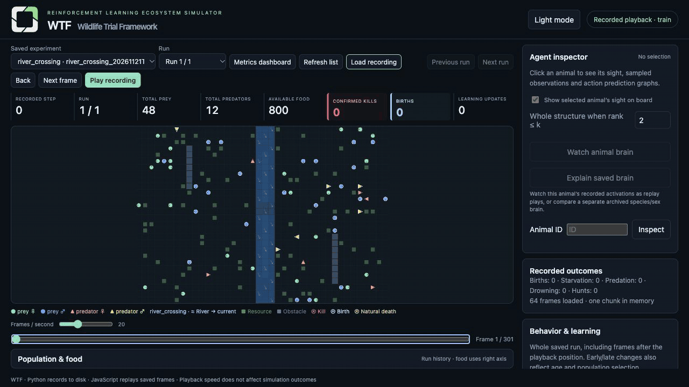
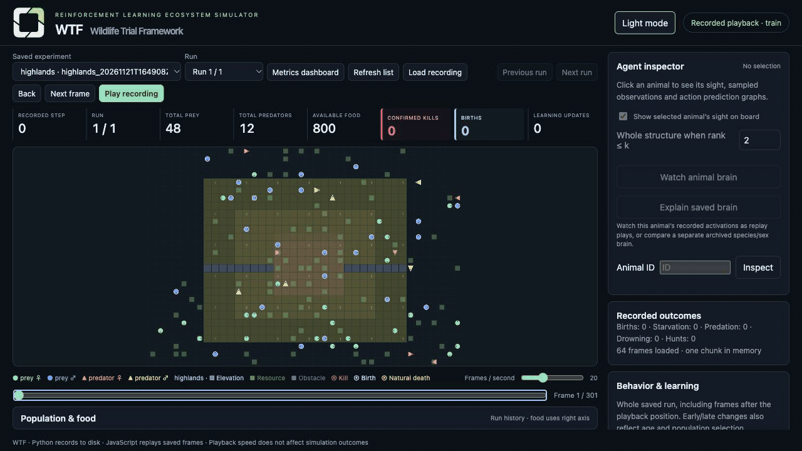
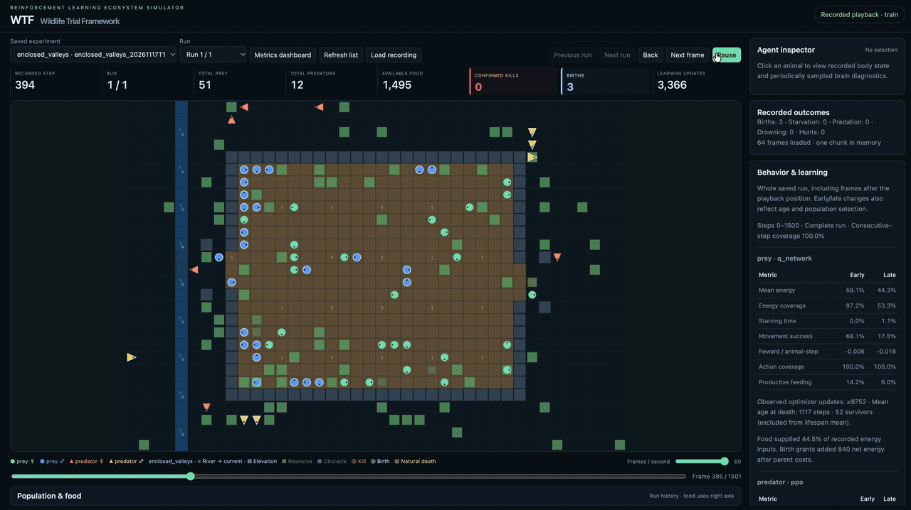

# Geography, rivers and elevation

[Configuration](configuration.md) · [Species](species.md) · [Playback](recording.md)

For diagrams and the interactive explorer, see [Physics illustrated](physics.md).

Terrain is optional. Existing environments remain flat unless they select a map.
Four optional presets cover three maps, keeping one prey species and one predator species:

| Environment | Map |
| --- | --- |
| [river_crossing.json](../environments/river_crossing.json) | A river bisects the world, with a fast deep channel and a slower shallow ford |
| [river_crossing_ppo.json](../environments/river_crossing_ppo.json) | The same river map with PPO for both species |
| [highlands.json](../environments/highlands.json) | Terraced highlands, a steep central plateau, a climbable north ramp and obstacle approaches |
| [enclosed_valleys.json](../environments/enclosed_valleys.json) | One elevated enclosure, two three-cell-wide gates, an exterior river and boundary-biased food |

```sh
.venv/bin/python -m ecosystem.cli environments/river_crossing.json --runs 10 --progress
# Alternatives: environments/highlands.json or environments/enclosed_valleys.json
./run.sh
```

`enclosed_valleys.json` uses **DQN for prey and PPO for predators**. The
`river_crossing_ppo.json` preset uses PPO for both; `river_crossing.json` and
`highlands.json` use Q networks. All nine algorithms support terrain; retain
`observation_version: 2` and the species action list when switching templates.
Enclosed-valley prey can load matching terrain Q/DQN weights; predators need
matching terrain PPO weights. The river presets provide corresponding compatible
signatures. Dry highlands omits `swim` and has a different action signature.
Older 20-input flat brains cannot initialize these 32-input terrain models.

## Recorded terrain previews

These **3.5-second full-viewer recordings** retain the controls, counters, board
and sidebar. They show saved run playback, not a live backend simulation.
[Source recordings, intervals and regeneration](assets/terrains/README.md) are
recorded alongside the GIFs. The separate [physics diagrams](physics.md) explain
the rules; these clips show the actual viewer UI.

### River crossing



### Highlands



### Enclosed valleys



Animals may pass through the gates during playback; the inside/outside placement
rule applies to founders, not permanent confinement.

## Use PPO on the river map

```sh
.venv/bin/python -m ecosystem.cli environments/river_crossing_ppo.json --runs 10 --progress
```

Both species use small PPO actor-critic networks with 32 terrain inputs. World,
map, health, populations, reproduction, currents and swim/climb settings match
the Q river preset. Brains remain private per animal and champions remain
species/sex-specific. No saved weights are requested by this preset; later runs
chain the corresponding PPO champions by default.

## Select or edit a map

An environment can reference a project-relative map JSON:

```json
"terrain": {"map_file": "maps/river_crossing.json"}
```

Absolute map paths also work. On loading, the map definition replaces this
reference in the resolved configuration. Results and checkpoints embed it, so
replay/resume does not read the source map again or follow later edits. The map
files under [maps/](../maps/) are intended to be edited and committed.

A map contains `map_version: 1`, `name`, `width`, `height`, `rows` and `legend`.
Dimensions must match `world.width`/`world.height`. `rows` is a list of strings,
each exactly `width` printable ASCII characters; there must be `height` rows.
Each character names a legend entry. Its properties are:

| Legend property | Meaning and default |
| --- | --- |
| `elevation` | Height units from 0 to 100; default 0 |
| `blocked` | Impassable, vision-occluding obstacle; default false |
| `water_depth` | Relative depth from 0 to 10; default 0 (dry land) |
| `flow` | `[dx, dy]` current vector in cells per simulation step; default `[0, 0]`, each component between −4 and 4 |

For example, the river map uses `.`, `~`, `%` and `=` for land, ordinary river,
deep channel and shallow ford. A custom river legend entry can be:

```json
"~": {"water_depth": 1, "flow": [0.4, 0.75]}
```

Coordinates start at the top-left: positive x goes right and positive y goes
down. A cell cannot be both blocked and water. Map obstacles are combined with
`obstacles.explicit_cells` or scattered obstacles; use explicit/no additional
obstacles to retain designed gates. Extra scattered barriers can block routes.
Founders, resources and newborns spawn on dry, unblocked cells. Initial capacity
is validated against dry space; disconnected regions are intentional and need
not contain food or both sexes in every randomized run.

## Swimming and currents

Add `swim` to a species' `allowed_actions` to make it capable of swimming. Normal
`move_forward` cannot enter **or leave** water. A swim stroke moves one cell in
the facing direction and works only while in water or facing a water cell; turn
toward the river first. Other attempted uses are blocked. Maskable PPO removes
unavailable strokes from its distribution; other algorithms can attempt blocked
actions just as they can attempt blocked walking or missed attacks.

Both health and energy constrain swimming. A stroke requires:

- Health at least `swim_min_health × max(current_depth, destination_depth)`.
- Energy strictly greater than swimming plus uphill costs.
- An unblocked/unoccupied destination and a climb within `max_climb`.

Every animal already in water drifts after voluntary movement, including an
animal that cannot swim or is too weak to stroke. The vector is sampled at its
post-action cell for that step. Fractional movement accumulates independently
on x and y: a 0.25-cell component moves one cell every four steps, rather than
rounding away. A stroke and current can reinforce or oppose each other.

Fast currents are traced through intermediate cells, with seeded contention,
no following/swapping into occupied starting cells, no wall tunneling and no
diagonal corner cutting. Blocked integer displacement is discarded rather than
stored up into a later leap. Fractional remainder persists while in water and
resets on reaching land. Flow stops at the first dry cell; heading is unchanged.
A current can therefore wash an animal onto another bank without a second action.

## Species locomotion costs

Optional `species.<name>.locomotion` values control abilities and costs:

```json
"locomotion": {
  "swim_min_health": 18,
  "swim_energy_cost": 1.5,
  "water_energy_cost": 0.25,
  "drowning_damage": 2,
  "uphill_energy_cost": 1,
  "max_climb": 1
}
```

`swim_min_health` is absolute health, not a percentage. With a threshold of 18,
a depth-1 cell needs 18 HP, a shallow depth-0.5 cell needs 9 HP, and depth 1.6
needs 28.8 HP. Predators in the supplied terrain presets use threshold 25.

A successful stroke spends `swim_energy_cost × maximum touched depth`, plus any
uphill cost. Failed strokes incur no extra terrain movement charge; the existing
body `movement_cost` still applies to attempted walks/strokes. An animal ending
the step in water spends `water_energy_cost × depth` each step. If it lacks swim
ability, falls below the depth-adjusted health threshold, or runs out of energy,
it also takes `drowning_damage × depth`. Existing starvation damage can also
apply to an exhausted animal. Drowning is recorded as a separate death cause.

Moving uphill spends `positive elevation gain × uphill_energy_cost`, and a
single rise above `max_climb` is blocked. Costs are charged only to successful
moves and require energy to spare. Downhill movement has no extra cost or refund;
there is no falling-injury model. Currents respect climb limits and pay uphill
costs too. Cliffs can therefore be inaccessible from below while ramps permit
incremental climbs.

Omitted fields default to swimming health of half maximum health, stroke cost
1.5, water cost 0.25, drowning damage 2, uphill cost 1 and maximum climb 1.
Locomotion costs have no effect on flat environments without terrain. Parents
must be on land with a bounded dry route between them; reproduction cannot mate
across a river or through sealed obstacle corners. Newborn placement also respects
local cliff limits.

## Terrain observations and model compatibility

Flat observation version 1 retains its 20 features. Version 2 appends 12 values:

| Indices | Meaning |
| --- | --- |
| 20 | Current water depth / 10 |
| 21–22 | Current flow x/y components / 4 |
| 23 | Current elevation / 100 |
| 24–25 | Forward water depth / 10 and elevation difference / 100 |
| 26–27 | Right water depth and elevation difference, same scales |
| 28–29 | Backward water depth and elevation difference, same scales |
| 30–31 | Left water depth and elevation difference, same scales |

Neighbor directions are relative to facing; flow components use world axes.
Scales are fixed across maps. The original neighbor-blocked features additionally
reflect normal walking's terrain restrictions in version 2. Terrain maps require
version 2 on referenced templates; a version-2 controller on a flat world receives
zero terrain features. Fractional current carry is checkpointed body state, not
an additional observation feature.

PPO-family networks, Q/QR-DQN, GRUs, masks and MAPPO critics use the configured
input size. MAPPO still adds its separate 16 critic-only context values. Model
signatures record the version/input count and action order; incompatible saved
weights are rejected instead of being truncated or padded.

## Playback, metrics and storage

Restart the playback server after updating Python telemetry code, then refresh
the browser. The viewer shades elevation, labels occasional heights and draws river/current
arrows. Its inspector shows current height, water depth and flow; its observation
panel displays the actual feature count. Drowning uses the existing natural-death
animation, with recorded final coordinates after drift. Kill markers likewise
use recorded positions when supplied.

The dashboard adds swim attempts, current-driven cell moves, terrain energy
demand and drowning deaths per step. Whole-run analysis separates swim success
from walking success and accounts for terrain energy. Terrain CSV files include
a `drowning` column. Forced drift is not counted as a voluntary successful move.
These are physical/behavioral measurements, not proof of learned navigation.

ASCII geometry is stored once in recording configuration, not in every frame.
Replay chunks retain only dynamic bodies, events and fractional drift state.
Seeking still loads one chunk at a time. Checkpoints rebuild sparse terrain
lookups from their embedded map; GRPO trials share read-only static lookups while
retaining independent obstacles, bodies, random streams and learning state.

## Learning feedback

[Reward accounting](rewards.md) explains direct energy-demand and failed-action
penalties, alongside existing drowning, damage and death penalties. A blocked
climb or swim receives a failed-action penalty; normal attempt costs still apply.
Current drift is forced motion and cannot make a blocked voluntary action count
as successful.

For the selected constants now applied to the original river, highlands and
enclosed-valley presets, and the
matched short comparisons used to select their constants with radius two, see
[survival/reproduction calibration](calibration.md).

## Enclosed-valley starting layout

`environments/enclosed_valleys.json` now has one main rectangular enclosure. Its
outer wall spans x=8..31 and y=4..23 (inclusive), with three-cell-wide gates at x=8, y=12..14 and x=31, y=13..15.
Guard obstacles sit beyond the approach lanes so all three entrance cells remain accessible.
The elevated interior is accessible by one-unit climbs. The river is outside the
left wall, with a shallow ford. Small obstacles guard the gate approaches.

All 48 founding prey start strictly inside the wall; all 12 founding predators
start strictly outside. Initial food is split into exactly 30 inner-boundary
patches, 30 outer-boundary patches and 20 farther-away patches. Boundary food
is within two grid cells of the rectangle; diagonal exterior distance uses the
maximum x/y offset. All founder and food positions are distinct within their own
group, dry and unblocked. Food can share a cell with an animal, as before.

Edit the optional top-level placement object to change these choices:

```json
"placement": {
  "enclosure_bounds": [8, 4, 31, 23],
  "species": {"prey": "inside", "predator": "outside"},
  "resources": {
    "boundary_fraction": 0.75,
    "boundary_width": 2,
    "inside_fraction": 0.5
  }
}
```

Bounds describe the outer perimeter and do not create walls; paint matching
geometry in the map. `inside` and `outside` exclude the perimeter, including
gates, when choosing founders. List each configured species by its exact name.
Multiple species can share a side without overlapping their starting positions.

`boundary_fraction` is the share of all patches placed near the wall.
`inside_fraction` is the share of those near-wall patches placed inside. Counts
round to nearest integer, half upward; remaining patches are sampled farther
away on either side. Allocation is exact; insufficient dry zone/band capacity
raises a configuration error rather than silently moving animals or food.
Placement requires explicit obstacles, so capacity can be checked before a run.

These are initial conditions. Animals can use the gates and normal movement,
and newborns use the existing local birth rules. Resources regrow at their
chosen positions. No permanent species barrier or automatic reproduction was
added. Configurations without `placement` retain their original seeded spawning.
Saved checkpoints/recordings embed the geometry and placement configuration;
resuming never redraws or relocates bodies. New invocations use the edited map.
The earlier calibration study used the previous two-valley geometry, so its
counts are historical rather than predictions for this layout.

## Directional sight across water

The river and enclosed-valley presets set `species.<name>.body.water_vision_bonus`
to **3** for both species. This is an optional integer from 0 to 32; omission
or zero preserves the original sight rule. Dry maps receive no extension.

For each target, the existing line-of-sight ray counts water cells strictly
between observer and target. Its effective radius is:

```text
vision_radius + min(water_vision_bonus, intervening_water_cells)
```

Thus a one-cell river adds one cell of sight; three water cells can add three.
Prey retain normal radius 6 on dry rays and can reach at most 9 across water.
Predators retain radius 8 and can reach at most 11. This applies to food and
animal targets in any direction, not just where the animal faces. Walls still
occlude targets, including across water; start/end water tiles alone grant no
extension. Swimming ability and physical movement costs are separate.

The spatial query searches only out to the maximum possible radius, then filters
individual targets with their actual water allowance. Nearest accepted targets
still win. When enabled on a wet map, nearest-target offsets and distances are
normalized by `vision_radius + water_vision_bonus`, keeping existing feature
ranges. This changes input values but adds no inputs: flat/terrain observations
remain 20/32 features. Model shapes stay compatible; existing weights may behave
differently with the changed sight range and normalization. Saved configs without
the field retain old behavior during exact resume.

Each world caches ordered static water-ray counts in a bounded 2,048-entry LRU.
Dynamic target positions, deaths and resource depletion still invalidate spatial
results. Sight result keys include base radius and bonus, even if their sum is
unchanged. These caches are transient and reconstructed after checkpoint restore;
no per-frame water data or new replay fields are stored.
