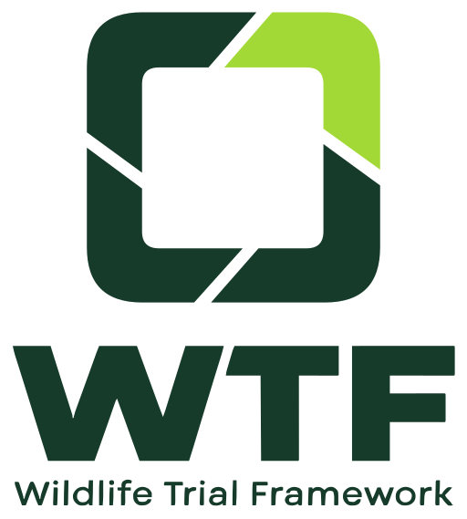
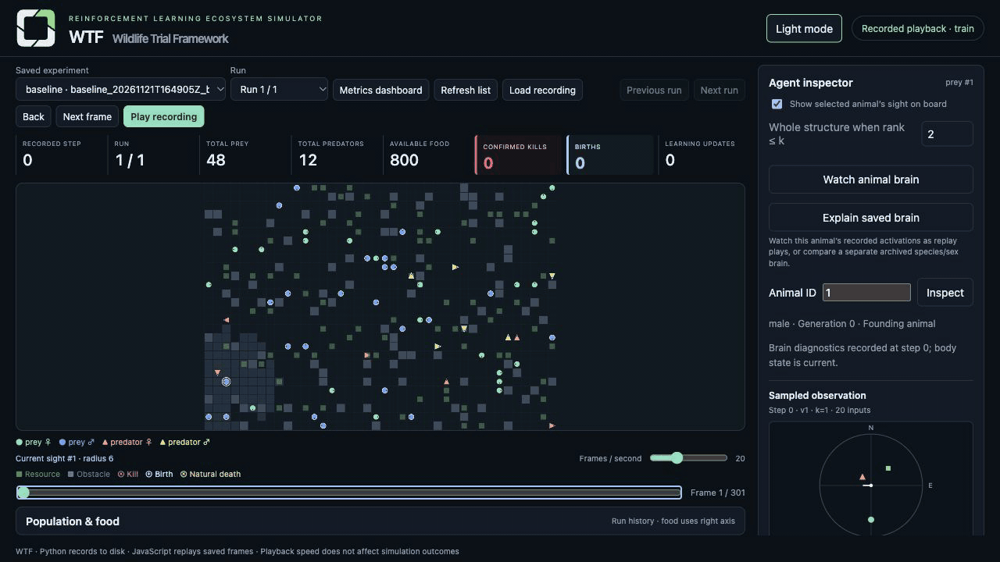

# Wildlife Trial Framework

[Complete documentation directory](directory.md) · [All visuals](visuals.md) · [Homepage click paths](access-map.md)

<picture class="brand-lockup brand-on-light">
  <source srcset="assets/branding/wtf-lockup-motion-light.svg" type="image/svg+xml" />
  
</picture>
<picture class="brand-lockup brand-on-dark">
  <source srcset="assets/branding/wtf-lockup-motion-dark.svg" type="image/svg+xml" />
  
</picture>

WTF is a configurable reinforcement learning wtf. Animals have private
brains, observe their surroundings, choose actions, learn from feedback and can
produce descendants. Python simulates and records; JavaScript plays the saved
world later, independently of training.

<picture class="replay-preview">
  <source media="(prefers-color-scheme: light)" srcset="assets/themed/simulation-playback-light.webp" type="image/webp" />
  <source media="(prefers-color-scheme: dark)" srcset="assets/simulation-playback.gif" type="image/gif" />
  
</picture>

## Install the published package

The [0.0.2.9 release on PyPI](https://pypi.org/project/wtf-wildlife-trial-framework/0.0.2.9/)
includes the maintained presets, maps and viewer. In a Python 3.12+ virtual environment:

```sh
python -m pip install wtf-wildlife-trial-framework==0.0.2.9
wtf run baseline --runs 1 --steps 200 --seed 100 --progress
wtf view --results results
```

Use a writable working directory for results. See [installation](../INSTALL.md)
for creating the environment, source builds and Docker.

## Start here

| Goal | Read next |
| --- | --- |
| Install and run a first world | [Installation](../INSTALL.md), then [run and resume](running.md) |
| Use Python directly | [Complete tutorial](tutorial.md) and [example script](../examples/README.md) |
| Change populations, maps, policies or actions | [Customization handbook](customization.md) |
| Understand movement, rivers, collisions, energy and births | [Physics and simulation rules](physics.md) |
| Identify animal pointers and board markers | [Board-piece legend](viewer-visual-reference.md#animals-resources-and-event-markers) |
| Inspect animals and their decisions | [Viewer appearance](viewer-visual-reference.md) and [brain explainability](explainability.md) |
| Understand a diagram or visual | [Visual guide](visual-guide.md) |
| Add movement memory and anonymous scent | [Tracking senses](tracking.md) |
| Enable optional food/path rivalry | [Same-species competition](competition.md) |
| Explore source calls and callers | [Source graphs and browser](source-graphs.md) |
| Contribute or extend the simulator | [Development](development.md) and [architecture](architecture.md) |

Python **3.12+** is required. The documentation website is a static guide;
training and the saved-run viewer run on your own machine. Existing interactive
physics examples can be opened directly from [Physics illustrated](physics.md).

## Installation and tutorials

Use [Linux/Ubuntu setup](linux.md) for platform details or [Docker](docker.md)
for container commands. The [three-part Python tutorial](tutorial.md) covers
configuration, recording, analysis, restoration and playback. The
[command reference](command-reference.md) lists the CLI controls.

## Worlds and species

Start with [environment configuration](configuration.md), [species](species.md)
and [geography](geography.md). Continue to [physics](physics.md) for movement,
visibility, elevation and swimming, and [day–night cycles](day-night.md) for
optional lighting and species modifiers. [Calibration](calibration.md) explains
the current supported tuning recommendations and their limits.

## Learning and behavior

[Algorithms and networks](algorithms.md) and [advanced learners](advanced-algorithms.md)
explain the available policies. Read [observations](observations.md),
[rewards](rewards.md) and the [feedback contracts](feedback-review.md) to understand
what enters a brain and how outcomes affect learning.

Reproduction is covered by [mating observations](mating-observations.md),
[mating intent](mating-intent.md), [escape and visible consent](escape-and-consent.md)
and [rare mutation](mutation.md). [Champions and inheritance](brain-library.md)
explains saved brains and lineage selection. Use [behavior analysis](analysis.md)
and [controlled evaluation](evaluation.md) to interpret outcomes.

## Viewer and storage

Start with [Playback and inspection](viewer/playback/index.md) for the viewer
workflow, or [Stored artifacts](viewer/storage/index.md) for saved data and restoration.

[Playback and metrics](recording.md), the [board objects and viewer guide](viewer-visual-reference.md)
and [explainability](explainability.md) cover the viewer and agent inspector.
[Replay structures](replay-data-structures.md), [checkpoint structures](checkpoint-data-structures.md)
and [binary storage](binary-storage.md) explain saved artifacts, compression,
restoration and memory boundaries.

## Development

See [package layout and import migration](package-layout.md) for the `wtf` namespace and module ownership.

Use [architecture](architecture.md), [development and testing](development.md)
and [contributor context](project-context.md) to navigate the implementation.
Extension guides cover [new policies](extending-policies.md) and
[new geography/actions](extending-worlds-and-actions.md); the
[customization handbook](customization.md) distinguishes JSON changes from code
extensions. [Package builds](packaging.md) covers distributable installations.

[Performance](performance.md), [native kernels](native-kernels.md),
[extended kernels](native-kernels-v2.md) and the
[native performance review](native-performance-review.md) explain optimizations
and their correctness boundaries. The [documentation website guide](documentation-site.md)
explains site maintenance and publishing.

## Reference

- [All configuration fields](configuration-reference.md)
- [All commands and overrides](command-reference.md)
- [Artifact and runtime compatibility](compatibility.md)
- [Visual documentation catalog](visual-guide.md)
- [Logo assets and usage](branding.md)
- [Existing release history](releases/README.md)

Documentation describes the package and reusable workflows. Local experiments,
research observations, results and the paper workspace stay outside this site.
