# Consequences: evidence, publication and private learning

[Sensing handbook](features.md) · [Collective-learning reference](../social-learning.md) · [Tutorial](../tutorials/06-sensing-and-learning.md)

There are three different things to distinguish: physical outcome evidence,
empirical consequence estimates, and an animal's learned use of those estimates.
A shared count table is not a shared brain. A displayed consequence rate is not
an exact reward or a causal action-value estimate.

## Three sources of evidence

| Source | What it represents | Update boundary |
| --- | --- | --- |
| Local witnessed outcomes | Personally visible same-species animals, pooled into six action groups | Private short sighting history |
| General consequences | Exact-species knowledge for one action across recorded contexts | Completed windows, then configured publication |
| Context consequences | Exact-species/action knowledge matching coarse current physical context | Completed windows, then configured publication |

Local groups are walk, swim, feed, combat, reproduce and idle. A witness must
satisfy the existing visibility rules; disappearance alone is not a witnessed
death. Moving subjects must be visible at both ends of the observed transition.
Birth observation also requires the newborn to be visible.

General/context tables aggregate participating animals of the same exact species,
including physically distant animals. They are a population-training abstraction,
not simulated messages propagating through space. Species with identical diets
still have separate tables; tables are not split into male/female neural models.
This evidence mechanism copies no neighbor scalar reward, policy parameters or
PPO trajectory. Existing learner-specific contracts, such as MAPPO's species-mean
training reward, are separate and unchanged.

## What labels and confidence mean

Shared-table action windows store whether any **harm**, **feeding** or **birth**
was observed before the window closed. Harm includes damage/death; feeding uses
positive energy-gain events; births credit both recorded parents. The three
labels are independent: one window can contain both feeding and harm.

A row is encoded as:

```text
[confidence, harm_rate, feeding_rate, birth_rate]
confidence = count / (count + 4)
rate = matching_positive_windows / count
```

For eight completed windows with two harms, three feeding outcomes and one
birth, the row is approximately `[0.6667, 0.25, 0.375, 0.125]`. This is a worked
example. Confidence is a sample-count heuristic, not calibrated correctness.
Unknown rows have four zeros; they are distinct from a well-sampled zero rate.
Local witness rows use the same encoding over visible one-step outcomes in
their short history, rather than the shared table's delayed horizon windows.

Context keys include action, coarse energy/health, current/destination water
depth, climb, current strength, swimming-health eligibility, food/blocked state,
maturity and a visible-danger indicator. They contain no absolute position or
individual target identity. For a non-movement action the destination is the
current cell. Context keys do not explicitly encode every action affordance,
attack distance, eligible-mate location or consent state. The ordinary physical
observation carries richer immediate information; the table can still merge
situations that lead to different outcomes.

## Action windows are not reward transitions

An action opens a bounded window of `horizon_steps` (1–64). Other actions and
outcomes can occur before that window closes. Repeated action windows overlap,
so their labels are correlated; a later successful hunt can label multiple
preceding choices as associated with feeding. This is intentionally broader
than one-step action feedback and is not causal credit assignment.

Death closes the dead animal's pending windows. A living animal's incomplete
windows at the episode time limit are discarded on the next fresh world;
unknown future outcomes are not labeled safe. Longer horizons provide more
association opportunities and more pending state, while also increasing delayed
and potentially ambiguous attribution.

## Continuous versus episode publication



| Boundary | `continuous` | `episode` |
| --- | --- | --- |
| A physical action happens | Open its outcome window | Same |
| A window closes | Update published counts immediately | Update staged counts |
| Further decisions in the same episode | Can read newly published completed evidence | Read the previously published snapshot |
| A new training episode starts | Carry published counts forward | Publish completed staged context/general counts together, then observe the new world |
| Private policy updates | Follow the learner's own schedule | Still follow the learner's own schedule |

**Episode publication does not postpone all neural learning until episode end.**
It only delays visibility of shared-table updates. Local witnesses and private
physical experience can still change during the episode. A first fresh episode
has no prior shared evidence unless compatible knowledge is explicitly loaded.

For example, with horizon=16, an action at tick 10 can close at tick 26 if the
animal survives that interval. Continuous mode can expose that completed row
then; episode mode keeps it staged until the next episode starts. Death can close
it earlier. A late action with fewer than 16 observed steps left is not invented
as a completed safe window at the time limit.

Persistent species/action totals keep the general rows outside the bounded
context LRU. Without that option, general knowledge is aggregated from the
contexts still retained, so eviction can remove older evidence. Published/staged
copies follow the same publication gate. Outcome exports may include completed
staged evidence from the last finished episode for a subsequent campaign; that
does not retroactively change the preceding playback.

## Availability and masks

An action configured for a species keeps its consequence row even when it is
currently masked. General knowledge of attacking can therefore remain available
while no prey is in range. An unknown current context does not erase a known
general row. V7 omits only permanently unconfigured actions from its input layout.

Knowledge does not bypass physics. A high feeding estimate cannot permit an
out-of-range attack or remove swim-health/mating gates. Ordinary PPO can still
choose invalid actions and receive their normal feedback. Masked PPO filters
physically unavailable choices when constructing the final action distribution.

## Input mode

With `consequence_observation: true`, `consequence_scope` chooses `context`,
`species_action` or `both`. Combined mode gives the network separate general and
context blocks; it does not average them before inference. Each source/action
retains its own confidence.

All fourteen learners support this mode with their existing training objectives.
The policy can use evidence alongside ordinary physical, movement, scent and
local witness cues. It is free to learn a weak, strong or unhelpful response.
V7 uses four values per configured action per source; legacy numeric layouts
use twelve stable rows and V6 expands the corresponding soft categories.

## Auxiliary outcome prediction



Ordinary PPO and masked PPO can add `auxiliary_consequence`. A private 36-output
head predicts harm/feeding/birth for the twelve stable actions. Each action uses
a known contextual target when available, otherwise general evidence. Unknown
rows contribute no auxiliary loss; confidence weights the loss.

The auxiliary prediction branch zeros all target-bearing consequence inputs,
preventing direct copying of the estimates it is meant to predict. With late
placement the evidence tail is already outside the physical trunk. Supervised
head gradients also train that animal's hidden trunk, so later policy predictions
can change. The actor/critic output layer receives no direct auxiliary-head
output gradient. The head is not a separate shared policy or an imitation of
another animal's chosen actions.

Targets are prepared from the animal's own saved rollout observations. Current
network predictions and gradients are recalculated at every accepted minibatch.
Native batching preserves the established reduction order; preparation caches are
bounded by one update and are not checkpointed. The PPO KL gate rejects actor,
adapter and auxiliary updates together. Other learner families currently reject
this head; see [supported options](../observations.md#algorithm-support-for-v7-and-consequence-handling).

## Late consequence adjustment



Only V7 ordinary PPO and masked PPO currently support this option. In late mode,
local/general/context evidence bypasses the physical actor/critic trunk. A
private small adapter turns each action's saved evidence into a bounded residual:

```text
features = confidence × outcome_rate × [1, hunger, health_deficit, own_readiness]
residual[action] = bound × tanh(weighted_sum(features[action]))
final_logit[action] = base_logit[action] + residual[action]
```

The adapter explicitly conditions on the animal's own needs, not every spatial
cue or action affordance. The physical actor still receives spatial observations.
The critic currently reads the physical trunk, not the evidence tail.

The adapter starts at zero weights. That yields zero **adjustments**, not zero
final predictions: the physical actor still supplies logits and a distribution.
When a confidence-weighted outcome feature and the policy-loss derivative
are nonzero, a zero-weight adapter can receive a nonzero gradient and start
learning. A known row with all three outcome rates zero still produces zero
features. Completely unknown evidence also remains neutral; no fabricated
positive/negative consequence baseline is inserted.

Example: base logits `[0.2, -0.1, 0.0]` for three illustrative actions and
residuals `[0.0, 0.4, -0.2]` produce `[0.2, 0.3, -0.2]` before softmax. These
are illustrative numbers, not recorded predictions. They show why the residual
can change the preferred action without multiplying the whole policy by zero.

PPO sampling, stored old log probabilities, objective ratios and KL tests all
use the **final** distribution. Masked PPO applies its physical mask after the
adjustment. Moving evidence to this branch changes the model architecture and
signature; it is not a transparent optimization or a supported shortcut for
DQN, A2C, GRPO or recurrent learners.

## State across birth, episodes and restoration

| Operation | What carries forward |
| --- | --- |
| Ordinary step | Private observations/experience; bounded local/sensory state; configured evidence updates |
| New episode | New world/scent/personal histories; published species knowledge can persist; policy retention follows experiment/champion settings |
| Birth | Configured private weight inheritance and child-only rare mutation; fresh child training state |
| Champion warm start | Matching private model weights, including enabled heads; not a world, old scent or pending outcome windows |
| Consequence warm start | Compatible exported population evidence; no policy weights |
| Exact checkpoint resume | Captured configuration, private optimizer/RNG/buffers, sensory state, published/staged knowledge and pending windows |

Best-ever champion chaining can reload an older selected private brain instead of
the latest end-of-episode weights while population evidence continues to grow.
Track both settings when interpreting apparent learning across episodes.

## Inspect the result in playback

1. Load a recorded episode and select an animal on the board.
2. Use its observation view for sensed target slots, personal movement and the V7 scent compass.
3. Inspect consequence rows where enabled. The general/context distinction matters; the physical world changing does not force episode-published rows to change.
4. Play through saved diagnostic ticks to watch probabilities and sampled hidden activations change.
5. For late models, compare base probabilities, signed adjustments and final probabilities.
6. Use the metrics dashboard for species-level cumulative witnessed/consequence trends.

The species dashboard and inspector's cumulative consequence summaries describe
history through the current replay step. They are presentation averages, not a
replacement for the brain's actual saved input vector. Episode publication can
keep shared input rows fixed while those presentation averages evolve.

Actual per-animal activity comes from recorded diagnostics/activations, normally
sampled rather than stored every tick. Between samples the graph can hold its
last saved value. Chunk starts can contain extra samples. Seeking backward must
not use a future sample, and omitted episodes or diagnostics cannot be recreated
from the full board state.

**Explain saved brain** evaluates archived model weights on the selected saved
observation. That champion may differ from the selected animal and the weights
it had at that tick. It is not the same as watching the animal's recorded neural
activity. Neither visualization proves an intention or a causal explanation.
See [explainability](../explainability.md#what-is-being-explained) for the full distinction.

## Diagnose common outcomes

| Symptom | Check first |
| --- | --- |
| No consequences in the input | Both world `consequence_learning` and brain `consequence_observation`; correct profile/template |
| First episode shared rows are zero | No prior published knowledge; windows may not have completed |
| Shared rows stay constant during replay | Episode publication can be working as configured |
| Actions remain almost random | Private policy updates, entropy/exploration, exposure to useful states and champion chaining; evidence alone does not choose actions |
| No predator births | Actual mate encounters, mutual intent, age/health/energy/cooldown and space; a consequence birth rate is not eligibility |
| “Brain incompatible” | Version, action order, k, memory/scent contracts and enabled head signatures |
| No changing neural graph | Recorded diagnostics/activations and sampling cadence; distinguish archived explanations from actual traces |

Use the [tutorial](../tutorials/06-sensing-and-learning.md) for supported parameter
combinations and a complete configuration workflow.
