# Sensing and consequence learning

[Documentation home](../index.md) · [Learning and behavior](index.md) · [Configuration fields](../configuration-reference.md)

An animal observes its surroundings, chooses an action with its private brain,
receives its own feedback and updates through its configured learner. Visual
memory, scent and consequence estimates provide different kinds of information.
Enabling one does not automatically enable the others.

## Read the complete path

| Question | Detailed guide |
| --- | --- |
| What is actually packed into each animal's input? | [V7 vector layout and worked offsets](v7-observations.md) |
| What can it remember or smell, and what remains hidden? | [Personal movement memory and scent](memory-and-scent.md) |
| Who collects consequences, when are they published, and how are they learned? | [Evidence, publication and private learning](consequence-pipeline.md) |
| How do I configure and inspect a complete run? | [Tutorial: senses and consequence learning](../tutorials/06-sensing-and-learning.md) |
| Which settings are recommended, and what has been established? | [Current calibration and its limits](../calibration.md) |

## From environment to decision

The diagram shows logical dependencies, not a second simulator or a literal
sequence of UI updates. A physical step produces the next observations; the
runner then finishes the previous transition's private learning. This means a
next-step observation can be constructed before the preceding update commits.
The policy that subsequently uses it has the current weights.

1. **Sense:** visibility filters candidates before top-k selection. Personally
   seen motion and nearby dry-ground scent are sampled separately.
2. **Encode:** V7 packs body-relative numerical fields into a fixed ordered vector.
   Each species keeps its configured k and action contract.
3. **Predict:** the private learner produces action scores. Optional consequence
   evidence either enters the network as inputs or, for supported PPO models,
   reaches a separate learned late adapter.
4. **Choose and act:** ordinary PPO remains unmasked. Masked PPO applies its
   physical action mask; eligibility rules still govern actual outcomes.
5. **Collect evidence and learn:** the world records observable physical outcomes;
   the animal's learner uses its own transition. Population counts and private
   neural parameters have different update schedules.
6. **Record:** sampled inputs, predictions and activations are saved for playback.
   The viewer reads saved data; it does not continue training.

## Choose features deliberately

| Feature | Configuration | Ownership and effect |
| --- | --- | --- |
| Compact representation | `brains.<name>.observation_version: 7` | Ordered numerical input contract; no automatic action policy |
| Personal visual memory | `movement_history_steps: 3` | Per observer, only personally seen targets; seven values per track in V7 |
| Blended scent | `scent_trails` plus `scent_observation` | World deposits; one anonymous four-value directional summary per animal |
| Local witnessed outcomes | `social_observation` | Short private history of visible same-species outcomes, grouped by action type |
| Shared consequences | `consequence_learning` plus `consequence_observation` | Exact-species empirical action/context counts; no shared policy parameters |
| Durable general totals | `persistent_action_totals: true` | General counts survive detailed-context eviction |
| Publication timing | `update_schedule: continuous` or `episode` | Controls when completed shared evidence becomes available |
| Auxiliary prediction | `auxiliary_consequence` | Private PPO/masked-PPO outcome head; additional trunk training |
| Late adjustment | `late_consequence` | Private V7 PPO/masked-PPO residual over actor logits |

The maintained run presets now select V7, three-step visual history and blended
scent. They **do not all enable social observations, shared consequences,
auxiliary prediction or the late adapter**. Those retain each preset's existing
choices. The minimal baseline, archived-brain example and explicit V5/V6 controls
remain available. See [preset migration](../configuration.md#v7-sensory-preset-defaults).

## What is independent and what is shared?

| State | Shared? | Lifetime |
| --- | --- | --- |
| Animal network, optimizer, rollout/replay and RNG | No | Owning animal; exact checkpoint can restore it |
| Visual sightings | No | Owning observer, bounded by history window |
| Ground deposits | World field | Until expiry; rebuilt on a fresh world |
| Local witnessed counts | No | Owning observer's configured short window |
| Published/staged consequence tables | Within exact species | Can persist across episodes and be exported separately |
| Champion models | Archived by species and sex | Warm-start weights, not a full continuation snapshot |
| Sampled inspector traces | Saved recording | Read-only playback, at the recorded cadence |

Two species with the same diet do not share consequence tables or mating pools.
Within a species, shared evidence is currently not separated into male/female
tables. Champion selection and saved-brain initialization remain species/sex
specific. Blended scent deliberately hides both species and sex identities.

## Learner support and limits

All fourteen learners support V7 observations and the existing consequence
**input** mode. Only ordinary PPO and masked PPO currently support the auxiliary
head and late adapter. The late adapter requires V7; the auxiliary head is also
available with earlier compatible observation layouts. See the
[per-algorithm support matrix](../observations.md#algorithm-support-for-v7-and-consequence-handling).

Extra inputs do not force useful behavior. A predictor can learn a weak response,
a champion selector can repeatedly reload an older model, and reproductive
opportunities can remain scarce. Lower entropy or a nonzero consequence residual
alone does not establish better survival, mate seeking or hunting. Use
[matched-world evaluation](../evaluation.md), retaining the learning/selection
settings used in each comparison.

## Save, resume and inspect

Start fresh after changing a sensory/model signature, or load matching complete
brain contracts. Merely having the same number of inputs is insufficient.
An exact checkpoint retains the captured configuration, private training state,
sensory state and pending/published shared evidence. Loading a champion is a warm
start; loading consequence knowledge is a separate choice.

Follow the [tutorial](../tutorials/06-sensing-and-learning.md) for executable
configuration, [the compatibility policy](../compatibility.md) for saved artifacts,
and [the inspection checklist](consequence-pipeline.md#inspect-the-result-in-playback)
for distinguishing actual replay activity from archived-brain explanations.
