# Personal movement memory and blended scent

[Sensing handbook](features.md) · [V7 layout](v7-observations.md) · [Configuration reference](../configuration-reference.md)

Visual memory remembers an observer's own sightings. Scent samples a shared
world field. Neither mechanism supplies the true route, future location or
identity of an animal that is currently hidden.

## Two information paths

| Property | Personal movement history | Blended ground scent |
| --- | --- | --- |
| How information enters | Target was personally visible | Animals left deposits on dry cells |
| Owner | One observer | World field; each animal samples locally |
| Effect of losing sight | Keep a bounded last-seen estimate | Unrelated to visual visibility |
| Source identity | Used internally to join personal sightings | Not delivered in blended observations |
| V7 payload | Seven values per track | Four values total for one blended channel |
| What is lost | Exact intermediate route and turns | Other patches/directions, identity and exact distance |

New main presets normally enable H=3 and blended radius=2. Their vision angles,
water sight bonuses and top-k values remain preset-specific. A 150° visual field
does not turn smell into a 150° cone.

## Visual memory: update and expire

At observation time the system records the personally visible prey-role and
predator-role target slots. Food patches do not receive movement tracks. New
sightings update the corresponding target identity's memory; unseen movement is
never appended. A second observation at the same tick replaces that tick's
entry rather than extending the time window.

At most H previous simulation steps are retained, plus the current sighting.
Track slots prefer current visible targets, followed by eligible last-seen
tracks. A slot is a changing selection, not a permanent global identity.
Observations belonging to different animals do not pool their visual histories.

Every V7 track has this order:

| Index | Value | Interpretation |
| --- | --- | --- |
| 0–1 | Last forward/right position | Last seen world point projected into the observer's current frame |
| 2–3 | Trend forward/right velocity | Oldest-to-latest personally seen displacement / elapsed steps, normalized by range |
| 4 | Freshness | `1 - age / (H + 1)` while the remembered track is retained |
| 5 | Visible now | Explicit current-visibility flag |
| 6 | Motion reliability | Sighting coverage × path straightness |

The trend describes observed target movement, not an extrapolated next position.
A remembered point is not advanced using its velocity. The field is projected
using the observer's current position/heading, so changes in that frame must not
be mistaken for newly observed target motion.

For at least two available points:

```text
trend = (last_seen_position - first_seen_position) / elapsed_steps
coverage = (number_of_distinct_available_times - 1) / H
straightness = direct_displacement_length / observed_polyline_length
reliability = coverage × min(1, straightness)
```

A zero-length stationary path uses straightness 1. A single known point has
zero trend and zero reliability. Reliability is a numerical summary, not a
calibrated probability of a future move.

### Worked sighting example

For H=3, suppose one target was personally seen at forward positions 0.2, 0.3,
0.4 and 0.5 on four consecutive ticks, with right=0 throughout. At the final tick:

```text
[last_forward, last_right, trend_forward, trend_right, freshness, visible, reliability]
[0.5,          0,          approximately 0.1, 0,        1,         1,       1]
```

If the middle observation was missing, the general trend can remain the same,
but coverage falls to 2/3. The missing point is not invented. After one unseen
step freshness falls to 0.75, visible becomes 0, and no new hidden location is
recorded. Expired/missing tracks have seven zeros.

H=3 is a memory window; it does not mean the same animal is guaranteed to stay
in one input slot for three steps. Increasing k increases target capacity.
Increasing H changes temporal information and internal memory, not V7 channels
per track.

## Scent: deposit, fade, choose a patch



The field stores the newest deposit time for each occupied cell and internal
species/sex group. Refreshing the same group at the same cell replaces its time;
it does **not** count every animal visit or retain individual identities.
Dry death positions can leave a final deposit. Water and blocked cells do not.
Old entries expire, keeping the field bounded by cells/groups rather than the
number of episodes or steps ever simulated.

For a deposit made at time d, sampled at t with lifetime T:

```text
remaining_strength = max(0, 1 - (t - d) / T)
```

Blended mode sums the remaining strengths of the internal groups at a patch,
capped at 1. Its freshness is the largest contributing remaining strength.
Thus strength is not a count of animals, and freshness describes the freshest
contribution, not the average age of the mixture.

The observer searches reachable dry cells within the configured number of
cardinal grid steps. Obstacles and water block this search. It is not a circular
Euclidean radius, an airflow simulation, or an elevation/slope-cost search.
There is no scent advection by river current. An observer starting in water
has no reachable dry search path in this model. No sniff action is required.

V7 excludes the observer's current cell, preventing its own fresh deposit from
dominating every reading. Older own traces on other cells remain detectable.
It picks the patch with highest strength, then highest freshness, then shortest
squared distance, then stable cell order. The selected patch yields:

```text
[direction_forward, direction_right, strength, freshness]
```

The direction is a unit vector in the current heading frame. It is not an
absolute compass label, distance or movement instruction. A strongest patch can
lie around a corner; its bearing does not supply a navigable route. If no
eligible patch exists, all four values are zero.

### Worked mixture example

These are illustrative values, not measured results. At t=24 with T=32:

| Patch | Deposits from different internal groups | Strength | Freshness |
| --- | --- | ---: | ---: |
| A, northeast | Latest deposits at ticks 16 and 8 | `min(1, 0.75 + 0.5) = 1` | 0.75 |
| B, west | One latest deposit at tick 20 | 0.875 | 0.875 |

If both patches are reachable, A wins because strength is ranked before
freshness. Facing north with A one cell north and one cell east gives:

```text
[approximately 0.7071, approximately 0.7071, 1.0, 0.75]
```

Facing west, the same patch has approximately `[-0.7071, +0.7071]`: behind and
to the right. The unit vector rotates with heading. Changing heading does not move or refresh the deposit.
A diagonal patch requires two dry cardinal steps to reach in the search.

## Species, sex and biological limits

Blended mode combines all configured species and sexes. The brain cannot infer
which group deposited the winning patch from these four values. It can encounter
own-species, other-species or its own earlier traces. It does not receive an
explicit prey/mate classification from smell.

Optional separated channels remain available through the legacy
[`scent_observation` configuration](../tracking.md#enable-and-configure).
Each configured separated channel also becomes four values in V7. Changing
blended/separated mode, channel order, radius or H changes the model contract.
Sharing a diet does not automatically create a separate scent channel.

Linear fading, dry reachability and grouped timestamps are engineering
approximations. The field does not model wind, diffusion, chemical discrimination
or individual recognition. See [biological interpretation](../tracking.md#biological-interpretation)
for the existing research motivation and its limits.

## Configuration and playback checklist

- Enable world `scent_trails` **and** brain `scent_observation`; they serve different roles.
- Use `movement_history_steps: 0` to disable visual history, or omit scent observation to remove its inputs.
- Use `observation_version: 7` for these compact summaries; older versions have different recorded layouts.
- Select an animal in playback to inspect its movement plot and scent compass.
- Board trail overlays are selection-specific. A cumulative movement heatmap counts observed occupancy; it is not the animal's scent field.
- Retain diagnostics for the episodes you want to inspect. The viewer cannot reconstruct missing personal sightings from omniscient board positions.

Exact checkpoints save sensory state. Champion weights do not contain an old
world's scent or one animal's personal track history. Fresh worlds restart those
states even when they load learned policy weights.
