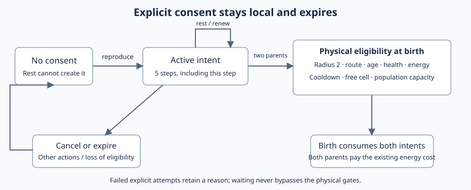

# Mating intent and proximal reproduction

[Configuration](configuration.md) · [Observations](observations.md) · [Rewards](rewards.md)

Mating is a learned decision subject to physical eligibility and mutual consent.
An optional intent window allows nearby animals to coordinate choices across
steps while resting; it does not create automatic or asexual reproduction.

## Consent state

Set `species.NAME.reproduction.intent_steps` to an integer from 1 to 128.
Omitting it is equivalent to 1: both parents must choose `reproduce` in the same
step. Use the effective environment configuration to determine the duration.

For `intent_steps: 5`, choosing `reproduce` while personally eligible grants
consent for the current step and the next four steps. Repeating that choice refreshes the window.
`rest` preserves it; turning, moving, swimming, eating or attacking cancels it,
even if the attempted action fails. Expired intent cannot produce a birth.
Self ineligibility clears intent, so recovery would require a new choice.
Resting alone never grants consent. A parent that previously consented can mate
when the other parent chooses reproduction later within the window.

Both parents must still be alive, same-species/opposite-sex, mature, off cooldown,
healthy, sufficiently energized, on dry cells, within radius, and connected by
line of sight and a valid dry route. The pair needs free child space and species
population capacity. Checks resolve after movement, combat and metabolism.
A birth consumes both intents, debits energy from both parents and starts both
cooldowns. Children begin without consent and mix both parents' weights with
the existing fresh training-state and rare mutation rules.

Successful parents receive the ordinary birth reward and energy-cost feedback
on the step of birth, including a parent currently resting. A failed explicit
`reproduce` choice retains the configured failed-action penalty, including while
awaiting consent. Waiting with `rest` has its ordinary living cost. There is no
new penalty, proximity bonus, free birth or distant-mating exception.

## Failure reasons and inspection

Every unsuccessful explicit reproduction choice emits `mating_failed` with an
actor and one deterministic `cause`. The event is saved with playback events;
the inspector displays each living animal's last reason and remaining intent.
The offline analyzer's species/window `mating_failures` dictionary and dashboard
telemetry retain counts by cause. They do not change the reward formula.

| Cause | Meaning at resolution |
| --- | --- |
| `parent_died` | The attempting animal died before the birth phase |
| `disabled` | Reproduction is disabled or unconfigured |
| `immature` / `cooldown` | The animal's actual age/clock is not ready |
| `low_health` / `low_energy` | A personal resource gate fails |
| `in_water` | The attempting animal is in water |
| `population_cap` | No species population capacity remains |
| `no_nearby_mate` | No same-species, opposite-sex animal is within radius |
| `blocked_route` | Nearby candidates fail visibility or the dry-route rule |
| `mate_unavailable` | A reachable candidate has already paired this step |
| `mate_not_ready` | Reachable candidates fail personal eligibility |
| `awaiting_consent` | Ready reachable candidates have no active consent |
| `no_birth_space` | A willing pair cannot place a child |

Personal gates take priority, followed by population capacity and candidate
checks. This is one diagnostic reason per explicit attempt, not an exhaustive
list of all failed predicates. Resting animals with pending intent do not emit
additional attempt failures. Sampled recordings can omit events between saved
frames; record every step for complete failure counts. Before/after-birth state
can change which candidate reason is reported under contention.

`mating_intent_until_tick` and `last_mating_failure` are per-animal state, saved in
JSON/binary checkpoints and replay field tables. Old checkpoints default to no
intent; old recordings remain readable. Model weight formats are unchanged.
Version-3 remains the existing 42-input layout (at k=1); intent counters and
failure strings are inspector state, not extra neural inputs. The mask checks
physical opportunity without assuming or reading future partner choices.

Same-step reproduction success ratios are reported as unavailable for persistent
intent, since a birth can consume consent from a previous step. Use births,
explicit attempts and failure-reason counts rather than interpreting
`2 * births / current-step reproduce choices` as a probability.

Deterministic lifecycle, checkpoint and playback tests verify the mechanism.
Ecological stability requires separate behavioral evaluation.

Version 4 also exposes local consent to the brain; see [escape and consent](escape-and-consent.md).
