# Native execution and Python queries

[Running experiments](running.md) · [Python tutorials](tutorial.md) · [Native numerical kernels](native-kernels.md)

The experimental, opt-in C++ engine owns world construction, physical stepping,
observations, all 14 built-in CPU learners, private RNGs and episode lifecycle.
One Python call can execute many complete steps without Python callbacks per
animal or step. Founder initialization and between-episode champion chaining
also run natively. The ordinary `Experiment` API remains the portable reference;
C++ is selected explicitly with `--engine cpp`.

This describes the unpublished 0.1.0.0 source candidate. Local regression,
installed-package, independent-review and workflow benchmark results are recorded
in the [release notes](releases/0.1.0.0.md) and [performance guide](performance.md#native-ppo-episode-engine).
All built-in learners have differential correctness coverage; timing/RAM figures
apply to the listed workloads.

## Build and select

From a source checkout, using CPython 3.12 or 3.13 and a C++17 compiler:

```sh
.venv/bin/python -m work.build_native_engine
.venv/bin/python -m wtf run ppo --engine cpp --runs 2 --seed 100 --progress
```

Compilation is explicit; importing the package never invokes a compiler. Restart
existing Python processes after rebuilding so they load the new extension. Source
builds can include the engine with `WTF_BUILD_ENGINE=1`; `WTF_BUILD_NATIVE=1`
separately selects the existing C numerical kernels. Portable installations keep
the Python engine. `--engine python` explicitly selects it; explicit `cpp`
selection fails before starting when the requested configuration is unsupported.

The engine is a CPU backend. Existing CUDA execution remains a separate path.
C++17 support and Python development headers are needed when compiling, not for
reading recordings. See [installation](../INSTALL.md).

## Supported execution contracts

| Area | Native episode path |
| --- | --- |
| Learners | Q-network, DQN, DDQN, QR-DQN, Discrete SAC, PPO, masked PPO, MAPPO, A2C, REINFORCE, GRPO, TRPO, recurrent PPO and LSTM PPO |
| Numbers | FP32 model/optimizer storage; existing FP64 arithmetic and ordered reductions |
| World | Closed maps, resources, obstacles, terrain/elevation, swimming/current drift, day/night, hunting, contests, effort, starvation and deaths |
| Reproduction | Proximal mutual consent, configured intent and age/cooldown windows, parental inheritance and rare child mutation |
| Inputs | V1–V7; configured top-k/FOV, personal movement history, scent, local witnesses and consequence scopes |
| Shared evidence | Species outcome tables, bounded contexts, optional persistent action totals and continuous/episode publication; private neural weights remain independent |
| Optional heads | Auxiliary outcome prediction and late consequence adjustment for ordinary/masked PPO, matching their Python support |
| Species | Arbitrary configured names; independent species/sex champions and private animal controllers |
| Modes | Training, evaluation, random baseline, frozen-brain evaluation and configured early stopping |
| Inspection | Recorded observations, predictions and sampled activations from native controllers; existing archived-weight explanation remains read-only |
| Artifacts | Existing checkpoint, champion, metrics and replay contracts through the Python artifact layer |

CUDA requires `--engine python`; the C++ episode engine is a CPU backend.
Custom Python subclasses, monkeypatches and callbacks also require Python
execution. Selecting a backend does not make a new policy identifier, action or
observation contract available automatically. Unsupported execution is rejected
rather than dropping configured behavior.

Legacy FP64-stored controller continuation remains on the Python engine. The
native core preserves FP64 **arithmetic**, but its live model and optimizer
arrays use FP32 **storage**. Loading compatible older weights into a fresh FP32
run remains a warm start, distinct from exact legacy checkpoint continuation.

## Execution and ownership



Python validates configuration, resolves saved-model files and supplies a fresh
randomization seed when required. C++ constructs worlds and private founders,
applies compatible warm starts, schedules world seeds, publishes episode-level
knowledge and initializes the next run's champions/controllers. Normal fresh
construction and `next_run()` do not create Python worlds or learners.

The CLI executes bounded native batches
of at most 250 steps, ending sooner at configured checkpoint/brain-save boundaries.
Progress updates and artifact work occur between batches. It does not rebuild
observations or execute learning through Python inside those batches.

The native world keeps an owned obstacle byte grid, immutable terrain, ordered
entity state, bounded sensory histories and species consequence knowledge.
Learners use separate typed parameter, optimizer and replay/rollout/trajectory
buffers; recurrent hidden state and GRPO trial randomness are private too. Immutable metadata/model records share native storage until a
write detaches them. Model import, snapshot and checkpoint transport keep explicitly
FP32 parameters in packed four-byte arrays; observation values and world
arithmetic are not narrowed. Public exports still contain ordinary
Python lists. Champion encodings can be reused while a private learner's
update counter is unchanged: live model arrays cannot be modified by Python.
That ownership rule differs from the reference engine's externally mutable arrays.

When recording is selected, C++ prepares sampled world/inspector frames into a
bounded temporary JSONL spool. Python streams those frames through the unchanged
binary/delta/XZ writer after each batch, then removes the spool. The whole replay
is never retained in RAM. This temporary transport is not a new saved replay
format. Capture, retention and last-episode selection remain independent controls.

### Native hotpath data and caches

The implementation uses typed, read-only phase views where repeated interpretation
was expensive. Each observation phase collects current animal coordinates, body
settings, species counts, mating readiness, occupancy, food cells and scent
indices once. Top-k selection, mating cues and personal histories share those
views. Visibility results belong to that observer and phase; nothing is reused
across steps, so target movement, food changes, births and deaths remain visible.
Target ordering, presence, occlusion and signed-zero observation values are exact.

| Data | Owner and bound | Refresh/invalidation |
| --- | --- | --- |
| Sensory projection and spatial lookup | One observation call; current cells, species and animals | Rebuilt for every observation phase |
| Animal ID → live slot | World; living animals only | Insert at birth; rebuild after removals |
| Effective species bodies | World; one current-tick entry per species | Rebuilt when the tick changes, including day/night modifiers |
| Observation layout | Immutable template contract | Shared by compatible controllers; contains no animal observations |
| Forward/backward/GAE buffers | Private learner; fixed network shape and configured batch/rollout | Reused scratch; recreated on restore, never shared as another animal's experience |
| Pending prediction and recurrent memory | Private learner; pending decision and configured recurrent width | Updated by its own decisions/learning; temporal state resets under the existing child/run contracts |
| Forward activation reuse | Private PPO learner; one input/model version | Exact input-bit and optimizer-update match; no shared learner state |
| Species consequence rates | Shared evidence owner; configured species/actions and bounded context tables | Continuous publication or episode boundary; context eviction does not discard enabled persistent totals |
| Champion model snapshot | Session; current private IDs and update counters | Replaced after updates; removed when the controller retires |

PPO bootstrapping evaluates the final critic row rather than every action output.
A compatible next-state forward pass can supply hidden activations for the next
choice while the private weights remain unchanged. This preserves reduction
order, FP32 storage rounding, RNG draws, KL gates and action probabilities.
Workspaces and derived caches are absent from saved checkpoints: they are rebuilt,
not inherited as training experience. Replay/rollout contents, recurrent memory,
pending decisions, target/reference networks, optimizer state, private RNGs and
published/staged shared knowledge are authoritative continuation data and remain
checkpointed under their existing contracts.

GRPO trial worlds can share read-only geography while keeping mutable bodies,
resources, RNGs, social publication state and trial observations isolated. A
trial's frozen policy choices do not advance the owning live controller's action
RNG, replay cursor or exploration schedule. MAPPO privileged context feeds its
critic only; actors continue to receive local observations.

## Query through Python

```python
from wtf import NativeExperiment, load_config

config = load_config("ppo")
config["seed"] = 100
config["world"]["max_steps"] = 200
config["experiment"].update(runs=1, world_seed_policy="fixed")

session = NativeExperiment(config)
session.run(100)                 # One native call, many complete simulation steps.
state = session.snapshot()       # Detached world data, no Python learner rebuild.
observations = session.observations

view = session.query()           # Full ordinary Experiment copy for existing tools.
for animal in view.world.animals.values():
    print(animal.id, animal.species, animal.health)

session.run()                    # Finish this episode in C++.
```

`snapshot()` and `observations` export detached data. `query()`/`to_python()`
restore a complete independent Python `Experiment`; use one query copy for a group
of inspections rather than restoring it repeatedly. Editing that copy does not
change the native session. `world` and `brains` convenience properties also return
query copies. Queries of the same session while `run()` is executing are rejected;
its native loop releases the GIL, but live mutable state is not exposed to races.

`NativeExperiment.restore(checkpoint)` imports a supported logical checkpoint.
`session.checkpoint()` exports one for native or Python continuation. Explicit
`restore()`/`from_experiment()` use the Python compatibility and validation path
before importing detached state; they are not calls made inside a native step.
`next_run()` performs world/controller initialization, champion chaining and
shared-knowledge publication in C++. Ordinary CLI progress and artifact
projections remain Python work at batch boundaries.

## Verify complete workflows

```sh
.venv/bin/python -m unittest \
  tests.test_cpp_value_policies tests.test_cpp_actor_policies \
  tests.test_cpp_world_features tests.test_cpp_sensing_features \
  tests.test_cpp_run_genesis tests.test_cpp_feature_integration tests.test_cpp_session
.venv/bin/python -m work.benchmark_native_engine \
  --presets ppo --steps 256 --runs 1 --repeats 3 --seeds 100 \
  --profiles headless replay --modes train evaluate
```

The benchmark alternates isolated Python/C++ workers, includes setup and artifact
work, checks full checkpoint/CSV/replay equivalence, and reports peak host RAM.
It preserves configured recording cadence. Raw measurements stay in ignored
`.cache/native-engine/`; see [performance](performance.md) for adopted results and
limits. Local measurements do not establish Linux or another interpreter's pass;
the native CI matrix validates those builds separately.

## Adding native support

Keep Python as the behavioral reference. A new native feature needs explicit
configuration guards, private lifecycle state and differential checks for the
full checkpoint and replay, including births, deaths, restoration and episode
boundaries. Port initialization, diagnostics, frozen trial choices, model
signatures, target/reference state and heads as well as forward/backward math. Implement world/observation rules inside the core rather than calling
Python from the native step loop. The bridge owns conversion and the GIL; it must
not retain Python objects after import.

Adding an action, policy or observation adapter to Python does not automatically
add native execution support. Until its complete contract is ported, reject it
at native selection and use `--engine python`. See
[world/action extensions](extending-worlds-and-actions.md) and
[policy extensions](extending-policies.md).

## Inspect native phase costs

For an explicit diagnostic measurement, run a supported session with:

```python
report = session.run(250, options={"profile_native": True})
print(report["profile_native"])
```

This reports seconds for choosing, physics, observation, learning, champions,
lifecycle, metrics and native capture. It adds clock measurements, so use it to
locate costs rather than as the throughput benchmark. Timings are transient return
data; they do not enter checkpoints, metrics, recordings or viewer state. The
[paired workflow benchmark](#verify-complete-workflows) measures the uninstrumented
CLI path, including setup, projections and artifact writing.
