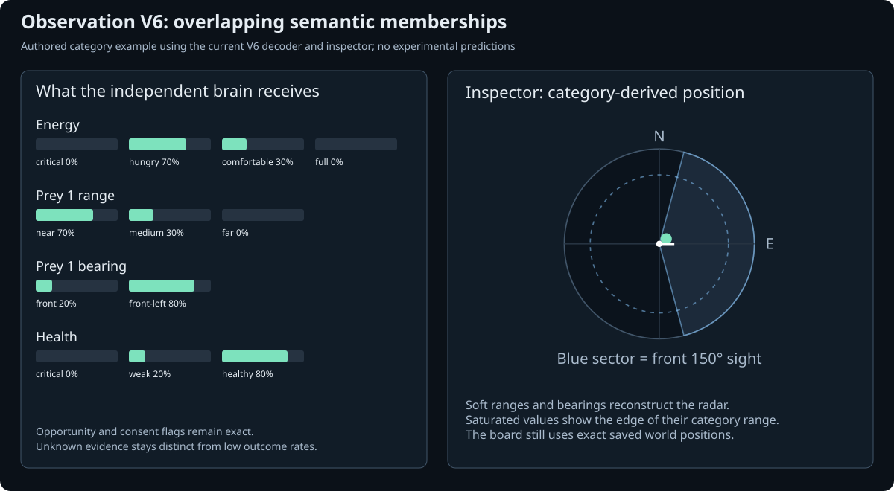

# Animal observations

[Configuration](configuration.md) · [Geography](geography.md) · [Saved brains](brain-library.md)

Each living animal receives a numerical observation before choosing its own
next action. The sight area determines which targets it can detect. The brain
does not receive an image or control the other animals.

## Visible target slots


Set `observation_top_k` on a brain template to choose how many visible targets
are retained **per category**: food patches, resource-eating animals and
prey-eating animals. Categories follow diet, not configured species names.
The setting accepts integers 1–16 and defaults to 1 for old configurations.
Prey and predators can reference different templates with different k values.

```json
"observation_version": 2,
"observation_top_k": 4
```

These fields belong alongside `type`, `network` and training settings inside
`brains.<template>`. The enhanced [river preset](../environments/river_crossing_strong_predator.json)
and its [deeper-network variant](../environments/river_crossing_strong_predator_deep.json)
set k=4 for both species' templates.

Targets are ordered by distance within each category. Equal-distance targets
retain authoritative insertion order, matching the original nearest-only rule.
Each slot contains normalized relative x, relative y, distance, and presence
(1 for a target, 0 for padding). Empty slots contain four zeros. A food patch at
the animal's own cell has distance zero and presence one. An animal excludes
itself from animal targets. Food must exceed the existing presence threshold.

The first k **visible** targets are selected: a hidden near target does not
consume a slot. Sight radius, directional water extension and wall occlusion
still apply. Target coordinates/distances are normalized by the query radius
(base sight plus configured water bonus on a wet map), as with k=1. Positions
use world x/y axes; nearby blocked directions are relative to heading.

This exposes several possible targets instead of only the closest. It still
limits information to k per category and does not expose target health, target
brain state, unique identity or a complete occupancy grid. Slot identities can
change as distance ordering changes. Brains choose existing actions such as
turn/move/swim/attack; an observation slot is not a direct attack-target command.

## Forward visual field

Set this on each species body to use front-facing vision:

```json
"field_of_view_degrees": 180
```

Supported values are **150**, **180** and **360**; omission preserves the original 360°
view. The 150° option uses a ±75° forward cone. The 180° setting keeps targets in the front half-plane relative to the
animal's current heading, including both side boundaries and its own cell.
Turning changes the field immediately, even without movement. Radius, wall
occlusion, night-time range and the directional water bonus still constrain
sight. The water bonus cannot reveal a target behind the animal.

This filters fresh food/prey/predator slots, visual mate/pair/consent cues and
local witnessed outcomes. Top-k remains a maximum per category; missing targets
are zero-padded. Target coordinates remain world-axis offsets in versions 1–4; V5 uses
forward/right offsets. Input-vector
lengths and policy signatures do not change, although perceived states do.
Personal movement memory can briefly retain an older rear sighting with fading
confidence; it never receives unseen new movement. Learned species knowledge is
also retained. Scent remains omnidirectional within its smell radius.

Own body state, immediate adjacent collision/terrain affordances and physical
action eligibility are not the visual target sensor. They retain their existing
rules, including backward movement and proximal mating. A physical mate behind
an animal is omitted from fresh visual mate cues; this does not enlarge or
shrink the reproduction radius or bypass mutual consent.

The selected-agent board overlay shows the current forward sector. The inspector
radar shades the configured sector using the **recorded sample's heading**, which may
lag the current board. Both follow the viewer theme. Old recordings without the
setting retain their circular overlay. [Appearance examples](viewer-visual-reference.md#forward-vision).

`land_bridge_collective` enables 180° for both species. The earlier bridge
presets retain 360°; compare with matching vision settings when attributing a
learning effect. Existing compatible policy weights can transfer between fields,
but they must be evaluated under the new perception. The shared consequence
predictor's saved physical contract includes the species body, so 360° knowledge
exports are not silently imported into a different 150°/180° body contract.

The `land_bridge_collective_150` preset keeps the collective bridge setup with
`field_of_view_degrees: 150` for both species; use it to compare a narrower
forward cone with `land_bridge_collective` (180°). Other settings remain the same.

`seaside_150` applies 150° to both species and enables visible social outcomes,
both general and context consequence inputs, durable species/action totals and
private auxiliary consequence heads (coefficient `0.1`). Evidence is published
between episodes. It retains the ordinary `seaside` map, body/reproduction
settings and PPO update settings; its observation/model contract is larger.
Start fresh rather than loading weights from the earlier plain `seaside_150`
configuration. Brains remain independent. See [collective learning](social-learning.md).

```sh
.venv/bin/python -m wtf run seaside_150 --runs 5 --seed 100 --progress
```

## Input layout


The illustrated version-3, k=4 vector has terrain at indexes 56–67 and mating
at 68–77. With k=1 those blocks start at 20 and 32. More target slots shift the
following blocks; they do not duplicate terrain or mating inputs.

| Section | Number of values |
| --- | ---: |
| Own energy, health and heading vector | 4 |
| Blocked walking ahead, right, behind and left | 4 |
| k food slots, k resource-eater slots, k prey-eater slots | 12 × k |
| Version 2/3: current depth, flow x/y, elevation; four adjacent depth/elevation differences | 12 |
| Version 3: sex, maturity, cooldown, readiness and nearest eligible-category mate/pair information | 10 |

Mating inputs keep their existing single nearest-visible-mate summary, separate
from the k general animal slots. Version 2/3 terrain inputs are zero-padded on
flat maps. General target slots do not distinguish sex or exact species.

| Observation version | Default k=1 | k=4 |
| --- | ---: | ---: |
| 1: base | 20 | 56 |
| 2: terrain | 32 | 68 |
| 3: terrain + mating | 42 | 78 |
| 4: mating + visible consent | 45 | 81 |
| 5: body-relative spatial values + immediate opportunities | 48 | 84 |

The general formula is the original version width plus `12 * (k - 1)`.
Changing k changes the input layout and required model signature. Start fresh,
or load a model with the same algorithm, architecture, actions, version and k.
Old models without a top-k field keep their original k=1 signature; explicitly
setting k=1 is compatible too. Exact checkpoints retain their saved setting.

## Observation version 5

Set `brains.<template>.observation_version: 5` to opt in. Versions 1–4 retain
exactly their existing widths and world-coordinate meanings. V5 keeps the same
self, top-k target, terrain and mating blocks as V4, projects directional values
into the animal's current forward/right basis, and inserts three opportunity
values **after consent and before optional tracking/social inputs**.


For heading `(hx, hy)` and a normalized world vector `(dx, dy)`:

```text
forward = dx * hx + dy * hy
right   = -dx * hy + dy * hx
```

Negative right means left; negative forward means behind. Heading x/y remain
world-relative self information. Target/mate distances, presence, normalization
radii, top-k ordering, sight limits, physical rules and consent are unchanged.

| Block | V5 encoding |
| --- | --- |
| Food, prey, predator and mate offsets | Forward/right relative to the observer |
| River current | Forward/right components, with the existing flow scale |
| Personal visual memory | Last position, velocity and each remembered position rotate using the observer's current heading; stored memory stays in world coordinates |
| Ground scent | Same anonymous channels and strengths, reordered as here/front/front-right/right/back-right/back/back-left/left/front-left |
| Social and consequence estimates | Same scalar meanings and configured widths |

| New input | Meaning at the decision snapshot |
| --- | --- |
| Attack possible now | Attack is allowed, the observer is a predator with positive attack damage, and prey occupies the cell directly ahead |
| Eat possible now | Eat is allowed, the animal has energy capacity and positive bite/food conversion, and a nonempty resource is here or directly ahead |
| Swim possible now | Swim is allowed and the front transition passes the existing occupancy, terrain, health and effort gates |

Unsupported actions produce zero. These are sensed immediate affordances,
**not masks**: ordinary PPO still assigns probability to every allowed action.
They do not predict another animal's simultaneous move, reserve a resource or
guarantee the eventual outcome. Existing pair-opportunity and consent inputs
continue to describe reproduction; V5 does not add duplicate mating flags.

With k=10, the base width changes from V4's 153 to **156**, before optional
tracking/social blocks. Architectures and top-k are unchanged. Old V4 weights
cannot be silently relabeled V5; create fresh compatible brains. Exact checkpoints
restore their saved version. The [compatibility policy](compatibility.md) and
[viewer reference](viewer-visual-reference.md#observation-v5) cover readers.

`seaside_150` remains the V4 preset. `seaside_150_v5` keeps its geography,
species, ordinary PPO, auxiliary/consequence settings, radius and other physics;
only the observation version and descriptive preset identity differ.

```sh
.venv/bin/python -m wtf run seaside_150_v5 --runs 5 --seed 100 --progress
```

To compare the maintained V4 setup against V5 without large artifacts:

```sh
.venv/bin/python -m work.compare_observation_versions \
  --environment environments/seaside_150.json \
  --seeds 100 200 300 --episodes 3 --steps 1500 \
  --evaluation-seeds 900 901 --progress \
  --output .cache/v4-v5-comparison.json
```

Each version starts fresh with the same seeds and all other configuration values.
The helper verifies common configuration and initial world hashes, trains without
recording, and freezes same-species/sex selected champions on shared holdout seeds.
It reports greedy and seeded stochastic evaluation separately and asserts that
weights and consequence evidence remain frozen. Births in frozen evaluation copy
same-sex parent weights without crossover or mutation. The report retains compact
summaries, not model/replay files. Input widths change initialization shapes, so
matched seeds do not imply identical initial weights, trajectories or work counts.
Repeated runs and both species changing prevent treating individual births/kills
as proof of a general improvement. V5 remains opt-in; its representation is not
a survival or reproduction guarantee. Keep experiment reports local.

## Observation version 6

V6 is an opt-in **soft semantic basis** over the already sensed V5 vector. It
keeps each top-k entity slot and independent ordinary PPO brains. It changes
what the network receives; it does not change actions, physics, proximal mating,
mutual consent or the publication schedule of consequence knowledge.

### What changed from V5 to V6


V5 supplied normalized numbers; V6 expands selected numbers into overlapping
category memberships, while exact flags and top-k slot identities remain intact.
The comparison shows the same scene on both sides, plus all optional block
widths. This is a change in representation, not additional sensory information
or a smaller byte format. In-range scalar memberships retain reconstructable
values; saturation outside the configured endpoints remains explicit.

The later V6 allocation/training optimization changes **none of these inputs**:
values, order, widths and recorded playback are identical before and after that
optimization. Only repeated computation and allocation are reduced.

### Reading the memberships



Instead of a single normalized distance, a slot carries near/medium/far
memberships. Directions use eight circular body-relative sectors. Adjacent
categories overlap linearly: a distance of `0.09` with knots `[0, 0.3, 1]` is
`near=0.7, medium=0.3, far=0`. Bearings interpolate between adjacent sectors across
the front-left/front wrap too. A zero vector has no bearing; a presence flag
keeps an animal/resource in the observer's own cell distinct from an absent slot.

| Sensed field | Semantic channels |
| --- | --- |
| Energy | Critical, hungry, comfortable, full |
| Health | Critical, weak, healthy |
| Each target/mate position | Near/medium/far; eight forward-relative bearing memberships; exact presence |
| Current and remembered velocity | Still/gentle/strong speed and eight bearings |
| Local/adjacent water | Dry/shallow/deep |
| Elevation | Low/middle/high |
| Adjacent climb | Steep-down/gentle-down/level/gentle-up/steep-up |
| Maturity, cooldown, consent duration, memory age/confidence, scent strength and evidence confidence | None/partial/strong, interpreted in the named field's existing normalized scale |
| Harm/feeding/birth tendency | Zero/very-low/low/moderate/high, with extra knots near zero to preserve rare-outcome distinctions |

Sex, world heading, collision indicators, presence/seen flags, readiness,
pair opportunity, consenting-pair opportunity and attack/eat/swim opportunities
retain their exact existing values. No new hidden positions, identities, rewards
or future outcomes enter the vector. Unknown evidence has confidence `none=1`;
that remains distinct from a well-supported low outcome rate.

### V6 input layout


The input is one ordered flat vector. Each target keeps its own top-k slot;
range/bearing memberships are concatenated with its exact presence flag. Core
blocks precede optional movement history, scent, local visible outcomes, general
consequences and context consequences, in that order. Disabled blocks contribute
no channels. The figure labels actual zero-based ranges for the maintained
`seaside_150_v6` prey template and checks those boundaries against the current
decoder. Its predator template uses a different k and therefore different offsets.
The zoomed values are illustrative; the blocks are not drawn to scale.

### Soft-category configuration

Set `observation_version: 6` on selected brain templates. Optional
`soft_categories` overrides membership centers on **normalized V5 scales**, not
absolute cell distances or physical thresholds:

```json
{
  "observation_version": 6,
  "soft_categories": {
    "distance": [0, 0.2, 1],
    "energy": [0, 0.2, 0.7, 1]
  }
}
```

Every list has a fixed length, strictly increasing finite values and fixed
endpoints. Omitted groups use the defaults below. Category names stay fixed.
Changing the centers changes the saved-model signature and requires matching
weights. Physical health, swimming and reproduction thresholds remain in their
existing species settings; soft labels never replace eligibility gates.

| Group | Default centers |
| --- | --- |
| distance | `0, 0.3, 1` |
| energy | `0, 0.25, 0.75, 1` |
| health / level | `0, 0.5, 1` |
| depth / elevation | `0, 0.1, 1` |
| climb | `-1, -0.1, 0, 0.1, 1` |
| speed | `0, 0.25, sqrt(2)` |
| outcome | `0, 0.001, 0.01, 0.1, 1` |

Values outside a group's represented range **saturate at its end category**.
This is particularly relevant to remembered positions after movement or range
changes. Scalar values inside the range can be reconstructed from their linear
memberships; this is not hard quantization. Category-derived inspector positions
are representative values, especially after saturation. Exact world replay
positions, event data, physics and V1–V5 observations remain unchanged.

### Width, storage and private auxiliary learning

V6 makes information more semantic, **not necessarily smaller**. Its base width
is `94 + 36*k`: 130 at k=1, 202 at k=3 and 454 at k=10. Optional blocks add:

- Personal history: `2*k*(29 + 12*H)` values when H is enabled.
- Scent: 27 values per configured anonymous channel.
- Local social observations: 108 values.
- Consequences: 216 values per scope; `both` adds 432.

The maintained `seaside_150_v6` preset therefore has **742 prey / 994 predator
inputs**, versus V5's 192/276 with the same optional settings. The larger first
layer and rollout vectors can cost more CPU, RAM and replay space. V6 templates
are limited to 4096 encoded inputs; reduce top-k/history/channels if needed.
Compiled structural layouts use a bounded 128-entry cache with no animal state.
Bounded immutable coefficient caches reuse repeated scalar/bearing values and
auxiliary reconstruction; fresh observation containers preserve independent
ownership. Unknown consequence samples avoid zero-loss auxiliary decoding.
Exact-value contracts and measured CPU/memory results are in
[V6 performance](performance.md#v6-semantic-encoding-and-auxiliary-work).

The private auxiliary head keeps its 36 physical-outcome outputs. It decodes
published consequence targets from V6 memberships and zeros **every encoded
consequence channel** on its auxiliary branch. Independent ownership, the PPO
KL gate and on-policy rollouts are unchanged.

```sh
.venv/bin/python -m wtf run seaside_150_v6 --runs 5 --seed 100 --progress
```

This preset changes only the V5 preset's observation version and descriptive
identity. It retains ordinary PPO and the same auxiliary/consequence settings;
V5 and all earlier presets stay available. Start with fresh compatible brains.

For a bounded comparison with compact local summaries:

```sh
.venv/bin/python -m work.compare_observation_versions \
  --versions 5 6 --environment environments/seaside_150_v5.json \
  --seeds 100 200 300 --episodes 3 --steps 1000 \
  --evaluation-seeds 900 901 --progress \
  --output .cache/v5-v6-comparison.json
```

The helper retains V4/V5 defaults unless `--versions` is supplied. V6-only knot
settings are removed from older arms and recorded separately as treatment
metadata; they are excluded from the common-configuration hash. Both arms use
the same remaining configuration and starting world seeds, with fresh compatible
weights. Frozen greedy and stochastic holdouts are reported separately; no
replays or model archives are written. Input shapes and initial parameters differ;
matched seeds do not establish identical trajectories or a runtime speedup.
Keep study outcomes in local reports, and evaluate ecological benefit before
promoting this opt-in representation.

## Optional movement memory and scent

[Movement history and scent trails](tracking.md) append personal sighting and
blended anonymous scent or legacy species/sex ground-scent inputs after the existing versioned blocks.
Both default off. The base widths above remain unchanged; enabled movement adds
`2 * K * (7 + 3 * H)` values and scent adds nine values per configured channel.
Their layout fields participate in model compatibility. The inspector displays
sampled tracks and a blended heatmap (or legacy local scent grids) without storing complete world scent maps.

## Observation version 7

V7 is an optional compact numeric representation. V1–V6 remain supported;
V6 soft categories are not removed or relabeled. V7 changes the policy input
contract and needs matching fresh weights. It does not guarantee improved
survival or faster training.


### Compact vector order

| Block | Width | Contents |
| --- | ---: | --- |
| Own state | 8 | Energy, health, heading x/y, four blocked flags |
| Food / prey / predator slots | `9k` | Three channels per slot: forward, right, presence |
| Terrain | 12 | Depth, flow forward/right, elevation, adjacent depth/climb |
| Mating and consent | 12 | Existing numeric cues, excluding mate distance |
| Immediate opportunities | `O` | Only configured attack/eat/swim actions |
| Movement summaries, if enabled | `14k` | Seven channels per prey/predator-role track |
| Scent, if enabled | `4C` | Four channels per configured anonymous channel |
| Local witnessed outcomes, if enabled | 24 | Six groups × confidence/harm/feeding/birth |
| General consequences, if enabled | `4A` | Configured actions, stable order |
| Context consequences, if enabled | `4A` | Configured actions, stable order |

`k` is top-k, `A` is the species' configured action count, `O` is its number of
attack/eat/swim actions, and `C` is scent-channel count. Derived distances can be
reconstructed from coordinates, with possible last-bit floating-point differences.
Presence, heading, readiness and pair flags remain explicit. General/context
knowledge for a temporarily masked action stays present; only permanently
unconfigured actions are omitted. Local outcomes and both consequence sources
remain separate, with their own confidence. No new hidden-world information is
introduced.

`observation_actions` is resolved from the exact species' ordered
`allowed_actions` during validation and stored in model signatures and recording
metadata. An explicit list must match. V7 species sharing a brain template must
use identical ordered action lists; use separate templates otherwise. Animal
weights remain independent even when a template is shared.

### Movement summary and scent bearing

A track contains last-known forward/right position, overall trend velocity
forward/right, freshness, visible-now and motion reliability. Velocity uses the
oldest/latest available personal sightings over their elapsed steps. Reliability
combines sighting coverage and path straightness; it is not a calibrated
probability. Missing tracks are zero. No unseen positions are extrapolated.
Historical sightings are retained internally for the configured window, but
individual lag coordinates are not delivered to the brain or stored in V7 inputs.
The inspector shows a summary, not a reconstructed observed path.

Each scent channel is `[direction_forward, direction_right, strength, freshness]`.
Direction is a unit bearing to the strongest reachable **off-cell** dry patch;
the current cell is excluded because the observer's fresh deposit would otherwise
dominate. Own older traces remain. Blended contributions at a patch add with a
cap of one; freshness is the freshest contributing deposit's remaining lifetime.
Ties prefer freshness, then squared distance, then stable cell order. Obstacles
and water constrain dry-cell reachability. No patch gives four zeros. Separated
legacy channels remain configurable; V7 also summarizes each of them in four
values. A single-source patch can have equal strength/freshness; mixtures can
separate them. Alternative scent directions are deliberately lost. A bearing is
not a route around an obstacle and carries no animal identity or exact distance.

### Algorithm support for V7 and consequence handling

Compact V7 movement/scent observations and the existing local/general/context
**input-feature mode** support all fourteen learners. The learned **late
consequence adapter** and its native CPU minibatch currently support only
ordinary PPO and masked PPO. Configurations requesting `late_consequence` for
another learner fail validation; the option is never silently ignored.

| Algorithm type | Compact V7 + consequence inputs | Late adapter / its native CPU batch | Remaining integration |
| --- | --- | --- | --- |
| `ppo` | Yes | Yes | Implemented, ordinary policy remains unmasked |
| `maskable_ppo` | Yes | Yes | Implemented, final probabilities honor the physical mask |
| `q_network` | Yes | No | Online/target Q adjustments and TD targets |
| `dqn` | Yes | No | Online/target adapter synchronization and Bellman targets |
| `ddqn` | Yes | No | Separate online selection / target evaluation consistency |
| `qrdqn` | Yes | No | Quantile outputs, target distributions and adapter gradients |
| `a2c` | Yes | No | Final-distribution policy loss and adapter optimizer integration |
| `reinforce` | Yes | No | Trajectory loss / baseline and final-distribution gradients |
| `grpo` | Yes | No | Trial/reference policies, probability ratios and KL terms |
| `mappo` | Yes | No | Local actor adapter with the centralized training critic |
| `recurrent_ppo` | Yes | No | Sequence rollouts, recurrent state and backpropagation |
| `lstm_ppo` | Yes | No | LSTM sequence/BPTT integration with final-policy objectives |
| `trpo` | Yes | No | Full-policy KL constraint, curvature and line-search parameters |
| `discrete_sac` | Yes | No | Entropy-aware actor, critic targets and adjusted action probabilities |

These are current implementation limits, not theoretical restrictions. Adding an
adjustment only at inference would leave the unsupported learner training against
a different prediction function. Q-values represent estimated returns, rather
than PPO action logits, so their target networks and losses need explicit
integration too. Each learner's existing native kernels remain available;
“No” in this table refers specifically to the new late-adapter batch. Compact V7
support does not imply CUDA support for a particular learner.

### Opt-in late consequence policy


Set `"late_consequence": {"max_adjustment": 2}` on a V7 ordinary/masked PPO
brain with consequence observations enabled. Omit it to keep all compact
observations as ordinary neural inputs. Other learners support compact V7 but
currently do not support this adapter.

With the adapter, all local/general/context evidence bypasses the physical
actor/critic trunk. Every action's learned residual uses confidence-weighted
harm/feeding/birth rates from each enabled source, conditioned on a constant,
hunger, health deficit and own reproduction readiness. Each animal owns its
adapter weights and Adam state. The zero-initialized adapter starts neutral;
residuals are bounded by `max_adjustment`. No fixed utility coefficient forces
food, safety or reproduction to win. The critic currently uses physical inputs
only; this is a baseline-information tradeoff, not a claim of equivalent learning.

PPO samples and trains with the **final adjusted distribution**. Masked PPO applies
its existing physical mask after adjustment; ordinary PPO remains unmasked.
Rollouts retain the exact evidence available for each sampled action, so training
never substitutes a newer live lookup. Episode publication can freeze shared
estimates between episodes; continuous publication still keeps each saved sample
immutable. The KL gate rejects both actor and adapter updates together. Auxiliary
PPO outcome heads remain optional and exclude consequence targets from their
prediction inputs. An optional fused native CPU minibatch computes both actor
and adapter gradients; older/missing native extensions and custom hooks retain
the exact reference path. CUDA PPO training does not yet implement the adapter.
See [training performance](performance.md#v7-late-adapter-training-batches).

### Preset and measured layout sizes

```sh
.venv/bin/python -m wtf run seaside_150_v7 --runs 5 --seed 100 --progress
```

The preset uses ordinary PPO, three-step movement summaries, blended scent and
both consequence scopes, with evidence published between episodes. It inherits
the current seaside geography and reproduction configuration. Its normal
recording selection retains the last two episodes; set `--record-last-episodes -1`
to record all scheduled episodes.

| Matched settings | Prey k=3, A=10 | Predator k=10, A=7 |
| --- | ---: | ---: |
| V5, no movement/scent, local + both scopes | 192 | 276 |
| V6, same settings | 742 | 994 |
| V7, same settings | 165 | 204 |
| V7 preset, movement + blended scent enabled | 211 | 348 |
| Physical neural inputs with late adapter, preset | 107 | 268 |

These are exact layout widths, not timing or ecological results. All 211/348
values remain available in sampled replay diagnostics; only 107/268 enter the
base network when late adjustment is enabled. Saved brains include the private
adapter weights; recovery additionally includes its optimizer state. Birth,
crossover, rare mutation and warm starts preserve the new parameter block without
sharing arrays. Old artifacts do not require conversion.

## Runtime and playback

Multi-target selection reuses the world's spatial buckets and visibility cache.
Candidates inside the maximum radius are distance-sorted; sight checks stop
when k visible targets have been found. The original native nearest-target path
remains available for k=1; the optional [native top-k selector](native-top-k.md)
fuses multi-target ranking and sight filtering for recognized world callbacks.
Final feature arithmetic remains Python, and custom callbacks or older/missing
extensions use the reference selector.

One result per observer and category is retained, keyed by position, target
bucket revisions, radius, k and directional range settings. Moves, births,
deaths, food-presence changes, obstacle edits and visibility implementation
changes invalidate relevant results. Derived caches are world-local, omitted
from checkpoints and rebuilt on restore. They are not shared mutably by GRPO
trial worlds. Higher k increases inputs, training memory and observation work;
workload-specific measurements are in the native selector guide.

Replays still store world frames/events/diagnostics in the existing binary chunk
format. They do not store a separate observation vector for every animal per
frame. Playback and chart interfaces do not need a format change.

The [visual inspector](recording.md#visual-agent-inspector) draws current sight on
the board and the recorded input slots in a radar, alongside probability/Q bars
and bounded prediction-sample history. The observation and prediction timestamps
are shown separately from the current body/frame.

## Visible consent

[Version 4](escape-and-consent.md#observation-version-4) appends own consent,
nearest visible mate consent and a proximal consenting opportunity flag. It
preserves versions 1–3 and uses a distinct saved-model signature.

## Optional collective and consequence inputs

[Collective learning](social-learning.md) appends pooled visible same-species
outcomes (24 inputs) and optional persistent consequence estimates (48 inputs
for `context` or `species_action`, 96 general-then-context inputs for `both`),
after existing tracking/scent blocks. No individual identities or exact rewards
are exposed. The optional layouts are part of model compatibility; observation
versions 1–4 retain their original base meanings when the blocks are absent.
