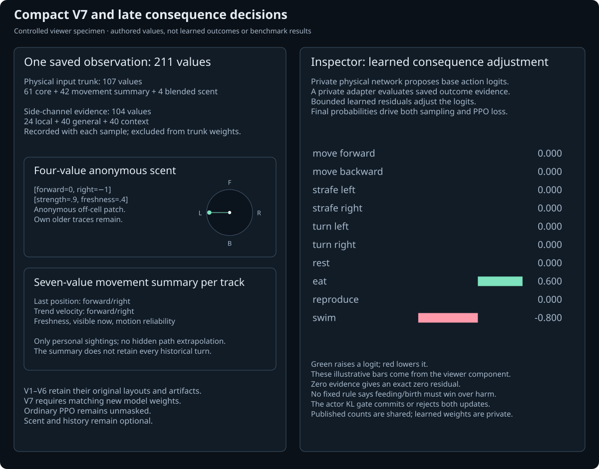

# Animal observations

[Sensing handbook](learning/features.md) · [V7 layout](learning/v7-observations.md) · [Configuration](configuration.md)

Maintained run presets use **V7 compact observations, personal movement history
and blended scent**. Each animal receives its own fixed ordered vector before
choosing an action. More information does not force useful decisions, and
physical eligibility still governs action outcomes.

## Visible target slots



Visibility filters candidates before selecting the nearest k in each diet-based
category: resources, resource-eating animals and prey-eating animals. Distance
ordering uses stable authoritative insertion order for ties. A slot contains
forward, right and explicit presence; missing slots are zero-padded. Categories
are diet-based, not separate budgets for every named species.

```json
"observation_version": 7,
"observation_top_k": 4,
"movement_history_steps": 3,
"scent_observation": {"mode": "blended", "radius": 2}
```

These are brain-template fields. The world also needs `scent_trails`; the
[complete tutorial](tutorials/06-sensing-and-learning.md) supplies both sides.
k is a model capacity limit, not the size of the visible region. The native
selector and its fallback preserve the same visibility/ranking contracts.

## Input layout



Use the [exact V7 block order, worked offsets and name enumeration](learning/v7-observations.md)
for model inputs. Food/prey/predator slots have three values each; movement
tracks have seven summary values; one blended scent channel has four values.
General/context evidence is optional and contains four values per configured
action per source. Physical trunk width differs from recorded width when late
placement is enabled.

## Forward visual field

Set this on each species body to use front-facing vision:

```json
"field_of_view_degrees": 180
```

Supported values are **150**, **180** and **360**; omission preserves the original 360°
view. The 150° option uses a ±75° forward cone. The 180° setting keeps targets in the front half-plane relative to the
animal's current heading, including both side boundaries and its own cell.
Turning changes the field immediately, even without movement. Radius, wall
occlusion, night-time range and the directional water bonus still constrain
sight. The water bonus cannot reveal a target behind the animal.

This filters fresh food/prey/predator slots, visual mate/pair/consent cues and
local witnessed outcomes. Top-k remains a maximum per category; missing targets
are zero-padded. V7 target coordinates use the animal's forward/right frame. Changing the
visual angle does not change vector width or policy signature, although
perceived states do; the consequence export body contract still matters.
Personal movement memory can briefly retain an older rear sighting with fading
confidence; it never receives unseen new movement. Learned species knowledge is
also retained. Scent remains omnidirectional within its smell radius.

Own body state, immediate adjacent collision/terrain affordances and physical
action eligibility are not the visual target sensor. They retain their existing
rules, including backward movement and proximal mating. A physical mate behind
an animal is omitted from fresh visual mate cues; this does not enlarge or
shrink the reproduction radius or bypass mutual consent.

The selected-agent board overlay shows the current forward sector. The inspector
radar shades the configured sector using the **recorded sample's heading**, which may
lag the current board. Both follow the viewer theme. Old recordings without the
setting retain their circular overlay. [Appearance examples](viewer-visual-reference.md#forward-vision).

`land_bridge_collective` enables 180° for both species. The earlier bridge
presets retain 360°; compare with matching vision settings when attributing a
learning effect. Existing compatible policy weights can transfer between fields,
but they must be evaluated under the new perception. The shared consequence
predictor's saved physical contract includes the species body, so 360° knowledge
exports are not silently imported into a different 150°/180° body contract.

The `land_bridge_collective_150` preset keeps the collective bridge setup with
`field_of_view_degrees: 150` for both species; use it to compare a narrower
forward cone with `land_bridge_collective` (180°). Other settings remain the same.

`seaside_150` applies 150° to both species and enables visible social outcomes,
both general and context consequence inputs, durable species/action totals and
private auxiliary consequence heads (coefficient `0.1`). Evidence is published
between episodes. It retains the ordinary `seaside` map, body/reproduction
settings and PPO update settings; its observation/model contract is larger.
Start fresh rather than loading weights from the earlier plain `seaside_150`
configuration. Brains remain independent. See [collective learning](social-learning.md).

```sh
.venv/bin/python -m wtf run seaside_150 --runs 5 --seed 100 --progress
```


## Observation version 7

For a complete walkthrough, read [V7 layout and worked offsets](learning/v7-observations.md),
[personal memory and scent](learning/memory-and-scent.md) and the
[configuration tutorial](tutorials/06-sensing-and-learning.md).

V7 is the current compact sensory default for maintained run presets and an
explicit option in custom configurations. V1–V6 remain supported;
V6 soft categories are not removed or relabeled. V7 changes the policy input
contract and needs matching fresh weights. It does not guarantee improved
survival or faster training.


### Compact vector order

| Block | Width | Contents |
| --- | ---: | --- |
| Own state | 8 | Energy, health, heading x/y, four blocked flags |
| Food / prey / predator slots | `9k` | Three channels per slot: forward, right, presence |
| Terrain | 12 | Depth, flow forward/right, elevation, adjacent depth/climb |
| Mating and consent | 12 | Existing numeric cues, excluding mate distance |
| Immediate opportunities | `O` | Only configured attack/eat/swim actions |
| Movement summaries, if enabled | `14k` | Seven channels per prey/predator-role track |
| Scent, if enabled | `4C` | Four channels per configured anonymous channel |
| Local witnessed outcomes, if enabled | 24 | Six groups × confidence/harm/feeding/birth |
| General consequences, if enabled | `4A` | Configured actions, stable order |
| Context consequences, if enabled | `4A` | Configured actions, stable order |

`k` is top-k, `A` is the species' configured action count, `O` is its number of
attack/eat/swim actions, and `C` is scent-channel count. Derived distances can be
reconstructed from coordinates, with possible last-bit floating-point differences.
Presence, heading, readiness and pair flags remain explicit. General/context
knowledge for a temporarily masked action stays present; only permanently
unconfigured actions are omitted. Local outcomes and both consequence sources
remain separate, with their own confidence. No new hidden-world information is
introduced.

`observation_actions` is resolved from the exact species' ordered
`allowed_actions` during validation and stored in model signatures and recording
metadata. An explicit list must match. V7 species sharing a brain template must
use identical ordered action lists; use separate templates otherwise. Animal
weights remain independent even when a template is shared.

### Movement summary and scent bearing

A track contains last-known forward/right position, overall trend velocity
forward/right, freshness, visible-now and motion reliability. Velocity uses the
oldest/latest available personal sightings over their elapsed steps. Reliability
combines sighting coverage and path straightness; it is not a calibrated
probability. Missing tracks are zero. No unseen positions are extrapolated.
Historical sightings are retained internally for the configured window, but
individual lag coordinates are not delivered to the brain or stored in V7 inputs.
The inspector shows a summary, not a reconstructed observed path.

Each scent channel is `[direction_forward, direction_right, strength, freshness]`.
Direction is a unit bearing to the strongest reachable **off-cell** dry patch;
the current cell is excluded because the observer's fresh deposit would otherwise
dominate. Own older traces remain. Blended contributions at a patch add with a
cap of one; freshness is the freshest contributing deposit's remaining lifetime.
Ties prefer freshness, then squared distance, then stable cell order. Obstacles
and water constrain dry-cell reachability. No patch gives four zeros. Separated
legacy channels remain configurable; V7 also summarizes each of them in four
values. A single-source patch can have equal strength/freshness; mixtures can
separate them. Alternative scent directions are deliberately lost. A bearing is
not a route around an obstacle and carries no animal identity or exact distance.

### Algorithm support for V7 and consequence handling

Compact V7 movement/scent observations and the existing local/general/context
**input-feature mode** support all fourteen learners. The learned **late
consequence adapter** and its native CPU minibatch currently support only
ordinary PPO and masked PPO. Configurations requesting `late_consequence` for
another learner fail validation; the option is never silently ignored.

| Algorithm type | Compact V7 + consequence inputs | Late adapter / its native CPU batch | Remaining integration |
| --- | --- | --- | --- |
| `ppo` | Yes | Yes | Implemented, ordinary policy remains unmasked |
| `maskable_ppo` | Yes | Yes | Implemented, final probabilities honor the physical mask |
| `q_network` | Yes | No | Online/target Q adjustments and TD targets |
| `dqn` | Yes | No | Online/target adapter synchronization and Bellman targets |
| `ddqn` | Yes | No | Separate online selection / target evaluation consistency |
| `qrdqn` | Yes | No | Quantile outputs, target distributions and adapter gradients |
| `a2c` | Yes | No | Final-distribution policy loss and adapter optimizer integration |
| `reinforce` | Yes | No | Trajectory loss / baseline and final-distribution gradients |
| `grpo` | Yes | No | Trial/reference policies, probability ratios and KL terms |
| `mappo` | Yes | No | Local actor adapter with the centralized training critic |
| `recurrent_ppo` | Yes | No | Sequence rollouts, recurrent state and backpropagation |
| `lstm_ppo` | Yes | No | LSTM sequence/BPTT integration with final-policy objectives |
| `trpo` | Yes | No | Full-policy KL constraint, curvature and line-search parameters |
| `discrete_sac` | Yes | No | Entropy-aware actor, critic targets and adjusted action probabilities |

These are current implementation limits, not theoretical restrictions. Adding an
adjustment only at inference would leave the unsupported learner training against
a different prediction function. Q-values represent estimated returns, rather
than PPO action logits, so their target networks and losses need explicit
integration too. Each learner's existing native kernels remain available;
“No” in this table refers specifically to the new late-adapter batch. Compact V7
support does not imply CUDA support for a particular learner.

### Opt-in late consequence policy



Set `"late_consequence": {"max_adjustment": 2}` on a V7 ordinary/masked PPO
brain with consequence observations enabled. Omit it to keep all compact
observations as ordinary neural inputs. Other learners support compact V7 but
currently do not support this adapter.

With the adapter, all local/general/context evidence bypasses the physical
actor/critic trunk. Every action's learned residual uses confidence-weighted
harm/feeding/birth rates from each enabled source, conditioned on a constant,
hunger, health deficit and own reproduction readiness. Each animal owns its
adapter weights and Adam state. The zero-initialized adapter starts neutral;
residuals are bounded by `max_adjustment`. No fixed utility coefficient forces
food, safety or reproduction to win. The critic currently uses physical inputs
only; this is a baseline-information tradeoff, not a claim of equivalent learning.

PPO samples and trains with the **final adjusted distribution**. Masked PPO applies
its existing physical mask after adjustment; ordinary PPO remains unmasked.
Rollouts retain the exact evidence available for each sampled action, so training
never substitutes a newer live lookup. Episode publication can freeze shared
estimates between episodes; continuous publication still keeps each saved sample
immutable. The KL gate rejects both actor and adapter updates together. Auxiliary
PPO outcome heads remain optional and exclude consequence targets from their
prediction inputs. An optional fused native CPU minibatch computes both actor
and adapter gradients; older/missing native extensions and custom hooks retain
the exact reference path. CUDA PPO training does not yet implement the adapter.
See [training performance](performance.md#v7-late-adapter-training-batches).

### Preset and measured layout sizes

```sh
.venv/bin/python -m wtf run seaside_150_v7 --runs 5 --seed 100 --progress
```

The preset uses ordinary PPO, three-step movement summaries, blended scent and
both consequence scopes, with evidence published between episodes. It inherits
the current seaside geography and reproduction configuration. Its normal
recording selection retains the last two episodes; set `--record-last-episodes -1`
to record all scheduled episodes.

| Current preset | Prey recorded / trunk | Predator recorded / trunk |
| --- | ---: | ---: |
| `ppo` | 106 / 106 | 267 / 267 |
| `seaside_150` (input evidence + auxiliary) | 211 / 211 | 348 / 348 |
| `seaside_150_v7` (late evidence + auxiliary) | 211 / 107 | 348 / 268 |

These are exact layout widths, not timing or ecological results. All 211/348
values remain available in sampled replay diagnostics; only 107/268 enter the
base network when late adjustment is enabled. Saved brains include the private
adapter weights; recovery additionally includes its optimizer state. Birth,
crossover, rare mutation and warm starts preserve the new parameter block without
sharing arrays. Old artifacts do not require conversion.


## Runtime and playback

Multi-target selection reuses the world's spatial buckets and visibility cache.
Candidates inside the maximum radius are distance-sorted; sight checks stop
when k visible targets have been found. The original native nearest-target path
remains available for k=1; the optional [native top-k selector](native-top-k.md)
fuses multi-target ranking and sight filtering for recognized world callbacks.
Final feature arithmetic remains Python, and custom callbacks or older/missing
extensions use the reference selector.

One result per observer and category is retained, keyed by position, target
bucket revisions, radius, k and directional range settings. Moves, births,
deaths, food-presence changes, obstacle edits and visibility implementation
changes invalidate relevant results. Derived caches are world-local, omitted
from checkpoints and rebuilt on restore. They are not shared mutably by GRPO
trial worlds. Higher k increases inputs, training memory and observation work;
workload-specific measurements are in the native selector guide.

Replays still store world frames/events/diagnostics in the existing binary chunk
format. They do not store a separate observation vector for every animal per
frame. Playback and chart interfaces do not need a format change.

The [visual inspector](recording.md#visual-agent-inspector) draws current sight on
the board and the recorded input slots in a radar, alongside probability/Q bars
and bounded prediction-sample history. The observation and prediction timestamps
are shown separately from the current body/frame.

## Visible consent

V7 includes own readiness, observed mate readiness, pair opportunity and local
consent signals. These do not grant permission to reproduce. Both parents still
need active consent and must satisfy the [mating gates](mating-intent.md) and
[current input contract](mating-observations.md).

## Optional collective and consequence inputs

Use [the consequence pipeline](learning/consequence-pipeline.md) for local
witnesses, general/context tables, publication timing, auxiliary prediction and
late policy routing. Those are separate options, not automatic effects of V7.

## Historical contracts

<a id="observation-version-5"></a>
<a id="observation-version-6"></a>
<a id="what-changed-from-v5-to-v6"></a>
<a id="reading-the-memberships"></a>
<a id="v6-input-layout"></a>
<a id="soft-category-configuration"></a>
<a id="width-storage-and-private-auxiliary-learning"></a>

Earlier numeric/soft layouts and their visuals are kept in the
[archived observation reference](archive/observation-layouts.md) and
[archived inspector views](archive/sensory-viewer.md). They remain valid for
matching saved artifacts or explicit comparison settings. Do not relabel old
weights or infer current preset defaults from those pages.
