# Performance and benchmarking

[Project overview](../README.md) · [Architecture](architecture.md) · [Development](development.md)

Commands in this guide run from the project root.

Champion exports now use lossless binary/XZ arrays and a content-addressed shared
weight directory. Repeated unchanged models reuse the existing weight blobs
rather than storing another parameter copy.
See [measurement and compatibility](binary-storage.md#champion-storage-measurement).
An export-local identity cache reuses serialization references for shared,
immutable snapshots; it is bounded by distinct champion models in that export
and discarded afterward. It never caches live controller parameters or enters
checkpoints. No training throughput/RAM improvement is claimed for this change.

## Recent export and inspector work

Champion export now serializes and hashes each shared configuration object once
per export, alongside the existing immutable-model reference reuse. The cache key
is object identity; it keeps strong references until export returns, is bounded
by the distinct configurations in that generation and is then discarded. A later
export always reads current values. Different historical training configurations
remain separate, and equal serialized configurations still share the same file.
JSON bytes, model blobs, artifact identities and compatibility are unchanged.

The inspector builds its recent-prediction chart only when its disclosure opens.
It processes each sample once when building that chart and reuses the chart when
closed/reopened until the diagnostic sample changes. Closed panels retain only
the existing bounded score history, without allocating SVG dots for it. Collecting
samples validates finite scores without constructing full bar-layout objects.
Current radar and action bars, expanded-state persistence, the 64-score-vector
limit, chunk loading and backward-seek filtering are unchanged.

Operation-count tests cover one configuration serialization per identity, exact
configuration/model round trips and fresh values after a later export. Viewer
checks cover deferred rendering, one score pass, reopen reuse, mixed score types
and signed/zero scales. No profiling or throughput/peak-RAM benchmark was run,
so these are removed operations rather than measured speedup percentages.

The optional [native top-k selector](native-top-k.md) now handles candidate
collection, tuple ordering and visibility/range filtering for k > 1. Python still
owns invalidation and exact final feature arithmetic. Its matched measurements
compare against the reference selector with all other kernels already enabled.

## Earlier optimizations and measurements

Lineage accounting now allocates a founder-family dictionary only on first use.
Champion comparisons request rank tuples without diagnostic dictionaries; full,
detached family metadata is generated only for final lineage winners. No new
cache or checkpoint state is introduced. In a 60-animal accounting/ranking probe
(500 passes, seven alternating samples, baseline `65345bf`), median time fell
from 0.15828 s to 0.09859 s (37.7%). This measures that path, not end-to-end
training speed or peak RAM. Forty-step seed-42 checkpoint comparisons matched
across all nine algorithms and the mixed meandering-river preset. See
[rollout 0.0.1.5](releases/0.0.1.5.md) for scope and verification.

The latest [second native-kernel report](native-kernels-v2.md) compares against
commit `baa5101` **with the existing native backend enabled**. Median additional
180-step speedups include PPO 2.22×, recurrent PPO 21.36× and QR-DQN 4.46×.
Replay expansion is 3.39× and dashboard summarization 1.90× faster on their saved
fixtures. All matched checkpoints and recorded chunk bytes agree. Raw binary
decoding is essentially unchanged (1.03×); peak RAM is not consistently lower.
The report includes the complete tables, workload, memory tradeoffs and checks.

For implemented CPU acceleration, build/backend controls and numerical boundaries,
see [optional CPU kernels](native-kernels.md). The preceding
[native performance review](native-performance-review.md) records the original
assessment; its remaining GRU/quantile/visibility proposals are not implemented.

New experiments now keep network parameters, target/reference networks and Adam
moments/variances in packed **float32** buffers across all nine algorithms.
Python arithmetic, gradient accumulation, activations, losses, returns and world
physics retain float64 precision. That storage change reduces retained model
memory. The optional C kernels independently accelerate numerical loops. Parameter rounding
can change learned policies and ecosystem trajectories, even with the same seed.

Checkpoint precision is explicit. Older checkpoints without it keep float64
models, including later births and episode initialization; warm-starting their
champions into a new experiment converts those weights to float32. Exact resume
is distinct from a warm start. See [precision handling](running.md#numeric-precision)
and [rollout 42](releases/0.0.0.42.md).

The [native-kernel benchmark results](native-kernels.md#benchmark-results) compare
three-process medians against the preceding FP32 code on 11 matched 180-step
presets. Complete-state hashes match. Those first-rollout training-loop speedups range from
1.53× (recurrent PPO) to 12.97× (MAPPO); the valley with binary/XZ recording gains
2.41×. Peak RSS is not consistently lower; QR-DQN rose from 26.3 to 30.6 MiB in
these samples. See the linked report for settings, all timings, limitations and
build instructions. Native kernels are optional and do not change replay formats.

Historical measurements describe the implementation evaluated at each optimization stage. Rerun the probe for the current revision and your workload.

The engine shares a per-observation-phase list of positions and resources instead of rebuilding it for each animal. An incremental spatial index groups food and animals into nearby cells, so limited-vision agents skip distant candidates. Small target sets and wide-vision queries use a full scan. Squared-distance filtering preserves visibility and insertion-order ties, including across cells. Each animal keeps a spatial window: movement reuses its overlapping bucket references and updates only entering/leaving strips. Shared buckets receive target moves, births, deaths and food-presence changes once per phase. Stationary observers reuse nearest-target results while the relevant bucket versions stay unchanged. Movement and obstacle edits force visibility to be checked again because occlusion inside the overlap can change. Energy, health, heading and blocked neighbors are always current. Derived caches are rebuilt after checkpoint restoration and released for dead observers; authoritative state is reconciled each phase to detect manual edits too. The Python fallback uses native multiplication iterators with the original summation order. Training computes Q-network weight offsets once per neuron, and MLP backpropagation avoids checking the input-layer case for every weight. Optimizer mathematics and accumulation order remain unchanged. Replay experiences use compact immutable tuples. Snapshot creation copies primitive entity fields without recursive dataclass conversion.

Recording streams one encoded frame and retains one previous frame for computing chunk-local deltas. CLI checkpoint files are written atomically in compact JSON with one copied brain at a time. This avoids simultaneously holding every copied replay buffer and a large formatted JSON string. Checkpoint values remain exact; the CLI now writes compact version-2 envelopes while the loader still accepts existing version-1 files. Scheduled intermediate checkpoints are preserved; the final checkpoint is written once. Population sizes, model dimensions, training cadence, recording frequency and diagnostics remain unchanged by these optimizations.

Playback reuses the loaded snapshot when rendering and avoids clearing/reallocating the canvas backing store or writing identical layout dimensions every frame. Chunk loading, chart history, selection and death effects remain available.

Earlier optimization results (median of three separate-process measurements, 180 steps, 48 prey + 12 predators, Python 3.9.6):

| Measurement | Before | After |
| --- | ---: | ---: |
| Simulation | 3.09 s | 1.69 s |
| Simulation + recording | 3.67 s | 1.80 s |
| Checkpoint writing | 1.04 s | 0.15 s |
| Peak RSS, including checkpoint writing | 114.53 MiB | 29.25 MiB |

Every before/after run produced the same complete-state digest. Ordinary simulation RAM changed only slightly; the large memory reduction is specifically in checkpoint writing.

A subsequent pass with reproduction enabled (400 steps, seed 42, median of three
separate-process runs) reduced baseline simulation time from **4.62 s to 3.71 s**
and A2C simulation plus recording from **5.48 s to 4.71 s**. Complete-state
hashes matched in every comparison; A2C recording output sizes also matched.
Peak RSS increased from **38.51 to 39.46 MiB** for baseline and **23.69 to
26.11 MiB** for A2C. This pass improves runtime with a small memory tradeoff;
that earlier pass rebuilt temporary spatial lookups each observation phase.
No dependencies, model sizes, learning schedules or ecosystem settings changed.

Incremental-window reuse then reduced baseline time from **3.71 s to 3.33 s**
(another 10%) and A2C with recording from **4.74 s to 4.53 s** (another 4%),
using the same 400-step, seed-42, three-run comparison. Complete-state hashes
and recording output sizes matched. Peak RSS was **37.16 to 36.36 MiB** for
baseline and **26.31 to 27.13 MiB** for A2C; these measurements show no clear
memory improvement. Windows and nearest-result caches are bounded by the living
observers and spatial cells, rather than accumulating one entry per step.


A local before/after benchmark and repeated measurements are saved under `work/performance/`. Run the optimized probe with:

```sh
.venv/bin/python -m work.performance.benchmark --case record --steps 180 --output work/performance/local-record.json
.venv/bin/python -m work.performance.benchmark --environment environments/a2c.json --case record --steps 400 --output work/performance/local-a2c.json
.venv/bin/python -m work.performance.benchmark --case checkpoint --steps 180 --output work/performance/local-checkpoint.json
```

The benchmark fixes seed 42 with the baseline 48 prey/12 predators and checks a digest of the complete world, brain, replay and random-generator state. It measures process peak RSS before constructing the comparison digest; checkpoint-case peak RSS includes both simulation and checkpoint saving. These are local measurements for a small workload, not guarantees for every environment. Large populations still incur independent-brain and perception costs, and the growing collection of completed-run summaries remains in memory for experiment reporting.


Replay chunks use a complete keyframe followed by sparse field changes within
each chunk, then lossless gzip (default level 6). On the same 401-frame PPO data,
full snapshots used 9,276,835 bytes, gzip snapshots 851,601 bytes, and delta plus
gzip 722,700 bytes: another 15.1% reduction over gzip alone. Entity identity and
unchanged food cells are no longer repeated every frame. Every chunk decodes
independently, preserving random seeking and full recorded precision. The native
viewer receives compressed stored bytes; legacy API clients receive full frames.
Decoded viewer memory remains one chunk and live brain memory is unaffected.
See the [recording guide](recording.md#optimize-older-recordings) for format,
measurement limits and conversion commands.

Checkpoint storage now pools repeated configuration/actions/model metadata and
encodes large float64/uint32 arrays as portable little-endian binary values in
base64 before gzip. A measured PPO checkpoint fell from 7.03 MB plain JSON to
2.56 MB, versus 3.19 MB with gzip alone. Writing took 0.24 seconds in that one
local sample; this is not a general throughput guarantee. The writer still
streams one detached brain at a time. Restoring and offline conversion decode
one complete checkpoint in RAM; no peak-memory reduction is claimed for loading.
See [checkpoint storage](running.md#optimize-existing-checkpoint-files).

A subsequent code-review pass reduces training-loop work without changing
learning settings or arithmetic order:

- DQN replay loss computes only the chosen action's current Q value; policy and
  bootstrap inference still compute all action values. Action indices are
  precomputed, and target refreshes update existing arrays in place.
- Modern experiments release dead founders as well as descendants after terminal
  learning and champion capture. Their update counts are retained separately.
  Old modern checkpoints skip rebuilding already-dead controllers when restored.
  Legacy checkpoints that reuse founder controllers retain their prior behavior.
- DQN-only steps avoid the per-animal GRPO scan. Mode checks are outside the
  learning loop; balanced champion settings are constructed once per predator
  species per candidate pass rather than once per animal.

Validation compares DQN against the former full-output replay update through
buffer wraparound, target refreshes, terminal/truncated transitions and resume.
Lifecycle checks verify buffer release, identical living controller/world states,
champions, update totals and future chained runs. These changes were reviewed and
checked for correctness without profiling or timing benchmarks; no runtime or
peak-RAM percentage improvement is claimed. Living agents still own independent
networks and experience buffers, and completed episode summaries still accumulate.

The shared policy-training paths also avoid unnecessary work:

| Algorithms | Code-review optimization |
| --- | --- |
| PPO, A2C, REINFORCE, GRPO | Inference returns outputs without retaining a backpropagation activation tape. Full activations are retained only for actual gradient calculation. |
| PPO, A2C | Bootstrapping computes the critic output without evaluating unused policy output heads. |
| PPO, GRPO | Minibatches reuse gradient containers within one update call, resetting values before each minibatch. No scratch arrays are kept on every living brain. |
| PPO, A2C, REINFORCE | Fresh advantage vectors normalize in place. REINFORCE reuses its return vector after calculating the mean return. |
| GRPO | Shared trajectory advantages/weights are calculated once per trajectory. Zero-KL settings skip reference inference. Trial clones omit historical lifespan records while preserving the authoritative next-animal ID. |
| All checkpoint restores | Recorded next-animal IDs avoid rescanning death history; legacy files still reconstruct the bound. |

These preserve rewards, update schedules, sampling order, optimizer arithmetic,
rollout sizes and diagnostic contents. Correctness checks include exact serialized
state comparisons with the original implementations over 240 policy transitions,
including normalization variants, PPO/GRPO KL stopping, unequal trial lengths and
checkpoint resumes. Regression tests additionally compare inference with full
forward passes, reused/fresh gradients, and trial histories with/without old death
records. No profiler or timing/memory benchmark was used in this review, so these
are reductions in work and allocation rather than measured speedup claims.


## Additional algorithm review

The GRU, distributional and centralized-critic paths reduce repeated computation
without adding persistent per-animal caches:

| Path | Reduction in work or temporary allocations |
| --- | --- |
| Recurrent PPO backpropagation | The output MLP returns its input derivative while accumulating parameter gradients, replacing a separate second traversal through the same head. |
| Recurrent PPO bootstrapping | Evaluates only the scalar value head after the GRU/hidden layers; unused policy outputs are skipped. Gate dot products use native multiplication iterators with the same summation order. |
| QR-DQN diagnostics | One network prediction supplies both mean action values and return quantiles. |
| QR-DQN targets | Computes only the chosen action's target quantiles at the final layer. Online action selection still evaluates all actions. |
| MAPPO training | Reuses the post-physics global context for bootstrapping and the next decision. A pure MAPPO phase does not build an unused mask-occupancy map. |
| MAPPO greedy evaluation | Uses only the local actor; the critic remains available for recorded diagnostics. |
| PPO variant construction/restore | Constructs the actual network once. GRU and MAPPO also avoid discarded default optimizer arrays; Maskable PPO avoids its discarded default MLP. |
| GRPO with masked opponents | Shares one occupancy map per trial step across masked agents and evaluates frozen policies without copying controller objects. |

Correctness verification compared exact serialized world, brain, replay/rollout,
optimizer, RNG and champion state with revision `0ae8df0`: 207 checkpoint
comparisons across all nine algorithms and 23 further comparisons for mixed
GRPO/Maskable PPO. The workload uses two 11-step episodes per case, small
networks, reproduction windows, chained champions, a forced death in the
nine-algorithm comparison and checkpoint restoration in the mixed case. The
23rd comparison in each case also checks the already-completed lifecycle.

Regression tests check numerical input derivatives, selected-head equivalence,
forward-pass and context-build counts, direct network construction, value-only
GRU bootstrap and shared trial occupancy. Learning schedules, rewards, network
sizes, buffers, random draws and checkpoint formats are unchanged. No profiler,
time benchmark or peak-memory measurement was run, so no percentage speedup or
RAM reduction is claimed. The main dense arithmetic remains standard-library
Python and independent-agent costs still grow with population and model size.


## Binary storage and bounded replay caches

New presets store typed binary replay chunks with XZ compression. The records
retain full float64 precision and wrap the existing field deltas; homogeneous
entity/event records become columns, numeric arrays are raw bytes and repeated
strings use file-local dictionary entries. Binary version-3 checkpoints replace
the previous base64/JSON wrapper while retaining shared metadata/models and
one-controller-at-a-time writing. Readable metrics and champion archives retain
their existing formats. See [binary storage](binary-storage.md).

Storage conversion is validated by comparing expanded replay frames and exact
checkpoint states before replacing a file. Only smaller verified replacements
are published. Python/JavaScript decoder parity, seeking and checkpoint restore
must remain intact. Disk reduction depends on entity counts, numeric ranges and
compression settings; it is not a fixed property of every recording. LZMA2 adds
encoder memory and CPU cost; gzip offers a faster compression option.

Recording avoids sorting/copying static obstacles and dimensions into every
frame before discarding them. The playback server reads metadata once per
telemetry request and caches at most four derived 128-frame pages, protected by
a lock and invalidated using manifest/chunk stat fingerprints. Cached results
are detached from callers. No simulation-state or learned-prediction cache is
introduced, and no complete world-chunk cache is retained on the server.


## Spatial window structure


Each world has separate food/resource-eater/prey-eater indexes. Windows retain
bucket references, so a target change inside an overlapping bucket is visible
without copying the window contents. Revisions invalidate target selections;
current self/terrain/mating fields are assembled separately. Sparse/wide queries
can scan directly. The following dependency flow describes the invalidations.

## Observation cache dependencies

Dynamic targets and static geometry have different invalidation rules. An observer staying still is not enough to reuse a target result.



## Simulation caches and champion selection

The simulation uses simple in-memory dictionaries rather than a broad memoization
layer. An obstacle-only visibility LRU (`OrderedDict`) retains at most 2,048
ordered start/end ray results per world. Observation setup already reconciles
obstacle edits; changed obstacles or visibility implementations clear this cache
and invalidate nearest-target results. Changing animal positions or food does
not invalidate a geometric ray, but target selection still uses the current
spatial-index revisions. Direct `World.visible` calls remain uncached and current.
Restored worlds rebuild the cache; it is absent from checkpoints and replay data.
There is no shared global cache holding retired worlds or model controllers.

Champion selection resolves all final winning ranks before copying model
parameters. A transient dictionary copies each actual winning animal once per
consideration pass, sharing that detached snapshot across its winning criteria.
Temporary record breakers no longer trigger discarded copies. Snapshots are not
reused between steps because weights can change independently of observed rank
changes or optimizer counters.

Population metrics count animals in one pass instead of one scan per configured
species. Reproduction resolves species-wide timing-window flags once per phase
instead of once per animal and successful parent. Both remain derived from current
state on each call, so manual edits and lifecycle changes are visible immediately.

Verification passed 279 exact serialized-state comparisons with the previous
simulation/champion paths across all nine algorithms: two 15-step episodes per
case plus a completed-lifecycle check, with reproduction, forced mortality,
obstacle edits, checkpoint restoration and chained champions. Regression tests
cover cache hits/eviction, geometry invalidation, transient final-winner copies,
former ranking behavior and current population counts. The full suite passes
274 Python tests. No profiler or timing benchmark was run, so fewer calculations
and copies are verified without claiming a measured overall speedup or RAM drop.

## Decision-phase mating data and birth availability

Observation production builds one occupied-cell mapping and passes it into the
mating context. Population counts, sex/spatial buckets and personal readiness are
prepared once for that phase. Masked-PPO context refresh receives this data
explicitly instead of rebuilding the mapping/counts and repeating each mate's
health, energy and timing checks. GRPO's masked opponents reuse their own trial
world's phase data; real and hypothetical worlds never share it.

This is phase-local reuse, not a persistent LRU or a cache keyed only by position
or tick. The context is replaced during observation production and is bounded by
living animals. It is valid only while the observed physical state is unchanged.
Standalone mask/availability calls read current state; standalone runner refresh
prepares new data, so direct same-tick health, population or configuration edits
remain visible. Contexts are not serialized, and restore creates independent
ones. The post-movement/combat/cost birth phase rechecks actual eligibility.

Observation pair flags are not substituted for action-mask results. Mating
observations apply the configured observation range, whereas mask availability
keeps its existing radius/line-of-sight rules. Sharing personal readiness does
not merge these different contracts or predict another animal's consent.

Birth-cell predicates use a common ordered candidate iterator. Boolean
availability checks stop at the first valid cell without allocating a list or a
deduplication dictionary. Actual births still materialize the complete unique
sequence in the original parent/direction order, preserving seeded cell choice.
Terrain dryness, elevation, occupancy and boundaries use the same conditions.

[Regression tests](../tests/test_mating_context_efficiency.py) cover one readiness
preparation per masked phase, early exit, same-tick edits, RNG/state transparency,
water/cliffs, empty/full birth space, ordering, visibility differences and fresh
post-cost eligibility. Pre-change reference comparisons cover all supported
learners, consent versions, mixed GRPO/masked opponents, terrain, forced births
and mutation; checkpoint/observation values and recorded replay bytes match on
both automatic/native and Python-only paths. These checks establish removed
work and equivalence, not a measured throughput or peak-memory improvement.

## Founder initialization and shared reporting

Run initialization constructs one fresh controller per populated species/sex
rather than generating the same seeded network for every founder. A selected
warm-start model is validated and loaded once for that group. Remaining founders
clone that pristine template with their original individual seeds. Templates are
local to initialization and discarded before actions or learning; they never
hold a trained animal's optimizer or experiences. Each animal owns its parameters,
configuration, target/reference networks, optimizer, buffers, recurrent state and
independent action/training/GRPO RNGs. No controller state is pooled across animals,
sexes, species or runs. Existing legacy controller-retention behavior is preserved.

Completed-step metrics are produced after learning and birth mutation. When the
metrics and replay schedules coincide, CLI recording uses that existing report;
CSV, progress and final terminal output read it too. The final summary takes a
detached copy instead of rescanning the world. Initial CLI reporting similarly
shares one fresh report among CSV, recording and progress. Skipped replay samples
still return before computing metrics or building a frame; a replay-only step
computes its own current metrics.

This sharing uses explicit optional `metrics` arguments to `World.snapshot`,
`Recorder.begin_run`/`capture` and `RunProgress.start`, valid only while the reported
physical state is unchanged. There is no persistent reporting cache or tick-only
key. Standalone calls without a report calculate fresh values, including after
same-tick edits. Snapshots own copies of supplied metric maps; summaries remain
independent of history. Reporting templates and metrics add no checkpoint fields,
format changes, diagnostic samples or viewer requirements.

[Regression checks](../tests/test_founder_reporting_efficiency.py) count founder
construction/model loads, verify original seeded states and independent mutable
state across all nine learners, and check report scan counts, detached maps,
sampling and fresh standalone reads. Short pre-change reference comparisons
verify exact observations, checkpoints and replay bytes. Two-run workflow checks
also cover resume, champion chaining, disabled chaining and randomized worlds,
including identical CSV, summary, checkpoint and recording artifacts. These
checks demonstrate removed work without claiming a measured throughput gain.

### Measured initialization and reporting cost

A paired native-backend benchmark on macOS ARM64 with CPython 3.9.6 compares
0.0.1.24 against the saved pre-change implementation. Both versions include the
preceding mating-context optimization. The workload uses `maskable_ppo.json`,
48 prey/6 predators, seed 100, one fixed world and a 32-step limit; network sizes,
learning settings, metric/frame/diagnostic intervals and binary/XZ recording
settings retain the preset values. Each timed sample runs in a separate process,
after an untimed warmup, with alternating before/after order. Values below are
medians of five uninstrumented samples per version. Training/recording includes
initialization and chunk closure, but excludes checkpoint/champion exports,
post-run state hashing and process/import startup.

| Measurement | Before | After | Interpretation |
| --- | --- | --- | --- |
| Initialization | 179.7 ms | 71.1 ms | 60.5% less elapsed time; 2.53× speedup |
| Initialization plus 32 training/recording steps | 860.9 ms | 748.4 ms | 13.1% less elapsed time |
| Initialization peak traced Python allocation | 4.70 MiB | 4.69 MiB | Effectively unchanged |
| Training/recording peak traced Python allocation | 22.09 MiB | 22.07 MiB | Effectively unchanged |

Memory values are separate single-sample `tracemalloc` measurements; they exclude
untraced native/compressor allocations and are not total process RAM. Independent
per-animal weights, buffers and optimizer state remain necessary. The full-run
time reduction is approximately the initialization saving; these measurements
do not establish a sustained per-step throughput improvement or material memory
reduction. Do not extrapolate the short-run percentage to long episodes.

Both versions perform 432 optimizer updates and produce 53,297 bytes of playback
artifacts. Complete state and replay artifact hashes match for every timed pair.
Temporary recordings are deleted after each sample; measurements and the local
benchmark helper remain under ignored `.cache/`, outside `results/`.

## On-demand brain explanations

[Brain explanations](explainability.md) run only when the selected animal's
inspector window is opened, its controls change, or a new recorded observation
sample arrives while **Follow replay samples** is enabled. The archived-analysis
path adds no training callbacks, model snapshots or replay bytes. It never restores a world or a full
checkpoint to explain a champion. One stateless forward/reverse pass computes
activations and local input sensitivity, avoiding a forward pass per input.

The optimization review adopted these bounds:

- Decode only the selected published chunk, extract one animal's diagnostic and
  release the frame list. A two-entry context cache keys recording/run/frame/ID
  and chunk path/size/mtime/ctime. It never retains full chunks or later samples.
- Validate/prepare a champion once; retain packed double arrays to preserve
  legacy weights exactly. Cache at most two models with a combined one-million
  scalar-parameter limit, keyed by weight-blob stat identity and its reference,
  or artifact stat identity for inline models. Identical blobs are shared across
  criteria. Only weight loading/preparation is locked; arithmetic is read-only.
- The model cache limit bounds retained parameter payload, not total process RAM
  or concurrent response memory. Cache misses serialize model decompression;
  oversized/unsupported models fail with an explanation message. Layers are
  limited to 1,024 units and input vectors to 512 values.
- Reuse one manifest read per context request; avoid prefix-list allocation when
  finding the diagnostic. Cache ownership is playback-server-local and ephemeral.
- Send a bounded route graph rather than weight matrices: up to 12 selected
  hidden units per layer and three incoming visible links per displayed unit,
  plus layer activations and feature sensitivities. The browser retains one
  displayed response while open, skips identical samples and rejects stale
  responses. Following has one in-flight request and only the newest pending
  request; there is no unbounded queue or per-animation-frame inference. Errors
  stop automatic retries until a manual retry or group change. Closing/death/run
  changes invalidate pending work. Following writes no new artifacts or replay
  fields, and does not alter diagnostic capture frequency.

A CPython 3.9.6/macOS ARM64 check using stateless Python inference on a
153-input, 64/32-hidden-unit
masked-PPO archived actor (12,167 parameters) measured 30.7 ms for one cold store
request and 3.28 ms median across 20 subsequent action-target requests
(3.06–3.63 ms). Across all 21 requests there was one chunk decode and one model
load. The cached parameter arrays occupied 97,336 bytes; a representative JSON
response was 41,558 bytes with 43 graph nodes and 93 links. A separate warm
`tracemalloc` sample peaked at 226,727 bytes of transient traced Python allocation,
excluding already-cached arrays and untraced native allocations. Timings exclude
HTTP transport and browser rendering; they are not training-throughput numbers.
Temporary playback artifacts are local test fixtures and are removed after use.

Tests compare all nine algorithms' probabilities/Q means with actual model
prediction functions, check analytic derivatives against finite differences,
and cover packed-weight deduplication, stat invalidation, legacy inline archives,
current top-k/consent layouts, HTTP validation and asynchronous UI ownership.

## Sampled animal activations

[Actual brain activity](explainability.md#recorded-animal-activations) reuses the
existing diagnostic sampling schedule for every living animal. Each sampled
controller performs one diagnostic forward pass; its hidden values are detached
and rounded to FP32 for visualization storage only. Learning arithmetic, state,
RNG consumption and existing observation/prediction values are unchanged. No
inference is added on unsampled frames. Setting `recording.record_activations`
to `false` omits the new arrays and uses the previous diagnostic path.

Only hidden layers are added: inputs, action scores, values and quantiles already
exist in diagnostics. Recurrent PPO adds actual prior memory and the resulting
GRU activation; sampling never assigns to its live hidden state. MAPPO retains
only its actor's hidden tape, while its critic remains value-only inference.
No weights, optimizers, gradients, layer labels or weighted routes are repeated
in these samples. FP32 values use the existing lossless narrow-array codec;
there is no model or world arithmetic conversion.

The browser renders only the selected animal, keeps one world chunk and reuses
its activation DOM between diagnostic samples. The large window follows the
existing replay loop rather than starting a polling/inference loop. Closing it
releases its retained sample/view. Selection, death and recording/run changes
replace or clear the display. Inline maps show at most 64 units per layer; the
window shows all units. This saves display work without dropping recorded units.

A controlled 32-step native-backend check of the masked-PPO preset, seed 100,
with 48 prey/6 predators initially and its default binary/XZ recording cadence,
produced 48,660 bytes of replay chunks without activations and 74,776 bytes with
them: an additional 26,116 bytes. The 268 animal diagnostics contained 6,688 new
activation scalars (26,752 raw FP32 bytes). This is additional storage, not a disk
reduction compared with omitting the feature. The same scalars would occupy twice
as many bytes as FP64 before compression. Long-run costs depend on sample
cadence, populations and layer widths; this short check is not a throughput or
peak-RAM benchmark. Temporary fixture recordings are removed after verification.

Regression tests compare complete controller/world checkpoints and existing
recorded fields with sampling enabled/disabled across all nine learners, including
nonzero recurrent memory, and pass on both native and Python fallback paths.
Tests also verify one inference pass, no unused centralized critic tape, sampling
cadence, FP32 isolation, buffer ownership, seek/run boundaries and chart reuse.

## Rank-based explanation display

Input/output cards are the default. Whole-structure visualization uses the
existing complete activation arrays and declared stage sizes when hidden rank
is at most the viewer's k (default two). It does not request full matrices or
expand the saved replay payload. Every unit is represented; above 1,024 total
dense inter-stage links, connectivity is bundled instead of allocating one
element per edge. Deeper brains default to a stage-size summary.

Individual unit maps, recurrent details and selected weighted routes are lazy
Advanced disclosures. Threshold changes re-render only the selected view from
already loaded data; they do not issue explanation requests or change the model.
The threshold is separate from observation top-k and is not stored in environment
files or model/checkpoint signatures.

## Day–night rendering and metabolism

The board shares a single sunlight result during each draw: ground light,
night shading, dial and selected-animal body calculations consume that same
value. The overlay receives the effective body already used by the sight
caption, and passes it through to visibility geometry on a cache miss. These
are frame-local values, not a cross-frame cache; backward seeking and changing
recordings always read the current saved tick/configuration. Diagnostic radar
inputs still use their own sample tick. The existing overlay cache includes
effective radius and invalidates when that radius changes.

The dial retains only its last phase and SVG node references. An unchanged
phase returns before orbit trigonometry or SVG writes, with visibility still
updated when switching enabled/disabled recordings. Repeated status text is
not assigned again; disabled cycles skip hidden label construction. No browser
animation timer or replay storage is added.

In Python, effective bodies remain bounded by the species count and are rebuilt
once per tick. A native-metabolism configuration view reuses those body objects
and shallow-copies only affected species entries. It is allocated lazily only
for flat native metabolism, retained for that tick, and invalidated alongside
the body cache. Configuration is immutable during a run; loading another JSON
creates a new world. Views are read-only by convention and never checkpointed.
Restore/GRPO trial worlds reconstruct private caches. Terrain and unavailable
native kernels continue through the Python reference path.

Regression evidence includes exact native/reference checkpoint, observation,
event and reward equality across 120 steps, one sunlight computation per tick,
restore isolation, explicit frame-value reuse and byte-identical regeneration
of the viewer appearance sheets. These remove repeated operations; no measured
end-to-end speedup or RAM reduction is claimed.

## Champion capture and competition occupancy

Champion ranking and source metadata still update on each record improvement.
The champion book can reuse the detached model payload when its signature and
all packed FP32 parameter bytes match the previous capture for that controller.
Comparison is lazy: a changed optimizer counter forces a fresh snapshot without
building comparison buffers. An unchanged counter alone never permits reuse;
the cache compares `array.tobytes()` against the prior snapshot's packed values,
so direct edits, native optimizer writes, loading and signed-zero changes are
detected. The first reuse packs the old detached list once; subsequent reuses
retain its comparison bytes. Changes to recurrent memory or optimizer state alone do not alter
a warm-start model payload; exact resume checkpoints still retain that state.

The cache belongs to one champion book and retains only controllers that won a
criterion in the latest consideration pass. Its key includes controller identity
(verified through a weak reference), model signature and every parameter-buffer
byte in layer/field order. It holds immutable comparison bytes and detached
snapshots, never live model buffers. Non-winners are removed on the next pass;
restoration starts with an empty cache. Legacy FP64/list models use the existing
uncached capture path. Snapshot payloads shared among criteria remain immutable
by convention. No cache field enters checkpoints, brain artifacts or replays.

This replaces repeated Python float/list materialization with byte copying and
comparison; it is not a zero-copy cache. Retained comparison bytes cost four
bytes per cached FP32 parameter after reuse, plus small structure/weak-reference
overhead. Controllers updated between every capture retain no comparison bytes.
Existing champion records already retain the shared model snapshots. The cache
has no additional lifetime ownership of controllers, optimizers or replay buffers.

Within an enabled competition phase, live occupied positions are built lazily
on the first winning path challenge and then updated after every displacement
or contest death. Later contests see current occupancy without another full
population scan. The shared set is discarded when resolution returns; opportunity
targets remain selected from the original phase positions. Retreat order, seeded
ties, damage, movement effort and recorded event positions are unchanged.

Two controlled operation-count probes demonstrate the removed work. A 20-step
PPO fixture with reproduction disabled and rollout length 64, including founder
initialization, made 63 detached model captures before reuse and six afterward.
A six-animal phase resolving three path contests made five full animal-list
passes before reuse and three afterward (targets, challengers and one live set).
These are fixture-specific counts, not measured training speedups or peak-RAM
reductions. Exact state and replay comparisons are separate compatibility checks.

### Local timing and memory measurements

The following comparison uses CPython 3.12 on local macOS with the optional native
backend enabled. The baseline is the implementation before champion snapshot and
contest occupancy reuse (`4558cef`); the optimized version includes both changes.
Each workload used five fresh processes per version, alternating before/after
order. Values are medians. Complete-state hashes matched between versions.

| Workload | Before | After | Observed change |
| --- | ---: | ---: | --- |
| 1,000 champion-ranking passes over one unchanged 3,655-parameter predator brain from `ppo_large_predator.json` | 48.76 ms | 10.57 ms | 4.61× faster; 78.3% less elapsed time |
| PPO simulation, 60 founders, 120 steps | 199.00 ms | 197.78 ms | Essentially unchanged; 0.6% less elapsed time |
| Competition simulation, 54 founders, 120 steps | 716.08 ms | 682.37 ms | 4.7% less elapsed time |

The isolated champion probe increments the animal's age and source tick for each
consideration while retaining its weights; ranking, lineage and metadata handling
remain included. The simulation probes use [`ppo.json`](../environments/ppo.json)
and [`competition.json`](../environments/competition.json), seed 100, one fixed-seed
training run and a 120-step limit. Both reached step 120. Their timers include
experiment initialization and training, excluding imports, recording, rendering
and the final comparison digest. Other preset settings are unchanged.

The simulations are short: the small timing differences need longer measurements
before treating them as dependable gains. The 4.61× figure describes unchanged
champion capture, not whole-training acceleration or controllers that update
between every capture.

| Process peak RSS | Before | After |
| --- | ---: | ---: |
| Champion-ranking probe | 28.41 MiB | 28.25 MiB |
| PPO simulation | 30.83 MiB | 30.77 MiB |
| Competition simulation | 40.48 MiB | 40.50 MiB |

Peak RSS uses `resource.getrusage(RUSAGE_SELF).ru_maxrss`, sampled after the
workload and before building its comparison digest. It includes process imports
and initialization. These small differences do not establish a memory reduction;
peak RAM is effectively unchanged. The tested champion retains about **14.3 KiB**
of comparison bytes after reuse (3,655 × 4 bytes), plus container overhead.
The benefit is fewer repeated snapshot allocations rather than lower steady-state
memory in every workload. Legacy FP64 and Python-fallback timings were not
measured here; their compatibility was checked separately.

### Kernel assessment

Neither change requires a new native kernel: packed-byte extraction/comparison
and set membership already execute in CPython's compiled implementations. The
removed work was repeated object construction or full-world lookup preparation.
The existing optional kernels continue to cover numerical inference, gradients,
optimizers, visibility rays and spatial group metrics.

Top-k perception is implemented separately in the optional
[native selector](native-top-k.md). Its benchmark and exact-parity checks are
independent of the champion/competition optimization above.


## GRPO trial reuse and independent actor batches

The [workflow guide](training-workflow-performance.md) documents group-private
trial resets, immutable initial-observation reuse and independent dense-model
inference batches. It includes matched timing/RSS tables, component controls and
limits: recurrent/Q-learning decisions remain scalar, actor weights are never
merged, and native scratch exists only during a batch call.

## Rolling artifacts and masked-PPO batches

[Artifact retention](artifact-retention.md) documents separate policies for exact
recovery and recent qualifying best-brain milestones. All replay chunks remain.
The native masked-PPO batch handles local-input networks and stored masks in one
call, retaining the scalar path's floating-point order and per-animal learning
state. Invalid actions receive the same masked logit and zero derivative. FP64
models, subclasses or overridden objectives use the existing fallback; no GPU,
new dependency, shared policy or changed learning schedule is introduced.

Reproduce the bounded before/after measurements with a copy of the pre-change
package (including its built native module) outside the import path:

```sh
.venv/bin/python work/benchmark_artifact_retention.py \
  --baseline /path/to/baseline-package-root --repeats 3
```

The measured baseline package matches runtime commit `19085c5`; the comparison
includes the pending masked-PPO batch extension. The script uses fresh processes,
alternating order, matching seed 100, CPython
3.12 and native kernels. It compares full state hashes and restore round trips.
Temporary outputs are isolated from `results/`. The update workload applies 12
64-sample masked-PPO updates (four epochs, minibatches of 16) to the tracking
preset's 482-input, 64/32-hidden-unit predator network. Training covers one
160-step tracking world, 48 prey and six predators, including initialization and
champion selection but excluding recording and disk writes. Storage writes eight
successive states of that setup and times the writers separately from stepping
and restore verification. Peak RSS includes imports/initialization; storage RSS
also includes explicit restore checks. Timings are local medians, not universal
speedup guarantees or process-independent RAM estimates.


| Workload | Before | After | Result |
| --- | ---: | ---: | --- |
| 12 masked-PPO rollout updates | 433.32 ms | 374.34 ms | 13.6% less elapsed time |
| 160-step tracking training | 2.629 s | 2.284 s | 13.1% less elapsed time |
| Eight self-contained recovery saves, retained disk | 5,707,800 B (eight files) | 1,455,864 B (latest two) | 74.5% less retained disk; older recovery points intentionally unavailable |
| Rolling two, optional shared static metadata | 1,455,864 B | 1,456,236 B including pool | 372 B larger; pooling is opt-in, not a claimed improvement |

The writer-only medians for eight saves were 7.969 s before, 8.096 s with rolling
retention and 8.014 s with shared metadata. Retention reduces disk, not compression
work: all eight snapshots were still serialized. This fixture does not establish
a faster checkpoint writer. Native batching improves learning, not checkpoint I/O.

Peak RSS medians were 39.95→37.33 MiB for update-only processes,
152.05→149.94 MiB for training, and 183.28/183.72/190.31 MiB for
legacy/rolling/shared storage probes. These are workload-specific process peaks,
including explicit restore verification in storage probes; they do not establish
a general RAM reduction. Most checkpoint bytes are dynamic numeric state, not
repeated static definitions. The three variants produced identical final state
hashes, and each stored checkpoint restored exactly. A separate regression test
checks identical decoded playback across enabled/disabled retention, including
chunk boundaries and multiple runs. No replay retention or recording-cadence
changes were used to obtain these savings.


## Shared model encoding and checkpoint copy reduction

See the [cache ownership and lifetime diagram](artifact-retention.md#save-time-memory-and-repeated-work)
and [checkpoint copy paths and file layout](checkpoint-data-structures.md#file-records-and-shared-values).

Periodic champion gates and exports now use one save-scoped model encoding
cache. A snapshot shared by several criteria is encoded once, and the same
canonical bytes/hash feed both the unchanged-weight gate and the weight writer.
A small PPO fixture with 16 criteria referencing three distinct snapshots needed
19 model encodings on first publication before this change and three afterward;
an unchanged-weight check with higher ranks needed 16 before and three afterward.
These are operation counts, not whole-training speedup factors.

The cache owns strong model references for one synchronous save, preventing
object-ID reuse. Its payload LRU is bounded to 4 MiB, in addition to one active
encoding and the writer's normal workspace; oversized or evicted payloads are
re-encoded and checked when needed. All cache data expires when the save returns,
including skipped saves. Later weight changes cannot reuse a previous save's
hash. No cache is added to a checkpoint or replay. Standalone model writes keep
their existing behavior and exact record bytes/checksums.

Synchronous checkpoint writing borrows existing retained-model/configuration/
report metadata instead of deep-copying those trees before deduplication. It
still constructs the world snapshot and streams one detached controller at a
time. The public `checkpoint()` API stays detached. The borrowed view is internal
to the blocking writer: simulation does not advance while it is consumed. This
is not a background checkpoint implementation or support for concurrent mutation.
Both standalone and optional shared-metadata file layouts remain unchanged.

Measurements below compare a saved copy of the pre-change **pending 0.0.2.8**
runtime against this implementation, on CPython 3.12/macOS with native kernels.
They use three alternating fresh-process samples per variant and report medians.
Reproduce with:

```sh
.venv/bin/python work/benchmark_encoding.py \
  --baseline /path/to/pre-change-package-root --repeats 3
```

| Workload | Before | After | Observed change |
| --- | ---: | ---: | --- |
| 20 checkpoint-metadata preparations | 660.80 ms | 11.56 ms | 98.3% less component time |
| One metadata preparation, peak traced Python allocations | 1,452,264 B | 126,464 B | 91.3% less component allocation |
| First periodic publication plus nine higher-rank/unchanged-weight checks | 831.41 ms | 188.06 ms | 77.4% less save/check time |
| Training + recording + periodic saves + recovery writes, 32 steps | 4.047 s | 3.703 s | 8.5% less complete workflow time |
| Complete workflow process peak RSS | 118.64 MiB | 99.23 MiB | 16.4% lower measured process peak |

The seed-100 fixture uses the tracking preset: 48 prey, six predators, the blended
scent layout and a 32-step limit. Metadata timing excludes `tracemalloc`; the
allocation row is one separately traced preparation. The periodic component's
higher-rank checks are controlled persistence probes; they do not simulate
learning improvements. Complete workflow timing includes founder initialization,
all simulation steps and diagnostic frames, brain checks every eight steps,
recording finalization and recovery writes at steps 16 and 32. Restore verification
and result hashing occur after the workflow timer/RSS measurement. No unbounded
run is loaded into memory; replay hashes are accumulated chunk by chunk.

Final state and decoded-replay hashes matched in every before/after sample.
Both variants retained exactly **3,777,620 checkpoint bytes** and **87,292 replay
bytes** in that workload. This change removes repeated work and transient copies;
it does not reduce recording detail, checkpoint contents or retained file counts.
The figures are local short-workload measurements, not guarantees for every
population, model depth or algorithm. They are separate from the earlier native
masked-PPO and rolling-retention benchmarks; do not add their percentages.
