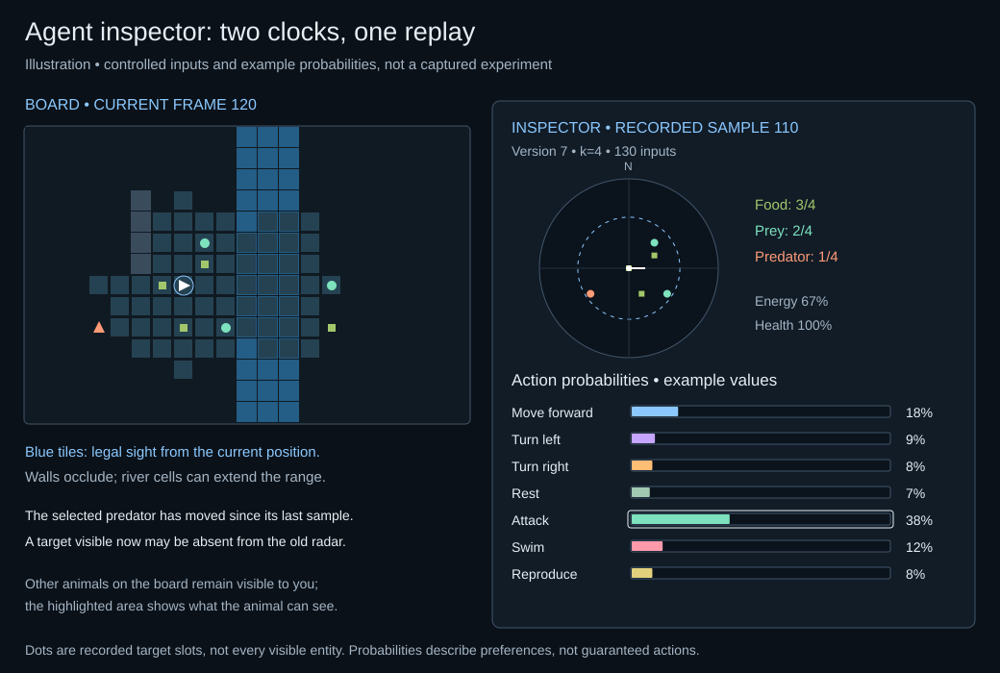
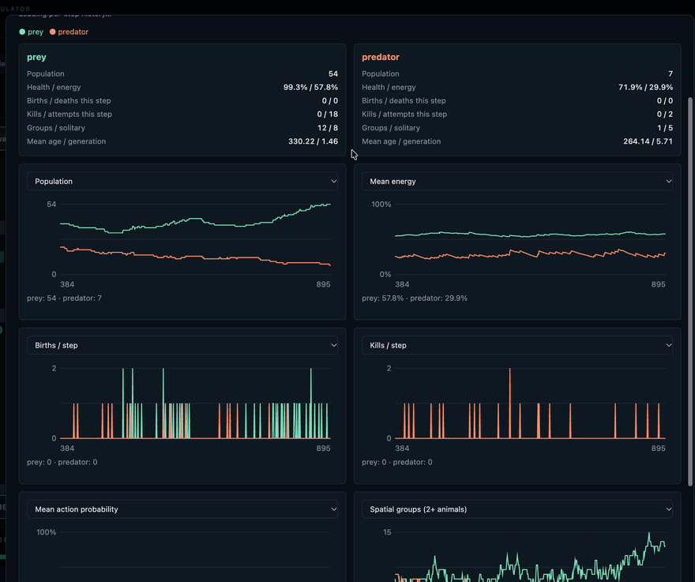

# Playback, recording format and memory

[Playback and inspection](viewer/playback/index.md) · [Viewer and storage](viewer/index.md)

[Project overview](../README.md) · [Setup and runs](running.md) · [Analysis](analysis.md)

For file trees, record layouts, entity schemas and a worked field-mask example,
see [Playback data structures](replay-data-structures.md).

Commands in this guide run from the project root.

Identify animal pointers, food, obstacles and birth/death symbols in the
[board-piece legend](viewer-visual-reference.md#animals-resources-and-event-markers).
The [viewer visual guide](viewer-visual-reference.md) also covers terrain, sight,
themes and brain-view graphics.

See the [recorded terrain previews](geography.md#recorded-terrain-previews) for
short full-screen clips of this viewer on all three maps.

## Visual agent inspector



Click a living animal on the board. **Show selected animal’s sight on board**
highlights its current visible cells using recorded body/map settings, wall
occlusion and directional water bonuses. Heading does not restrict sight to a
cone; elevation and other animals do not occlude sight under the current rules.
The highlighted area is current-frame geometry, not a replayed older input.

This [controlled illustration](assets/inspector/README.md) uses actual observation
inputs and labelled example probabilities; it is not a captured experiment.

**Watch animal brain** follows the selected animal's own sampled hidden
activations as replay plays, with a larger window and playback controls. Inputs and outputs lead the inspector, and **Whole structure when rank ≤ k**
(default two hidden stages) selects whole-network structure versus a deep-network
summary. Individual activation maps remain under Advanced. This uses recorded diagnostic arrays and needs no saved
champions. See [animal activity and storage](explainability.md#recorded-animal-activations).
The separate **Explain saved brain** button re-evaluates an archived champion
on the selected animal's recorded observation samples. Its **Follow replay
samples** option and playback controls keep the weighted diagrams updating with
the playhead, without storing additional data. What-if analysis pins a sample;
see [archive following and pinning](explainability.md#archived-comparison).

The inspector adds:

- A radar of the sampled food/prey/predator target slots, heading, presence counts,
  energy/health gauges and blocked walking directions. Food at the animal's own
  position remains a present target. Wet maps show a dashed base-range ring
  inside the maximum range; actual wall/water-limited visibility is on the board.
- Terrain and version-3 mating inputs in expandable sections. Target categories
  are grouped by diet; general target slots do not reveal identities or sex.
- Horizontal action-probability bars for policies, and signed Q-return bars with
  a zero axis for Q learners. Masked actions are marked; the outline means highest
  predicted score, not the action actually sampled or an accuracy measurement.
- **Recent prediction samples**, an expandable time plot of up to 64 already
  loaded diagnostic samples for the selected agent. Dots are measured values;
  missing intervals are not filled. The small score-only history survives forward
  chunk crossings, drops future points on backward seeks and resets on agent/run/
  recording changes. It never downloads all earlier chunks or retains frames.
  The chart is built on opening this section, reuses its SVG on reopening, and
  processes each recorded score sample once per chart build.



Graphs update when a new diagnostic sample is available; they do not invent
values between samples. Sampling cadence is controlled by the saved
`recording.diagnostics_every_steps` setting.

Every observation/prediction card states its recorded step. Body fields and board
sight are current; brain diagnostics may be older between samples. The radar
uses that sample's heading/relative positions, not the current animal pose.
Unknown layouts and missing diagnostics remain explicit, with raw input arrays
available in a disclosure. **Current body & training details** retains the
existing numerical body/learning fields. Expanded disclosures stay open as
samples advance.

Refresh the viewer page to load the new UI. Existing recordings work without
conversion when their diagnostics are present. The observation and prediction graphs need no model weights or inference.
Activation maps additionally use the optional sampled activation field.
The optional **Explain saved brain** window additionally reads an archived model;
see its [data-flow diagram](explainability.md#what-is-being-explained) and
[worked activation example](explainability.md#worked-activation-example).
No screen recording or additional runtime package is needed. See the
[input layout](observations.md) for supported versions and k values.

## Interface appearance

Use the header **Light mode / Dark mode** button to switch the viewer palette.
Your browser remembers the preference. See [theme examples](viewer-visual-reference.md#interface-themes);
this setting is independent of recorded day/night.

## Playback controls

The Python simulator and JavaScript viewer are independent. Run training first,
then start the viewer with `./run.sh`. Open <http://127.0.0.1:8000>, choose an
experiment and click **Play recording**. The server never loads a learning
checkpoint or advances the world.

- **Refresh list** discovers new saved experiments.
- Choose any saved run using the **Run** dropdown in the top toolbar. **Previous run** and **Next run** jump between runs; the frame slider, **Back**, and **Next frame** inspect the current timeline.
- Playback automatically continues into the next recorded run and stops after the final run.
- A recording opened during training discovers new committed frames/runs when it reaches the available end. It waits for new data and refreshes metadata at most once every two seconds.
- Click an animal, or use **Animal ID → Inspect**, to see its body, sex, both biological parents, lineage and sampled brain diagnostics.
- **Explain saved brain** opens activation routes, local input sensitivity, action comparisons, layer maps and single-input what-if controls for a matching archived champion. See [brain explanations](explainability.md); archived weights are distinct from the animal’s historical predictions.
- The board legend shows every configured species with female/male colors and ♀/♂ keys. The first prey/predator use green/blue and orange/gold; extra species get their own colors, optionally set in JSON. Prey are circles, predators triangles, and males have light outlines. See [species appearance](species.md#viewer-colors-and-metrics). Older recordings without sex data retain their base species colors.
- Set **Frames / second** to change playback speed; simulation outcomes stay fixed.
- Kills have red rings, attacker highlights, KILL labels and a banner.
- Natural deaths use green rings for prey and amber rings for predators, with DIED labels.
- Births use cyan rings and plus signs, BORN labels, a two-parent/child banner for paired births and a counter.
- Playback continues through events at the chosen rate. Event animations remain visible.
- Event markers continue across sequential chunk boundaries and reset across runs.
- **Behavior & learning** analyzes the entire saved run, including later frames; see [metric definitions](analysis.md).

You can close the simulator before playing a recording. Older experiments made
before frame recording was introduced have only metrics/checkpoints and do not
appear in the playback catalog.

## Per-step species dashboard

<picture class="replay-preview">
  <source media="(prefers-color-scheme: light)" srcset="assets/themed/species-metrics-light.webp" type="image/webp" />
  <source media="(prefers-color-scheme: dark)" srcset="assets/species-metrics.gif" type="image/gif" />
  
</picture>

A 3.5-second preview showing species trends as the recorded timeline advances.
The selected animation matches the documentation theme.

Click **Metrics dashboard** in the toolbar. Its charts follow the replay position
while playing, stepping or scrubbing; no future frames are displayed. The modal
has its own play, next/back and seek controls, keeping the main board's size
unchanged. Choose all species or one species and a rolling window of 128, 512 or
1,024 recorded frames. Each of six charts has an independent metric selector.

Available trends include population, mean health/energy, births and deaths per
step, predation/starvation deaths, kills, attack/eat attempts, hunting/feeding
success, starving animals, reward, age, generations and spatial groups. Cards
show the current step, not episode totals. Hunting success is kills per attack;
prey feeding success is productive feeds per eat attempt. No attempts gives no
value. Reward averages surviving animals that acted; deceased actors' rewards
are omitted. Action coverage exposes missing terminal actions.

Prediction charts distinguish action probabilities from Q values, and also
include state value, policy entropy and Q exploration. Select an action for
probability/Q charts. Dots appear only at recorded diagnostic samples; values
are not filled forward or interpolated. These are averages on the sampled
agents' changing observations, not prediction accuracy or proof of improvement.
Health/energy/age averages are missing after extinction. Known event counts
remain zero when there were no events. If frames skip simulation steps, event
metrics and success rates are missing across the gap, not reconstructed.

Spatial groups are same-species connected components of animals linked within
3 Euclidean grid cells, ignoring obstacles. The group count includes components
of two or more animals; solitary animals are separate. Links are transitive,
and proximity does not imply cooperative behavior or shared brains.

The server derives telemetry from old or new replays on demand, in pages of at
most 128 frames, reading bounded chunks. The browser caches at most 12 pages of
scalar summaries; there are no additional result files, models or simulations.
Live recording pages refresh when additional frames are committed. The read-only
API is `GET /api/recordings/{id}/runs/{run}/telemetry/{page}` (zero-based page).
The **Behavior & learning** panel remains a separate whole-run summary.

## Optional terrain playback

[Terrain recordings](geography.md) embed the selected map in configuration once.
The board shades elevation and water, with arrows showing current direction;
the inspector shows depth, elevation and flow. Swim/climb costs, current moves
and drowning have dashboard selectors. Final death positions are recorded so
river drift does not misplace animation markers. Existing flat recordings still
work and chunks remain independently seekable.


## Seeking and charts use separate data

On a cache miss, moving the playhead loads the selected world chunk. Chart history and scalar telemetry are separate requests; none advances the simulator.



Follow [Tutorial 4](tutorials/04-training-and-inference.md) for a complete
training-only → saved brains → recorded inference workflow.

## Training recording profiles

The optional `recording.profile` field, or `--recording-profile`, controls capture
for **training runs**. Missing profiles retain `full`, preserving the existing
configured recording behavior. Learning, world seeds, rewards, reproduction,
champion selection and checkpoint retention are independent of the profile.

| Profile | World frames, events and metrics | Inspector samples | Other training artifacts |
| --- | --- | --- | --- |
| `full` | Configured frame cadence | Configured diagnostic cadence and activation setting | Unchanged |
| `compact` | Same configured frame cadence | Diagnostic interval at least 50 steps; activations off | Unchanged |
| `training-only` | No replay directory | None | Metrics CSV, summaries, seeds, recovery checkpoints and best brains remain |

Compact capture retains chunk-start and final diagnostic samples, so these can
occur sooner than the regular interval. A configured zero diagnostic interval
remains disabled; an existing interval above 50 remains unchanged. Compact does
not lower world-frame cadence or invent missing inspector values. `training-only`
requires a new evaluation recording to watch behavior; it cannot replay the
original training episodes. `--no-library` still explicitly disables new brain
exports, and the existing checkpoint retention policy still applies.

Add the profile to the normal complete `recording` JSON object, or select it per
invocation:

```sh
.venv/bin/python -m wtf run ppo --runs 10 --seed 100 \
  --recording-profile training-only --progress
# Retain training playback with fewer inspector samples instead:
.venv/bin/python -m wtf run ppo --runs 10 --seed 100 \
  --recording-profile compact --progress
```

The selected profile is persisted in the environment/checkpoint configuration;
resuming training keeps it unless explicitly overridden with `--recording-profile`.
The experiment manifest records effective `recording_profile`, `recording_settings`
and `playback_recording`. The playback manifest records effective capture options.
Direct Python users should check `settings(config, mode)["enabled"]` before
constructing `Recorder`; disabled capture raises before creating a replay folder.

Evaluation and random modes resolve a configured training profile to `full`,
using the original low-level frame/diagnostic/activation settings. Explicit CLI
`compact`/`training-only` selections require training mode. Configured
`recording.enabled: false` and CLI `--no-record` still disable capture in any mode.
This never alters or removes existing saved playbacks.

For recorded inference with fixed learned weights, use the
[training-to-evaluation workflow](running.md#train-without-replay-then-record-inference).

## Recording settings

Each environment has a recording section:

```json
"recording": {
  "profile": "full",
  "enabled": true,
  "frame_every_steps": 1,
  "frames_per_chunk": 64,
  "diagnostics_every_steps": 10,
  "record_activations": true,
  "encoding": "binary",
  "compression": "xz",
  "compression_level": 6
}
```

Replay storage separates the data layout (`encoding`) from compression:

- `"binary"` (default): typed numeric arrays, dictionary strings and column-packed
  entity records wrap the keyframe/delta layout. No JSON or base64 is stored
  inside these replay chunks. See [binary storage](binary-storage.md).
- `"delta"`: each chunk begins with a complete keyframe. Later frames
  store only changed top-level/metric fields and entity additions, removals and
  changed fields. Animal IDs and resource coordinates identify entities; small
  field masks avoid repeating field names. Unchanged food patches are omitted.
- `"snapshot"`: every frame is complete, useful for debugging and comparison.
- `"xz"` compression (default level 6, 1 MiB dictionary) prioritizes disk size;
  binary chunks use `*.bin.xz`. `"gzip"` uses `*.bin.gz`; `"none"` uses `*.bin`.
  Levels 1–9 are accepted. JSON layouts retain `.json` before their compression
  suffix. XZ costs more compression work than gzip.

When metric and frame schedules coincide, CLI recording reuses the completed-step
report already used for history/CSV/progress. The recorder copies its metric maps;
report sharing does not add frames, change diagnostic sampling or change encoded
values. Replay-only steps and standalone captures still obtain current metrics.
See [report ownership and freshness](performance.md#founder-initialization-and-shared-reporting).

All layouts preserve every recorded frame, stored numeric value, event and
sampled diagnostic. Hidden-activation visualization arrays are sampled as FP32;
existing observation and prediction values retain their previous precision. Updates store absolute values, avoiding cumulative rounding.
Every chunk has its own keyframe and field table: seeking reconstructs at most
one chunk, never the whole run. The recorder streams frames and retains only the
previous frame for computing changes. No database or new package is required.

Previous configurations without this section use the same defaults. Set `enabled` to `false` or pass `--no-record` for metrics/checkpoints only. Increase `frame_every_steps` to reduce disk usage; initial and final frames are always saved. Intermediate events between sampled frames are omitted, while sampled metrics retain cumulative outcomes. Set `diagnostics_every_steps` to `0` to omit brain diagnostics entirely. When enabled, diagnostics are also sampled at chunk boundaries so chunks can be inspected independently.

The recorder encodes one frame at a time into an open chunk file; it never collects the full playback history in RAM. Completed chunk files are renamed atomically, then advertised in the manifest. Cleanly interrupted runs retain their committed frames and are labeled `interrupted`; a hard crash can leave an unadvertised `.tmp` file. Such files are not served. The current manifest can be refreshed to discover additional committed chunks, although the intended workflow is playback after simulation finishes.

The browser retains one decoded world chunk at a time and loads the necessary chunk for seeking. It also keeps a small previous-frame position list to locate removed animals for death highlights. A direct seek can briefly read the preceding chunk to recover those positions, then release it. For older recordings that omit intermediate steps, natural deaths still show a banner, but no location is guessed if the immediately preceding state was not recorded. Chart history is loaded separately as at most 2,048 lightweight population/food samples for the current run, plus the exact current-frame point. It persists across world-chunk boundaries and only displays points up to the playback position. Very long histories are progressively downsampled, preserving the first and last recorded metric points. Switching runs resets the chart to that run. The server reads bounded requested chunks and caches at most four stat-validated
derived telemetry pages, without caching an entire recording. Neural weights, target networks, optimizer state and raw experience buffers are absent from playback files; recorded diagnostics contain observations and counts plus Q values/epsilon or PPO probabilities/entropy/value. Hidden-activation samples add compact FP32 layer arrays and recurrent prior memory where applicable. The inspector identifies the diagnostic sample step, which may precede the displayed body state.

Training still needs the live brains and replay buffers. CLI checkpoint writing copies and encodes one brain at a time, then atomically publishes a compact compressed checkpoint ([format and migration](running.md#optimize-existing-checkpoint-files)). Programmatic `checkpoint()` still returns a detached in-memory snapshot of all brains; restoring a checkpoint still materializes that complete state. Recording avoids an additional full-run frame history; it does not make learning itself constant-memory or guarantee a measured peak-memory reduction. Disk usage grows with duration. `frames_per_chunk` is capped at 256, but individual frame size still depends on world/population size.

## Read-only HTTP API

| Route | Response |
| --- | --- |
| `GET /api/recordings` | Saved recording catalog |
| `GET /api/recordings/{id}` | Recording metadata and run list |
| `GET /api/recordings/{id}/runs/{run}/chunks/{index}` | One bounded frame chunk |
| `GET /api/recordings/{id}/runs/{run}/metrics` | Lightweight population/food history |
| `GET /api/recordings/{id}/runs/{run}/analysis` | Behavior and sampled learning statistics |

 The previous live simulation POST endpoints return 405. Use `./run.sh --results PATH` to view recordings stored under a custom CLI `--output` directory.


## Optimize older recordings

Restart the playback server and refresh the viewer after upgrading. Old full
snapshot arrays, compact delta chunks, plain JSON and gzip files remain readable,
including mixtures left by an interrupted conversion.

The disk-focused [binary converter](binary-storage.md#convert-existing-completed-results)
handles replay chunks and exact checkpoints together:

```sh
.venv/bin/python -m wtf.storage.optimize_storage results/EXPERIMENT
.venv/bin/python -m wtf.storage.optimize_storage results --all
```

The older conversion commands remain available for JSON recordings:

```sh
# Upgrade one completed experiment to delta encoding plus gzip:
.venv/bin/python -m wtf.storage.compress_recordings results/EXPERIMENT --delta
# Upgrade all completed/interrupted experiments:
.venv/bin/python -m wtf.storage.compress_recordings results --all --delta
# Gzip alone, preserving the existing serialized layout:
.venv/bin/python -m wtf.storage.compress_recordings results --all
```

Conversion handles one committed chunk at a time and retains the smaller
representation. Delta conversion verifies SHA-256 of canonical expanded frames;
gzip-only conversion verifies decompressed bytes. Replacements are atomic,
originals survive failed verification, batch mode skips active recordings, and
conversion can be rerun safely. Checkpoints, saved champions, metrics and training
configuration are untouched. A single active recording is rejected; finish or
close training first. Metadata may say `mixed` if some original chunks were smaller.

For programmatic access use `wtf.storage.replay_io.load_chunk(path)`: it returns
full frames for either layout/compression. Behavior analysis and fallback
population history use the same reader. The viewer retains one decoded world
chunk, so this storage change does not reduce the expanded chunk's memory.

The chunk HTTP endpoint returns a full-frame JSON array by default for existing
clients. The viewer sends `X-WTF-Replay: binary-v1` to receive the native stored
layout and decode it locally. Binary responses use an ArrayBuffer; legacy JSON
chunks use JSON parsing. The server decompresses XZ chunks, while gzip-capable
native requests receive stored gzip bytes directly. Responses vary on both `Accept-Encoding` and `X-WTF-Replay`.
No simulation or learning runs during decoding.

A representative 400-step PPO replay (401 frames, seed 11, 64-frame chunks) used:

| Layout | Chunk bytes |
| --- | ---: |
| Full JSON snapshots | 9,276,835 |
| Full snapshots + gzip 6 | 851,601 |
| Delta JSON | 3,881,570 |
| Delta + gzip 6 | 722,700 |

Delta plus gzip saved another **15.1% versus gzip alone**, or **92.2% versus full
JSON**. This is one local workload; savings depend on population, changes and
diagnostics. Encoding the already generated frames took 0.55 seconds and parsing
plus delta reconstruction took 0.68 seconds across all 401 frames; these are not
end-to-end training or browser timings. Reducing recording frequency can save
more space but omits intermediate events; both layouts above preserve them.

## Mutation information

Training births can include a `mutated` event with parent, child and changed
weight count. Animal records include scalar mutation lineage fields; the
inspector displays them even when a brain diagnostic was not sampled that step.
CSV/summary metrics and per-step telemetry track species mutation counts. No
model parameter arrays or extra animation delays are added. See
[rare mutations](mutation.md) for settings and inheritance behavior.

## Optional day–night cycle

See [day–night configuration and playback](day-night.md) for gradual sunlight,
species-specific night vision/energy modifiers and the maintained example.

For package-versus-format support and cross-machine limits, see the
[artifact compatibility policy](compatibility.md).
