# Release and commit rollout hub

[Project overview](../../README.md) · [Development](../development.md) · [Release template](TEMPLATE.md)

The rollout history links implementation commits to their behavior changes,
compatibility requirements and validation. Open a version below for its detailed
child document. Operational instructions remain in the relevant project guides.

**Latest committed rollout:** [0.0.2.5](0.0.2.5.md), `882c155`.
**Latest committed runtime implementation:** [0.0.2.5](0.0.2.5.md), `882c155`.
**Published package:** [0.0.2.0 on PyPI](https://pypi.org/project/wtf-wildlife-trial-framework/0.0.2.0/).
**Pending rollout:** [0.0.2.6 — Stable board event overlays](0.0.2.6.md).

## Rollout index

The initial history is backfilled in commit order. A Committed status means the
referenced change is in local Git history; it does not establish deployment,
publication, a Git tag or a successful historical test run. Dates are commit
dates, or explicitly labeled preparation dates for pending work.

| Version | Status | Date | Implementation commit | Scope |
| --- | --- | --- | --- | --- |
| [0.0.2.6](0.0.2.6.md) | Pending | 2026-11-22 | Not committed; base `882c155` | Overlay competition labels without resizing the board |
| [0.0.2.5](0.0.2.5.md) | Committed | 2026-11-22 | `882c155` | One runtime asset allowlist for source archives and wheels |
| [0.0.2.4](0.0.2.4.md) | Committed | 2026-11-22 | `b47a2b0` | Reuse private GRPO trial state and batch independent dense actors |
| [0.0.2.3](0.0.2.3.md) | Committed | 2026-11-22 | `47110e9` | Exact optional native top-k perception and matched benchmarks |
| [0.0.2.2](0.0.2.2.md) | Committed | 2026-11-22 | `47110e9` | Reuse unchanged champion models and phase-local contest occupancy |
| [0.0.2.1](0.0.2.1.md) | Committed | 2026-11-22 | `4558cef` | Opt-in learned same-species contests for food/path priority |
| [0.0.2.0](0.0.2.0.md) | Committed | 2026-11-22 | `18ca6f0` | Rename the Python namespace to `wtf`, group modules by responsibility and preserve artifact compatibility |
| [0.0.1.32](0.0.1.32.md) | Committed | 2026-11-21 | `1b6b5ca` | Theme-aware inspector/XAI, paired replay previews and TestPyPI trial preparation |
| [0.0.1.31](0.0.1.31.md) | Committed | 2026-11-21 | `8a4d8c5` | Require Python 3.12+, port native arithmetic to 3.12/3.13 and pin Ubuntu packaging CI |
| [0.0.1.30](0.0.1.30.md) | Committed | 2026-11-21 | `18126f4` | Portable wheel/sdist, installed runtime assets/commands and isolated installation/Ubuntu CI checks |
| [0.0.1.29](0.0.1.29.md) | Committed | 2026-11-21 | `18126f4` | Docker training/playback launcher, compatibility policy and complete Python/Markdown example |
| [0.0.1.28](0.0.1.28.md) | Committed | 2026-11-21 | `92fb6e7` | Reuse frame lighting/body values and restore native flat metabolism with cycle costs |
| [0.0.1.27](0.0.1.27.md) | Committed | 2026-11-21 | `92fb6e7` | Light/dark viewer themes and explicit daytime ground illumination |
| [0.0.1.26](0.0.1.26.md) | Committed | 2026-11-21 | `92fb6e7` | Gradual sunlight, species night vision/energy modifiers and tick-based replay lighting |
| [0.0.1.25](0.0.1.25.md) | Committed | 2026-11-21 | `1c98f86` | Replay-following actual animal activations plus archived routes, sensitivity and what-if controls |
| [0.0.1.24](0.0.1.24.md) | Committed | 2026-11-21 | `41139fa` | Initialize founder networks once per species/sex and share unchanged-state reports |
| [0.0.1.23](0.0.1.23.md) | Committed | 2026-11-21 | `41139fa` | Share mating phase data and stop birth-availability scans early without changing behavior |
| [0.0.1.22](0.0.1.22.md) | Committed | 2026-11-21 | `9152756` | Promote supported masked-PPO defaults under the common name; localize superseded variants |
| [0.0.1.21](0.0.1.21.md) | Committed | 2026-11-21 | `9152756` | Ignore local experiment output, developer artifacts and LaTeX intermediates |
| [0.0.1.20](0.0.1.20.md) | Committed | 2026-11-21 | `9152756` | Learned escape actions, version-4 consent signals and compatible readers |
| [0.0.1.19](0.0.1.19.md) | Committed | 2026-11-21 | `9152756` | Proximal consent, prey survival, lineage selection and mating diagnostics |
| [0.0.1.17](0.0.1.17.md) | Committed | 2026-11-19 | `e62e0ad` | Nature Machine Intelligence paper source, method citations and editable future-observation tables |
| [0.0.1.16](0.0.1.16.md) | Committed | 2026-11-19 | `6e354d3` | Checkpoint state/access blocks, observation packing, founder families and spatial-window references |
| [0.0.1.15](0.0.1.15.md) | Committed | 2026-11-19 | `f3d5a1a` | Playback/model artifacts, binary records, entity columns, layer arrays and field masks |
| [0.0.1.14](0.0.1.14.md) | Committed | 2026-11-19 | `91697aa` | Format 162 maintained source files, establish style settings and verify full suites |
| [0.0.1.13](0.0.1.13.md) | Committed | 2026-11-19 | `91697aa` | Mandatory repository-wide formatting after code updates and explicit formatter checks |
| [0.0.1.12](0.0.1.12.md) | Committed | 2026-11-19 | `91697aa` | Export-local configuration reuse, lazy history SVGs and single-pass score processing |
| [0.0.1.11](0.0.1.11.md) | Committed | 2026-11-19 | `91697aa` | Top-k, inspector, champion storage and plateau visuals with maintained guides |
| [0.0.1.10](0.0.1.10.md) | Committed | 2026-11-19 | `91697aa` | Selected-agent sight overlay, sampled-input radar, action bars and bounded prediction history |
| [0.0.1.9](0.0.1.9.md) | Committed | 2026-11-19 | `91697aa` | Optional plateau patience over selected champion ranks, species monitoring and exact-resume counters |
| [0.0.1.8](0.0.1.8.md) | Committed | 2026-11-19 | `91697aa` | Strict improvement-only champion promotion and lossless deduplicated binary/XZ model weights |
| [0.0.1.7](0.0.1.7.md) | Committed | 2026-11-19 | `91697aa` | Configurable top-k target slots, compatible input sizing and enhanced river opt-in |
| [0.0.1.6](0.0.1.6.md) | Committed | 2026-11-19 | `91697aa` | Separate standard/deep strong-predator river PPO presets with longer predator sight |
| [0.0.1.5](0.0.1.5.md) | Committed | 2026-11-19 | `91697aa` | Deferred lineage diagnostics and allocation only for new founder families |
| [0.0.1.4](0.0.1.4.md) | Committed | 2026-11-19 | `65345bf` | Qualified lineage retention, 42-input mating observations and longer/more frequent meandering GRPO trials |
| [0.0.1.3](0.0.1.3.md) | Committed | 2026-11-18 | `47d8d54` | Generic feedback audit and 216 preset/controller contract combinations; no runtime tuning changes |
| [0.0.1.2](0.0.1.2.md) | Committed | 2026-11-18 | `47d8d54` | Proven biological generations, unique founder-family fitness and independent lineage champion selectors |
| [0.0.1.1](0.0.1.1.md) | Committed | 2026-11-18 | `d320059` | Meandering river with A2C/GRPO, three further PPO landscapes and map diagrams |
| [0.0.1.0](0.0.1.0.md) | Committed | 2026-11-18 | `abd310d` | Fused PPO/GRU/quantile math, spatial/world/replay/dashboard kernels and native-to-native benchmarks |
| [0.0.0.43](0.0.0.43.md) | Committed | 2026-11-18 | `baa5101` | Optional dense/backprop, DQN/SGD and Adam kernels with matched benchmarks |
| [0.0.0.42](0.0.0.42.md) | Committed | 2026-11-18 | `baa5101` | Float32 model/optimizer buffers, precision-aware resume and lossless narrow binary arrays |
| [0.0.0.41](0.0.0.41.md) | Committed | 2026-11-18 | `baa5101` | Code-inspection assessment of native kernels, packed runtime data and precision boundaries |
| [0.0.0.40](0.0.0.40.md) | Committed | 2026-11-18 | `35f17db` | Documentation-wide learning, inheritance, storage and workflow diagrams |
| [0.0.0.39](0.0.0.39.md) | Committed | 2026-11-17 | `2d2e036` | Three full-viewer terrain GIFs with capture provenance and export helper |
| [0.0.0.38](0.0.0.38.md) | Committed | 2026-11-17 | `2d2e036` | Ten SVG physics cases, standalone explorer, illustrated guide and regeneration tools |
| [0.0.0.37](0.0.0.37.md) | Committed | 2026-11-17 | `2d2e036` | Water-directed sight extension with wall occlusion and bounded static caching |
| [0.0.0.36](0.0.0.36.md) | Committed | 2026-11-17 | `2d2e036` | One enclosed valley, prey/predator founder zones and exact boundary-food allocation |
| [0.0.0.35](0.0.0.35.md) | Committed | 2026-11-17 | `2d2e036` | Terrain energy configuration and scalar calibration tooling |
| [0.0.0.34](0.0.0.34.md) | Committed | 2026-11-17 | `68855f3` | Mutual reproduction choices, energy/failure/birth rewards and decision metrics |
| [0.0.0.33](0.0.0.33.md) | Committed | 2026-11-17 | `68855f3` | Optional map geography, health-gated swimming, fractional currents and climb costs |
| [0.0.0.32](0.0.0.32.md) | Committed | 2026-11-17 | `6480da8` | Arbitrary species names, dynamic legends/colors and multi-species coverage |
| [0.0.0.31](0.0.0.31.md) | Committed | 2026-11-17 | `a7a4e70` | Species/sex champion pools, matching loading/chaining and distinct viewer colors |
| [0.0.0.30](0.0.0.30.md) | Committed | 2026-11-17 | `a7a4e70` | Physical male/female pairing, crossed newborn brains and rare mutation |
| [0.0.0.29](0.0.0.29.md) | Committed | 2026-11-17 | `5df2562` | Repository context, agent conventions and three reusable workflows |
| [0.0.0.28](0.0.0.28.md) | Committed | 2026-11-17 | `6ee3f91` | Compact simulation and metrics GIFs in documentation |
| [0.0.0.27](0.0.0.27.md) | Committed | 2026-11-17 | `e16300e` | Binary replay server capability check and restart guidance |
| [0.0.0.26](0.0.0.26.md) | Committed | 2026-11-17 | `e16300e` | Rare newborn mutations, lineage tracking and optimizer resets |
| [0.0.0.25](0.0.0.25.md) | Committed | 2026-11-17 | `e5d8fcf` | Visibility LRU, final champion snapshots and per-species work reuse |
| [0.0.0.24](0.0.0.24.md) | Committed | 2026-11-17 | `dc36663` | Binary replay/checkpoints, XZ compression and bounded caching |
| [0.0.0.23](0.0.0.23.md) | Committed | 2026-11-17 | `7d238e6` | Recurrent, distributional and multi-agent training efficiency |
| [0.0.0.22](0.0.0.22.md) | Committed | 2026-11-17 | `0ae8df0` | Per-animal reproduction timing windows |
| [0.0.0.21](0.0.0.21.md) | Committed | 2026-11-17 | `406487d` | Recurrent PPO, QR-DQN, Maskable PPO and experimental MAPPO |
| [0.0.0.20](0.0.0.20.md) | Committed | 2026-11-17 | `0740c67` | Larger predator PPO preset and lifespan champion selection |
| [0.0.0.19](0.0.0.19.md) | Committed | 2026-11-16 | `23df8af` | Release history and maintenance workflow |
| [0.0.0.18](0.0.0.18.md) | Committed | 2026-11-16 | `c3af0d3` | Shared policy training efficiency |
| [0.0.0.17](0.0.0.17.md) | Committed | 2026-11-16 | `a75083c` | Balanced champions and DQN lifecycle efficiency |
| [0.0.0.16](0.0.0.16.md) | Committed | 2026-11-16 | `70468cb` | Per-step dashboard and compact checkpoints |
| [0.0.0.15](0.0.0.15.md) | Committed | 2026-11-16 | `82ee88e` | Species learning-rate controls |
| [0.0.0.14](0.0.0.14.md) | Committed | 2026-11-15 | `651c33b` | Compact replay storage |
| [0.0.0.13](0.0.0.13.md) | Committed | 2026-11-15 | `761119a` | Champion chaining and multiple-run playback |
| [0.0.0.12](0.0.0.12.md) | Committed | 2026-11-15 | `7c53c52` | Run-local archives and CLI model selectors |
| [0.0.0.11](0.0.0.11.md) | Committed | 2026-11-15 | `88f0006` | Saved champions and documentation guides |
| [0.0.0.10](0.0.0.10.md) | Committed | 2026-11-15 | `c302ea7` | Behavior and learning analysis |
| [0.0.0.9](0.0.0.9.md) | Committed | 2026-11-15 | `47b1674` | Incremental spatial perception |
| [0.0.0.8](0.0.0.8.md) | Committed | 2026-11-15 | `550718d` | Source formatting |
| [0.0.0.7](0.0.0.7.md) | Committed | 2026-11-15 | `97e9bc5` | Reproduction and inherited brains |
| [0.0.0.6](0.0.0.6.md) | Committed | 2026-11-15 | `08e2e5b` | Policy algorithms and training progress |
| [0.0.0.5](0.0.0.5.md) | Committed | 2026-11-15 | `e98fd36` | Wildlife Trial Framework naming |
| [0.0.0.4](0.0.0.4.md) | Committed | 2026-11-15 | `f02b618` | Remove generated benchmark files from Git |
| [0.0.0.3](0.0.0.3.md) | Committed | 2026-11-15 | `0c6a1a0` | Ignore generated performance artifacts |
| [0.0.0.2](0.0.0.2.md) | Committed | 2026-11-15 | `a9190e4` | Streamed saves and simulation efficiency |
| [0.0.0.1](0.0.0.1.md) | Committed | 2026-11-15 | `5cd6937` | Randomized experiments and playback outcomes |
| [0.0.0.0](0.0.0.0.md) | Committed | 2026-11-14 | `ada088a` | Initial simulation and recorded playback |

## Rollout record lifecycle

Preparing a record does not create an implementation commit or publish a release. Only verified Git history changes its status to Committed.

## Four part version numbers

Use `MAJOR.MINOR.PATCH.ROLLOUT`, with four nonnegative integer components.
Historical entries and the initial documentation rollout use `0.0.0.N` in commit
order. They do not retroactively assign compatibility meaning to old commits.
Future changes can increment the appropriate component and reset components to
its right:

| Component | When to increment | Example |
| --- | --- | --- |
| MAJOR | An incompatible public interface or data-format change | `1.0.0.0` |
| MINOR | A compatible new capability | `0.1.0.0` |
| PATCH | A compatible correction or implementation improvement | `0.0.1.0` |
| ROLLOUT | Another delivery within the same version line | `0.0.0.20` |

The native-kernel internals release starts the `0.0.1.0` line: a third-component
PATCH increment for compatible performance improvements, with ROLLOUT reset to
zero. Another delivery within that line would be `0.0.1.1`.

These are rollout documentation versions, separate from the package version in
`pyproject.toml`. This initial history creates neither Git tags nor package
version changes. Sort versions numerically by all four components, not as text.

## Maintain the next rollout

Create records for implementation, public-interface or adopted configuration
changes. Executing experiments, analyzing a run or adding manuscript observations
is not a rollout. Record tests of changed behavior; keep ecological findings and
campaign progress out of the release history.

1. Copy [TEMPLATE.md](TEMPLATE.md) to the next version file before preparing a
   rollout. A rollout may identify one implementation commit or an explicit
   contiguous range. Keep its status Pending until the changes are committed.
2. Describe the problem, resulting behavior, affected configuration and file
   formats, migration steps, validation evidence, and rollback boundaries.
   Separate measured results from expected performance improvements.
3. Add the hub row and update the latest/pending links. Link the previous and
   next child records, keeping navigation valid. Keep a pending record current
   if the change's scope grows or is split.
4. After the implementation commit exists, record its actual hash/range and
   commit date and mark the record Committed. A subsequent documentation-only
   update can record the hash; do not invent a self-referential commit hash.
   Such reconciliation stays with that rollout rather than creating an endless
   sequence of documentation-only application releases.
5. Check the child file, hub entry, relative links and referenced Git commits.
   Run checks appropriate to implementation changes and record actual results.
   The [development guide](../development.md) lists the runtime check commands.

Do not reuse a committed version for unrelated work. Corrections to its history
must preserve the original change's identity and explain any substantive change
in interpretation. Normal operating instructions should be updated in the
existing guides and linked from release notes instead of copied into the README.

## Status and evidence

- **Pending:** prepared or in progress; no implementation commit is claimed.
- **Committed:** associated implementation commit(s) exist. Historical backfill
  entries use this status.
- **Rolled back:** a recorded reversal, with its reason and reverting commit.
  Keep the original child record and add the reversal link.

Historical validation sections describe coverage introduced by the revision.
They are not assertions that every historical revision was re-executed. Actual
session pass counts are included only where recorded for that implementation.
Individual experiment outcomes and identifiers do not belong in release records.
Keep them in ignored reports or the separate paper workspace. Current supported
calibration recommendations belong in the calibration guide, not a trial history.

## Operational rollback

Code rollback and experiment-data rollback are separate operations. Preserve the
checkpoint, model archive and environment needed to reproduce a result. A newer
writer may produce data an older reader cannot decode; export or verify a
compatible representation before changing readers. An already-running Python
process retains imported code, so start a new training/viewer process to adopt
an implementation change. Preserve existing work before applying a source
revert, and record the reverting commit in the affected release entry.
