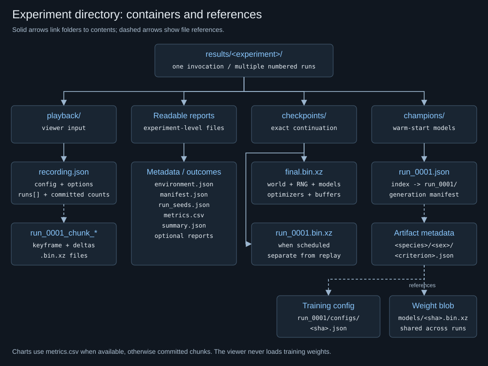
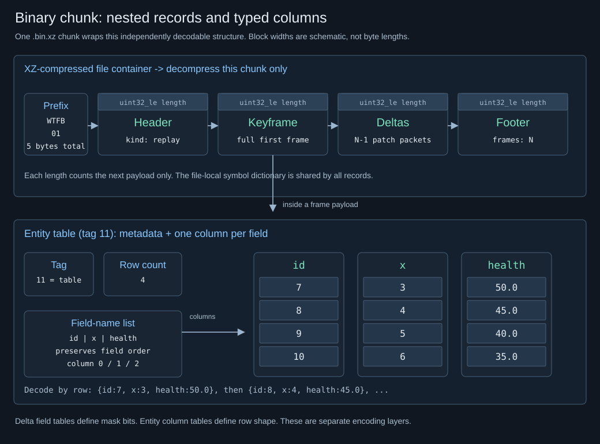
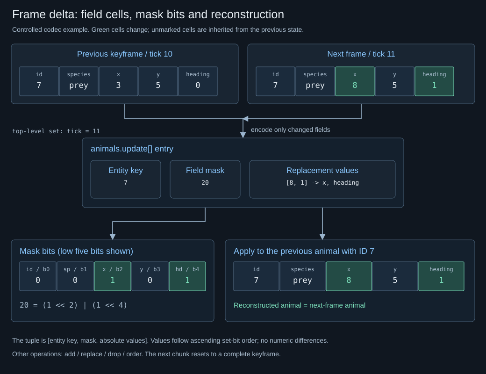

# Playback data structures and artifact map

[Stored artifacts](viewer/storage/index.md) · [Viewer and storage](viewer/index.md)

[Playback guide](recording.md) · [Binary format](binary-storage.md) · [Saved brains](brain-library.md) · [Visual guide](visual-guide.md)

This guide describes the current default binary/XZ layout. The figures show
actual field names and record boundaries, with abbreviated, controlled examples.
Object notation below explains decoded values; the replay stores typed binary
records rather than JSON text. Legacy JSON/snapshot/gzip variants remain readable.

## Experiment directory and references



```text
results/<experiment>/
├── environment.json                 effective configuration and CLI overrides
├── manifest.json                    experiment metadata and model provenance
├── run_seeds.json                   world seed used by each run
├── metrics.csv                     readable per-step/per-run metrics
├── summary.json                    completed-run outcomes
├── early_stopping.json             present when plateau monitoring is configured
├── analysis.json                   optional generated behavior report
├── playback/
│   ├── recording.json              playback manifest: config + options + runs[]
│   ├── run_0001_chunk_000000.bin.xz independent chunk of run 1
│   ├── run_0001_chunk_000001.bin.xz next chunk of run 1
│   └── run_0002_chunk_000000.bin.xz first chunk of run 2
├── checkpoints/
│   ├── run_0001.bin.xz             optional scheduled exact-state checkpoint
│   └── final.bin.xz                final exact-state checkpoint
└── champions/
    ├── run_0001.json               index pointing to that run's generation
    ├── run_0001/
    │   ├── manifest.json          champion generation index
    │   ├── configs/<sha>.json     pooled training configurations
    │   └── <species>/<sex>/<criterion>.json
    │                              metadata + relative config/weight references
    └── models/<sha>.bin.xz         shared lossless champion model blobs
```

Run numbers start at 1; chunk indexes start at 0 and reset per run. Extensions
change with the selected encoding/compression. Checkpoints and champion exports
are conditional on mode/options; this is a layout map, not a guarantee every
invocation creates every file. See [run outputs](running.md#train-and-save-a-recording).

Playback needs `playback/recording.json` and its committed chunk files.
`metrics.csv` accelerates population/food history; without it the server can
reconstruct that history by scanning committed chunks one at a time. Advanced
telemetry/behavior pages derive their data from chunks. Playback does not load
champion weights, training buffers or resume checkpoints.

Champion config references resolve from the generation directory; model
references resolve to the shared `champions/models/` pool. Keep those dependencies
when copying saved brains. An exact checkpoint has a different purpose and
contains the full continuation state; see [weights versus exact state](brain-library.md#weights-versus-exact-state).

## Playback manifest

`playback/recording.json` is readable JSON. It carries the static data and the
index of committed frames rather than repeating static geometry in every frame.

| Field | Shape / meaning |
| --- | --- |
| `recording_version` | Integer `1`, checked by the reader |
| `name`, `mode`, `status` | Experiment name; execution mode; `writing`, `complete` or `interrupted` |
| `config` | Full effective environment configuration, including species/templates and resolved terrain when present |
| `recording` | Capture cadence, diagnostic cadence, chunk limit, encoding and compression options |
| `storage_format`, `storage_compression` | Current storage descriptors; conversion can produce a mixed layout |
| `runs[]` | One metadata entry per recorded run |

Each run entry contains `run`, `seed`, `brain_precision`, `obstacles`,
`initialized_from` (species/sex provenance), `chunk_count`, `frame_count`,
`first_tick`, `last_tick` and `complete`. Chunk filenames are derived from the run
number and chunk index; the manifest does not contain the frame bodies.
World dimensions/species/terrain come from `config`; obstacle placement is per run.

The recorder publishes a chunk by closing its `.tmp` file, renaming it to its
final filename, then atomically replacing the manifest with updated counts.
An unadvertised temporary chunk is not a committed playback artifact.

## Binary chunk and typed payloads



After decompression, the byte sequence is:

```text
57 54 46 42 01                            ASCII "WTFB", version byte 0x01
uint32_le length + typed replay header    {kind: "replay", delta: {...}}
uint32_le length + typed full keyframe    first frame of this chunk
uint32_le length + typed delta packet     repeat for remaining frames
uint32_le length + typed footer          {kind: "replay_end", frames: N}
```

The prefix is **five bytes total**. Each 4-byte length counts only the following
encoded payload bytes. `N` counts frame records, including the keyframe, and
excludes the header/footer. The header's `delta` object contains
`codec: "wtf-delta-v1"`, `animal_fields` and `resource_fields`.
A reader checks framing, supported tags and footer count before reconstruction.

Within payloads, maps/lists/scalars have type tags. Repeated strings are defined
once then referenced by file-local symbol IDs. Lists of at least two nonempty
records with identical ordered keys can become a tag-11 table: row count,
field-name list, then a column per field. Decoding zips columns back into records.
Variable-shaped lists retain their general representation.

Numeric arrays choose lossless representations: exactly representable float32,
otherwise float64; eligible integer arrays choose packed unsigned widths only
when smaller than their varint representation. Scalar floats remain float64.
This changes byte layout, not numeric precision. See [all layout rules](binary-storage.md#structured-binary-layout).

## Reconstructed frame and entity fields

A decoded frame has this logical schema:

```text
Frame
├── tick: integer
├── animals: Animal[]                   only living animals in that frame
├── resources: Resource[]               {x, y, quantity}
├── events: Event[]                     events captured in this frame
├── metrics: map                        populations, food and other world metrics
├── total_updates: integer              experiment training update count
├── finished_run: boolean
└── diagnostics?: map<string ID, Diagnostic>
```

The current animal delta table has the following ordered fields. Bit indexes
refer to the **header table**, not an assumed layout in an older recording.

| Bit indexes | Fields in order |
| --- | --- |
| 0–4 | `id`, `species`, `x`, `y`, `heading` |
| 5–9 | `energy`, `health`, `age`, `last_action`, `last_reward` |
| 10–14 | `parent_id`, `generation`, `last_reproduced_age`, `kills`, `energy_gained` |
| 15–19 | `statistics_since_age`, `reproduction_due_age`, `mutated`, `mutation_count`, `mutation_weights` |
| 20–23 | `sex`, `second_parent_id`, `drift_x`, `drift_y` |
| 24–25 | `mating_intent_until_tick`, `last_mating_failure` |

Resources use the ordered fields `x`, `y`, `quantity`. Events carry `kind`,
`actor`, `target`, `amount`, `cause`, `mate` and `position`; events may identify
animals removed from the living-animal table, and a position may be absent/null.
Animal identity is `id`; resource identity is its `(x, y)` coordinate pair.

Diagnostics contain the sampled observation `features`, sample `tick` and
algorithm-specific outputs/counters: for example Q values/exploration or action
probabilities/entropy/value estimates. They omit model weights and raw training
experience. They are sampled, not present at every step. A diagnostic's timestamp
can precede the displayed body frame; the [inspector diagram](recording.md#visual-agent-inspector)
explains the two clocks. Metric and diagnostic extension fields vary by algorithm
and recording version; readers preserve their maps rather than a fixed field list.

New diagnostic records can additionally contain `activations.version: 1` and
`activations.layers`, an array of hidden-layer arrays. Recurrent PPO also adds
`activations.recurrent_prior`. These visualization values are sampled as FP32;
existing features and output scores keep their previous precision. No input or
output arrays, weights or optimizer state are duplicated. The field follows the
normal diagnostic cadence and is optional for older/disabled recordings. See
[activation sampling and replay](explainability.md#recorded-animal-activations)
for its ownership diagram and `recording.record_activations` setting.

## Field masks and frame deltas



The example moves `x` from 3 to 8 and changes `heading` from 0 to 1. It tests the
codec independently of movement rules; it is not an observed animal trajectory.
With `x` at bit 2 and `heading` at bit 4, the mask is `4 + 16 = 20`. The encoded
update is `[7, 20, [8, 1]]`: entity key, mask, absolute values in ascending field
order. These are replacements, not numerical differences; reconstruction does
not accumulate floating-point drift.

| Patch location | Operation |
| --- | --- |
| Top-level `set` / `drop` | Replace or remove whole fields such as `tick`, `events` or `diagnostics` |
| `metrics.set` / `metrics.drop` | Patch changed metric keys |
| `animals` / `resources`: `add` | Insert full new entity records |
| `replace` | Replace full records when their shape changes or extensions need it |
| `update` | Apply `[entity_key, field_mask, values]` to existing records |
| `drop` | Remove entities by key |
| `order` | Restore explicit entity ordering when needed |

Empty operations are omitted. Unchanged fields carry forward. An explicitly
dropped diagnostic map must not carry forward as though a fresh sample existed.
At every chunk boundary, both the delta baseline and string dictionary reset.
Starting playback at chunk 8 therefore needs no frames from chunks 0–7 to
reconstruct its world states.

## Champion weight records


A version-3 champion artifact is a small JSON document, separate from its learned
weights. Its `model` field is a reference object:

```text
model
├── signature       algorithm + observation/action/network compatibility
├── precision       float32 or legacy float64
├── weights_file    ../models/<sha256>.bin.xz
└── sha256          hash of the complete uncompressed WTFB model file
```

The pooled file decompresses to the five-byte `WTFB`/version prefix followed by
one length-prefixed typed record:

```text
{ kind: "champion_model",
  model: {
    signature: { algorithm, inputs, hidden_layers, actions, ... },
    precision: "float32",
    parameters: <algorithm-specific numeric parameter tree>
  }
}
```

Unlike a replay chunk, this one-record model file has no replay header, frame
deltas or replay footer. Its SHA-256 includes framing, signature, precision and
parameter values; it excludes artifact rank/source metadata and the separately
pooled training configuration. Criteria or runs can therefore share the exact
same blob while retaining independent champion metadata. An unchanged model
needs no new weight file. Different compatible-looking models still get distinct
hashes when their encoded values differ. Keep the shared pool when moving archives.

For a feed-forward PPO MLP, `parameters` is an ordered list of layers. Each layer
has a flat `weights` array and `bias` array. Weight offset
`output_index * input_count + input_index` gives row-major indexing for the
logical `[outputs, inputs]` matrix. The illustrated 68 → 16 → 8 network stores:

| Layer | Logical weight shape | Flat weight count | Bias count |
| --- | --- | ---: | ---: |
| 0 | `[16, 68]` | 1,088 | 16 |
| 1 | `[8, 16]` | 128 | 8 |

That is 1,240 learned scalars. For this PPO example, the last eight outputs are
seven action logits and one critic value; action order comes from the signature.
These are parameter shapes, not a dense matrix of textual JSON numbers on disk.
The binary codec stores eligible flat arrays as typed numeric bytes under XZ.
Other algorithms can have different parameter trees: the legacy Q network uses
`w1`, `b1`, `w2`, `b2`; recurrent/quantile/centralized models include their own
contract and parameter structures. The MLP drawing is not a universal schema.

Loading verifies the blob checksum, signature/precision and finite parameter
shapes before copying weights into independent controllers. New experiments use
FP32 model storage; legacy FP64 snapshots retain their exact stored values, with
warm-start conversion governed by the new controller's precision. There is no
additional lossy quantization in the file codec.

| Champion warm start | Exact training checkpoint |
| --- | --- |
| Compatible learned parameters and archive provenance | World, private controllers and complete continuation state |
| Fresh body, optimizer, buffers, counters and random streams | Restored optimizer, experience, counters and RNG state |
| Q targets / GRPO reference initialized from imported weights | Existing target/reference networks restored |
| Used to initialize a new experiment or chained world | Used to resume the same experiment |

Ordinary world/brain-activity playback uses sampled diagnostics. The separate
[archived comparison](explainability.md#archived-comparison) reads matching saved
weights for on-demand analysis.
See [champion selection and loading](brain-library.md) and
[checkpoint records](binary-storage.md#structured-binary-layout).

For optimizer arrays, RNG states, experience buffers and their runtime consumers,
see [checkpoint storage and restoration](checkpoint-data-structures.md).

## Loading and memory boundaries

The server decompresses a requested XZ chunk and serves binary records to the
current viewer. JavaScript decodes the typed records and applies deltas to build
that chunk's frames. The viewer retains one decoded world chunk, a lightweight
metric history and at most 64 score vectors for its selected animal. It does not
decompress all runs at startup.

A direct seek may briefly read the preceding chunk to recover event positions;
only small carry records survive that read. Charts use a separate history of at
most 2,048 sampled population/food points for the current run, plus its exact
current point. See [transport and cache details](binary-storage.md#browser-transport-and-caching).

## Source and figure provenance

The schemas follow [the recorder](../wtf/storage/recording.py),
[the delta codec](../wtf/storage/replay_codec.py),
[the typed binary codec](../wtf/storage/binary_io.py),
[world snapshots](../wtf/simulation/world.py) and
[the viewer reader](../viewer/playback.mjs). The [asset catalog](assets/storage/README.md)
documents the three original SVG illustrations and their validation. None uses
experiment data, model weights, screenshots or screen recordings.

## Replay-time movement counts

The [movement heatmap](tracking.md#replay-time-movement-heatmap) is reconstructed
from saved body frames and known terminal positions. It creates no artifact,
per-step grid history or replay field. The browser holds one count grid and
previous positions alongside its current replay chunk. Larger jumps request
`/api/recordings/{id}/runs/{run}/movement/{frame_index}`, which streams only the
needed prefix on the server and returns counts through that frame. Other
behavior tables remain full-run summaries; the heatmap excludes future frames.

## Collective inputs and separate consequence knowledge

Opt-in collective learning reuses the sampled diagnostic `features` vector,
appending the configured 24/48 inputs. A replay contains the values actually
available to that animal at its diagnostic tick, without embedding the current
species tables or all personal sighting histories. The viewer reads these values
for its inspector charts. One completed-run `consequences.json.xz` stores aggregate
knowledge for future training, while full `world.social_state` in recovery
checkpoints also includes short local/pending histories for exact continuation.
See the [ownership diagram](social-learning.md) for those separate paths.
