# Rewards, costs and training loss

[Configuration](configuration.md) · [Architecture](architecture.md) · [Analysis](analysis.md)

The [cross-environment feedback review](feedback-review.md) maps the supported
controllers and geography presets to these shared rules, documents current
coefficient scales and explains the distinction between raw feedback and
MAPPO's training reward.

The environment returns a reward for each animal’s transition. Q algorithms use
it in value targets; policy algorithms use it in returns/advantages and their
own losses. The environment does not directly assign a neural-network loss.
MAPPO retains its existing species-mean training reward aggregation. Evaluation
and random mode record feedback but do not update weights.


## Physical costs and learning feedback

Reward accounting describes the consequence without spending the body’s energy a second time. Only training mode updates controllers.



## Configuring feedback

Edit each `species.<name>.rewards` object. Example coefficients (configure them per species and preset):

```json
"per_energy_cost": -0.01,
"failed_action": -0.05,
"per_offspring": 1.0
```

These fields are optional; omission means zero for that component. Energy and
failure coefficients must be nonpositive; the birth coefficient nonnegative.
Existing food, damage-dealt, damage-taken and death coefficients still apply.

| Component | Accounting |
| --- | --- |
| Energy demand | Living, walking/swim attempts, attack attempts, successful swim/uphill costs, water maintenance and successful reproduction cost × `per_energy_cost` |
| Failed action | Once per unsuccessful walking (forward/backward/sideways), `swim`, `attack`, `eat` or `reproduce` choice × `failed_action` |
| Successful birth | `per_offspring` for each parent, minus its energy-demand feedback |
| Harm/death | Actual damage and death use existing configured penalties, including starvation and drowning |

Demand is the configured cost before energy is floored at zero. This makes
exhausting actions costly even when reserves cannot cover them. Reward accounting
does not debit the body twice: physical energy spending and scalar learning
feedback are separate. A failed swim can incur its normal attempt cost, but no
successful-stroke or climb cost. Rest and turns have no failure penalty, while
living demand still applies. There is no extra proximity or survival bonus.

A move must actually occur; forced current drift does not rescue a blocked move.
An attack succeeds when it deals positive damage, even without a kill. Feeding
must gain positive resource energy; eating at full energy is unsuccessful.

## Reproduction decisions

Both same-species, opposite-sex parents must consent through `reproduce`: in the
same step by default, or overlapping configured [mating-intent windows](mating-intent.md)
while resting. Delayed-consent parents receive their birth feedback at birth.
Distance, line of sight, dry terrain route, maturity, strict health threshold,
energy, cooldown, population capacity and a free reachable birth cell all remain
required. Each parent can participate in one birth per step.

Failed reproduction produces no child, takes no reproduction energy and starts
no cooldown. It receives the failure penalty plus normal living-cost feedback.
A successful parent receives its configured `per_offspring` reward, less its
energy-demand penalty. Omission means zero; the current `ppo` preset uses +3.
Children still mix both parents’ weights, start with configured body health and
energy, and may receive the existing rare child-only mutation. Their optimizer
and temporal training state starts fresh. Newborns do not learn on their birth step.

Maskable PPO hides reproduction when physical checks already make it impossible.
The read-only mask does not predict another animal’s simultaneous choice, combat
or the outcome of an unsampled maturity window. Thus an offered action can still
fail. Other algorithms may choose an unavailable action and learn from failure.

## Compatibility and interpretation

Adding `reproduce` changes the action output signature. Old champion weights
without this output cannot initialize the updated presets. Use fresh brains or
an exactly compatible action list. Old checkpoints remain readable, but their
old controllers cannot choose reproduction and will not reproduce automatically.
Current presets use V7 with maturity, sex, cooldown, consent and opportunity
cues, plus configured movement/scent and optional consequence inputs. Use the
[complete V7 contract](learning/v7-observations.md); earlier layouts belong to
[the historical reference](archive/observation-layouts.md).

These coefficients provide feedback, not evidence that a policy has learned.
Mutual reproduction is harder than automatic birth and population stability is
not guaranteed. Compare frozen policies across held-out seeds; tune costs and
rewards in JSON rather than treating larger training rewards as proof of better
survival or hunting. Restart training processes to adopt code changes; saved
configs retain their own coefficients.

All [escape walking actions](escape-and-consent.md) use the same movement
effort, terrain costs and failed-action reward as forward walking.
