# Setup, runs and checkpoints

See [artifact retention](artifact-retention.md) for periodic improvement-only best-brain
saves, rolling exact recovery and shared cross-checkpoint metadata. All playback
chunks and numbered run archives remain retained.

[Project overview](../README.md) · [Configuration](configuration.md) · [Saved brains](brain-library.md)

Commands in this guide run from the project root.


## Run, continue, or view

New initialization, exact continuation and saved-frame playback are separate entry points.


## Setup

See [INSTALL.md](../INSTALL.md) for the complete Python, Windows and Docker
installation paths and optional native build.

Python 3.12+ and a project-local virtual environment are used for the backend.
JavaScript rendering uses browser APIs and has no package installation or build step.

```sh
cd /path/to/wtf
python3 -m venv .venv
.venv/bin/python -m pip install --cache-dir .cache/pip -r requirements.txt
```

Install future Python packages into `.venv`. The only current runtime dependency
is `tqdm`; simulation and neural-network implementations use the standard library.
The launcher creates `.venv` if absent but does not install training dependencies.

## Numeric precision

New runs use packed float32 weights, biases, Q/QR-DQN targets, GRPO references
and Adam state for every algorithm. No additional dependency, build command or
CLI flag is needed. Scalar math and temporary activations/gradients/returns stay
in Python float64; health, energy, resource growth and terrain physics also keep
their original precision. This is float32 **model storage**, not pure float32
arithmetic. An optional [compiled CPU backend](native-kernels.md) independently
accelerates network and optimizer loops; build it once to enable automatic use.

Checkpoints record per-brain `precision` and experiment `brain_precision`;
recording run metadata also records `brain_precision`. Exact resume reconstructs
the recorded storage. Legacy checkpoints without these fields use float64,
including future episodes and children. Saved champions can still initialize a
new float32 run if their architecture/actions match; that warm start rounds
parameters to float32 and resets training state as usual. Champion snapshots
record precision without changing their architecture signature.

New runs may follow different trajectories than earlier float64 runs with the
same seed. Existing results are not converted. The binary reader/viewer supports
both old numeric tags and the smaller lossless encodings described in
[binary storage](binary-storage.md). Restart any running playback server and
refresh the viewer before opening newly written binary files with these tags.
Older source revisions cannot decode the new tags; keep the updated readers
when reverting learning code.

## Train and save a recording

```sh
.venv/bin/python -m wtf.cli environments/baseline.json
.venv/bin/python -m wtf.cli environments/scarce_food.json --runs 3 --steps 1000 --seed 42
.venv/bin/python -m wtf.cli environments/baseline.json --mode random --runs 3
```

Training displays a tqdm bar automatically in a terminal, showing run/step progress, elapsed time, ETA, step rate, populations, kills and food. `--progress` forces display in redirected/IDE output; `--no-progress` disables it. Evaluation/random runs and redirected logs omit the bar by default. Resume starts at the saved step, and early extinction completes the bar at the actual final step. Progress is throttled to avoid rendering overhead.

`--champion prey=lineage --champion predator=lineage` selects lineage champions
for later-run chaining without loading saved starting weights. Existing criteria
and sex-specific overrides remain available; see [lineage scoring and archives](brain-library.md#select-successful-biological-lineages).

Each invocation creates a unique folder inside `results/` containing:

- `environment.json`: exact effective configuration, including CLI overrides.
- `manifest.json`: mode, Python/platform version, checkpoint/observation versions and resolved starting-model provenance.
- `run_seeds.json`: actual world seeds used.
- `metrics.csv`: per-run population, food, cumulative energy gained, kills, births and deaths.
- `summary.json`: per-run outcomes, lifespans of dead animals, and ages of survivors. Survivor ages are censored observations, not completed lifespans.
- `champions/run_0001.json`, etc.: references to the archived models selected during each completed training run.
- `analysis.json`: optional report created by the [analysis command](analysis.md).
- `checkpoints/`: scheduled intermediate learning checkpoints and a final checkpoint. The final run writes `final.bin.xz` once instead of duplicating the same state in a numbered file.
- `playback/recording.json`: versioned recording manifest and static layout per run.
- `playback/run_0001_chunk_000000.bin.xz`, etc.: independently decodable binary frame chunks (older JSON layouts remain readable).

Pass `--output PATH` to choose another result directory. Champion metadata is stored under `champions/run_0001/`, etc., and references shared weight blobs in `champions/models/`; see [saved brains](brain-library.md) for loading them and changing archive settings. Generated results and optional shared libraries are ignored by Git.

## Randomized and reproducible runs

Example environments default to `"world_seed_policy": "random"`. Each fresh CLI invocation gets a new random seed stream, and every run in that experiment gets a distinct seed. Positions, resource locations, obstacle layouts and conflict outcomes vary. Newly initialized species base brains and individual exploration streams vary too. Animals receive independent copies of their species' starting weights. `chain_best_brains: true` (the default) promotes the matching best-so-far champions into the next world (strict improvement by default; see [retention](brain-library.md#promote-only-improvements)); `--no-chain-brains` restores the experiment's original starting models each time.

The three policies are:

| `experiment.world_seed_policy` | Behavior |
| --- | --- |
| `random` | New random seed for each run and fresh invocation; JSON `seed` is not used |
| `increment` | Reproducible seeds `seed`, `seed + 1`, etc. |
| `fixed` | Same world seed on each run; chained champions can still change behavior |

Run normally to randomize:

```sh
.venv/bin/python -m wtf.cli environments/baseline.json --runs 3
```

For reproducible comparisons, `--seed 42` automatically selects `increment` unless you explicitly choose `--seed-policy fixed`. `--seed-policy random` explicitly enables randomization for an older fixed configuration. Combining `--seed` with `--seed-policy random` is rejected to avoid silently ignoring an explicit seed.

```sh
.venv/bin/python -m wtf.cli environments/baseline.json --runs 3 --seed 42
.venv/bin/python -m wtf.cli environments/baseline.json --runs 3 --seed 42 --seed-policy fixed
```

Actual world seeds are printed, written to `run_seeds.json` as runs start, and stored with recordings and summaries. `manifest.json` also records the experiment's randomization seed. The viewer's run selector displays each recorded world seed. Checkpoints preserve the seed generator state, so restoring continues the same future seed sequence and learning trajectory, rather than starting a fresh random sequence. Old deterministic checkpoints remain supported. To compare configurations, use the same explicit base seed and policy and repeat with several seeds. Layouts differ when obstacle or population settings differ, even with the same seed.

## Stop on performance plateaus



Early stopping is optional and disabled by default. Set a patience in completed
training runs. Stop only after that many consecutive runs fail to improve a
monitored champion's **full existing rank**, including tie-breakers.

```sh
# Stop after 10 runs without predator progress (maximum 100 runs).
.venv/bin/python -m wtf.cli environments/river_crossing_strong_predator_deep.json \
  --runs 100 --seed 100 --progress \
  --early-stop-runs 10 --early-stop-species predator

# Watch prey instead: --early-stop-species prey
# With no species restriction, any species' selected champion can reset patience.
.venv/bin/python -m wtf.cli environments/river_crossing_strong_predator_deep.json \
  --runs 100 --seed 100 --progress --early-stop-runs 10
```

The JSON equivalent belongs inside `experiment`:

```json
"early_stopping": {
  "patience_runs": 10,
  "species": ["predator"]
}
```

Omit `species` to monitor all configured species, or list several names. The CLI
flag can repeat, e.g. `--early-stop-species prey --early-stop-species predator`.
Explicit CLI species replace any JSON list. `--early-stop-runs 0` disables the
feature. A species-only flag needs patience supplied by JSON or the CLI.

Each watched species/sex uses its selected `--champion`/`--brain` criterion,
including sex-specific overrides. **Any** improvement in the monitored groups
resets the shared counter. Updates to unused archive criteria, optimizer counters,
losses or weight bytes do not count. Exact rank ties and lower ranks use patience.
Names are actual species keys, supporting custom multi-species configurations.

A fresh first run establishes the baseline. With patience 2, two subsequent
unchanged runs stop at run 3. A comparable typed warm-start champion establishes
a known baseline before run 1, so an unchanged first run already uses patience.
The monitor keeps its own best ranks even with per-episode promotion enabled;
`--no-chain-brains` can still reset brains independently each episode. Evaluation
and random modes do not update the training patience counter.

The stop happens at the completed run boundary. Its replay, champion archive,
metrics, summary and final exact checkpoint are saved normally. The CLI prints
the reason, and `early_stopping.json` plus per-run summary metadata record the
counter, monitored criteria and ranks. Checkpoints preserve that counter across
mid-run or completed-run resumes. A completed early stop stays completed on
resume; start a new warm-start experiment to change its settings or continue.
Existing checkpoints without the feature configured keep it disabled.

Changing seeds/opponents can affect these observed ranks. This is a practical
training budget rule, not statistical evidence of convergence or generalization.

## Resume an exact experiment

The [checkpoint structure guide](checkpoint-data-structures.md) shows stored
optimizer/RNG/buffer blocks and how the restored training loop accesses them.

Resume a checkpoint:

```sh
.venv/bin/python -m wtf.cli --resume results/EXPERIMENT/checkpoints/run_0001.bin.xz
```

New CLI checkpoints use `run_0001.bin.xz` and `final.bin.xz`. The binary
version-3 format stores raw float64/uint32 numeric arrays and shared metadata,
without base64 or JSON payloads, then applies bounded-dictionary XZ compression.
It is lossless, including signed zero and 64-bit randomization seeds, and the
writer still copies one brain at a time. See [binary storage](binary-storage.md).

Use `--checkpoint-format compact` for the previous `.json.gz` format, or
`--checkpoint-format json` for legacy full JSON. Programmatic
`Experiment.write_checkpoint(path)` selects binary for `.bin`, `.bin.gz` and
`.bin.xz`, compact JSON for `.json.gz`, and legacy output for `.json`.

Older plain/compact JSON checkpoints remain readable.
`wtf.storage.checkpoint_io.read_checkpoint(path)` returns the original state for
`Experiment.restore(...)`; do not pass a serialized envelope directly to restore.
Old `.json` and `.json.gz` paths also resolve a converted binary counterpart
when the original is absent. Loading still decodes a complete state in memory.

Champion retention does not suppress numbered full-resume checkpoints: these
still follow `experiment.checkpoint_every_runs`, and the final checkpoint retains
the latest continuation state. Champion weights contain only reusable models;
resume checkpoints also contain optimizer/RNG state and experience buffers.

Checkpoints include the world, counters, private replay buffers, online/target weights, and policy/training/world random-generator states. They use versioned typed records (or legacy JSON), not executable pickle files. Resume continues remaining runs from the saved experiment; a completed experiment stays completed.

## Optimize existing checkpoint files

For the smallest lossless binary format:

```sh
.venv/bin/python -m wtf.storage.optimize_storage results/EXPERIMENT --only checkpoints
.venv/bin/python -m wtf.storage.optimize_storage results --all
```

The older compact-JSON conversion remains available:

```sh
.venv/bin/python -m wtf.storage.optimize_checkpoints results/EXPERIMENT
.venv/bin/python -m wtf.storage.optimize_checkpoints results --all
```

Conversion handles one checkpoint at a time, verifies SHA-256 of canonical
expanded state (including integer/float representations), then atomically
publishes the smaller file before removing its redundant original. Existing
conflicting copies or failed verification leave originals intact. Batch mode
skips experiments marked as writing or without a completion marker; finish or
close training before converting them. Repeat conversion is safe. Replay chunks,
metrics, summaries and champion artifacts are untouched.

A local PPO checkpoint measured 7,028,427 bytes as plain JSON, 3,193,141 with gzip
alone, and 2,562,706 with the compact layout plus gzip: about 64% less than plain
JSON and another 20% less than gzip. Sizes depend on model and buffer contents.

## Evaluate saved brains

Evaluate saved brains by restoring a checkpoint in evaluation mode:

```sh
.venv/bin/python -m wtf.cli --resume results/EXPERIMENT/checkpoints/run_0001.bin.xz --mode evaluate
```

Use an intermediate checkpoint with remaining runs to evaluate future runs. Checkpoint restore is a CLI operation; the playback viewer reads frame recordings only.

To evaluate champion weights in a fresh world, set a species' `initial_brain`
then use `--mode evaluate`. This is different from `--resume`, which restores the
saved world and remaining run schedule. See [brain initialization](brain-library.md).

## Train while recording only the final episodes

Current source can train every episode while encoding playback only for the
scheduled tail:

```sh
.venv/bin/python -m wtf run ppo --runs 10 --steps 200 \
  --recording-profile full --record-last-episodes 2 --progress
```

Episodes 9–10 are recorded while training continues normally. Use `-1` for all
(default), `0` for none, or a larger positive count capped at the configured total.
Metrics and normal model/checkpoint retention still cover all episodes. The
selector is saved for resume and applies to inference too. Early stopping can
end before the selected tail; see [selection and resume details](recording.md#record-only-the-final-scheduled-episodes).
This option requires source newer than the published 0.0.2.9 package.

## Train without replay, then record inference

Use the same environment and learning configuration, but skip training playback:

```sh
.venv/bin/python -m wtf run ppo --runs 10 --seed 100 \
  --recording-profile training-only --progress
```

Take the printed result directory and load its saved champions into fresh worlds:

```sh
.venv/bin/python -m wtf run results/TRAINING_EXPERIMENT/environment.json \
  --mode evaluate --freeze-brains --brains-from results/TRAINING_EXPERIMENT \
  --recording-profile full --runs 3 --seed 200 --progress
.venv/bin/python -m wtf view --results results
```

Choose the new **evaluation** recording in the viewer. This is a newly simulated
world, not a reconstruction of the original training history. `--brain-run N`
selects a numbered source archive; `--brain SPECIES[:SEX]=CRITERION` selects
criteria using the existing species/sex compatibility rules. Source brain
artifacts are read-only; evaluation does not replace training champions.

`evaluate` disables exploration-driven training, feedback learning, GRPO update
trials and birth mutation. `--freeze-brains` additionally prevents birth crossover:
a child receives an independent copy of its same-sex parent's learned model,
with fresh transient/recurrent memory. Physical mating eligibility, costs and
births still operate. Recurrent hidden state advances during decisions; fixed
weights do not mean fixed memory or identical actions. Ordinary evaluation
without this flag retains the existing two-parent crossover behavior.

Metrics, checkpoints and full configured playback are saved during evaluation;
new champion exports remain training-only. The explicit freeze policy survives
checkpoint resume. Older checkpoints default to ordinary non-frozen evaluation.
A resumed finished checkpoint cannot start new evaluation episodes; use
`--brains-from` for a fresh evaluation schedule as shown above.

For Python callers:

```python
from wtf import Experiment, load_config
from wtf.storage.library import apply_brain_overrides

config = load_config("results/TRAINING_EXPERIMENT/environment.json")
apply_brain_overrides(config, source_experiment="results/TRAINING_EXPERIMENT")
evaluation = Experiment(config, mode="evaluate", freeze_evaluation_brains=True)
```

The Python constructor uses the supplied brain initialization configuration;
it does not implicitly locate champions. See [saved-brain loading](brain-library.md)
and [profile details](recording.md#training-recording-profiles). Compact recording
is also available when retaining training world playback is useful.

## Start playback

```sh
./run.sh
```

Open <http://127.0.0.1:8000>. The server reads completed recordings and does not
run training. Use `./run.sh --port 8001` if the port is occupied, or
`./run.sh --results PATH` for a custom results directory. Restart the server after
Python server changes and refresh the page after viewer changes. See
[playback and recordings](recording.md) for controls and event highlights.

If saved results appear but playback says **Recording or chunk not found**, restart
an older playback server before retrying. A running Python server retains its
imported replay readers even when the viewer JavaScript has been updated. Current
viewers check the server's binary replay capability and explain when a restart
is needed. Stop the server with Ctrl+C, run `./run.sh` again and refresh the page.
This does not require regenerating or converting results.

## Docker and complete examples

Use the [Docker launcher](docker.md) for container training and read-only playback.
The [complete tutorial](tutorial.md) contains all Python example code and explains
recording, analysis and checkpoint restoration. See [compatibility](compatibility.md)
before moving artifacts between runtime/package versions.

## Reuse population consequence knowledge

The opt-in `seaside_social` preset keeps independent PPO policies while adding
local collective observations and retained species outcome estimates. Completed
runs export `consequences.json.xz`; use `--consequences-from results/EXPERIMENT`
with a compatible enabled environment to reuse it independently of `--brains-from`.
Exact checkpoint resume restores its own knowledge and accepts no replacement.
See [the full configuration and playback guide](social-learning.md).
