# Setup, runs and checkpoints

[Project overview](../README.md) · [Configuration](configuration.md) · [Saved brains](brain-library.md)

Commands in this guide run from the project root.


## Run, continue, or view

New initialization, exact continuation and saved-frame playback are separate entry points.



## Setup

Python 3.9+ and a project-local virtual environment are used for the backend.
JavaScript rendering uses browser APIs and has no package installation or build step.

```sh
cd /path/to/wtf
python3 -m venv .venv
.venv/bin/python -m pip install --cache-dir .cache/pip -r requirements.txt
```

Install future Python packages into `.venv`. The only current runtime dependency
is `tqdm`; simulation and neural-network implementations use the standard library.
The launcher creates `.venv` if absent but does not install training dependencies.

## Train and save a recording

```sh
.venv/bin/python -m ecosystem.cli environments/baseline.json
.venv/bin/python -m ecosystem.cli environments/scarce_food.json --runs 3 --steps 1000 --seed 42
.venv/bin/python -m ecosystem.cli environments/baseline.json --mode random --runs 3
```

Training displays a tqdm bar automatically in a terminal, showing run/step progress, elapsed time, ETA, step rate, populations, kills and food. `--progress` forces display in redirected/IDE output; `--no-progress` disables it. Evaluation/random runs and redirected logs omit the bar by default. Resume starts at the saved step, and early extinction completes the bar at the actual final step. Progress is throttled to avoid rendering overhead.

Each invocation creates a unique folder inside `results/` containing:

- `environment.json`: exact effective configuration, including CLI overrides.
- `manifest.json`: mode, Python/platform version, checkpoint/observation versions and resolved starting-model provenance.
- `run_seeds.json`: actual world seeds used.
- `metrics.csv`: per-run population, food, cumulative energy gained, kills, births and deaths.
- `summary.json`: per-run outcomes, lifespans of dead animals, and ages of survivors. Survivor ages are censored observations, not completed lifespans.
- `champions/run_0001.json`, etc.: references to the archived models selected during each completed training run.
- `analysis.json`: optional report created by the [analysis command](analysis.md).
- `checkpoints/`: scheduled intermediate learning checkpoints and a final checkpoint. The final run writes `final.bin.xz` once instead of duplicating the same state in a numbered file.
- `playback/recording.json`: versioned recording manifest and static layout per run.
- `playback/run_0001_chunk_000000.bin.xz`, etc.: independently decodable binary frame chunks (older JSON layouts remain readable).

Pass `--output PATH` to choose another result directory. Trained champion weights are stored inside that experiment under `champions/run_0001/`, etc.; see [saved brains](brain-library.md) for loading them and changing archive settings. Generated results and optional shared libraries are ignored by Git.

## Randomized and reproducible runs

Example environments default to `"world_seed_policy": "random"`. Each fresh CLI invocation gets a new random seed stream, and every run in that experiment gets a distinct seed. Positions, resource locations, obstacle layouts and conflict outcomes vary. Newly initialized species base brains and individual exploration streams vary too. Animals receive independent copies of their species' starting weights. `chain_best_brains: true` (the default) promotes the previous run's chosen champions into the next world; `--no-chain-brains` restores the experiment's original starting models each time.

The three policies are:

| `experiment.world_seed_policy` | Behavior |
| --- | --- |
| `random` | New random seed for each run and fresh invocation; JSON `seed` is not used |
| `increment` | Reproducible seeds `seed`, `seed + 1`, etc. |
| `fixed` | Same world seed on each run; chained champions can still change behavior |

Run normally to randomize:

```sh
.venv/bin/python -m ecosystem.cli environments/baseline.json --runs 3
```

For reproducible comparisons, `--seed 42` automatically selects `increment` unless you explicitly choose `--seed-policy fixed`. `--seed-policy random` explicitly enables randomization for an older fixed configuration. Combining `--seed` with `--seed-policy random` is rejected to avoid silently ignoring an explicit seed.

```sh
.venv/bin/python -m ecosystem.cli environments/baseline.json --runs 3 --seed 42
.venv/bin/python -m ecosystem.cli environments/baseline.json --runs 3 --seed 42 --seed-policy fixed
```

Actual world seeds are printed, written to `run_seeds.json` as runs start, and stored with recordings and summaries. `manifest.json` also records the experiment's randomization seed. The viewer's run selector displays each recorded world seed. Checkpoints preserve the seed generator state, so restoring continues the same future seed sequence and learning trajectory, rather than starting a fresh random sequence. Old deterministic checkpoints remain supported. To compare configurations, use the same explicit base seed and policy and repeat with several seeds. Layouts differ when obstacle or population settings differ, even with the same seed.

## Resume an exact experiment

Resume a checkpoint:

```sh
.venv/bin/python -m ecosystem.cli --resume results/EXPERIMENT/checkpoints/run_0001.bin.xz
```

New CLI checkpoints use `run_0001.bin.xz` and `final.bin.xz`. The binary
version-3 format stores raw float64/uint32 numeric arrays and shared metadata,
without base64 or JSON payloads, then applies bounded-dictionary XZ compression.
It is lossless, including signed zero and 64-bit randomization seeds, and the
writer still copies one brain at a time. See [binary storage](binary-storage.md).

Use `--checkpoint-format compact` for the previous `.json.gz` format, or
`--checkpoint-format json` for legacy full JSON. Programmatic
`Experiment.write_checkpoint(path)` selects binary for `.bin`, `.bin.gz` and
`.bin.xz`, compact JSON for `.json.gz`, and legacy output for `.json`.

Older plain/compact JSON checkpoints remain readable.
`ecosystem.checkpoint_io.read_checkpoint(path)` returns the original state for
`Experiment.restore(...)`; do not pass a serialized envelope directly to restore.
Old `.json` and `.json.gz` paths also resolve a converted binary counterpart
when the original is absent. Loading still decodes a complete state in memory.

Checkpoints include the world, counters, private replay buffers, online/target weights, and policy/training/world random-generator states. They use versioned typed records (or legacy JSON), not executable pickle files. Resume continues remaining runs from the saved experiment; a completed experiment stays completed.

## Optimize existing checkpoint files

For the smallest lossless binary format:

```sh
.venv/bin/python -m ecosystem.optimize_storage results/EXPERIMENT --only checkpoints
.venv/bin/python -m ecosystem.optimize_storage results --all
```

The older compact-JSON conversion remains available:

```sh
.venv/bin/python -m ecosystem.optimize_checkpoints results/EXPERIMENT
.venv/bin/python -m ecosystem.optimize_checkpoints results --all
```

Conversion handles one checkpoint at a time, verifies SHA-256 of canonical
expanded state (including integer/float representations), then atomically
publishes the smaller file before removing its redundant original. Existing
conflicting copies or failed verification leave originals intact. Batch mode
skips experiments marked as writing or without a completion marker; finish or
close training before converting them. Repeat conversion is safe. Replay chunks,
metrics, summaries and champion artifacts are untouched.

A local PPO checkpoint measured 7,028,427 bytes as plain JSON, 3,193,141 with gzip
alone, and 2,562,706 with the compact layout plus gzip: about 64% less than plain
JSON and another 20% less than gzip. Sizes depend on model and buffer contents.

## Evaluate saved brains

Evaluate saved brains by restoring a checkpoint in evaluation mode:

```sh
.venv/bin/python -m ecosystem.cli --resume results/EXPERIMENT/checkpoints/run_0001.bin.xz --mode evaluate
```

Use an intermediate checkpoint with remaining runs to evaluate future runs. Checkpoint restore is a CLI operation; the playback viewer reads frame recordings only.

To evaluate champion weights in a fresh world, set a species' `initial_brain`
then use `--mode evaluate`. This is different from `--resume`, which restores the
saved world and remaining run schedule. See [brain initialization](brain-library.md).

## Start playback

```sh
./run.sh
```

Open <http://127.0.0.1:8000>. The server reads completed recordings and does not
run training. Use `./run.sh --port 8001` if the port is occupied, or
`./run.sh --results PATH` for a custom results directory. Restart the server after
Python server changes and refresh the page after viewer changes. See
[playback and recordings](recording.md) for controls and event highlights.

If saved results appear but playback says **Recording or chunk not found**, restart
an older playback server before retrying. A running Python server retains its
imported replay readers even when the viewer JavaScript has been updated. Current
viewers check the server's binary replay capability and explain when a restart
is needed. Stop the server with Ctrl+C, run `./run.sh` again and refresh the page.
This does not require regenerating or converting results.
