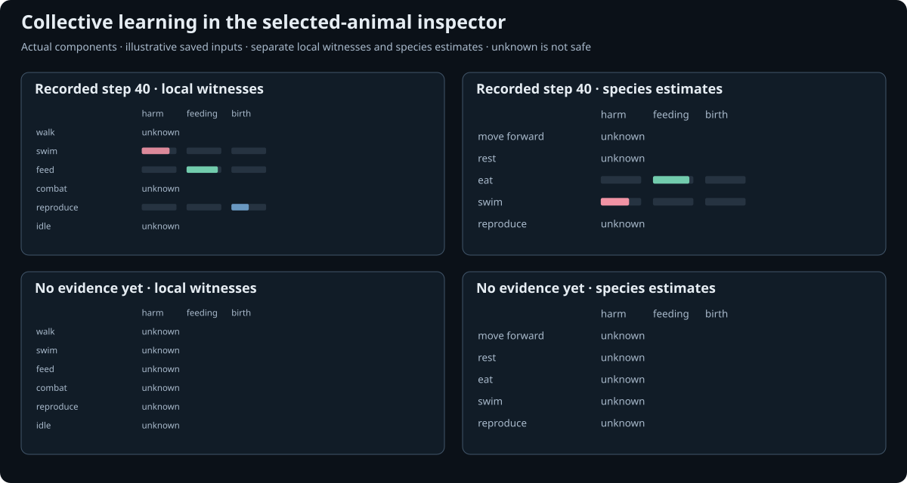

# Collective observations and consequence learning

[Observations](observations.md) · [Tracking](tracking.md) · [Rewards](rewards.md) · [Playback and inspection](viewer-visual-reference.md#collective-learning)

Two independent opt-ins add social information while keeping every animal's
policy parameters, optimizer, exploration and learning experiences independent.
Local collective observations pool visible same-species behavior. A separate
bounded species predictor retains population experience across episodes. Neither
feature copies another animal's reward into an individual's learning update.
Existing algorithm-specific semantics, including MAPPO's species-mean training
reward, remain unchanged.


## Run the complete example

```sh
.venv/bin/python -m wtf run seaside_social --runs 3 --seed 100 --progress
```

The editable [environment](../environments/seaside_social.json) uses ordinary PPO
for both species on the existing [seaside map](../maps/seaside.json). It retains
the seaside ecology, action sets and proximal mating radii. Only the two optional
input blocks and consequence settings are enabled. Its `compact` recording profile
retains world playback with a diagnostic interval of at least 50 steps (plus
chunk-start samples) and omits
activation traces. Use `--recording-profile full` for the preset's normal configured
diagnostic/activation cadence. Existing presets stay opted out.

## Local collective observations

Add this object to each participating brain template, preserving its other fields:

```json
"social_observation": {
  "history_steps": 4,
  "max_neighbors": 8
}
```

Each observer samples at most eight nearest visible animals of the **same exact
species**, including either sex. Different species remain separate even if they
share a diet or brain template. Ordinary sight radius, water sight extension,
night modifiers and obstacle occlusion apply. A subject must be seen at the start
and end of its action. Disappearing beyond sight is not an observed death, and
hidden actions/outcomes are never backfilled. Birth feedback requires the newborn
to be visible too.

The observer receives six pooled groups, without individual identities:

| Group | Observed actions |
| --- | --- |
| Walk | Forward/backward walking and sideways escape actions |
| Swim | Swimming |
| Feed | Eating |
| Combat | Attack and same-species challenge |
| Reproduce | Reproduction choice |
| Idle | Resting and turning |

Each group adds **confidence, harm rate, feeding rate and birth rate**, for
**24 inputs**. Harm means visible injury or death; feeding requires an actual
positive food/hunting energy gain; birth requires an actual birth. Rates describe
outcomes during the observed step, rather than another animal's numerical reward.
Counters are pooled across the recent `history_steps` (1–16). `max_neighbors`
(1–16) bounds sampling per observer and step.

Confidence is an evidence-size heuristic, `n / (n + 4)`, rather than calibrated
statistical certainty. No samples gives confidence zero; the viewer labels that
state **unknown** rather than presenting it as evidence of safety.

## Persistent consequence predictor

Enable a top-level population-learning block:

```json
"consequence_learning": {
  "enabled": true,
  "max_contexts": 512,
  "horizon_steps": 16,
  "update_schedule": "continuous"
}
```

Then add this to every consuming brain template:

```json
"consequence_observation": true
```

The first implementation is a compact empirical outcome table, not another
neural policy. There is one bounded table per exact species, pooling both sexes.
It records animals' **own physical experiences**, including animals that die.
It does not train from exact rewards or duplicate experiences for every witness.

A context contains the action identifier, coarse own energy/health ranges,
current/destination depth, uphill difference, current strength, swimming health
eligibility, adjacent food/obstruction, maturity and a nearby visible threat
indicator. It contains no absolute coordinate or target identity, allowing matching
situations at different locations to reuse evidence. Physical differences outside
this coarse representation can still matter.

For each action, the model estimates whether **harm, feeding or a birth** occurs
within the next `horizon_steps` (1–64). Death closes pending windows. A living
animal at an episode's time limit has incomplete windows discarded; it is not
labelled safe beyond the observed interval. Overlapping windows are correlated,
so these rates are associations and are not causal estimates. Consequences
beyond the selected horizon, such as much later starvation, do not label the
initial action harmful.

### State-independent knowledge and learned relevance

Choose which consequence sources each consuming brain receives:

```json
"consequence_observation": true,
"consequence_scope": "species_action"
```

| `consequence_scope` | Inputs | Meaning |
| --- | ---: | --- |
| `context` (default) | 48 | Current physical context, preserving the legacy lookup |
| `species_action` | 48 | General action knowledge across the species' retained contexts |
| `both` | 96 | General 48 first, then context 48; independent confidence per action/source |

Use `"consequence_scope": "both"` to give the NN both sources without manually
blending them or choosing a source for it. All ordinary state inputs remain.
For example, general swimming experience may indicate moderate harm while the
current deep-water context indicates high harm. Those arrive as separate
features, so the independent network can learn how to use them. An unknown
context does not erase known general evidence. The two sources are correlated
summaries of the same experience, not independent trials; enabling both does not
collect or count an event twice.

`species_action` aggregates published outcome counts for each action across the
species' retained contexts. It supplies the same general knowledge to all
consuming animals of that exact species, regardless of sex, current health,
energy, position, chosen action or dynamic action mask. Every supported action's
knowledge remains present when that action is unavailable. Unsupported actions
remain zero-filled. The regular body, terrain, target and mating inputs stay
alongside this vector, so each independent network can learn when and how the
knowledge is useful. No hard-coded hunting/mating mode or automatic preference
is introduced, and useful behavior is not guaranteed merely by adding inputs.

For example, a distant predator can receive feeding evidence from another
predator's attack while its own attack is masked. That information remains when
prey approaches and attack becomes eligible. The network can use hunger and
prey observations to learn pursuit or attack preferences; the mask still controls
execution for maskable policies, and physical checks still apply for all policies.

Only real attempted actions and observed physical outcomes update the tables.
Masked or unchosen actions do not create fictional successes/failures, and
numerical rewards are not shared. Rates are count-weighted across retained
contexts, rather than a mean of context percentages. They remain associations
within the configured outcome horizon, not causal action values. Context
capacity/eviction and counter rescaling still bound the available evidence;
this is not unlimited lifetime memory.

Omitting `consequence_scope`, or setting `context`, preserves the previous
context-matched lookup. In that mode a new physical context can be unknown even
when the action has evidence elsewhere. Each single-source mode keeps 48 inputs;
`both` adds another 48. Non-default scopes are explicit model-signature distinctions: use fresh matching
brains, or resume an existing checkpoint with its original scope. Weights are not silently
exchanged across different scopes, including the wider combined layout. The physical
consequence export can be reused across scopes when its physical/horizon
contract matches, since the stored counts have not changed.

The maintained `seaside_social` example uses `species_action`; the local seaside
DQN scent/day-night configuration uses `both`. Other presets retain their existing
mode. Publication remains independent: with `update_schedule: "episode"`, new
knowledge first becomes visible at the next episode. A fresh single episode has
no earlier published evidence to expose.

General summaries use a derived species-owned cache, invalidated by continuous
learning or publication. Staged episode evidence never enters it. Cache size is
bounded by species × action count, and summaries are rebuilt after restoration.
No new checkpoint version, top-level replay fields or extra persistent count
table is required. The combined mode does store 48 more values per recorded
diagnostic vector and increases model first-layer/replay-buffer memory; it is
not a storage-saving setting. Cached immutable general rates reuse float objects
across live observations until publication changes them. Recorded samples, model feature labels and viewer notes identify the
scope; cumulative chart behavior remains as described below.

Each of the twelve stable action identifiers contributes confidence and three
outcome rates per source: **48 inputs**, or **96 for `both`**. Unsupported actions have zero-filled slots.
Unknown lookups also have zero confidence. The predictor supplies information;
it does not force an action, change action masks, issue a reward or merge policy
weights. Each learner decides how to use the estimates through its own algorithm.

Updates occur only in training. Evaluation/random modes consult the retained
model without updating it, while local witnessing can still update observations.
GRPO trial worlds have private copies of this state; trials cannot update the
real world's knowledge. Local histories and incomplete windows reset between
episodes; the species tables survive independently of champion selection and
`--no-chain-brains`.

## Publication timing

`update_schedule` defaults to `continuous`: finished outcome windows update the
predictor during training. Choose `episode` to collect the same bounded evidence
while keeping the published predictor frozen until the next training episode's
first observations:

```sh
.venv/bin/python -m wtf run seaside_social --runs 3 --seed 100 \
  --consequence-update-schedule episode --progress
```

The CLI override applies to fresh experiments with consequence learning enabled;
`--resume` restores its saved schedule. Local witness inputs and individual
policy learning keep their existing cadence. Collection still uses rolling
horizon windows, rather than whole-episode trajectories. The first episode has
unknown estimates unless compatible population knowledge was imported.

Episode mode lazily copies a species table on its first new evidence, keeping
published rows separate from staged updates. This bounds staging by one extra
capacity-limited table per updated species. Changing the schedule does not change
input width or require different policy weights. Evaluation and random modes
neither collect evidence nor publish staged training evidence at episode changes;
that evidence remains available for a later training continuation.

## Save, restore and reuse

Recovery checkpoints include the species tables **once**, plus the short personal
witness histories and pending outcome windows needed for exact continuation.
No knowledge table is copied into each animal's brain checkpoint or champion.
Continuous mode retains version-1 model state. Episode mode uses version-2
recovery state with both published and staged tables, so interruption does not
publish evidence early or lose it. Completed aggregate exports remain version 1
and include finished-window evidence from the final episode without changing
that episode's recorded predictions. Either schedule accepts compatible exports.

A completed CLI experiment also writes one `consequences.json.xz` beside its
summary. This is a compressed aggregate table with physical contracts, not full
trajectories, world frames, policy weights or individual identities. Recovery
checkpoints remain the way to recover an interrupted experiment's latest state.

```sh
# Start fresh policy weights while reusing compatible population knowledge.
.venv/bin/python -m wtf run seaside_social --runs 3 --seed 200 \
  --consequences-from results/EXPERIMENT --progress

# Matching policy brains can be loaded separately when desired.
.venv/bin/python -m wtf run seaside_social --runs 3 --seed 200 \
  --brains-from results/EXPERIMENT \
  --consequences-from results/EXPERIMENT --progress
```

The import accepts either a result folder or the specific file. Species names,
physical species contracts and prediction horizon must match. Geography may
change, because coordinates are excluded, but unseen contexts still need new
evidence. Rates also depend on the policies and encounter conditions that
produced the samples; they are not guaranteed outcomes under a different policy.
Changing reward coefficients alone does not invalidate physical outcome
knowledge. A smaller capacity retains the newest compatible context entries.
Exact `--resume` uses its checkpoint's own model and rejects `--consequences-from`.

## Input and storage compatibility

These blocks append **after** existing observation, movement-history and scent
inputs. Local witnesses plus one consequence source add 72 inputs; the
maintained example has 141 prey inputs and 225 predator inputs. Local witnesses
plus both consequence sources add 120 inputs. The local seaside DQN scent/day-night
setup has 198 prey inputs and 282 predator inputs with combined consequences. The optional fields enter model signatures. Old weights without
the blocks cannot initialize these wider policies; unchanged presets and legacy
checkpoints retain their original layouts and behavior.

Tables retain at most `max_contexts` entries (16–8192) per participating species,
using deterministic update-order LRU eviction. There are no unlimited experience
archives. Personal histories are bounded by recent steps and neighbour count;
pending windows are bounded by living animals and the horizon. Model reads and
repeated observation calls neither train the predictor nor duplicate sightings.

Replay storage adds **no new frame/event fields**. Existing sampled diagnostic
vectors contain the added inputs, so inspectors need no decoded-run knowledge
model. Extra inputs still enlarge policy weights, training buffers and recorded
diagnostic samples; compact capture is useful for large experiments. No reduction
in total RAM/disk usage is claimed from enabling this feature.

## Playback inspection

Open **Metrics dashboard → Species collective outcomes** for species averages.
The dashboard's species filter selects which panels are visible; its trend-window
selector does not shorten these cumulative averages. The action selector controls
the trend charts; collective panels retain the available action rows. Select a living animal and
open **Agent inspector → Collective learning** for that individual's averages:

- **Local witnesses:** harm, feeding and birth rates grouped by observed action.
- **Consequence estimates:** corresponding shared-model estimates for that animal, averaged over its
  available recorded lifetime. These are general species/action rates or
  context-matched rates according to its template scope.
  Combined mode displays **General consequence estimates** and **Context consequence
  estimates** separately in both the inspector and species dashboard.

All chart groups use the same action-label column, outcome columns and row spacing.
Wide dashboard panels align local/general/context groups side by side; the narrower
agent inspector stacks them without stretching shorter charts. Different groups
can have different action lists; their rows remain labeled independently.

Both views average through the current playback step rather than displaying
only that step's diagnostic values. Species summaries first average available
living-animal values at each step, then average those per-step means over time.
Each step therefore has equal time weight; high-population periods do not
implicitly outweigh low-population periods. Individual summaries start with that
animal's first valid saved inputs, with independent totals for each identity.
Extinct species retain their last cumulative result.

Saved diagnostic values are held forward until the next sample. For example,
values 0 at step 0 and 1 at step 4 yield a step-4 mean of 1/5, not 1/2: steps
0–3 retain the earlier value and only step 4 receives the new one. This is a
viewer reconstruction from sparse samples, not a claim to recover unsaved
intermediate inputs. Missing initial samples are not filled with zeros. Unknown
contexts count toward elapsed observed time but are excluded from outcome-rate
averages, so “unknown” does not become “safe.” These are means of saved rates,
not pooled raw outcome counts or causal estimates.

Playback updates averages in place, pauses at the current frame and excludes
future samples during backward seeking. Run changes reset totals. Rewinds inside
the loaded chunk reuse a compact chunk-start aggregate; distant seeks rebuild a
prefix by reading older chunks sequentially and releasing them. Only living-agent
aggregates, species totals and one chunk-start copy are retained; no per-frame
history, whole-run decode or additional replay artifact is stored. A distant seek
can temporarily decode one additional chunk alongside the selected chunk.

Brain inputs, policy outputs, raw input displays, prediction charts and
consequence learning/publication schedules are unchanged. In episode mode the
predictor remains frozen until the next episode, while viewer averages may change
as recorded contexts change. These charts never query future model weights or
hidden outcomes. Both interface themes use the shared palette. Older recordings
with saved collective inputs work without conversion; those without them omit
the panels.



## Biological motivation and limits

| Mechanism | Motivation and approximation |
| --- | --- |
| Local observed feeding | Guppies learned food routes by swimming with trained conspecifics; our grouped rates replace detailed individual social interactions. [Laland & Williams, 1997](https://pubmed.ncbi.nlm.nih.gov/9236013/) |
| Observed harm | Rhesus monkeys acquired snake fear observationally; this motivates danger learning, but does not validate our specific drowning labels or numerical rules. [Mineka et al., 1984](https://communities.pacificu.edu/wp-content/uploads/sites/1523/2023/02/Mineka-Davidson-Cook-Keir-1984.-Observational-conditioning-of-snake-fear-in-Rhesus-monkeys.pdf) |
| Population traditions | Foraging traditions spread in wild great tits, with social conformity; our retained tables approximate accumulated information rather than modelling that diffusion mechanism. [Aplin et al., 2015](https://www.nature.com/articles/nature13998) |

**The persistent population model is a training abstraction.** All participating
animals of a species can consult pooled experience, including experience from
far-away individuals. There is no simulated local communication/diffusion delay.
Its estimates must not be described as biologically realistic messages between
distant animals. Same-species-only pooling is a configurable-model boundary here,
not a claim that animals never learn across species.

Likewise, PPO and scalar rewards are computational learning mechanisms, and
copying/mixing learned weights at birth is evolutionary computation rather than
biological inheritance of acquired neural weights. Health, energy, swimming and
climbing thresholds use abstract units without species-specific empirical
calibration. This is biologically inspired learning with explicit approximations,
rather than a validated biological ecosystem.

Assess usefulness with matched-seed, held-out coast/inland evaluations: drowning,
energy coverage, survival, reproduction and successful crossings matter alongside
training reward. More cautious behaviour alone does not establish improvement.
