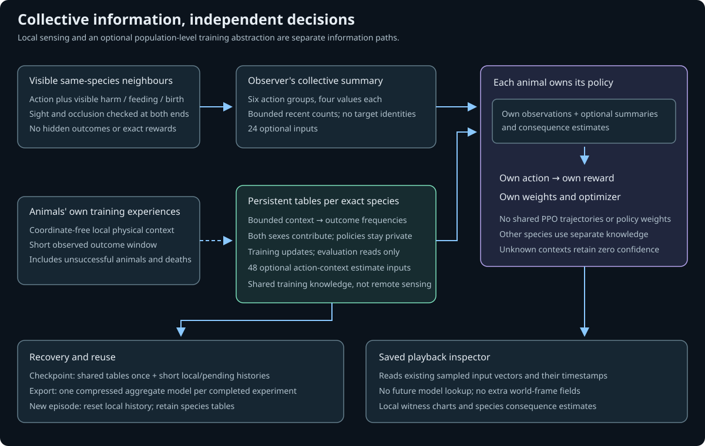

# Collective observations and consequence learning

[Observations](observations.md) · [Tracking](tracking.md) · [Rewards](rewards.md) · [Playback and inspection](viewer-visual-reference.md#collective-learning)

The [consequence pipeline handbook](learning/consequence-pipeline.md) provides
worked rates, publication timing, learning branches and a playback checklist.
Use [Tutorial 6](tutorials/06-sensing-and-learning.md) for complete configurations.

Two independent opt-ins add social information while keeping every animal's
policy parameters, optimizer, exploration and learning experiences independent.
Local collective observations pool visible same-species behavior. A separate
bounded species predictor retains population experience across episodes. Neither
feature copies another animal's reward into an individual's learning update.
Existing algorithm-specific semantics, including MAPPO's species-mean training
reward, remain unchanged.



## Run the complete example

```sh
.venv/bin/python -m wtf run seaside_social --runs 3 --seed 100 --progress
```

The editable [environment](../environments/seaside_social.json) uses ordinary PPO
for both species on the existing [seaside map](../maps/seaside.json). It retains
the seaside ecology, action sets and proximal mating radii. Only the two optional
input blocks and consequence settings are enabled. Its `compact` recording profile
retains world playback with a diagnostic interval of at least 50 steps (plus
chunk-start samples) and omits
activation traces. Use `--recording-profile full` for the preset's normal configured
diagnostic/activation cadence. Existing presets stay opted out.

## Local collective observations

Add this object to each participating brain template, preserving its other fields:

```json
"social_observation": {
  "history_steps": 4,
  "max_neighbors": 8
}
```

Each observer samples at most eight nearest visible animals of the **same exact
species**, including either sex. Different species remain separate even if they
share a diet or brain template. Ordinary sight radius, water sight extension,
night modifiers and obstacle occlusion apply. A subject must be seen at the start
and end of its action. Disappearing beyond sight is not an observed death, and
hidden actions/outcomes are never backfilled. Birth feedback requires the newborn
to be visible too.

The observer receives six pooled groups, without individual identities:

| Group | Observed actions |
| --- | --- |
| Walk | Forward/backward walking and sideways escape actions |
| Swim | Swimming |
| Feed | Eating |
| Combat | Attack and same-species challenge |
| Reproduce | Reproduction choice |
| Idle | Resting and turning |

Each group adds **confidence, harm rate, feeding rate and birth rate**, for
**24 inputs**. Harm means visible injury or death; feeding requires an actual
positive food/hunting energy gain; birth requires an actual birth. Rates describe
outcomes during the observed step, rather than another animal's numerical reward.
Counters are pooled across the recent `history_steps` (1–16). `max_neighbors`
(1–16) bounds sampling per observer and step.

Confidence is an evidence-size heuristic, `n / (n + 4)`, rather than calibrated
statistical certainty. No samples gives confidence zero; the viewer labels that
state **unknown** rather than presenting it as evidence of safety.

## Persistent consequence predictor

Enable a top-level population-learning block:

```json
"consequence_learning": {
  "enabled": true,
  "max_contexts": 512,
  "horizon_steps": 16,
  "update_schedule": "continuous"
}
```

Then add this to every consuming brain template:

```json
"consequence_observation": true
```

The first implementation is a compact empirical outcome table, not another
neural policy. There is one bounded table per exact species, pooling both sexes.
It records animals' **own physical experiences**, including animals that die.
It does not train from exact rewards or duplicate experiences for every witness.

A context contains the action identifier, coarse own energy/health ranges,
current/destination depth, uphill difference, current strength, swimming health
eligibility, adjacent food/obstruction, maturity and a nearby visible threat
indicator. It contains no absolute coordinate or target identity, allowing matching
situations at different locations to reuse evidence. Physical differences outside
this coarse representation can still matter.

For each action, the model estimates whether **harm, feeding or a birth** occurs
within the next `horizon_steps` (1–64). Death closes pending windows. A living
animal at an episode's time limit has incomplete windows discarded; it is not
labelled safe beyond the observed interval. Overlapping windows are correlated,
so these rates are associations and are not causal estimates. Consequences
beyond the selected horizon, such as much later starvation, do not label the
initial action harmful.

### State-independent knowledge and learned relevance

Choose which consequence sources each consuming brain receives:

```json
"consequence_observation": true,
"consequence_scope": "species_action"
```

| `consequence_scope` | V1–V5 numeric inputs | Meaning |
| --- | ---: | --- |
| `context` (default) | 48 | Current physical context, preserving the legacy lookup |
| `species_action` | 48 | General action knowledge across the species' retained contexts |
| `both` | 96 | General 48 first, then context 48; independent confidence per action/source |

V7 uses `4 × configured_action_count` values per source; V6 uses its expanded
semantic representation. The table above describes the legacy numeric blocks.

Use `"consequence_scope": "both"` to give the NN both sources without manually
blending them or choosing a source for it. All ordinary state inputs remain.
For example, general swimming experience may indicate moderate harm while the
current deep-water context indicates high harm. Those arrive as separate
features, so the independent network can learn how to use them. An unknown
context does not erase known general evidence. The two sources are correlated
summaries of the same experience, not independent trials; enabling both does not
collect or count an event twice.

By default, `species_action` aggregates published outcome counts for each action across the
species' retained contexts. It supplies the same general knowledge to all
consuming animals of that exact species, regardless of sex, current health,
energy, position, chosen action or dynamic action mask. Every supported action's
knowledge remains present when that action is unavailable. Unsupported actions
remain zero-filled. The regular body, terrain, target and mating inputs stay
alongside this vector, so each independent network can learn when and how the
knowledge is useful. No hard-coded hunting/mating mode or automatic preference
is introduced, and useful behavior is not guaranteed merely by adding inputs.

For example, a distant predator can receive feeding evidence from another
predator's attack while its own attack is masked. That information remains when
prey approaches and attack becomes eligible. The network can use hunger and
prey observations to learn pursuit or attack preferences; the mask still controls
execution for maskable policies, and physical checks still apply for all policies.

Only real attempted actions and observed physical outcomes update the tables.
Masked or unchosen actions do not create fictional successes/failures, and
numerical rewards are not shared. Rates are count-weighted across retained
contexts, rather than a mean of context percentages. They remain associations
within the configured outcome horizon, not causal action values. Context
capacity/eviction and counter rescaling still bound the available evidence;
this is not unlimited lifetime memory.

Omitting `consequence_scope`, or setting `context`, preserves the previous
context-matched lookup. In that mode a new physical context can be unknown even
when the action has evidence elsewhere. In legacy numeric layouts, each single-source mode keeps 48 inputs;
`both` adds another 48. V7 instead uses four inputs per configured action per
source, while V6 expands its soft categories. Non-default scopes are explicit model-signature distinctions: use fresh matching
brains, or resume an existing checkpoint with its original scope. Weights are not silently
exchanged across different scopes, including the wider combined layout. The physical
consequence export can be reused across scopes when its physical/horizon
contract matches, since the stored counts have not changed.

The maintained `seaside_social` example uses `species_action`; the local seaside
DQN scent/day-night configuration uses `both`. Other presets retain their existing
mode. Publication remains independent: with `update_schedule: "episode"`, new
knowledge first becomes visible at the next episode. A fresh single episode has
no earlier published evidence to expose.

General summaries use a derived species-owned cache, invalidated by continuous
learning or publication. Staged episode evidence never enters it. Cache size is
bounded by species × action count, and summaries are rebuilt after restoration.
No new checkpoint version, top-level replay fields or extra persistent count
table is required. The combined mode does store 48 more values per recorded
diagnostic vector and increases model first-layer/replay-buffer memory; it is
not a storage-saving setting. Cached immutable general rates reuse float objects
across live observations until publication changes them. Recorded samples, model feature labels and viewer notes identify the
scope; cumulative chart behavior remains as described below.

Each of the twelve stable action identifiers contributes confidence and three
outcome rates per source: **48 inputs**, or **96 for `both`**. Unsupported actions have zero-filled slots.
Unknown lookups also have zero confidence. The predictor supplies information;
it does not force an action, change action masks, issue a reward or merge policy
weights. Each learner decides how to use the estimates through its own algorithm.

Updates occur only in training. Evaluation/random modes consult the retained
model without updating it, while local witnessing can still update observations.
GRPO trial worlds have private copies of this state; trials cannot update the
real world's knowledge. Local histories and incomplete windows reset between
episodes; the species tables survive independently of champion selection and
`--no-chain-brains`.

## Persistent species/action totals

Enable `consequence_learning.persistent_action_totals: true` to retain general
physical-outcome counts independently of the bounded context LRU. The default is
`false`, preserving the older retained-context aggregation and trajectories when
the new option is omitted.

There are twelve action rows per exact species. Each row stores count, harm,
feeding and birth totals: **48 numbers per species**, rather than episodes or
trajectories. Context eviction still bounds detailed memory but cannot remove
those general totals. Published estimates use a revision-local cache. In episode
mode, one additional fixed-size row set per updated species holds staged totals;
publication swaps both contextual and general knowledge together. Counter ratios
are rescaled only near the portable exact-integer limit (`2**52`), preserving
rates without unbounded integer growth. Local observations and policy weights
remain private.

Legacy knowledge imports initialize totals from the context rows actually saved.
They cannot recover evidence discarded by the old LRU. New logical consequence
state uses version 3: a wrapper around the legacy table state plus published and
staged action totals. Checkpoint envelopes and replay encodings are unchanged.
Use this source version to restore the new state; older readers reject it.

## Auxiliary outcome prediction for private PPO brains



Ordinary `ppo` and `maskable_ppo` templates can opt in with:

```json
"consequence_observation": true,
"consequence_scope": "both",
"auxiliary_consequence": {"coefficient": 0.1}
```

Other algorithms reject this auxiliary setting explicitly. They can still use
persistent totals and their existing consequence input observations.

Each animal owns a small **36-output head**: harm, feeding and birth estimates
for the twelve stable actions. Targets are the published empirical outcome
rates already present in that animal's own observation. Known context estimates
take priority; otherwise general estimates are used when available. Unknown
rows contribute no loss. Confidence weights the binary cross-entropy loss;
confidence is an evidence-size heuristic, not calibrated correctness. Masked
PPO can learn outcome estimates for an action that is currently unavailable;
its physical action mask still governs action selection.

The auxiliary forward pass zeros **all consequence-estimate input fields**,
including both sources in combined mode. This prevents directly copying target
values from those inputs. It retains the animal's other physical and tracking inputs. In input mode
local social cues remain; with late placement local/general/context evidence
is outside the physical trunk. The head attaches to that animal's hidden trunk, adding
supervised gradients to its existing PPO trunk gradients. Its output layer has
private Adam state; the actor/critic output layer receives no direct auxiliary
output gradient. The normal policy path still sees configured consequence inputs.

Only the current animal's own rollout observations are used, at accepted PPO
minibatch boundaries. Stored actions, rewards, old log probabilities, GAE,
clipping, shuffle order and KL checks retain their own on-policy trajectory.
No other animal's action/reward samples enter that actor rollout. A KL-rejected
minibatch updates neither trunk nor auxiliary head; rollouts are cleared as
usual. Changing a shared trunk may change subsequent action probabilities, as
with ordinary value learning; the auxiliary objective does not guarantee
cooperation, causal understanding or better survival.

Evaluation never updates the head, trunk or shared evidence. Birth mixes the
parents' private head weights alongside policy parameters, resets the child's
optimizer state and buffers, and keeps rare mutation child-local. Champions
include the head weights; checkpoints additionally retain its Adam arrays and
update counter for exact continuation. The optional head is a model-signature
distinction: start a compatible new model rather than silently loading an old
headless champion. The head does not enlarge observations or actor output arrays.

Diagnostics add weighted `auxiliary_loss` and `auxiliary_coverage` (fraction of
training sample presentations with known labels). No extra per-frame prediction
array is recorded. The live policy/activation viewer continues to show the actor
path, not a new auxiliary-head visualization. Stock auxiliary PPO updates prepare
fixed targets once per rollout update and use an optional ordered **CPU**
minibatch kernel, with existing affine/backward execution as the fallback. Current
weights and gradients are recomputed each accepted minibatch. See the
[data-flow optimization measurements](performance.md#v7-data-flow-and-auxiliary-batching).
The CUDA PPO training shortcut is
bypassed for this objective so it cannot silently skip the supervised gradient.

### Run the combined example

[land_bridge_collective.json](../environments/land_bridge_collective.json) uses
the same map and body costs as `land_bridge_behaviors`, enabling durable
totals and a `0.1` auxiliary coefficient for both independent PPO species. It
also opts into [180° forward vision](observations.md#forward-visual-field). It
retains all playbacks and publishes consequence evidence between episodes.
This is an explicit learning variant, not a validated ecological calibration.

```sh
.venv/bin/python -m wtf run land_bridge_collective \
  --runs 5 --steps 1500 --seed 100 --progress
```

The `land_bridge_collective_150` preset keeps the collective bridge setup with
`field_of_view_degrees: 150` for both species; use it to compare a narrower
forward cone with `land_bridge_collective` (180°). Other settings remain the same.

The `seaside_150` preset also enables the same social/consequence inputs,
persistent totals, episode publication and private auxiliary coefficient `0.1`
for both PPO species, on the seaside map with 150° vision. It retains the
seaside body/reproduction and PPO update settings. Scent and day/night are
separate options and are not enabled by this preset.

### Compare changes without collecting large artifacts

`work.compare_collective_learning` runs legacy, persistent-only and auxiliary
arms in separate processes, using the same seed schedules and physical setup.
Keep an unchanged source snapshot outside tracked source, then run:

```sh
.venv/bin/python -m work.compare_collective_learning \
  --baseline /path/to/unchanged-source \
  --environment environments/land_bridge_behaviors.json \
  --seeds 100 200 300 --episodes 3 --steps 900 \
  --evaluation-seeds 900 901 --output .cache/collective-comparison.json
```

For a controlled comparison on the 180° preset, use `--baseline .` with
`--environment environments/land_bridge_collective.json`. The current source's
legacy arm disables durable totals and the auxiliary head while keeping the same
forward-vision physics. A source snapshot predating forward vision cannot read
that new body setting; use its matching 360° configuration instead.

Each trained species/sex lifespan champion is evaluated greedily in identical
held-out worlds with learning, mutation and crossover disabled. Its retained
knowledge is frozen too. The helper asserts no policy or knowledge updates and
stores compact outcome counters, training time and peak host RAM. It records no
replays, checkpoint files or model archives. Same-sex champions are mandatory;
it never substitutes a different sex. Seed groups are paired treatments, not
independent evidence for each episode. Wall time includes differing trajectories
and update counts, so it is not an equal-work speedup benchmark. A small campaign
can reject an improvement claim or remain inconclusive; it cannot establish
reliable ecological behavior across maps.

## Publication timing

`update_schedule` defaults to `continuous`: finished outcome windows update the
predictor during training. Choose `episode` to collect the same bounded evidence
while keeping the published predictor frozen until the next training episode's
first observations:

```sh
.venv/bin/python -m wtf run seaside_social --runs 3 --seed 100 \
  --consequence-update-schedule episode --progress
```

The CLI override applies to fresh experiments with consequence learning enabled;
`--resume` restores its saved schedule. Local witness inputs and individual
policy learning keep their existing cadence. Collection still uses rolling
horizon windows, rather than whole-episode trajectories. The first episode has
unknown estimates unless compatible population knowledge was imported.

Episode mode lazily copies a species table on its first new evidence, keeping
published rows separate from staged updates. This bounds staging by one extra
capacity-limited table per updated species. Changing the schedule does not change
input width or require different policy weights. Evaluation and random modes
neither collect evidence nor publish staged training evidence at episode changes;
that evidence remains available for a later training continuation.

## Save, restore and reuse

Recovery checkpoints include the species tables **once**, plus the short personal
witness histories and pending outcome windows needed for exact continuation.
No knowledge table is copied into each animal's brain checkpoint or champion.
Continuous mode retains version-1 model state. Episode mode uses version-2
recovery state with both published and staged tables, so interruption does not
publish evidence early or lose it. Completed aggregate exports remain version 1
and include finished-window evidence from the final episode without changing
that episode's recorded predictions. Either schedule accepts compatible exports.

A completed CLI experiment also writes one `consequences.json.xz` beside its
summary. This is a compressed aggregate table with physical contracts, not full
trajectories, world frames, policy weights or individual identities. Recovery
checkpoints remain the way to recover an interrupted experiment's latest state.

```sh
# Start fresh policy weights while reusing compatible population knowledge.
.venv/bin/python -m wtf run seaside_social --runs 3 --seed 200 \
  --consequences-from results/EXPERIMENT --progress

# Matching policy brains can be loaded separately when desired.
.venv/bin/python -m wtf run seaside_social --runs 3 --seed 200 \
  --brains-from results/EXPERIMENT \
  --consequences-from results/EXPERIMENT --progress
```

The import accepts either a result folder or the specific file. Species names,
physical species contracts and prediction horizon must match. Geography may
change, because coordinates are excluded, but unseen contexts still need new
evidence. Rates also depend on the policies and encounter conditions that
produced the samples; they are not guaranteed outcomes under a different policy.
Changing reward coefficients alone does not invalidate physical outcome
knowledge. A smaller capacity retains the newest compatible context entries.
Exact `--resume` uses its checkpoint's own model and rejects `--consequences-from`.

## Input and storage compatibility

These blocks append **after** existing observation, movement-history and scent
inputs. Local witnesses plus one consequence source add 72 inputs; the
maintained example has 141 prey inputs and 225 predator inputs. Local witnesses
plus both consequence sources add 120 inputs. The local seaside DQN scent/day-night
setup has 198 prey inputs and 282 predator inputs with combined consequences. The optional fields enter model signatures. Old weights without
the blocks cannot initialize these wider policies; unchanged presets and legacy
checkpoints retain their original layouts and behavior.

Tables retain at most `max_contexts` entries (16–8192) per participating species,
using deterministic update-order LRU eviction. There are no unlimited experience
archives. Personal histories are bounded by recent steps and neighbour count;
pending windows are bounded by living animals and the horizon. Model reads and
repeated observation calls neither train the predictor nor duplicate sightings.

Replay storage adds **no new frame/event fields**. Existing sampled diagnostic
vectors contain the added inputs, so inspectors need no decoded-run knowledge
model. Extra inputs still enlarge policy weights, training buffers and recorded
diagnostic samples; compact capture is useful for large experiments. No reduction
in total RAM/disk usage is claimed from enabling this feature.

## Playback inspection

Open **Metrics dashboard → Species collective outcomes** for species averages.
The dashboard's species filter selects which panels are visible; its trend-window
selector does not shorten these cumulative averages. The action selector controls
the trend charts; collective panels retain the available action rows. Select a living animal and
open **Agent inspector → Collective learning** for that individual's averages:

- **Local witnesses:** harm, feeding and birth rates grouped by observed action.
- **Consequence estimates:** corresponding shared-model estimates for that animal, averaged over its
  available recorded lifetime. These are general species/action rates or
  context-matched rates according to its template scope.
  Combined mode displays **General consequence estimates** and **Context consequence
  estimates** separately in both the inspector and species dashboard.

All chart groups use the same action-label column, outcome columns and row spacing.
Wide dashboard panels align local/general/context groups side by side; the narrower
agent inspector stacks them without stretching shorter charts. Different groups
can have different action lists; their rows remain labeled independently.

Both views average through the current playback step rather than displaying
only that step's diagnostic values. Species summaries first average available
living-animal values at each step, then average those per-step means over time.
Each step therefore has equal time weight; high-population periods do not
implicitly outweigh low-population periods. Individual summaries start with that
animal's first valid saved inputs, with independent totals for each identity.
Extinct species retain their last cumulative result.

Saved diagnostic values are held forward until the next sample. For example,
values 0 at step 0 and 1 at step 4 yield a step-4 mean of 1/5, not 1/2: steps
0–3 retain the earlier value and only step 4 receives the new one. This is a
viewer reconstruction from sparse samples, not a claim to recover unsaved
intermediate inputs. Missing initial samples are not filled with zeros. Unknown
contexts count toward elapsed observed time but are excluded from outcome-rate
averages, so “unknown” does not become “safe.” These are means of saved rates,
not pooled raw outcome counts or causal estimates.

Playback updates averages in place, pauses at the current frame and excludes
future samples during backward seeking. Run changes reset totals. Rewinds inside
the loaded chunk reuse a compact chunk-start aggregate; distant seeks rebuild a
prefix by reading older chunks sequentially and releasing them. Only living-agent
aggregates, species totals and one chunk-start copy are retained; no per-frame
history, whole-run decode or additional replay artifact is stored. A distant seek
can temporarily decode one additional chunk alongside the selected chunk.

Brain inputs, policy outputs, raw input displays, prediction charts and
consequence learning/publication schedules are unchanged. In episode mode the
predictor remains frozen until the next episode, while viewer averages may change
as recorded contexts change. These charts never query future model weights or
hidden outcomes. Both interface themes use the shared palette. Older recordings
with saved collective inputs work without conversion; those without them omit
the panels.


## Biological motivation and limits

| Mechanism | Motivation and approximation |
| --- | --- |
| Local observed feeding | Guppies learned food routes by swimming with trained conspecifics; our grouped rates replace detailed individual social interactions. [Laland & Williams, 1997](https://pubmed.ncbi.nlm.nih.gov/9236013/) |
| Observed harm | Rhesus monkeys acquired snake fear observationally; this motivates danger learning, but does not validate our specific drowning labels or numerical rules. [Mineka et al., 1984](https://communities.pacificu.edu/wp-content/uploads/sites/1523/2023/02/Mineka-Davidson-Cook-Keir-1984.-Observational-conditioning-of-snake-fear-in-Rhesus-monkeys.pdf) |
| Population traditions | Foraging traditions spread in wild great tits, with social conformity; our retained tables approximate accumulated information rather than modelling that diffusion mechanism. [Aplin et al., 2015](https://www.nature.com/articles/nature13998) |

**The persistent population model is a training abstraction.** All participating
animals of a species can consult pooled experience, including experience from
far-away individuals. There is no simulated local communication/diffusion delay.
Its estimates must not be described as biologically realistic messages between
distant animals. Same-species-only pooling is a configurable-model boundary here,
not a claim that animals never learn across species.

Likewise, PPO and scalar rewards are computational learning mechanisms, and
copying/mixing learned weights at birth is evolutionary computation rather than
biological inheritance of acquired neural weights. Health, energy, swimming and
climbing thresholds use abstract units without species-specific empirical
calibration. This is biologically inspired learning with explicit approximations,
rather than a validated biological ecosystem.

Assess usefulness with matched-seed, held-out coast/inland evaluations: drowning,
energy coverage, survival, reproduction and successful crossings matter alongside
training reward. More cautious behaviour alone does not establish improvement.


## Late policy adjustment in V7

The optional [V7 adapter](observations.md#opt-in-late-consequence-policy) moves
local/general/context evidence out of the physical input trunk and into a small
private learned action-logit residual. Published evidence is an input snapshot,
not frozen neural weights. It uses final adjusted probabilities for PPO ratios,
keeps existing masks separate, and commits its private Adam update only after the
actor KL gate accepts the minibatch. This changes the architecture and needs
matching new weights; it is not an optimization claiming identical trajectories.
The inspector displays base probabilities, signed residuals and final
probabilities. Counts remain species-shared; policy and adapter weights do not.


Late placement is a separate capability from consequence inputs. All fourteen
learners support the existing input-feature mode and compact V7. Only ordinary
PPO and masked PPO currently support the learned late adapter/native batch.
The [support matrix](observations.md#algorithm-support-for-v7-and-consequence-handling)
lists remaining work for each learner; adding the residual only at action
selection would leave its training objective inconsistent.
