# Adding prey and predator species

[Customization handbook](customization.md) · [Configuration](configuration.md) · [Saved brains](brain-library.md) · [Playback](recording.md)

Species are the named entries in an environment's `species` object. The supplied
presets still contain exactly one prey species (`prey`) and one predator species
(`predator`). You can add more entries without changing Python or JavaScript.
Use stable, nonempty names such as `rabbits`, `deer`, `foxes` and `wolves`.

## Species identity and diet

| Field | Meaning |
| --- | --- |
| Key under `species`, e.g. `deer` | Distinct species identity used for mating, metrics, controllers and champion archives |
| `diet: "resource"` | Prey/herbivore: eats the shared resource patches |
| `diet: "prey"` | Predator: hunts any resource-eating animal, across all prey species |
| `brain` | Key of a brain template under `brains` |

A species name is not its diet: `wolves` with `diet: "prey"` is a predator.
Predators do not hunt other predators. Prey species compete for the same food,
and all animals share the grid and obstacles. Selective food webs and
predator-on-predator hunting are not currently modeled.


## Names, roles and private brains

A common template can initialize several species without connecting their live weights. Mating and champion archives use exact species identity, not just diet. Each controller node is one example animal.



## Add entries to a JSON environment

Copy the complete existing prey or predator object under a new key, then edit
its population, body, learning-rate multiplier, reproduction settings and brain
reference. Keep every required field. A reused brain template initializes private
controllers; it does not share live weights between species or animals.

This complete recipe splits the existing 48 prey founders into two species of
24 without increasing the combined founder population. It keeps six predators
and the existing food/physics settings, and writes only an ignored local preset:

<!-- species-example:start -->
```python
import copy
import json
from pathlib import Path
from wtf.config import load, validate

config = load("environments/maskable_ppo.json")
config["name"] = "two_prey_species"
config["species"]["prey"]["initial_population"] = 24
config["species"]["prey"]["reproduction"]["max_population"] = 48

deer = copy.deepcopy(config["species"]["prey"])
deer["initial_population"] = 24
deer["display"] = {"color": "#b4e580", "male_color": "#ca94ff"}
deer.pop("initial_brain", None)
deer.pop("initial_brains", None)
config["species"]["deer"] = deer

# Other starting presets may define explicit spawn zones for every species.
if "placement" in config:
    config["placement"]["species"]["deer"] = config["placement"]["species"]["prey"]

validate(config)
output = Path("environments/local/two_prey_species.json")
output.parent.mkdir(parents=True, exist_ok=True)
output.write_text(json.dumps(config, indent=2) + "\n")
print(output)
```
<!-- species-example:end -->

Run the Python block from the checkout root (for example in
`.venv/bin/python`), then:

```sh
.venv/bin/python -m wtf.cli environments/local/two_prey_species.json \
  --runs 1 --steps 200 --seed 100 --progress
```

The two prey species compete for the same food and share a diet category, but
mate only within their own species and keep separate controllers/champions.
The shared `brain` template remains configuration, not shared live weights.
Splitting a population also splits its potential mate pool; unchanged total
population does not imply unchanged reproductive behavior.

You can instead make these copies directly in your JSON editor. Adjust world
size, food supply and population caps for the combined population. Python
validation checks initial grid capacity and rejects invalid settings. Different
species can use different supported learning algorithms or network sizes.

Remove copied saved-brain selectors when founding a new species: an artifact
for a differently named species is intentionally incompatible. See
[brain initialization](brain-library.md#species-and-sex-selection).

## Adjacent founder pairs

Set `spawn` on each species that should start in neighboring female/male pairs:

```json
"initial_population": 6,
"spawn": { "mode": "adjacent_pairs" }
```

Omitting `spawn`, or setting `"mode": "random"`, preserves normal seeded spawning.
Adjacent pairing requires an even initial population; six founders therefore
start as three female/male pairs. It uses the existing balanced sexes and loads
brains afterward, preserving each animal's sex-specific model and private state.
The option works with any species name and diet.

Each pair occupies two cardinally adjacent, dry, unblocked cells with a walkable
slope in both directions. Other species and resources retain their locations;
animals may share a food patch's cell as with normal spawning. Configured
inside/outside spawn zones still apply. Female anchors are preferred; if those
cannot fit, a disjoint-cell matching fallback relocates the selected species'
founders within its allowed region. Insufficient adjacent capacity raises a clear
error instead of silently scattering founders. Placement uses an isolated seeded
RNG and does not consume the simulation RNG or change headings, age, health or
energy.

This changes only new-world founder positions. Checkpoint restoration keeps saved
positions; newborn placement is unchanged. There is no permanent pair bond,
automatic consent or exemption from maturity, health, energy, cooldown, mating
radius or birth-space checks. Animals can disperse before maturity and can later
mate with any eligible same-species opposite-sex partner. Existing brains and
replays remain compatible because observation and action contracts do not change.

## Reproduction and best brains

Only an eligible female/male pair of the **same species** can reproduce. A deer
cannot mate with a rabbit, even though both eat resources. Children retain that
species, mix both parents' weights and keep the rare birth-mutation handling.

Every species has its own female and male health, kills, lifespan and food
champions; predator sexes also have balanced champions. Archives and CLI
selectors use the exact configured name:

```sh
.venv/bin/python -m wtf.cli environments/local/two_prey_species.json --runs 5 \
  --brains-from PREVIOUS_RUN_NAME --brain deer=lifespan --brain predator:male=kills
```

## Viewer colors and metrics

See the [animal appearance sheet](viewer-visual-reference.md#animals-resources-and-event-markers) for enlarged glyphs, sex colors and event markers.

The board legend is generated from the recorded species, with actual species
names and female/male colors. Prey remain circles and predators triangles;
males have light outlines. The first prey/predator retain the familiar palette,
and additional species receive generated colors without cycling a fixed palette.
Colors remain fixed while replaying that recording.

Optionally add this object inside a species definition for fixed colors across
configurations and ordering changes:

```json
"display": {"color": "#b4e580", "male_color": "#ca94ff"}
```

`color` is the female/base/chart color; `male_color` is the male body color. Both
are optional six-digit hex values. These are presentation settings and do not
change observations, model signatures or learning.

The top prey/predator cards show totals by diet; hover for per-species counts.
Population chart lines, dashboard choices, analysis, CSV columns and champion
folders remain separate for each species.

Adding species does not add input categories: food, resource-eating animals and
prey-eating animals remain diet-grouped visible top-k slots. Width depends on
observation version and top-k: versions 1–4 use 20/32/42/45 values at k=1, plus
12 for each additional slot. There is no explicit species-name ID or per-species
input block. MAPPO's team context groups allies by exact species and summarizes
other species in its non-ally block. See [observation definitions](observations.md).

## Customize a new species deliberately

| Setting | What to review |
| --- | --- |
| Name and diet | Use a unique nonempty name; copy a resource-eater for another prey or a prey-eater for another predator |
| Population and caps | Set `initial_population`, per-species `reproduction.max_population`, combined free-cell capacity and food supply |
| Brain | Reuse a compatible template or deep-copy it under a new key; point `brain` at that exact key |
| Body and rewards | Keep diet-specific required fields and meaningful costs/thresholds; see the complete field reference |
| Actions | `eat` belongs to resource-eaters, `attack` to prey-eaters; retain mask fallbacks and terrain-valid swimming rules |
| Reproduction | Keep proximal distance unless intentionally changing the model; review maturity, health/energy gates and consent windows |
| Saved weights | Remove copied initializers and use fresh weights for a new identity; later load its matching species/sex archives |
| Selection criteria | Copy role-compatible champion selection; `balanced` is predator-only |
| Spawn zones | If `placement` exists, add an entry for every new species and validate inside/outside capacity |
| Early stopping | Add the exact name to the watched list if it should govern stopping |
| Optional effects | Review `circadian`, `locomotion` and mutation; these remain per-species settings |
| Appearance | Use distinct six-digit colors; verify shapes, male outlines and labels in both viewer themes |

For another predator, copy the complete `predator` entry instead of converting a
prey entry piecemeal. The same existing prey-diet rule lets it hunt all resource-
eating species. Selective prey preferences, new diets or predator-on-predator
hunting require source changes; new names alone do not create a food-web rule.

After a short seeded run, verify all species appear separately in the captured
configuration, population metrics, legend, inspector and champion groups. Existing
coverage is in `tests/test_multiple_species.py`, `test_species_learning.py` and
`tests/species-style.test.mjs`. To change the ecological rules themselves, follow
the [customization handbook](customization.md#developer-extension-boundaries).

For package-versus-format support and cross-machine limits, see the
[artifact compatibility policy](compatibility.md).
