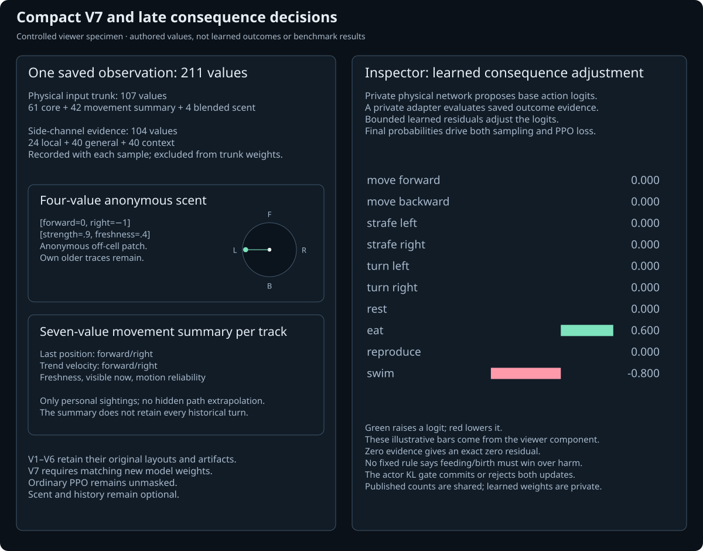

# Visual movement memory and scent trails

[Brain inputs](observations.md) · [Inspector appearances](viewer-visual-reference.md#movement-memory-and-scent) · [Configuration fields](configuration-reference.md)

Both senses are configurable and work with all fourteen controller algorithms.
For worked temporal/mixture examples and the current V7 path, start with the
[detailed memory and scent guide](learning/memory-and-scent.md). Visual
memory belongs to an observer; scent belongs to the world. Neither sense tells
an animal which action to choose, guarantees improved hunting, or relaxes mating
radius, readiness, consent or challenge eligibility. No sniff action is required.


## Enable and configure

The maintained [tracking preset](../environments/tracking.json) extends masked
PPO with three previous steps of visual memory and automatic ground-scent
sampling. Maintained run presets now enable these senses alongside V7;
custom configurations can still omit either one. See [sensory defaults](configuration.md#v7-sensory-preset-defaults).

```sh
.venv/bin/python -m wtf run tracking --runs 1 --seed 100 --progress
.venv/bin/python -m wtf view --results results
```

At the environment root, enable trail deposition and its lifetime:

```json
"scent_trails": {
  "enabled": true,
  "lifetime_steps": 20
}
```

On each brain template that should use these senses:

```json
"movement_history_steps": 3,
"scent_observation": {
  "mode": "blended",
  "radius": 2
}
```

`movement_history_steps` accepts 0–16 and defaults to zero. It counts previous
simulation steps, independently of the number of targets in
`observation_top_k`. Omit `scent_observation` to disable that brain's scent
inputs. Blended mode senses all configured species and sexes through one
anonymous field; omit `species` and `separate_sexes`. Radius accepts 1–8 and
defaults to two orthogonal dry-cell path steps.

For old saved brains, omission of `mode` retains `separated` behavior. In that
mode, the ordered `species` list accepts 1–8 exact configured names, and
`separate_sexes` defaults to true; false merges sexes within each species.
Explicit `"mode": "separated"` is equivalent to the old omitted-mode contract.
Scent input configuration requires `scent_trails.enabled: true`. To disable the
field entirely, remove those brain input blocks before disabling the root flag.
Trail lifetime accepts 2–256 steps. These are simulation controls, not calibrated
biological timescales.

Different brain templates may use different history lengths, scent modes and
smell radii; separated mode also chooses species and sex channels. Animals of every configured species leave traces
while the world field is enabled, including species that do not sense scent.

## Personal visual history

Only animals selected into the observer's visible top-k resource-eater and
prey-eater slots contribute sightings. Food has no movement history. The
existing visibility rules still apply: sight radius, sunlight modifiers, water
extensions and wall occlusion. A newly detected animal has no backfilled past.
Internal animal IDs match sightings across distance-slot changes; IDs are never
passed into brain inputs or the inspector's scent plots.

For each diet category, current visible targets receive tracking slots first.
Remaining slots can hold the most recently seen targets still within the history
window. A hidden target retains its **last observed** position and velocity
estimate, without updates from its actual position, health, reproduction or
hidden death. Confidence decreases with time since sighting and the memory
expires after the configured window. Missing sightings remain explicitly absent;
reappearance does not fill gaps. A velocity estimate can use two sightings
separated by a gap, but describes average observed displacement rather than a
known route through the gap.

Historical positions are relative to the observer's current position, using the
same current sight normalization as ordinary target slots. This compensates for
observer movement: a stationary target does not gain fictitious velocity when
the observer moves. Last-seen positions may lie outside the current sight circle.
A newborn starts with no personal past; it can acquire its first sightings at
birth. It does not inherit either parent's movement memories.

## Anonymous ground scent

Each occupied dry cell records the most recent deposit time for each species/sex
group. Multiple animals in the same group refresh one merged trace; they do not
create identifiable trails or per-animal concentrations. Standing still also
refreshes a trace. Scent can persist after its maker moves away or dies.
An animal's own scent is included in its group: the field does not secretly
subtract it using individual identity.

Freshness decreases linearly from one to zero over `lifetime_steps`. Detection
samples reachable dry cells within the configured path radius. For each sensed
group in legacy separated mode, the brain receives the strongest remaining
freshness in **each** of nine sectors: here, N, NE, E, SE, S, SW, W, NW. Two intersecting trails can therefore
produce several directional signals; there is no chosen prey or destination.
These are sector summaries, not a full local image or a complete historical path.

In blended mode, freshness from all species/sex groups is summed **at each
reachable cell**, capped at one. Each sector reports its strongest blended
cell, producing nine values total. This reuses the same bounded sparse deposits
without creating another world map. Repeated deposits within one group refresh
its timestamp, so strength is a bounded trace signal, not an animal count or a
physical concentration. The brain cannot identify a species, sex or individual
from a channel label. Own scent remains included.

Sealed obstacles and wet cells stop ground-scent sampling; no traces are
deposited in water. This is a deliberately simple ground-trace model, without
wind, airborne diffusion, transported river scent or terrain-specific chemistry.
Scent range is separate from sight and does not change with daylight. Species and
sex channels do not reveal individual identity, age, health or mating consent.

## Input contract and model compatibility

V7 uses seven values per personal motion track, independent of the configured
history length, plus four values per scent channel. One blended channel combines
all species/sex groups anonymously. The maintained tracking preset has 106 prey
and 267 predator inputs, using k=3/10 and H=3. The
[worked memory/scent guide](learning/memory-and-scent.md) explains fields,
fading, reachability, mixture arithmetic and information loss.

Changing version, action order, k, H, scent mode/radius/channel order or optional
learning heads requires a matching model contract. Equal width is insufficient.
Exact checkpoint resume restores its captured sensory state; weights alone do
not recreate a previous animal's sightings or a world's deposits.

## Inspector and replay



Select an animal and open **Tracks & scent charts**. V7 shows the compact
movement summary and scent compass, with recorded diagnostic timing. It does
not fabricate a lag-by-lag path or nine-cell scent map from the summary. The
selected agent's board trails and cumulative occupancy heatmaps are separate
views. Actual hidden/prediction activity also follows saved samples.

Older numeric grids and full lag displays are documented in the
[historical sensory viewer reference](archive/sensory-viewer.md), not as current
preset defaults. The current viewer still decodes matching older recordings.

## Selected-agent trails on the board

**Show sampled tracks on board** displays the selected animal's observed target
histories as simple connected dots, without projected arrows. Nothing is drawn without an agent
selection or supported visual-history sample. Scent remains in the inspector;
there is no world scent/hot-path overlay on the board. The origin is the selected
observer's recorded position at the diagnostic tick, not its later body position.
Unknown gaps remain disconnected. The inspector status names both the sample tick
and current body tick. At step zero there are no previous sightings yet; advance
the replay to see movement histories develop.

<a id="whole-run-movement-heatmap"></a>

## Replay-time movement heatmap

**All-species heatmap** jumps to the combined overview in the viewer sidebar.
Open **Metrics dashboard** for compact maps alongside each species' current
metrics. Its **All species** selector shows these cards together; choose one
exact species name to enlarge its map. Both sexes contribute; extinct
species retain their accumulated paths. Every map uses the same board geometry
and current replay step. Species cards share a logarithmic count color scale;
the combined overview and enlarged single map use their own scale. Equal colors
in species cards mean equal arrival counts, not population-normalized movement.

Maps accumulate arrivals **only through the current replay frame**, updating
while playing and rewinding when seeking backward. Seek to the end for the entire
run. The History selector limits trend charts only; heatmaps always start at the
first recorded frame. Other behavior/learning tables still summarize the full run.

Heat counts changed-position arrivals per destination cell, including drift and
displacement when they change the final position. Stationary frames and newborn
placements add no heat. Only consecutive recorded frames are compared; missing
intervals and unknown terminal routes are not interpolated. Known terminal
destination positions can contribute arrivals. A combined movement/drift step
contributes its final cell rather than an invented intermediate path. The color
key shows arrival counts; gray cells are obstacles. Both interface themes use
legible backgrounds and increasing-strength colors.

One pass through the loaded replay frames updates the combined grid and each
species grid. The browser retains one reusable Uint32 count grid per configured
species plus the combined grid, and one shared previous-position map. At 40 × 28
cells each count grid is 4,480 bytes: three species plus the overview use 17,920
bytes for count buffers, excluding canvas pixels and other metadata. There is no
per-frame grid history, grid copy on each step or extra decoded run in RAM.
Changing the species selector reuses these grids immediately, without replay
reads or pausing playback. Adding species adds current grids, never frame histories.

For a distant seek the read-only movement-prefix endpoint accepts
`?by_species=1`, streams saved chunks through the requested frame **once**, and
returns combined and per-species counts together. Its optional
`?species=<URL-encoded-name>` mode returns just one group for other clients;
the two query modes cannot be combined. Without either query it retains the
legacy combined response shape. The server retains one chunk and shared prior
positions during reconstruction and discards them afterwards. The browser never
downloads the whole run for this rebuild. Full-run behavior responses omit unused
heatmap grids; CLI analysis may still include the combined full-run grid.

No heatmap file or new replay field is written. Existing recordings work without
regeneration, even when the optional senses were disabled. Restart an already
running playback server after updating Python reader code. Future frames never
contribute to the displayed prefix. This is analyst information and is not sent
to animal brains or drawn as a global hot-path layer on the main board.

## Memory and storage boundaries

Personal storage keeps at most H+1 frames per living observer, each containing
only its selected animal sightings. Dead observers are removed and newborns get
new empty histories. The sparse scent field keeps one integer deposit time per
cell/species/sex group; refreshing a cell replaces its record. An ordered map
expires oldest records without scanning a full map, and a bounded 16-entry plan
cache shares static scent-channel lookups between observers.

Exact checkpoints store a versioned `world.sensory_state`: personal sighting
records and sparse deposit times. Restore and GRPO trials receive independent
mutable copies. Weight-only champions contain neither movement memory nor scent
state; a fresh world begins with new founder traces. Missing/unsupported sensory
state is rejected when restoring a checkpoint that enables these features.

Replays store **no full scent map or separate trajectory log**. The inspector
reads the extra values already carried by sampled observation vectors through
the existing lossless binary/compressed chunk codec. Enabling senses still grows
input layers, training buffers, checkpoints and sampled diagnostics; cost depends
on H, K, sensed channels, population and sampling interval. Whole-experiment
decoding is not required, and read-only playback does not advance either sense.

## Biological interpretation

The visual buffer approximates short-term movement estimation, not access to an
animal's true route. Predictive interception has been demonstrated in
[dragonflies](https://www.nature.com/articles/nature14045); ground-odour following
has been studied in [rats](https://www.nature.com/articles/ncomms1712) and
[dogs](https://pubmed.ncbi.nlm.nih.gov/8371085/). These motivate separate visual
memory and environmental traces. Fixed windows, linear fading and grouped sector
strengths are engineering abstractions, not universal biological laws.


## Compact V7 sensing

V1–V6 retain the full numeric/semantic layouts described above. Optional
[V7](observations.md#observation-version-7) summarizes each movement track in
seven values independent of history-window length and each scent channel in
four values: body-relative direction, strength and freshness. This loses path
turns and alternative scent directions; it does not expose hidden movement.
The current-cell scent is excluded from the directional summary, while older
own traces remain. Replay inspection labels summaries explicitly and does not
invent a nine-region scent heatmap or historical sightings.
