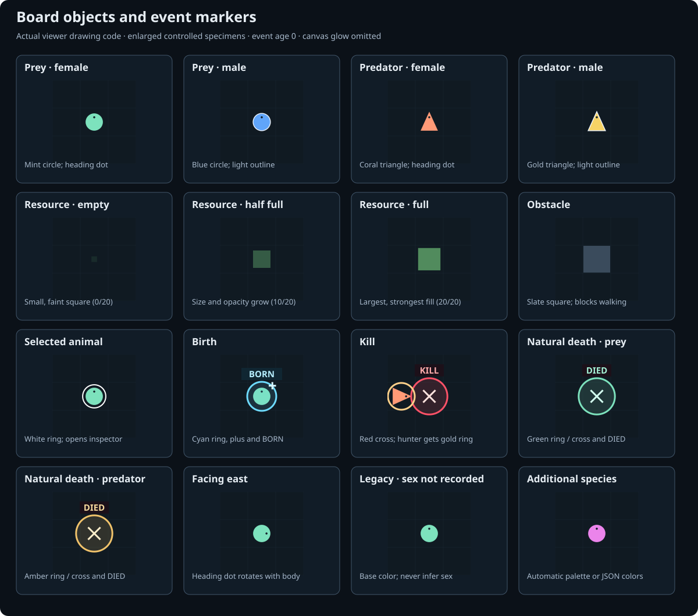
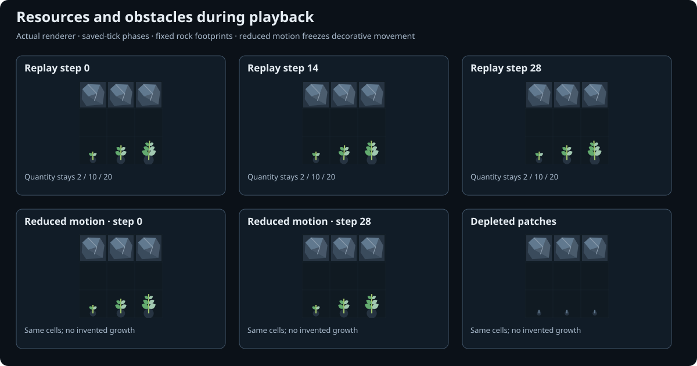
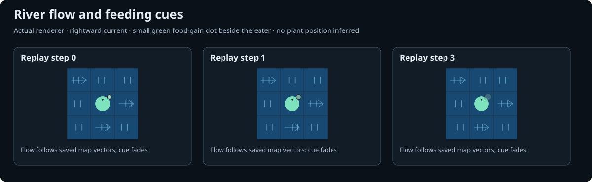
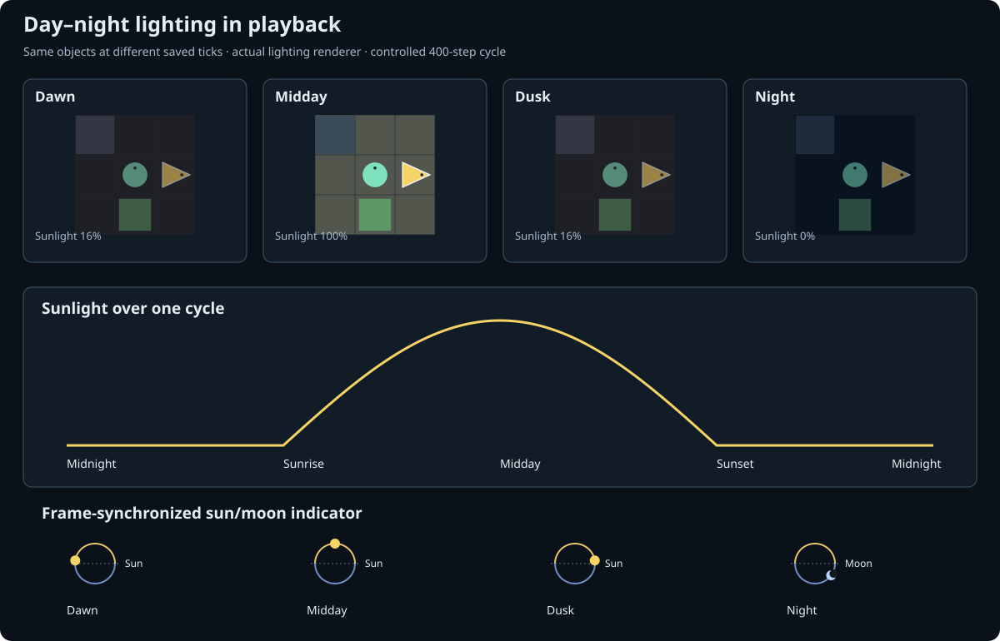
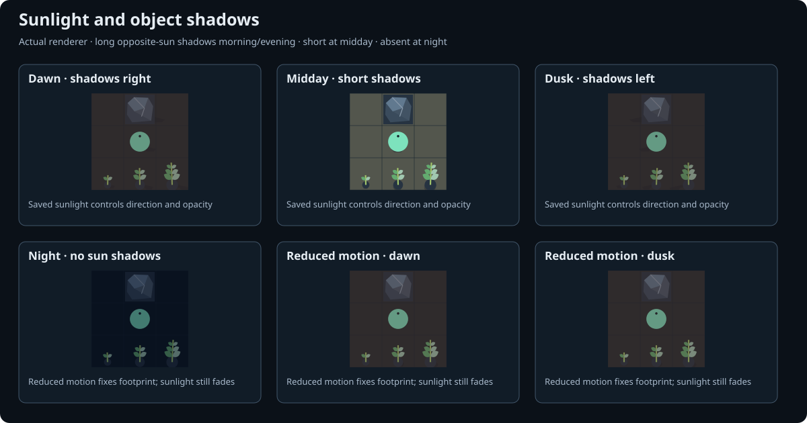
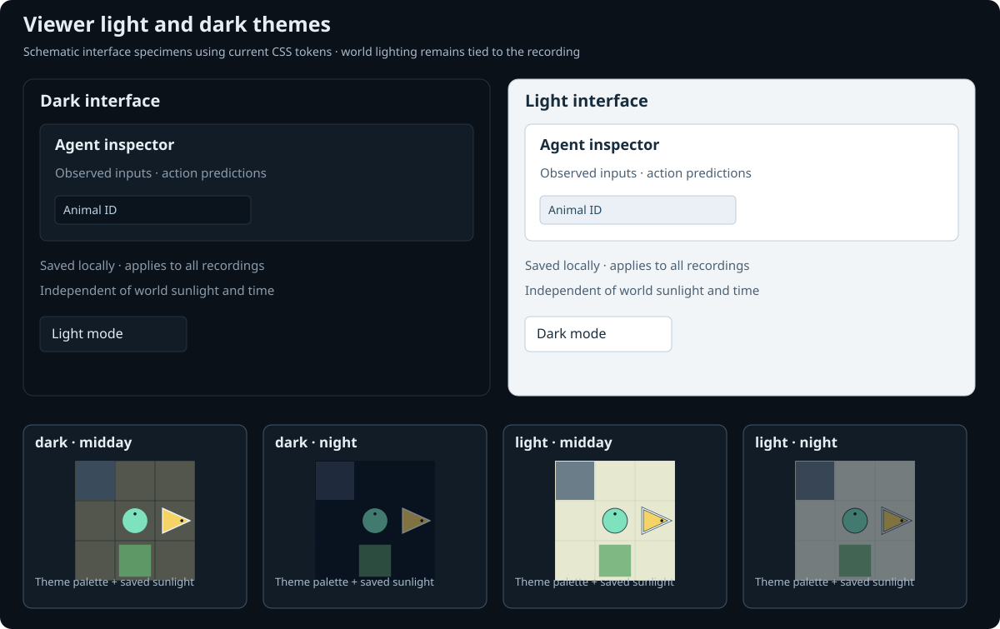
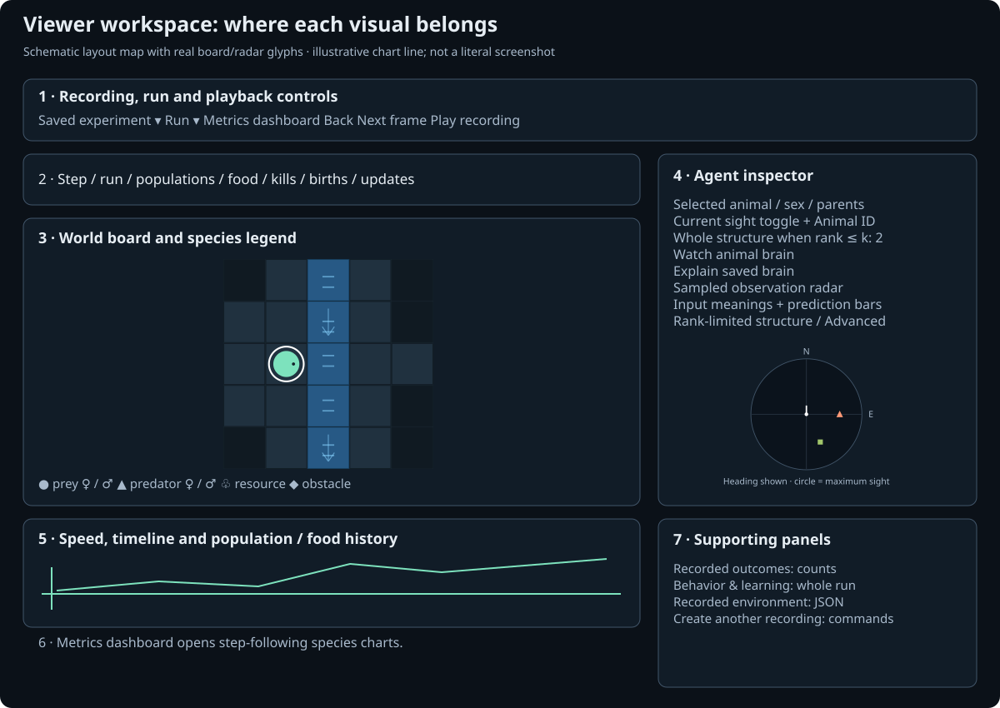
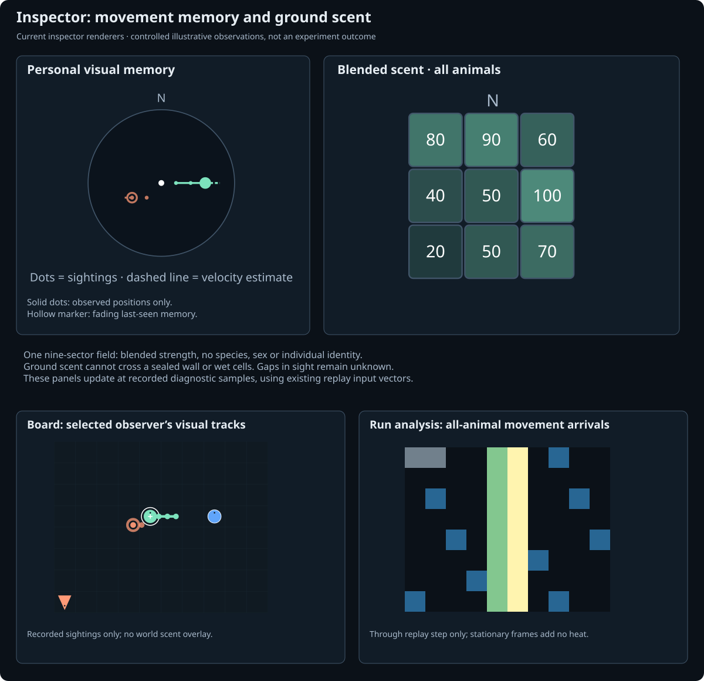
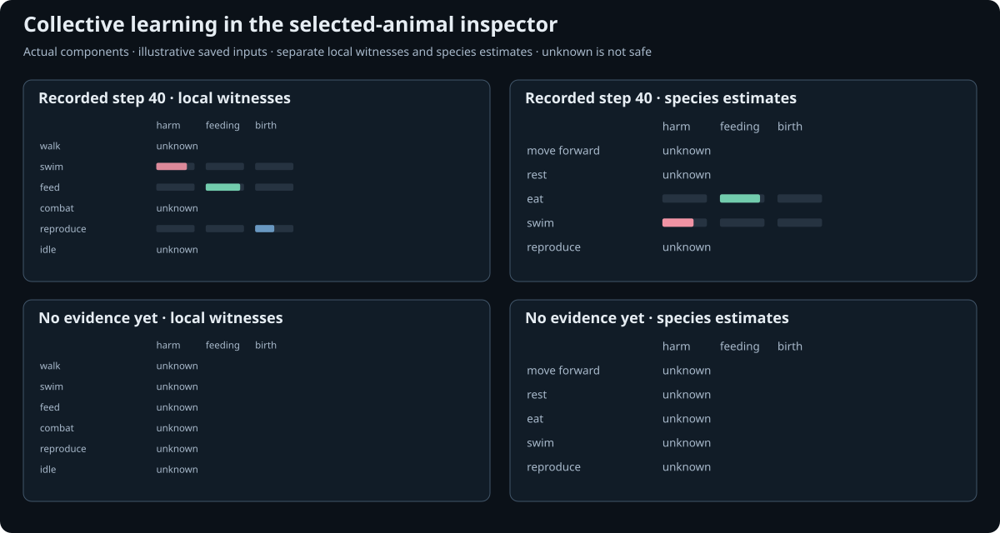

# Board objects and viewer guide

[Playback and inspection](viewer/playback/index.md) · [Viewer and storage](viewer/index.md)

[Playback guide](recording.md) · [Visual guide](visual-guide.md) · [Asset sources](assets/viewer/README.md)

Use this catalog to identify board objects, overlays and inspector graphics.
The examples are controlled specimens rendered through current viewer code.
The workspace map is schematic; chart values are illustrative, not experiment
results. The [animated vector demonstrations](geography.md#recorded-terrain-previews)
show controlled board states in motion.

## Find a viewer element

| Looking for | Section |
| --- | --- |
| Animal shapes, female/male colors, food, obstacles and event markers | [Board pieces and their meaning](#animals-resources-and-event-markers) |
| Rivers, elevation and the selected animal's visible area | [Terrain and current sight](#terrain-and-current-sight) |
| Sunlight and the time dial | [Day and night](#day-and-night) |
| Light/dark interface colors | [Interface themes](#interface-themes) |
| Board, sidebar, timeline and metrics placement | [Workspace and charts](#workspace-and-charts) |
| Observation circle, predictions and network diagrams | [Inspector and brain views](#inspector-and-brain-views) |
| Header logo and loading animation | [Project header](#project-header) |

The figures are embedded below. Open this guide from **Viewer and storage →
Board objects and viewer guide** in the documentation navigation. Use the site
light/dark toggle to change adaptive figures; comparison sheets intentionally
show several lighting conditions together.

## Animals, resources and event markers

This is the board-piece legend: animal pointers, resources, obstacles, selection
and lifecycle/competition events. [Open the full-size SVG](assets/viewer/board-objects.svg)
for a closer look. The final row shows prey/predator challenges, a shared-food
contest and a competition death using the current viewer drawing functions.

| Appearance | Meaning |
| --- | --- |
| Circle / triangle | Resource-eating animal / prey-eating animal, regardless of species name |
| Mint / blue circles | First resource-eating species: female / male |
| Coral / gold triangles | First prey-eating species: female / male |
| Thin light body outline | Male; independent of the larger white selection ring |
| Small dark dot | Heading, rotating with the body |
| Leafy green patch / bare rooted patch | Resource; plant size and leaf count reflect recorded quantity, with a bare patch at zero |
| Faceted slate rock | Blocking obstacle; its entire grid cell remains impassable |
| Small green dot beside an eater | Confirmed food gain; fades over four saved frames |
| Large white ring | Selected animal; selection drives the inspector |
| Cyan ring, plus and BORN | Birth at the child's recorded position |
| Red ring, cross and KILL | Killed animal's recorded position; hunter gets a gold ring |
| Amber paired rings and connector, winner / damage label | Optional same-species challenge at the recorded fight locations; distinct from a hunting kill |
| Green / amber ring, cross and DIED | Natural death of a resource-eater / prey-eater |

### Resource and obstacle motion

Food patches sway gently as replay steps advance; larger recorded quantities
produce larger, leafier plants. Depleted patches show a small bare stem. Obstacles
have fixed faceted-rock geometry with a faint changing surface highlight. The
whole obstacle cell still blocks movement; decorative gaps are not paths.

Motion is a deterministic function of saved tick and cell coordinates. Pausing
freezes it; seeking back reproduces the same phase. The viewer respects the OS
**Reduce motion** preference, including changes while open: sway and shimmer
become static while real quantity changes remain visible. Theme changes and the
existing day–night overlay still apply. This affects only drawing, with no extra
replay fields, asset downloads, timers or simulation work. Growth is shown only
when the recorded quantity changes; sway never invents food.

The legend uses configured species names and female/male colors. Extra species
receive generated colors; optional `display.color` and `display.male_color`
overrides are described in [species appearance](species.md#viewer-colors-and-metrics).
Legacy animals without recorded sex use the base species color; that color does
not establish their sex. Body color identifies species/sex, not remaining health.

Event illustrations freeze age zero and omit the canvas glow. In playback,
birth/death rings expand and fade, while competition rings fade at their
recorded fight locations. Banners identify recent events. They do not insert a simulation or playback delay. Marker placement
requires a recorded position; these examples do not imply inferred positions
for older recordings.

### River flow and feeding feedback

Short wave crests move along each water cell's configured flow direction. Still
water keeps stationary crests; existing current arrows remain. This is a
decorative direction cue, not an additional physics calculation or a speed scale.
A small green dot beside an eater marks a confirmed positive food gain, including
competition food priority. Hunting gains and unsuccessful eating produce no dot.
The dot fades over four saved frames, without extra delays or text labels.

The marker uses the eater's saved end-of-step position, including any drift. The
recording does not identify the exact plant consumed; the viewer never guesses
one. Missing eaters are skipped. Seeking rebuilds the same recent cues across
chunk boundaries. Reduced motion fixes ripple positions and dot size/opacity;
the event still appears and expires. Pause freezes both effects. Existing replay
files work when they contain the corresponding food-gain events.

### Optional social contests

The [competition guide](competition.md) explains the opt-in learned action,
physical eligibility, costs and outcomes. The contest banner names both animals,
the context and actual damage; markers persist briefly without pausing playback.
Contest and kill/death labels share a stacked overlay inside the board, leaving
its size unchanged when labels appear or disappear. Births retain their lower
board label.
Aggression needs no food or path objective and changes only the participating
animals through effort, health and resulting reward feedback.

## Terrain and current sight

Water uses blue tiles with depth-dependent shading; sparse arrows indicate flow
direction. Arrow length is a display convention, not a speed scale. Dry elevation
colors are scaled against the map's maximum height, with sparse numeric labels.
Compare heights using their values rather than assuming the same hue means the
same height on different maps.

The translucent blue wash is the selected animal's **current** sight. Walls
occlude visibility rays and water can extend permitted directions. The board
still displays objects outside that wash: it is an inspection overlay, not
fog of war. Heading is shown by the dot and does not create a sight cone.
Elevation and other animals do not occlude sight. The
[physics guide](physics.md) explains the corresponding movement and visibility
rules; the [map gallery](geography.md) shows maintained environments.

## Day and night

The example boards use the selected interface palette in both light and dark mode.
Optional [day–night cycles](day-night.md) dim the board and warm the low-light
periods. The time label follows saved world steps; night remains legible.
The sun/moon dial moves with saved frames and freezes on pause. It is hidden
when the cycle is absent or disabled. Species sight overlays and inspector costs
follow configured light effects.

### Object shadows

An enabled cycle projects decorative plant, rock and animal silhouettes opposite
the sun. They shorten at midday and disappear at night. Reduced motion fixes the
footprint while sunlight still fades its opacity. The [day–night guide](day-night.md#decorative-object-shadows)
explains the saved-step behavior; these marks never change visibility or physics.

## Interface themes

Use **Light mode / Dark mode** in the header. The preference is saved in the
browser and applies to controls, panels, dialogs, inspector views, chart axes
and the board grid/terrain. The selected theme appears first in the comparison; the labeled alternate
remains visible beside it. The board examples include midday and night in both
interface palettes.
Inspector radars, target legends, prediction histories, action bars, neuron
activations and archived-model sensitivity/route charts use theme-aware colors.
Cached or expanded charts recolor immediately on a theme toggle without seeking
or waiting for another diagnostic sample.

Event banners, canvas birth/death badges, end-of-recording messages, errors,
disabled controls and explanation notices use explicit foreground/background
pairs in both themes. Species legends retain colored marker symbols with neutral
text so bright species colors do not make their names difficult to read.
Movement-memory panels use compact headings; per-target details remain on hover.

It is independent of simulated sunlight; daylight lights the ground and night
dims it in either interface theme.

## Workspace and charts

Choose a saved recording and run before playing. The board and current totals
follow the playhead. **Metrics dashboard → Population & food** shows the
all-species overview through the current replay step, with food on its right
axis. The dashboard also holds per-species trends; the separate behavior analysis summarizes a run.
Species colors follow the legend. See [dashboard metrics](recording.md#per-step-species-dashboard)
for definitions and missing-data handling.

## Inspector and brain views

The observation circle plots sampled target slots relative to the animal; it
is separate from the current board sight overlay. The body step can advance
between recorded brain samples, so compare the displayed sample timestamps.
Inputs are normalized brain features, not necessarily physical units.

**Watch animal brain** follows the selected animal's recorded inputs, outputs and
sampled activations during playback. **Explain saved brain** instead evaluates
an archived species/sex champion on those inputs. Colored action bars show that
archive's inference; gray comparison bars show recorded scores. Masked actions
are labeled. Value-based brains show action values rather than probabilities.

Inputs and outputs lead both views. With default **rank threshold k = 2**, a
brain with at most two hidden processing stages shows its whole structure.
Deeper brains show a summary, with detailed maps/routes under **Advanced**.
Here rank means hidden-stage count, separate from observation top-k. Green/pink
units show positive/negative activations; gray units mean unavailable activity.
Structure links show connectivity, not causal importance or weight strength.
The [brain guide](explainability.md) includes current-viewer clips of both data
sources and explains recurrent memory, weighted routes,
local input sensitivity, what-if inputs and unavailable data.

## Project header

The header uses the [project symbol](branding.md) beside readable project text.
It switches between forest/lime and pale-mint/lime with the interface theme.
The SVG is primary, with transparent PNG fallbacks; simulated day/night does
not affect header branding.

While opening a recording or selecting a run, the four sections circulate around
the fixed window and the status badge says **Loading recording…**. The symbol
returns to its static form when loading completes or fails, and remains static
through playback and frame buffering. Reduced-motion preferences disable the
ribbon animation. See [motion assets and behavior](branding.md#motion-policy).

## Movement memory and scent

With the optional [tracking senses](tracking.md) enabled, select an animal to see
its sampled movement history and anonymous local scent patterns. **Tracks & scent
charts** jumps to those panels. A selected-only board overlay shows personal
visual tracks, while **All-species heatmap** opens the combined sidebar map. **Metrics dashboard**
keeps compact maps beside every species' metrics and a **Species** selector to
enlarge one group; all maps count arrivals through the current replay step. Scent itself stays off the main board. Hollow markers
are last-seen memories; dashed inspector lines are velocity estimates, and gaps remain
unknown. Blended mode shows one heatmap for all animals; legacy separated mode retains
its named species/sex grids. A scent field is not
one animal. These controlled SVG specimens come from the actual inspector
renderers and adapt to interface light/dark palettes.

## Collective learning

Optional [collective-learning inputs](social-learning.md#playback-inspection) have
two homes: **Metrics dashboard → Species collective outcomes** shows species
averages, while **Agent inspector → Collective learning** shows the selected
animal's averages. Both accumulate saved witness and consequence rates through
the current replay step, holding past samples forward without using future
samples. Unknown evidence stays distinct from zero outcomes. The specimen above
uses the actual chart renderer with illustrative cumulative inputs: witness,
general and context groups in combined mode. General and context estimates keep
separate confidence and are never blended by the viewer.

Charts update in place, pause and rewind with playback, adapt to both themes and
add no replay fields. Raw inputs and model predictions remain the original saved
values. See the linked guide for averaging, sparse-sample and seek semantics.
