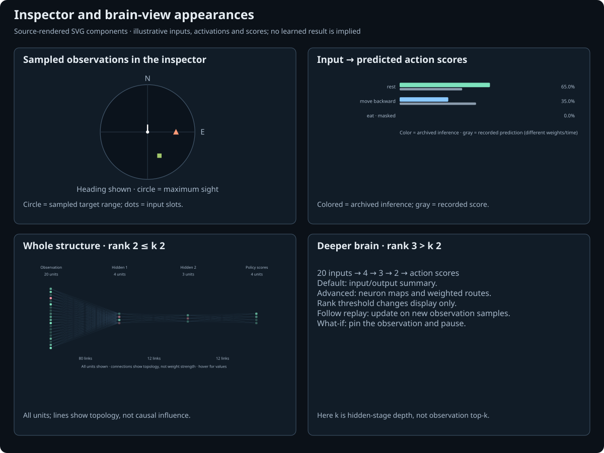

# Viewer appearance reference

[Playback guide](recording.md) · [Visual guide](visual-guide.md) · [Asset sources](assets/viewer/README.md)

Use this catalog to identify board objects, overlays and inspector graphics.
The examples are controlled specimens rendered through current viewer code.
The workspace map is schematic; chart values are illustrative, not experiment
results. Existing [full-viewer clips](geography.md#recorded-terrain-previews)
show the interface in motion.

## Animals, resources and event markers

| Appearance | Meaning |
| --- | --- |
| Circle / triangle | Resource-eating animal / prey-eating animal, regardless of species name |
| Mint / blue circles | First resource-eating species: female / male |
| Coral / gold triangles | First prey-eating species: female / male |
| Thin light body outline | Male; independent of the larger white selection ring |
| Small dark dot | Heading, rotating with the body |
| Green square | Resource; size and opacity increase with quantity relative to capacity |
| Slate square | Blocking obstacle |
| Large white ring | Selected animal; selection drives the inspector |
| Cyan ring, plus and BORN | Birth at the child's recorded position |
| Red ring, cross and KILL | Killed animal's recorded position; hunter gets a gold ring |
| Green / amber ring, cross and DIED | Natural death of a resource-eater / prey-eater |

The legend uses configured species names and female/male colors. Extra species
receive generated colors; optional `display.color` and `display.male_color`
overrides are described in [species appearance](species.md#viewer-colors-and-metrics).
Legacy animals without recorded sex use the base species color; that color does
not establish their sex. Body color identifies species/sex, not remaining health.

Event illustrations freeze age zero and omit the canvas glow. In playback the
rings expand and fade over recorded frames, while banners identify recent
events. They do not insert a simulation or playback delay. Marker placement
requires a recorded position; these examples do not imply inferred positions
for older recordings.

## Terrain and current sight

Water uses blue tiles with depth-dependent shading; sparse arrows indicate flow
direction. Arrow length is a display convention, not a speed scale. Dry elevation
colors are scaled against the map's maximum height, with sparse numeric labels.
Compare heights using their values rather than assuming the same hue means the
same height on different maps.

The translucent blue wash is the selected animal's **current** sight. Walls
occlude visibility rays and water can extend permitted directions. The board
still displays objects outside that wash: it is an inspection overlay, not
fog of war. Heading is shown by the dot and does not create a sight cone.
Elevation and other animals do not occlude sight. The
[physics guide](physics.md) explains the corresponding movement and visibility
rules; the [map gallery](geography.md) shows maintained environments.

## Workspace and charts

Choose a saved recording and run before playing. The board and current totals
follow the playhead. The population/food history and **Metrics dashboard** show
values over recorded time; the separate behavior analysis summarizes a run.
Species colors follow the legend. See [dashboard metrics](recording.md#per-step-species-dashboard)
for definitions and missing-data handling.

## Inspector and brain views

The observation circle plots sampled target slots relative to the animal; it
is separate from the current board sight overlay. The body step can advance
between recorded brain samples, so compare the displayed sample timestamps.
Inputs are normalized brain features, not necessarily physical units.

**Watch animal brain** follows the selected animal's recorded inputs, outputs and
sampled activations during playback. **Explain saved brain** instead evaluates
an archived species/sex champion on those inputs. Colored action bars show that
archive's inference; gray comparison bars show recorded scores. Masked actions
are labeled. Value-based brains show action values rather than probabilities.

Inputs and outputs lead both views. With default **rank threshold k = 2**, a
brain with at most two hidden processing stages shows its whole structure.
Deeper brains show a summary, with detailed maps/routes under **Advanced**.
Here rank means hidden-stage count, separate from observation top-k. Green/pink
units show positive/negative activations; gray units mean unavailable activity.
Structure links show connectivity, not causal importance or weight strength.
The [brain guide](explainability.md) explains recurrent memory, weighted routes,
local input sensitivity, what-if inputs and unavailable data.
